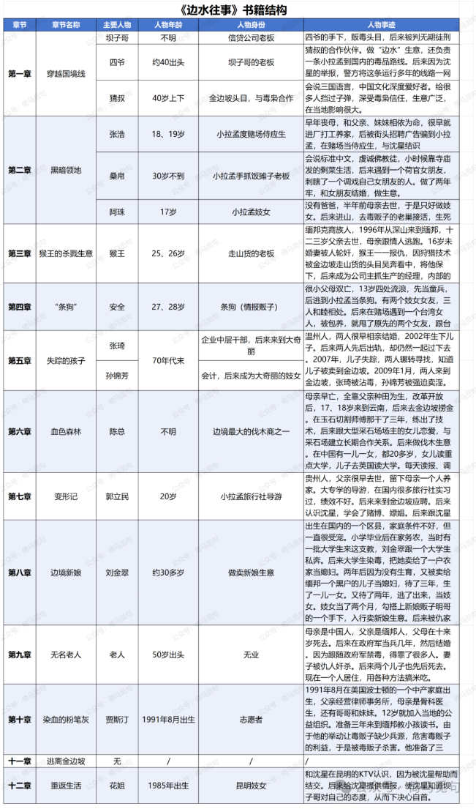

# 读书报告：《边水往事》

## 一 缘起

十几天前，一位朋友向我推荐了《边水往事》这部电视剧，我留意了一下，但没去看。几天后，我在微信读书无意间刷到了这本书，打开一看，被深深吸引，于是断断续续读了很多天。今天读完，感慨万千，于是写了这篇读书报告，记录自己的感想和收获，也供其他人参考。

## 二 本书背景

沈星，浙江人，出生于1991年，18岁时离家出走来到昆明，在一家信贷公司帮人收债，实际上是加入了黑社会。后来受到领头坝子哥的信任，被推荐到金边坡运送货物。

2009年3月进入缅邦，随后在猜叔的关照和带领下，进入了当地的黑道圈子，深入了解了当地的贩毒产业链和其他社会情况。后来因为恐惧猜叔杀害而逃离缅邦，于2010年4月18日凌晨回到中国，结束了300多天的边水生涯。

2010年5月13日，沈星走投无路选择自首，帮助警察破获一场重大案件，有重大立功表现，于2010年8月30日出狱。

2017年沈星通过女友了解到“天才捕手计划”的公众号，认识了编辑陈拙，他在陈拙的帮助下，写下了这本书。

## 三 本书叙述模式和结构

本书采取类似“纪传体”的叙述方式，共十二个章节，除了第一章和最后两章外，其他章节基本都是一章一个或几个主要人物。但是各章节的顺序安排巧妙，按顺序去读，不会有任何阅读障碍，虽是纪传体，却又让人感到故事在随着时间不不断发展，背景交代和悬念之间的平衡把控很好。

各章节涉及的主要人物如下，大家可以以这些人物为线索，了解这本书的故事情节：

（在公众号后台回复“边水往事”，可以获得原图和无水印的表格文件）

## 四 一些感想

这本书内容很丰富，读完以后，我说一下自己最有感触的几点。

### 1 对未知要有敬畏心

人总会从自己的经历中提炼出一些道理，作为永恒的真理，但实际上他们生活的区域是有限的，他们所见证的时间也是有限的，所以这些所谓的真理往往都是谬误，只在一时一地有效。

比如生活在现在的中国，我们会对国内的安稳习以为常，但实际上这些都不是理所应当的，而是由来有自。如果不能认识到这一点，以后一旦换个环境，或者形势变化，就很难适应。

比如书中那个男游客，根本不了解金边坡的危险，仍然像在国内一样神气十足，对当地实力派出言不逊，其实要不是沈星保护，他早就身死异乡了。

金边坡的很多事情，没有沈星的记录，可能我们永远都不会了解到，永远在我们的想象之外发生着。

所以，要永远认识到自己的渺小，对未知充满敬畏之心。

### 2 永远不要用自己狭隘的道德审判别人

书中的很多行为，例如吸毒、嫖娼、赌博、杀人、家暴，都不符合我们的主流价值观，这些人在很多人眼里都是不折不扣的恶人。

但是可恨之人必有可怜之处，贩卖新娘的人曾经也是被贩卖的新娘，抄家灭口的人曾经也是抄家灭口的幸存者……没有人生来就是坏人，你到了他们的境遇里，说不定还会更坏。

没有永恒的道德，道德只适用于特定地区和特定时代，所以未经他人苦，莫劝他人善，永远不要用自己狭隘的道德去审判别人。

道德是对自己的要求，而不是对别人的要求，管好自己就好。

### 3 做啥都要有文化、多学习

沈星是高中文凭，高考过了一本线，KTV的妓女都因此高看他一眼。

事实上，沈星本身就是一个有文化、爱学习的人。来昆明没几个月，就成为了坝子哥的亲信；到了缅邦，又深受猜叔赏识。

沈星在缅邦300多天，相当于做了一个全面的人类学调查，他不但把当地各种情况摸得清清楚楚，而且还在其中游刃有余、全身而退。

经历了那么多事，当时他才只有19岁，真的非常不容易。

### 4 最美好的品质是直面自己的内心

沈星最大的特点，就是能够很快适应当地环境，但是又能保持很多纯真——不然他不会关注那么多和自己赚钱享乐无关的故事。

这些都因为他能够直面自己的内心。

直面内心，所以他不会自故作高清，在缅邦那种地方生存下来；直面内心，所以他能够关注各种人，并记录下他们的故事。

这本书也很坦率，自己抽烟、喝酒、嫖娼、赌博、打人的事情，都没有隐瞒，让人很相信这本书的真实性。

我是历史爱好者，所以我认为最好的品质就是真实，真实的丑恶比虚假的善良更美好。因为，只有面对真实，我们才能找到建设美好世界的方法。

> 转换说明：配图：第1幅暂沿用现图（指定资料目录未找到可靠且质量更好的无水印原件）。
