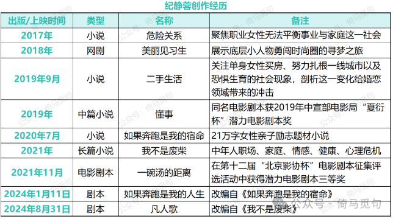
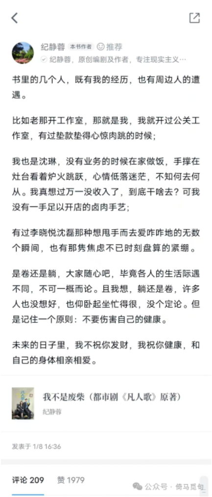
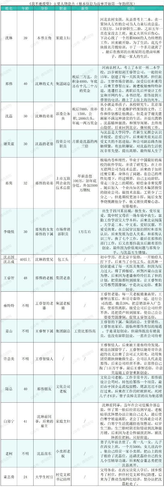

# 读书报告：《我不是废柴》（电视剧《凡人歌》原著）

## 一 前言

《凡人歌》是最近热播的电视剧，很早之前我就看到网上关于这部剧的各种评论。最近我正好有时间，就看了《凡人歌》的原著《我不是废柴》，此书20万字，我花了10个多小时读完，断断续续读了3天。

这篇读书报告是我的一些简单总结，由于我没看过剧版，甚至连剧照都没认真看过，剧中人长啥样都是按照原著的描写想象的，因此没看过原著的朋友，可以通过这篇读书报告快速了解原著内容，看过的也可以读本文复盘一下。有阅读原著计划的朋友慎看，因为本文有大量剧透内容。

## 二 作者和本书创作背景

作者纪静蓉，1978年出生在福建省漳州市平和县山格镇，从小怀揣文学梦。1996年中专毕业后离开闽南到北京求学，一边工作一边学习，自考考上北京师范大学，后来从事媒体工作，当过央视娱乐记者、新媒体公关营销等，如今已在北京定居20多年。

创作经历：2017年出版小说《危险关系》，2018年原创网剧《美丽见习生》，2019年出版小说《二手生活》《懂事》，2020年7月，创作长篇小说《如果奔跑是我的宿命》，2021年出版《我不是废柴》，2024年，1月改编自《如果奔跑是我的宿命》的电视剧《如果奔跑是我的人生》上映，同年8月31日，电视剧《凡人传》播出，《凡人传》即改编自小说《我不是废柴》。

（资料来源于网络。）

从纪静蓉的创作经历来看，可以归纳她的三个创作特点：

①主要作品都是其39岁以后发表的，属于大器晚成的类型。当然作家这个职业大多都是大器晚成的，少年天才只是少数；即使是少年成名的作家，其创作的高峰往往也在其中年甚至老年。

②她的作品和自己的经历和身份密切相关。不管是“职业女性的事业、家庭冲突”还是“底层人物的寻梦之旅”，还是“女性亲子励志题材小说”，还是“中年人的各种危机”，都跟她的年龄、性别、经历对得上。我们有理由相信，纪静蓉在生活中收集了大量写作素材，处处充满了自己的亲身经历和真情实感。

③她的作品具有很强的市场导向性，并获得了商业上的成功。我猜作者早年应该也发表过不少纯文学的作品，但是2017年以后，她的大作都在市场上获得了成功，而这些应该都在她的计划之内。事实上，她的题材本就受众够多，她也知道受众喜欢看什么。

关于本书创作背景，我补充一个作者在微信读书里的自我点评：

> 书里的几个人，既有我的经历，也有周边人的遭遇。

> 比如老那开工作室，那就是我，我就开过公关工作室，有过垫款垫得心惊肉跳的时候；

> 我也是沈琳，没有业务的时候在家做饭，手撑在灶台看着炉火跳跃，心情低落迷茫，不知何去何从。我真想过万一没收入了，到底干啥去？可我没有一手足以开店的卤肉手艺；

> 有过李晓悦沈磊那种想甩手而去爱咋咋地的无数个瞬间，也有那隽焦虑不已时刻盘算的紧绷。

> 是卷还是躺，大家随心吧，毕竟各人的生活际遇不同，不可一概而论。且我想，躺还是卷，许多人也没想好，也仰卧起坐忙得很，没个定论。但是记住一个原则：不要伤害自己的健康。

> 未来的日子里，我不祝你发财，我祝你健康，和自己的身体相亲相爱。

## 三 本书主要内容和角色

本书叙述了三对情侣在一年多时间的变故，探讨人到中年遇到的困难，这些困难有：生娃养娃、降薪辞职、感情破裂、疾病缠身、心理崩溃等。符合当前现实，让很多读者共情。

除了这三对情侣，还有许多其他人物，也都各有烦恼。现在将书中主要人物的情况列举如下，大家也可以通过各个人物的结局，了解本书的情节。

（资料整理于原著。）

## 四 一些感受

这本书内容丰富，涉及到很多当代现实问题，下面是我的一些感受。

### 1 作为打工人，要摆正自己的位置，对人生的各种困难做好准备

我在[《工资就是吃饭钱》](2024-09-14-%E5%B7%A5%E8%B5%84%E5%B0%B1%E6%98%AF%E5%90%83%E9%A5%AD%E9%92%B1.md)一文中分析过，一个人的工资就只是刚刚够他们生活而已，有些人工资高，但他们消费也高，而且这种高工资很可能无法长久；有些人通过透支生命挣钱，但这些多挣的钱可能还没法覆盖未来的医药费。

《我不是废柴》这本书，改编为电视剧，名字叫《凡人歌》。实际上书里的三对主角放在整个中国来讲，都是人中龙凤的存在，超过了至少99%的人，收入高，甚至颜值也高。但是他们本质上也只是打工人罢了，尽管他们是打工人中的天花板，或者说，是“凡人”中的天花板。天花板尚且如此，我这个地板大概率只会更惨。

那伟和那隽都有公司的期权，可以算是半个老板，但是期权毕竟没有兑现，随时有离职的风险。事实上，他们也确实被离职了。如果不是那伟的老大哥王睿智还俗，要不是那隽极端理性地争取到离职的最大权益，他俩背负那么重的房贷，很可能会被拖垮，不复往日的社会地位。

沈琳离职前月薪2万，担任50人公司的行政兼人事总监，可谓风光无限。但辞职五年后，竟然只能靠前下属的关系，找到一个月薪8000的工作，而且这个工作还没通过试用期，这让她不得不转行当月嫂和卖卤货。可是没有办法，这是市场的选择，年轻就是优势，如果不在这个优势丧失之前找到其他优势，就会在中年到来的时候丧失所有优势。

李晓悦和谢美蓝现在每个月都有一两万的工资，无忧无虑的，其实沈琳的今天就是她们的明天，只是这本书只写了一年时间，没有继续展开罢了。

沈磊其实是这六人中最有保障的，因为他的工资虽然现在不高，但是以后一定会稳定增长，那些北京老头有的东西，他都会有，如果他再积极一些，当上干部了，今后前途无量。可惜他老婆过不了现在清贫的生活，他自己也把这个工作给丢了。

所以人一定要把目光放长远，不能只想到自己现在的风光，也要考虑未来可能遇到的风险。在这一点上，那隽是最清醒的，他唯一失算的，就是高估了自己的身体，他以为他能扛到35岁，没想到才32岁身体就熬不动了。不过由于他处理得当，最后的结果倒也可以接受。

### 2 健康永远是最重要的

这也是作者最大的感慨。内卷也好，躺平也好，这些都是个人选择。但是前提一定是要保护好自己的身体。身体好，未来一切皆有可能。

很多东西只有在失去的时候，才知道可贵。年轻的时候只会觉得自己牛逼，什么都在往好的方向发展。人到中年，身体各项机能退化，各种病都显现出来了，才知道年轻是资本，健康是资本，容颜是资本，才知道以前有那么多资本，却又是那么有恃无恐。

### 3 要控制好自己的情绪，不要对亲近的人恶语相向

那伟的老板出家，自己又因为当了法人，被莫名其妙追债，那段时间压力非常大，和老婆沈琳发生争吵，说了一大堆非常伤人的话：

> 老那突然暴跳如雷：“这么多年，你吃我的喝我的，一分钱没挣过。钱都是我挣的，我想怎么花，你管得着吗？”

后面还有好几段输出，我就不贴了，总之非常伤人。沈琳也因此感到非常伤心，而且一直耿耿于怀。

当然，这些都是气话，那伟并没有亏待过沈琳。除了这次吵架，那伟在其他方面绝对是优秀的丈夫。

可是，这些话还是太伤人了，简直不给人留任何情面。你说了这些话，你是爽了，但是你让别人怎么办？沈琳当家庭主妇是你支持的，而且她也干得非常好，你这样说就是把别人的价值全给否定了。

所以哪怕再有情绪，也要考虑维护大家的体面，一时嘴快，可能就会让人心寒，成为两人之间永远的芥蒂。当然，问题还是要解决的，但是要注意表达。

### 4 要用宽容和发展的眼光看人，允许别人改正错误

人总是觉得自己的那一套是对的，然后看别人不顺眼。那伟和那隽认为沈磊不思进取，没有承担起男人的责任，又认为沈志国沈志成兄弟没文化，做着不体面的体力活。他俩互相也看不顺眼：那伟觉得那隽在透支身体而且太爹味，那隽觉得那伟太虚荣，没有核心技能，职业地位岌岌可危。还有，谢美蓝觉得沈磊挣得太少了，李晓悦觉得那隽没有生活。

总之，这种对他人的不满随处可见。

但结果证明，每个人都有自己的生存方式，没有哪一种是绝对正确的，也没有哪一种没有风险。其实，大家都有自己生活最舒适的方式，也都会在变故到来时调整，你说的那些隐患对方未必不知道，何需你的频繁提醒呢？

每个人也都有缺点，如果要存心找别人的不足，你可能对任何人都不满意，也会影响自己的心情。但如果你善于发现大家的闪光点，多多鼓励，用宽容的眼光看待别人的缺点，相信人是可以改变的，那么，就会有更多人愿意和你交往。
