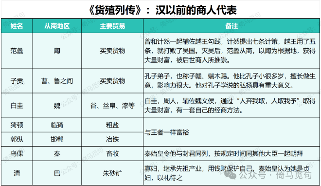
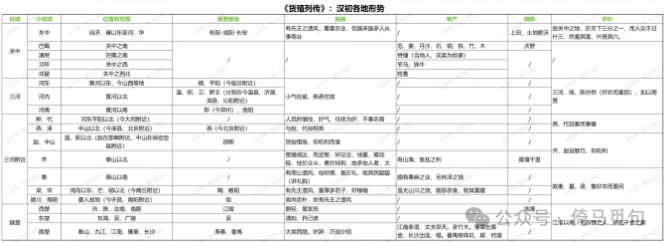
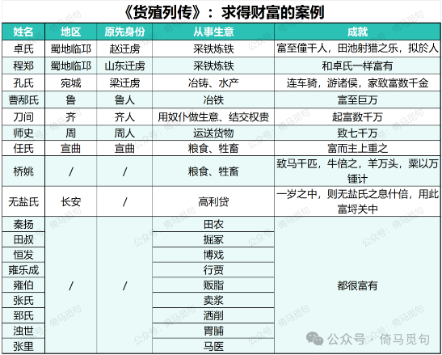

# 读书报告：《史记·货殖列传》

## 一　写作背景

货殖，古代指经商或囤积财货以营利。《论语·先进》曰：“赐不受命，而货殖焉；亿则屡中。”赐就是端木赐，也叫子贡、子赣，擅长经商。司马迁沿用“货殖”这个词，作为这篇列传的题目。

《太史公自传》曰：“布衣匹夫之人，不害於政，不妨百姓，取与以时而息财富，智者有采焉。作货殖列传第六十九。”

《货殖列传》在《史记》的七十篇列传中排名第六十九，最后一篇即《太史公自传》。《货殖列传》是一篇非常特殊的章节，没有为政治人物树碑立传，相反，司马迁观察当时的社会状况，表达了自己对财富和商业的看法，还结合具体案例，探讨了求得财富的方法。在今天，这篇文章不但有很强的史学价值，还能给我们的财富观带来很多启发。

《货殖列传》不到六千字，但其中信息密度非常高，信息量远高于11万字的《边水往事》和20万字的《我不是废柴》。我读了很多遍，还是感到很多地方无法理解。当然，这也不怪我，关于《货殖列传》的论文都不知道有多少，又何必苛求我这样一个普通人去全部理解呢？因此，这篇《读书报告》仅供参考，一切信息以原文为准。但是我相信，大家读这篇报告，一定能有所收获。

## 二　本文结构和主要内容

我根据文意，将此文分为五个部分：财富观、汉以前的商人代表、汉初各地经济形势、求得财富的方法、求得财富的案例。下面将一一介绍，读者可根据这些介绍，快速了解本文结构和主要内容。

## 1　财富观

前面五段像是序言，讲自己的社会历史观和财富观，体现出很强的唯物主义倾向。

司马迁认为神农以前的事情他不知道，就不说了；《诗》所描述的虞夏以来，人们的特点就是崇尚享受、追逐利益。《老子》中所描绘的那种小国寡民、安居乐业的理想，恐怕是不适用于今日了。

“农而食之，虞而出之，工而成之，商而通之”。农虞工商，是一种社会规律：大家各尽其能，各取其利，这些都是无需政府强迫而自然发生的事情。农虞工商，也是国家财富的源泉：姜子牙和管仲在齐国广开源泉使国力强盛就是一个例子。农虞工商，也是礼仪仁义的基础：君子富了，才会施加仁德；平民富了，才会调节自己的劳力。

所以，“天下熙熙，皆为利来；天下攘攘，皆为利往”，大家都是为了利益而奔走。连统治阶级都害怕破产，更何况其他贫民呢？

## 2　汉以前的商人代表

司马迁随后列举了汉代以前的几位商人，分别为：范蠡、子贡、白圭、猗顿、郭纵、乌倮和巴清。具体情况如下表：

## 3　汉初各地经济形势

汉朝天下统一，开放关卡要道，解除开采山泽的禁令，因此富商大贾得以通行天下，交易的货物无不畅通，他们的欲望都能满足，汉朝政府又迁徙豪杰、诸侯和大户人家到京城。

随后，司马迁介绍了汉初各地的情况，内容丰富，包括地理分区、重要都会、各地民俗、物产等，我制作了一张表格，可以大致一览。由于这一部分司马迁论述比较细碎，难以总结，因此表格仅供参考，读者应以原文文本为准：

## 4　财富的重要性以及求财富的方法

贤人出世入世，都是为了财富；壮士冲锋陷阵，是因为受到重赏的驱使；女人打扮自己，千里迢迢、不择老少，是为了追求财富；富家公子装饰讲究，出行排场很大，是为了摆出富贵的样子。其他如猎人渔夫、赌场赌徒、医生方士、官府吏士等等，来去奔走，无非也是为了财富和利益。

富有三种类型，本富、末富和奸富，获取财富，本富为上，末富次之，奸富最下。但是对穷人来讲，“农不如工，工不如商，刺绣文不如倚市门”。并指出利率不达到20%的生意，是不值得做的。

## 5　求得财富的案例

论述完求富的方法，司马迁紧接着给出了例子，见下表。

可见致富没有固定的行业，财富没有固定的主人，千金之家比一都之君，巨万者乃与王者同乐，这样的人被称为“素封”。

## 三　探讨几个问题

我有一些想法，其中不乏暴论，供大家参考、批评。

## 1　司马迁的社会历史观

我认为司马迁的社会历史观是大体符合历史唯物主义的。

历史唯物主义最重要的观点，就是经济基础决定上层建筑，人们首先要满足吃喝住行的需要，才会有剩余时间去探讨政治、文化、哲学等高端的内容。

司马迁认为，追求利益是人之常情，“故善者因之，其次利道之，其次教诲之，其次整齐之，最下者与之争”；另外，“仓廪实而知礼节，衣食足而知荣辱。礼生於有而废於无。”如果人民吃不饱饭，就不要跟他们奢谈道德。

也正是因此，司马迁能客观地面对当时的商业活动，并且讲述商人盈利的故事，探讨经商的方法。

当然，司马迁只是在这一点与历史唯物主义暗合，并不是完全等同。

## 2　秦汉时期商人的主要业务

根据司马迁对代表商人的描述，我们可以知道，从春秋到西汉初年，商人的主要业务有：农产品（谷、丝帛）的买卖、牛羊的买卖以及盐铁的开采加工和买卖，这三个业务养活了绝大多数大商人，至于掘冢、博戏、马医，都只是刚刚起家用到的偏门，不能长久。

由此可以得出几个猜想，供以后验证：

①春秋战国到汉朝初年，中国商品经济非常发达，民间商业活动也许达到了中国古代史的顶峰。

②汉武帝在全国实行盐铁官营后，一定会有很多大商人破产或衰落；由于盐铁官营，政府的财力增强，中央集权和专制主义也随之加强，代价就是民间商业的衰落。

③重农抑商的思想和政策，使中国古代封建王朝非常稳定，但社会发展也变慢了。否则，按照西汉初年商人的发展态势，很快他们就会有雇佣人的需求，说不定发展几十上百年，就有人开手工作坊了。

## 3　关于本富、末富和奸富

“本富”绝不能简单以“种田”去理解，而是从事农业生产，也就是当地主。

首先，司马迁谈致富之道，就是谈“素封”之道。“素封”，就是没有官爵封邑却有富贵的人。所以，要“素封”，就要跟那些“封者”比较。

“封者食租税，岁率户二百。千户之君则二十万。”平民呢？“庶民农工商贾，率亦岁万息二千，百万之家则二十万，而更租赋出其中。”

也就是说，普通人有百万钱，每年有二十万利润；有封邑的人，一千户也是收钱二十万。因此，百万之家和千户之君，在财富上是对等的。

那么，如何才能算是有“百万之家”呢？司马迁举例：

> 故曰陆地牧马二百蹄，牛蹄角千，千足羊，泽中千足彘，水居千石鱼陂，山居千章之材。安邑千树枣；燕、秦千树栗；蜀、汉、江陵千树橘；淮北、常山已南，河济之间千树萩；陈、夏千亩漆；齐、鲁千亩桑麻；渭川千亩竹；及名国万家之城，带郭千亩亩锺之田，若千亩卮茜，千畦姜韭：此其人皆与千户侯等。

都是拥有各种自然资源，说白了，就是当地主，因为这些东西不可能让你自己去干，都是让下面的人干。这些干活的人，当时多是“奴仆”，也就是没有人身自由的农奴；在封建社会中后期，就是佃农：佃农租种土地，给地主地租。

本富的特点，就是“不窥市井，不行异邑，坐而待收，身有处士之义而取给焉。”结合前文所说的“贤人深谋於廊庙，论议朝廷，守信死节隐居岩穴之士设为名高者安归乎？归於富厚也。”“处士”和“守信死节隐居岩穴之士”都是一类人，他们是隐士，但他们更是地主。所谓隐士，只是不参与政事罢了，还是很有财力的。如果你连财力都没有，你连隐士都称不上！

范仲淹的“处江湖之远则忧其君”，诸葛亮的“躬耕陇亩”，其实言下之意就是：老子不当官，回家也能当个小地主！

“是故本富为上，末富次之，奸富最下。”

也正是因此，穷人没有资格和资本搞“本富”，所以，“夫用贫求富，农不如工，工不如商，刺绣文不如倚市门，此言末业，贫者之资也。”

一贫如洗的人，要求富贵，就必须尝试各种方法积累第一桶金，哪怕是走偏门。

另外，司马迁在论述中表现出的鄙视链，和当今社会很像。“封者”相当于我在《现代社会，财富的五大来源》中所论述的“收税的”，“本富”则是“收地租的”，“末富”就是“求利润的”。

农业社会和现代社会虽有差别，但是财富在权力面前总要低一等，这个论断在中国却是一直正确。

> 转换说明：配图：第1–3幅暂沿用现图（指定资料目录未找到可靠且质量更好的无水印原件）。
