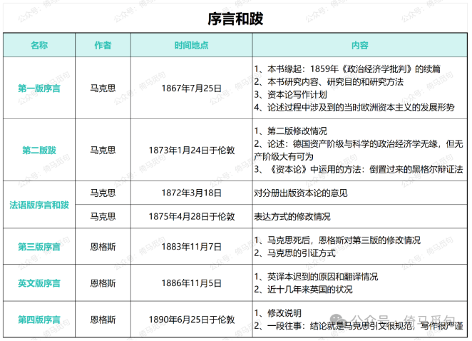

# 《资本论》问对录：序言和跋

昨天读完序言和跋，记了很多笔记，但是忘了保存，全都丢失了，只好重新来过，因此晚了一些。

我想了很久，还是决定以“问对录”的形式来写《读资本论》，因为以问题为导向，读者会轻松一些。如有引用，括号后会标记页码。这个系列所有页码都出自《马恩文集》；《资本论》第一册对应《马恩文集》第五卷。

**问曰：**

《资本论》有哪些序言和跋？它们的写作时间、作者和主要内容是什么？你认为我们应该如何对待这些序言和跋？

**对曰：**

序言是写在正文前的话，跋也叫“后记”，是写在正文后的话。一般来讲，序言和跋会介绍作者的创作意图和过程、基本内容、资料来源等信息。《资本论》再版多次，序言和跋自然也很多，马恩文集中收录了6篇序言和跋，可以帮助我们更好地理解《资本论》的内容，这六篇序言和跋的具体情况如下：

**问曰：**

《资本论》这本书到底要讲什么，马克思究竟想干啥？

**对曰：**

《资本论》是马克思1859年发表的《政治经济学批判》的续篇，他说：“我要在本书研究的，是资本主义生产方式以及和它相适应的生产关系和交换关系。（8）”他还说：“本书的最终目的就是揭示现代社会的经济运动规律。（10）”

**问曰：**

如何理解所谓的“规律”？

**对曰：**

规律就是客观事物发展过程中的本质联系，自然界有自然界的规律，人类社会有人类社会的规律，人类社会各个阶段有各个阶段的规律。“现代社会的经济运动规律”最主要的内容就是“资本主义生产方式以及和它相适应的生产关系和交换关系”，这也是马克思这本书要研究的内容。

**问曰：**

有人说社会科学不是科学，你怎么看？

**对曰：**

马克思说：“我决不用玫瑰色描绘资本家和地主的面貌。不过这里涉及的人，只是经济范畴的人格化，是一定的阶级关系和利益的承担者。我的观点是把经济的社会形态的发展理解为一种自然史的过程。不管个人在主观上怎样超脱各种关系，他在社会意义上总是这些关系的产物。同其他任何观点比起来，我的观点是更不能要个人对这些关系负责的。”（10）

自然科学解揭示自然规律，社会科学揭示社会规律，规律不以人的意志为转移，具有铁的必然性。由于社会科学很难验证，很难做社会实验，加之每个人都有自己的立场，本身就是社会的一员，所以很多所谓的社会科学，都混杂着意识形态色彩。任何社会科学都有科学的成分，也都有意识形态的成分，含量不同，大家可自行判断。我认为《资本论》的科学含量远高于其他社会科学著作。

**问曰：**

马克思的写作计划是什么？

**对曰：**

第一卷：资本的生产过程（第一册）；第二卷：资本的流通过程（第二册）和总过程的各种形式（第三册）；第三卷：理论史（第四册）。（13）

**问曰：**

如何理解《资本论》的研究方法和叙述方法？

**对曰：**

有三个地方提到了马克思的研究方法和叙述方法，各有侧重。

1、用抽象力来分析经济形式，“而对资产阶级社会说来，劳动产品的商品形式，或者商品的价值形式，就是经济的细胞形式。”（8）

2、倒置过来的辩证法：任何事物都是运动的，都是有始有终的，都是要灭亡的。（22）

3、“在形式上，叙述方法必须与研究方法不同。研究必须充分地占有材料，分析它的各种发展形式，探寻这些形式的内在联系。只有这项工作完成以后，现实的运动才能适当地叙述出来。这点一旦做到，材料的生命一旦在观念上反映出来，呈现在我们面前的就好像是一个先验的结构了。”（22）

总结一下：

①总思路和任何科学一样，就是充分占有材料，探寻内在联系；

②把资本主义社会当成人类社会的一个阶段研究，而不是把这些规律当成永恒的真理；

③首先要分析资本主义运动的细胞：商品。要先抽象，再具体，先揭示最本质的关系，再慢慢增加条件，使研究对象（或者说叙述对象）丰富起来。

**问曰：**

你说的这些都不重要，我也不想看。我看《资本论》就是为了装逼，要是看了不能装逼，那还看个鸟？

**对曰：**

装逼确实很重要，据说当年中苏十年论战的时候，邓小平和苏联官员对线，引用了一句马列的话，并指出引文出自某书某页，苏联人一查，果然如此，邓小平也因此大出风头。

这六篇序言和跋，文采斐然，金句频出，我列举于下，并标记页码，尔等可熟读之，以后谈恋爱、演讲、朗诵、外交、谈判、辩经等场合，或许可以用到。

> 已经发育的身体比身体的细胞容易研究些。（8）

> 在浅薄的人看来，分析这种形式好像是斤斤于一些琐事。这的确是琐事，但这是显微解剖学所要做的那种琐事。（8）

> 但是，如果德国读者看到英国工农业工人所处的境况而伪善地耸耸肩膀，或者以德国的情况远不是那样坏而乐观地自我安慰，那我就要大声地对他说：这正是说的阁下的事情！（8）

> 问题本身并不在于资本主义生产的自然规律所引起的社会对抗的发展程度的高低。问题在于这些规律本身，在于这些以铁的必然性发生作用并且正在实现的趋势。工业较发达的国家向工业较不发达的国家所显示的，只是后者未来的景象。（8）

> 在其他一切方面，我们也同西欧大陆所有其他国家一样，不仅苦于资本主义生产的发展，而且苦于资本主义生产的不发展。除了现代的灾难而外，压迫着我们的还有许多遗留下来的灾难，这些灾难的产生，是由于古老的、陈旧的生产方式以及伴随着它们的过时的社会关系和政治关系还在苟延残喘。不仅活人使我们受苦，而且死人也使我们受苦。死人抓住活人！（9）

> 一个社会即使探索到了本身运动的自然规律——本书的最终目的就是揭示现代社会的经济运动规律——，它还是既不能跳过也不能用法令取消自然的发展阶段。但是它能缩短和减轻分娩的痛苦。（10）

> 为了避免可能产生的误解，要说明一下。我决不用玫瑰色描绘资本家和地主的面貌。不过这里涉及的人，只是经济范畴的人格化，是一定的阶级关系和利益的承担者。我的观点是把经济的社会形态的发展理解为一种自然史的过程。不管个人在主观上怎样超脱各种关系，他在社会意义上总是这些关系的产物。同其他任何观点比起来，我的观点是更不能要个人对这些关系负责的。（10）

> 同时，大西洋彼岸的北美合众国副总统威德先生也在公众集会上说：在奴隶制废除后，资本关系和土地所有权关系的变化会提到日程上来！这是时代的标志，不是用紫衣黑袍遮掩得了的。这并不是说明天就会出现奇迹。但这表明，甚至在统治阶级中间也已经透露出一种模糊的感觉：现在的社会不是坚实的结晶体，而是一个能够变化并且经常处于变化过程中的有机体。（10）

> 任何的科学批评的意见我都是欢迎的。而对于我从来就不让步的所谓舆论的偏见，我仍然遵守伟大的佛罗伦萨人的格言：走你的路，让人们去说罢！（13）

> 《资本论》在德国工人阶级广大范围内迅速得到理解，是对我的劳动的最好的报酬。（15）

> 被认为是德国世袭财产的卓越的理论思维能力，已在德国的所谓有教养的阶级中完全消失了，但在德国工人阶级中复活了。（15）

> 但是我们的专家还是命运不好当他们能够不偏不倚地研究政治经济学时，在德国的现实中没有现代的经济关系。而当这些关系出现时，他们所处的境况已经不再容许他们在资产阶级的视野之内进行不偏不倚的研究了。（16）

> 只要政治经济学是资产阶级的政治经济学，就是说，只要它把资本主义制度不是看做历史上过渡的发展阶段，而是看做社会生产的绝对的最后的形式，那就只有在阶级斗争处于潜伏状态或只是在个别的现象上表现出来的时候，它还能够是科学。（16）

> 观念的东西不外是移入人的头脑并在人的头脑中改造过的物质的东西而已。（22）

> 辩证法在黑格尔手中神秘化了，但这决没有妨碍他第一个全面地有意识地叙述了辩证法的一般运动形式。在他那里，辩证法是倒立着的。必须把它倒过来，以便发现神秘外壳中的合理内核。（22）

> 辩证法，在其神秘形式上，成了德国的时髦东西，因为它似乎使现存事物显得光彩。辩证法，在其合理形态上，引起资产阶级及其空论主义的代言人的恼怒和恐怖，因为辩证法在对现存事物的肯定的理解中同时包含对现存事物的否定的理解，即对现存事物的必然灭亡的理解；辩证法对每一种既成的形式都是从不断的运动中，因而也是从它的暂时性方面去理解；辩证法不崇拜任何东西，按其本质来说，它是批判的和革命的。（22）

> 我所使用的分析方法至今还没有人在经济问题上运用过，这就使前几章读起来相当困难。法国人总是急于追求结论，渴望知道一般原则同他们直接关心的问题的联系，因此我很担心，他们会因为一开始就不能继续读下去而气馁。（24）

> 在科学上没有平坦的大道，只有不畏劳苦沿着陡峭山路攀登的人，才有希望达到光辉的顶点。（24）

> 一门科学提出的每一种新见解都包含这门科学的术语的革命。化学是最好的例证，它的全部术语大约每20年就彻底变换一次，几乎很难找到一种有机化合物不是先后拥有一系列不同的名称的。（32）
