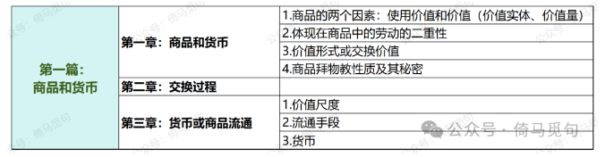
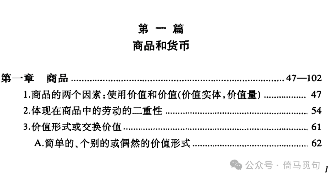
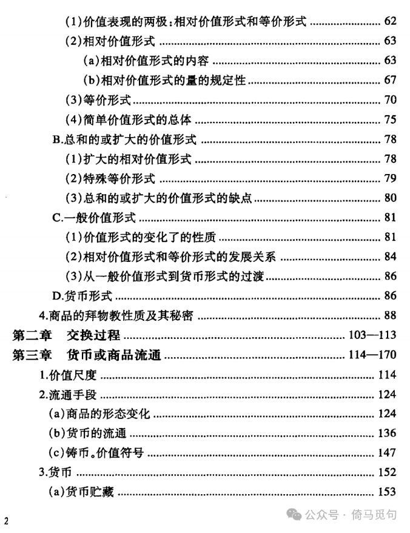
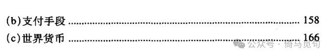

# 《资本论》问对录1.1：第一篇都有哪些章节？主要讲了什么？

**问曰：**

《资本论》第一篇都有哪些章节？主要讲了什么？

**对曰：**

第一篇标题为“商品与货币”，共三章。三章标题分别为：“商品”“交换过程”和“货币或商品流通”。这篇文章讲第一章“商品”的内容。

第一篇目录如下：

> 转换说明：配图：第1–4幅暂沿用现图（指定资料目录未找到可靠且质量更好的无水印原件）。
