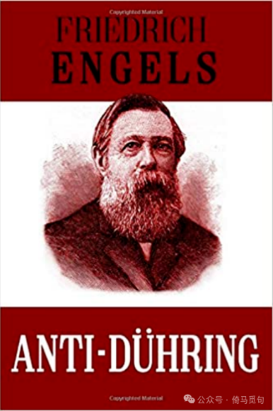
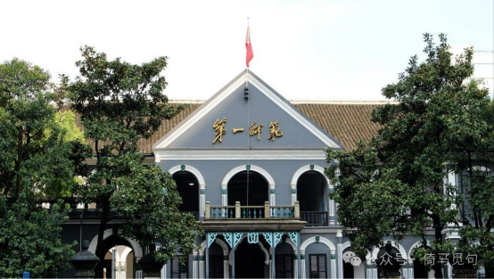
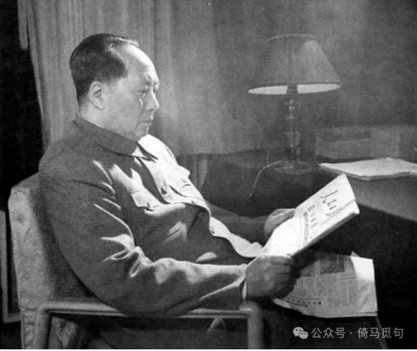
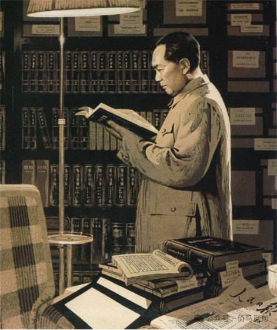
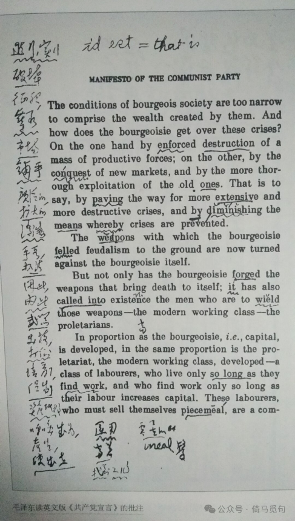
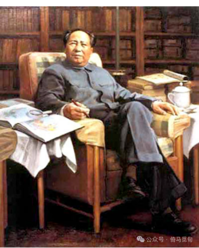
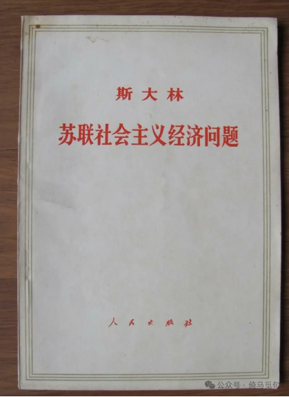

# 毛泽东与阅读

（在电脑里找到了大一时的毛概课展示讲稿，今天偷个懒，就直接发这篇了）

## 一、引入

> 现代社会主义，就其内容来说，首先是对现代社会中普遍存在的有财产者和无财产者之间、资产者和雇佣工人之间的阶级对立以及生产中普遍存在的无政府状态这两个方面进行考察的结果。但是，就其理论形式来说，它起初表现为18世纪法国伟大的启蒙学者们所提出的各种原则的进一步的、据称是更彻底的发展。同任何新的学说一样，它必须首先从已有的思想材料出发，虽然它的根子深深扎在经济的事实中。

> ——《马克思恩格斯文集9》p19

恩格斯在他的巨著《反杜林论》的开头，在他谈到他和马克思的理论的时候曾经这样说道：“同任何新的学说一样，它必须首先从已有的思想材料出发，虽然它的根子深深扎在经济的事实中。”

同样，毛泽东思想作为深刻改变了中国和世界的理论，它虽然根子深深扎在中国的现实之中，但是，它也离不开其他思想材料的启发——于是，我今天便和大家谈谈毛泽东思想的理论来源，或者说，咱们今天来谈一谈关于毛泽东读书的一些事。

## 二、历史，少年

首先，我们来讲一下毛泽东的读书史。

毛泽东出生在清末湖南的一个农民家庭，那时因为湖南是中国思想非常先进的省份，相对来说走在时代的前列。

毛泽东两岁至八岁在外婆家唐家坨度过，八岁到十三岁在附近的私塾读书，此后在父亲的干预下辍学两年。

在这期间，毛泽东读的书主要有两方面，一方面是古代的经史书籍，例如《三字经》《论语》《孟子》《诗经》等——这些是当时私塾的必修课；另一方面是课外书，尤其是《精忠传》《水浒》《隋唐嘉话》《三国演义》和《西游记》等中国古典小说。在辍学期间，毛泽东已经读到了郑观应的《盛世危言》一书。

在此期间，毛泽东受到了系统的中国传统教育。我们从这段材料中就可见一斑：

> 新中国成立后，毛泽东外婆家唐家坨移交给韶山毛泽东同志纪念馆一批珍贵的古籍，这些书相当一部分是毛泽东少年时代读过的，计有：乾隆丁亥（1767年）刊印的《御批通鉴辑览》58册；清嘉庆十三年（1808年）刊印的《礼记精义》1册、《周易精义》1册；同治三年（1864年）刊印的《尚书》4册、《礼记》10册、《诗经》4册；同治八年（1869年）刊印的《续资治通鉴》60册；光绪元年（1875年）刊印的《资治通鉴》104册；1926年刊印的《饮冰室文集》41册；另有《十三经注疏》3册、《论语》2册。

## 二、历史，求学时代1

1910年，十六岁的毛泽东离开韶山去往湘乡的一个西式学堂求学。

在那里，毛泽东读到了很多关于中国时事的书籍，读了梁启超的《新民丛报》，读了《世界英杰传》，并发表了很多时评文章。

> 孩儿立志出乡关，  
> 学不成名誓不还。  
> 埋骨何须桑梓地，  
> 人生无处不青山！

## 三、历史，求学时代2

1911年春，在湘乡读了半年后，毛泽东来到了长沙。在这里，由于关注时事，他喜欢上了看报。《湘报》和《民立日报》是他每日必看的。在那里，他剪掉了辫子。

接着，毛泽东当了半年兵。辛亥革命成功后退伍，继续求学。

## 四、历史，求学时代3

接着，毛泽东在省立第一中学读了六个月，看完老师推荐的《御批通鉴辑览》，他认为还不如自己自学。于是，他开始了长达半年的自学。

在自修期间，毛泽东读了很多关于世界历史和世界地理的书，看了很多西方的著作，例如达尔文《物种起源》、亚当斯密的《国富论》，还有很多启蒙思想家的书。

## 五、历史，求学时代4

1913年春，毛泽东考入湖南省立第四师范学校预科，一年后，此校合并到第一师范。

在这里，毛泽东遇到了两位对它影响很深的老师，一是袁仲谦，二是杨昌济。前者教国文，后者教伦理、修身。

在这里，值得一提的是毛泽东在泡尔生十万字的《伦理学原理》这本书上写了将近12000字的批注。这里面展现了当时毛泽东的思想状态。

在一师，毛泽东已经开始参加社会运动了。

从毛泽东求学时代的读书生涯中可以看出，青年毛泽东阅读非常广泛，基础知识非常牢靠，接受过古今中外很多大家思想的影响。这就决定了他不会随随便便把一个学说作为自己一生的信仰，也决定了他对马克思主义——如果马克思主义是真理的话——会有更深刻的理解。

## 六、毛泽东与马克思主义

有些公知认为毛泽东尽搞权谋，不懂马列。这种观点其实是非常可笑的。毛泽东是最优秀的马克思主义理论家和实践家，而且始终是全世界无产阶级的战士和领袖。

1917年11月7日，十月革命爆发。1918年8月，毛泽东来到北京，担任北京大学图书管理员，馆长是李大钊。在这里，毛泽东第一次接触到马列主义，并且读到了李大钊的《庶民的胜利》、《布尔什维主义的胜利》以及其他宣传十月革命和马克思主义的文章。

1920年春天，毛泽东第二次来北京，这一次他读了更多马克思主义著作，例如《共产党宣言》《阶级斗争》《社会主义史》等。

后来他对斯诺说：“到了1920年夏天，在理论上，而且在某种程度的行动上，我已成为一个马克思主义者了。”

现在我们以各个马克思主义著作为线索，来展开毛泽东思想的最重要的来源。

## 七、《反杜林论》

《反杜林论》在我非常迷茫的时期进入了我的生活，它是真正使我坚定信念的一本书，因此我对《反杜林论》和他的作者恩格斯有一种非常特殊的感情。

1932年4月，红军打下福建第二大城市漳州，毛泽东在漳州龙溪中学图书馆里翻阅了一上午，用汽车运了一车书到中央苏区。其中有很多马列著作，其中就有《反杜林论》。

1932年11月，《反杜林论》的译者吴亮平在中央苏区第一次见到毛泽东，毛泽东高度肯定了吴亮平的工作，称赞他翻译的好。

后来，毛泽东受到党中央排挤，他们说毛泽东是“狭隘经验主义”，还说“山沟沟里出不了马列主义”，嘲讽毛泽东看的马列书不多，只是会打仗罢了，而且打仗也不过是靠《孙子兵法》和《三国演义》，赢得并不光彩。毛泽东一气之下，长征随身带着两本书，一本是《国家与革命》，一本是就是《反杜林论》——当事人都亲眼见到过毛泽东在担架上拿着这两本书读。

1938年1月，毛泽东同梁漱溟谈话时提到：“我对你说一句要紧的话，要贡献你一句要紧的话。恩格斯写了一本书，叫《反杜林论》，你要读读《反杜林论》。”可见毛泽东对《反杜林论》十分推崇。

新中国成立后，毛泽东多次阅读《反杜林论》，在毛泽东给干部的书单中，多次出现《反杜林论》的名字。外出视察也常常带上它；1964年和1970年，两次批示印发大字本马列经典著作，都有《反杜林论》。他在自己的著作和讲话中多次引用《反杜林论》的语句和观点，例如，《矛盾论》里大段引用了《反杜林论》的“哲学”编第十二节“辩证法。量与质”中的论述。

《反杜林论》中，毛泽东最常谈及的两个问题是“唯物辩证法”和“自由与必然”的命题。时间有限。

## 八、《共产党宣言》

毛泽东1920年第一次阅读《共产党宣言》，这是他读的第一本马克思主义著作。

后来毛泽东曾回忆说，正是《共产党宣言》这部马克思主义著作，使我树立起马克思主义的信仰，我接受马克思主义，认为他是对历史的正确解释，就一直没有动摇过。

他说：“读了《共产党宣言》这本书，我才知道人类自始以来就有阶级斗争，阶级斗争是社会发展的原动力，初步地得到认识问题的方法论，可是这些书上并没有中国的湖南、湖北，也没有中国的蒋介石和陈独秀，我只取了他4个字‘阶级斗争’。”老老实实地开始研究实际的阶级斗争。

1939年，毛泽东曾经谈到：“这本书我读了不下一百遍，每读一次，我都有新的启发。”毛泽东还说：“遇到问题，我就翻阅马克思的《共产党宣言》，有时只阅读一两段，有时全篇都读，每阅读一次，我都有新的启发，我写《新民主主义论》时，《共产党宣言》就翻阅过多少次。”

毛泽东晚年还对英文版的《共产党宣言》下过功夫，有图为证：

## 九、《资本论》

很多人认为毛泽东只会搞军事和政治，不懂经济。还有些人曾经非常肯定地对我说，毛泽东并没有读过《资本论》。这样的论断其实是非常可悲的。

1929年，毛泽东经营长沙文化书社的时候，当时他多次向读者推荐李汉俊翻译的《马克思资本论入门》。这时他应该就已经读过这本《资本论》的入门书了。这应该是他第一次接触《资本论》。

到延安后，1941年毛泽东写的《改造我们的学习》《关于农村调查》《驳第三次“左”倾路线》等论著，便引用了不少《资本论》的论断，诸如：“观念的东西不外是移入人的头脑并在人的头脑中改造过的物质的东西而已”，“蜜蜂建筑蜂房的本领使人间的许多建筑师感到惭愧”等等。毛泽东还说：资本主义的理论和历史的一致，“模范地表现在《资本论》里面，我们可以从它懂得一点辩证法论理学和认识论一致的门径”。

建国以后，毛泽东也多次阅读《资本论》。因为我并没有读完《资本论》，所以不太有发言权，我找到了一篇关于毛泽东与《资本论》的考据的文章，作者是浙江大学马克思主义学院的教授刘召峰老师，或可作为参考。

https://mp.weixin.qq.com/s/BnkHS3-CAtJHqwQ9eGCzmQ

## 十、《苏联社会主义经济问题》

《苏联社会主义经济问题》是斯大林1951年出版的著作，总结了苏联30多年的经济建设的经验。毛泽东对此书极为重视，刚刚出版时就如饥似渴地读了一遍；1957年出第二版时又读了一遍。根据工作人员的整理，毛泽东有四个版本的《苏联社会主义经济问题》，都有批注和勾画。他多次推荐中央领导同志阅读这本书。

大家知道，《资本论》是马克思一生的心血，最看重的作品。但《资本论》论述的是资本主义的生产方式。而对于苏联、中国这样社会主义国家来说，他们的使命是建立和推广一种新的生产方式，共产主义的生产方式——而这种生产方式在马克思恩格斯那里只能找到很少的论述，最多只是提及一些原则，例如新的社会是没有商品的。——于是我们只能在实践中探索。

而苏联作为第一个社会主义国家，它的经验是非常宝贵的。事实上，斯大林同志也确实做得很好。

## 十一、结语

毛泽东曾经不止一次地说过：“饭可以一日不吃，觉可以一日不睡，书不可一日不读。”在他八十多年的生命长河中，从来没有放下过手中的书本——毫无疑问，这些书使他汲取了古今中外历代各个大家的思想，也是他的伟大思想形成的必要条件。

必然性通过偶然性来开辟道路。我们坚持群众史观，但不能不承认毛泽东确实在中国革命中起到了决定性的作用，他凭借自己卓越的才华和坚定的无产阶级立场，在历史上留下了浓墨重彩的一笔。虽然他最后失败了，但是荣耀依然属于伟大的毛泽东同志。

最后，我们用毛泽东的贺新郎·读史来结束这次展示。在这首诗里，毛泽东的历史观展现地淋漓尽致。

> 人猿相揖别。只几个石头磨过，小儿时节。铜铁炉中翻火焰，为问何时猜得？不过几千寒热。人世难逢开口笑，上疆场彼此弯弓月。流遍了，郊原血。

> 一篇读罢头飞雪，但记得斑斑点点，几行陈迹。五帝三皇神圣事，骗了无涯过客。有多少风流人物？盗跖庄蹻流誉后，更陈王奋起挥黄钺。歌未竟，东方白。
