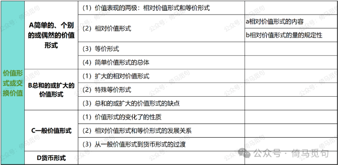

# 《资本论》问对录1.10：如何理解第一章第三节“价值形式或交换价值”？

**问曰：**

如何理解第一章第三节“价值形式或交换价值”？

**对曰：**

我们在第六个问题讲过，**交换价值是价值的表现形式，是一种商品同另一种商品相交换的量的关系或比例。**为什么这么说呢？因为商品的使用价值是可以通过商品体的自然形态表现出来的，但是商品的价值却无法直接从商品中看到，它**只能在商品与商品发生的社会关系中表现出来。**在这里，**价值形式**和**交换价值**是同义词，可以理解为商品与商品之间怎样发生社会关系，通过什么方式交换。（徐禾《政治经济学概论》将价值形式翻译为价值形态，交换价值就是价值的表现形态，大家可以对照一下。）

马克思在这里层层论述了四种价值形式，分别是**A简单的、个别的或偶然的价值形式，B总和的或扩大的价值形式，C一般价值形式，D货币形式。**第三节小标题目录如下：

马克思说：

“谁都知道——即使他别的什么都不知道，——商品具有同它们使用价值的五光十色的自然形式成鲜明对照的、共同的价值形式，即**货币形式**。但是在这里，我们要做资产阶级经济学从来没有打算做的事情：**指明这种货币形式的起源**，就是说，探讨商品价值关系中包含的**价值表现**，怎样从最简单的最不显眼的样子一直发展到炫目的货币形式。这样，货币的谜就会随着消失。（62）”

可见，马克思在这里花这么大篇幅讲这四种价值形式，就是为了克服古典经济学家的不足，通过分析价值形式的发展，更好地理解商品价值的货币形式。
