# 青岛地图分享以及关于青岛的10个冷知识

（文字资料来源于《青岛百科全书》中国大百科全书出版社1999年出版；地图来源于山东省标准地图服务网站，点击“阅读原文”可跳转至该网站。）

1　崂山朱峰海拔1132.7米，是中国海岸线上的第一高山。

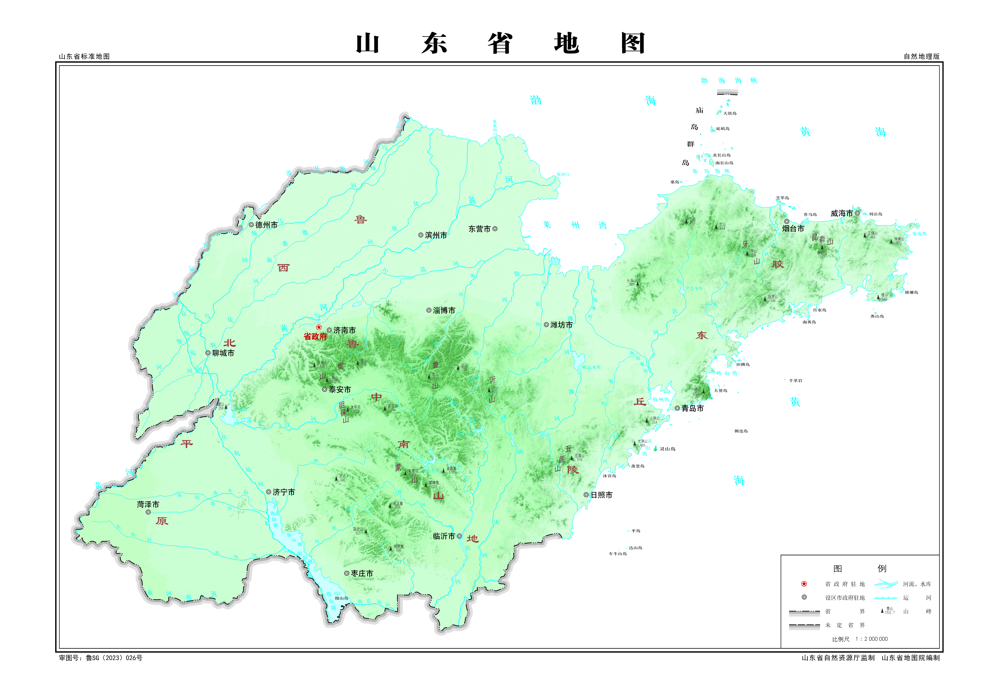

2　矗立在北京天安门广场上的人民英雄纪念碑，其碑身就是在崂山开采的花岗岩。

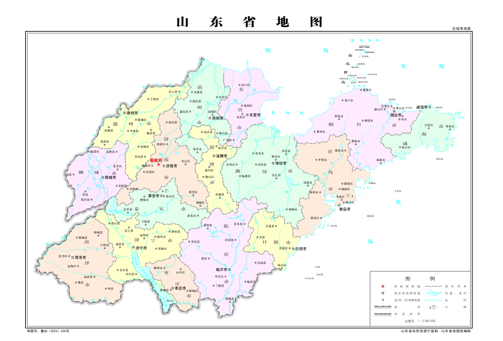

3　国立青岛大学创办于1930年，1932年改称国立山东大学。1937年七七事变爆发，国立山东大学迁入四川，学校解散，师生并入它校。1945年国立山东大学在青岛恢复。1958年山东大学才从青岛迁到济南。

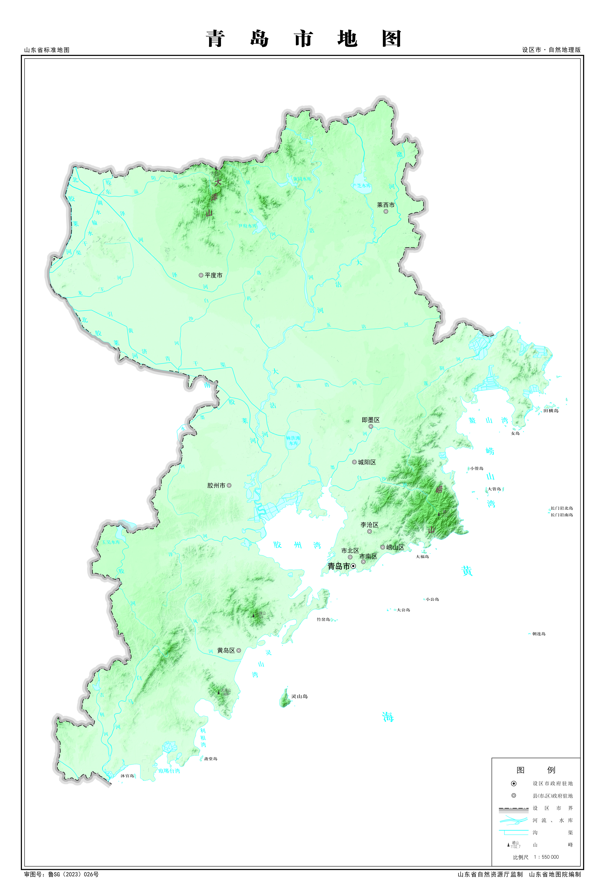

4　周敬王三十五年（前485年）发生在琅琊海域的齐吴海战，为中国历史上有记载的第一次海战。

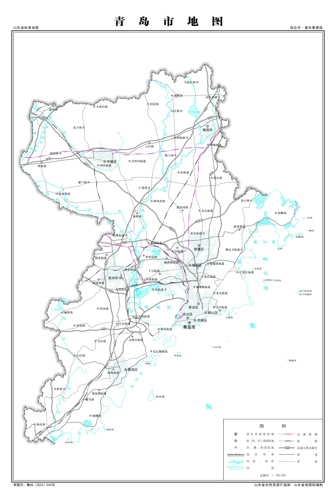

5　越王勾践灭吴后，曾经迁都琅琊，琅琊一度是越国的政治中心。

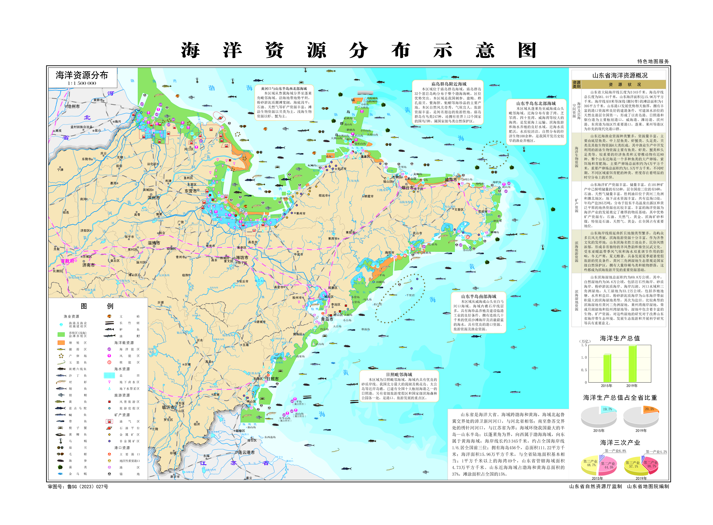

6　汉高祖4年（前206年），韩信击败田横，田横率500壮士逃到一个海岛，后来都壮烈殉国，这个海岛就在今天的即墨横岛。

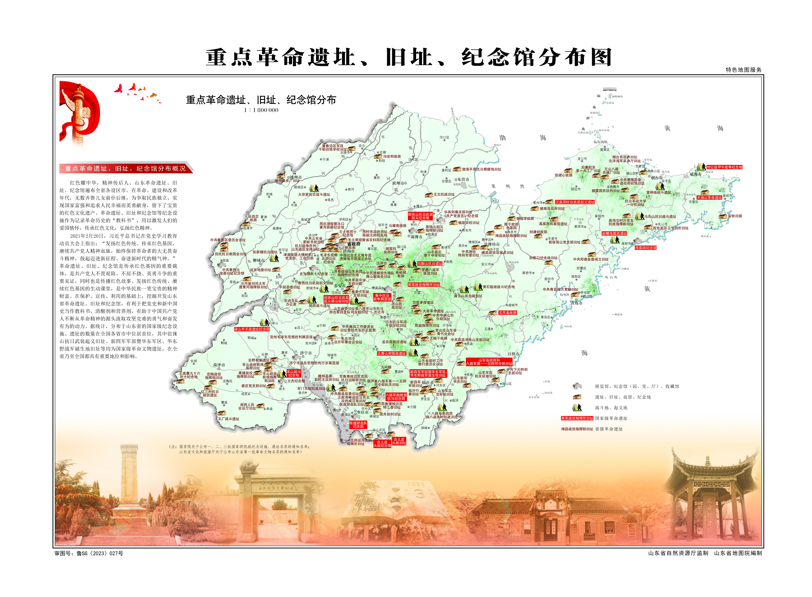

7　秦始皇和汉武帝都曾经多次巡幸琅琊。

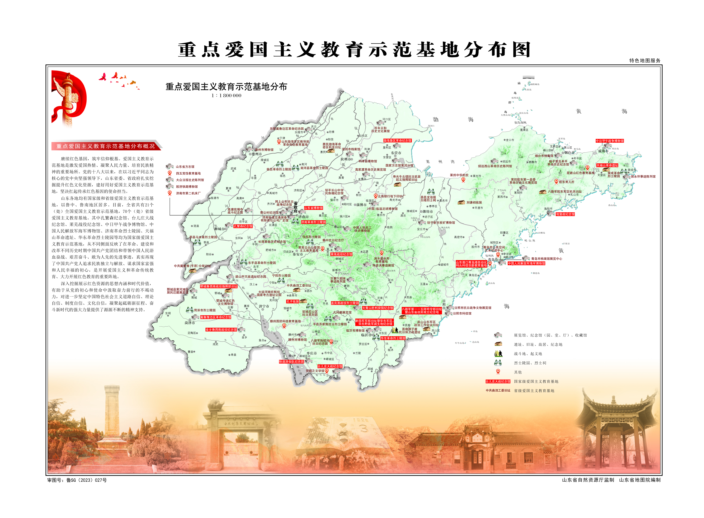

8　汉宣帝本始四年（前70年），琅琊发生地震，城邑受损严重，后琅琊郡治所迁到诸城、临沂，原先的琅琊治所（今琅琊镇）就此没落。

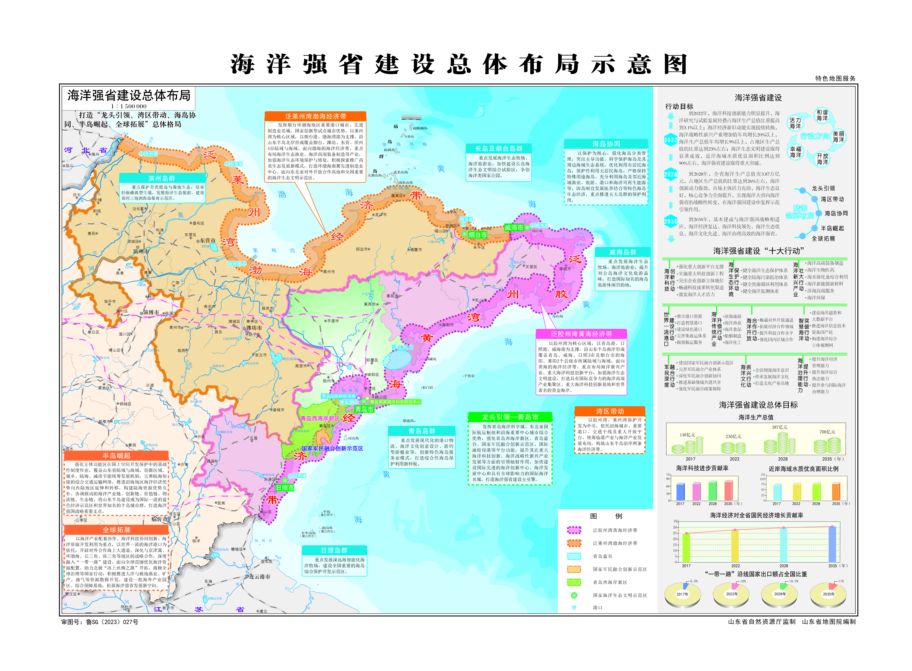

9　光绪十七年（1891年），李鸿章亲自在胶州湾勘察，奏请清廷胶澳设防，这是青岛建制之始；光绪二十三年（1897年），德国派远东舰队入侵胶州湾，制造了“胶州湾事件”，第二年3月，签订《胶澳租借条约》，德国租借胶澳，租期99年。光绪二十五年（1899年），德皇威廉二世将胶澳租借地内的新市区定名为青岛。

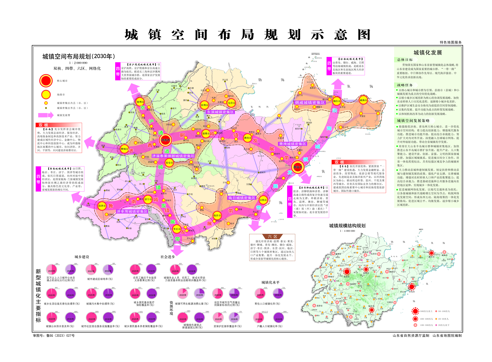

10　五四运动的导火线就是青岛问题，1919年5月4日北京学生游行示威，抗议巴黎和会承认日本接管德国在山东、青岛的各种特权。1922年12月，中国政府正式收回青岛主权。

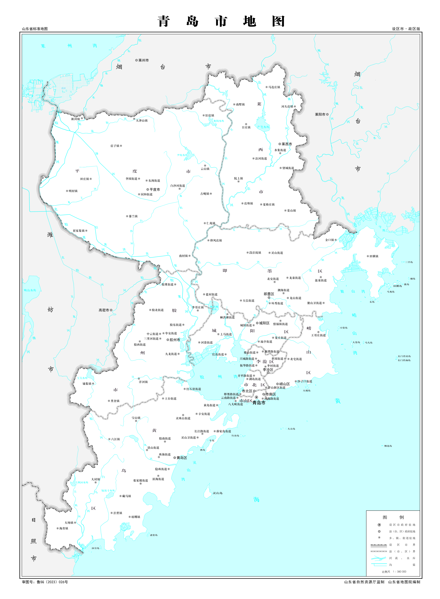

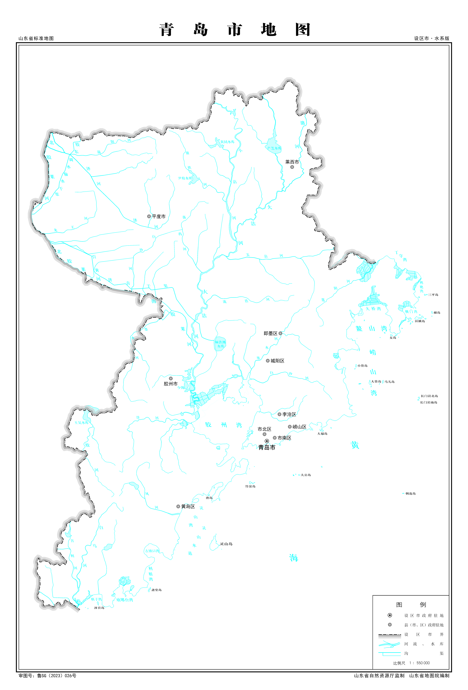
