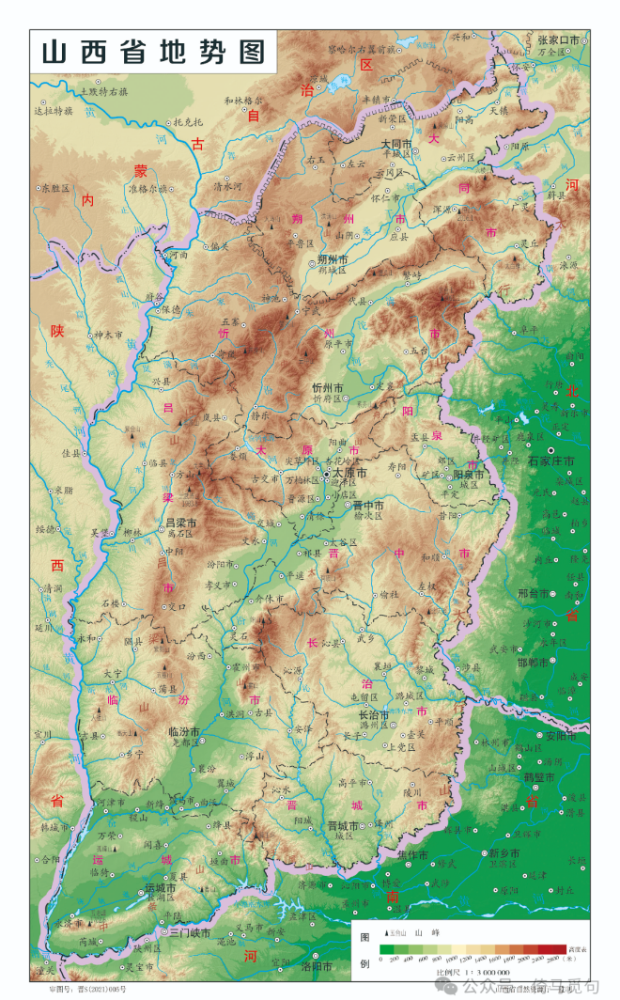
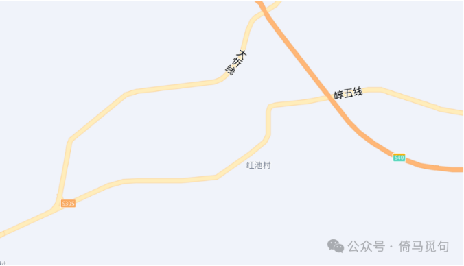

# 什么是山西？

（2021年暑假，我跟uu师兄去山西，那是我第一次去山西，对这个新地方充满了好奇，回来后写下这篇文章，成文时间大概是21年9月初。原文比较粗糙，经过uu师兄的改动，勉强可看。后发表于公众号“发展研究报告”，但该公众号于前两月被注销，于是现在一字不改，重新发表在此处。）

## （一）传说中的山西

说起山西，大家会想到什么呢？

或许会想到她的位置吧，左太行，右吕梁，这片土地连接着塞北的草地和华北的农田。

或许会想到她的历史吧，从战国时代的胡服骑射到抗战时期的平型关大捷，这里从来不缺少动人的故事。

或许会想到一些著名的标志吧，例如晋商、老醋、刀削面、煤老板之类。

但对我来说，这些毕竟是纸上的山西。这个夏天，我们有幸去了一次山西，实实在在地踏上了这片土地，真真切切地接触了这里的一些人与事。这篇文章便是这次山西之行的记录，从一个外地人的视角去审视山西，或许可以给大家一些启发。

## （二）矿场爆破队里的山西

煤矿是山西产业发展的主要动力，与采煤业直接关联的大体可以有爆破、开采、储存、运输、加工这么几个环节。

爆破是一个之前没有关注过的行业，我们或许可以以红池谷地附近一个矿场的爆破队为例，来看看这个行业的现实情况。

这个爆破队所属的爆破公司有两类业务，第一类负责与采矿单位、上级盖章单位谈判、周旋；第二类则是进行现场爆破作业。爆破的工作是承包的：采矿单位出一定的钱，然后把炸矿的任务全部地交给爆破公司，其中包括炸药钱、工人工资、宿舍房租、机器损耗、运输消耗等等，剩下的钱就是爆破公司的利润了。

爆破队的工作简单说就是把矿炸开，以方便之后的开采。每个工人都有较为固定的工作，负责固定的工序，但也有部分工人能够对整个生产过程都有所了解。据他们说，那里的工作环境不会好到哪里去。

很少有矿可以不爆破而直接开采，因而爆破显然属于采矿业的必要组成部分。据了解，大型矿场都有自己的爆破队，而这样单独的爆破公司一般只是服务于较小的矿场。这种单独爆破公司的出现应与煤矿开采的私人化有关，没有一个小煤老板可以养活一个单独的爆破部门。

那里的爆破工人每月工资3000多，每天只需工作上午半天，11点之前就下班了，而且每月实际工作日数大概不过15日。爆破工人是一个特殊的职业，需要经过较为复杂的训练，用工需求波动也大，因此老板会以旺季为标准培养较多的爆破工人；而在淡季时，老板会“好心”让一些工人“休假”。当然，休假期间的工资是不会给的。

大忻线和崞（音郭）五线交汇处北边的大忻线东侧，有三栋二层的水泥结构民房。这其中一栋被老板租下，改造了一番，这便是工人的宿舍了，大概容纳了30人；另外两栋则提供住宿、吃饭的服务。工人宿舍似乎是有统一做饭的，但是老板不包饭。工人上班都是坐面包车去，到矿区的车程约20分钟。

这里的爆破工人多为山西人，许多来自农村，也有被退职的警察和转行的公务员。他们有的高中毕业，有的初中毕业，有的初中还没毕业，只有一个来自地方高校的大学生算是大学学历。对于这份工作，大多数人是满意的，毕竟待遇好于在家务农，而且工作轻松，比较悠闲。也有工人爱好读书，对养牛、四书五经和西方后现代哲学颇有研究。

工人的休闲活动也不能算是特别单调。有的宿舍有电脑，可以打游戏、看视频；阳台空气很好（至少温度适宜），是个聊天的好场所。由于空闲时间较多，因此他们有时也会去较远的地方游玩，例如附近一个可以泡温泉的景点就时常被他们光顾。

爆破工人掌握的技术使它们成为具有破坏性的力量，而他们具有的大量空闲时间，使他们与其他行业的工人相比，拥有更全面发展的可能。这个队伍作为一个整体，既不缺乏知识，也不缺乏耐性，更不缺乏改天换地的豪情，所以，在爆破工人中间进行新社会组织方式的尝试或许是大有可为的。

## （三）矿区里的山西

红池村的爆破工人给我带来的感觉至少是轻松的，不过另一个地方煤矿工人的境遇却让人感到压抑。

在晋省北部某市有一个矿区，五十年代就建立起来，已开采七十余年了；至今还在采，年产量超过两百万吨。矿区内有小学、中学，也有很大的居民区、热闹的小集市，算是一个相对独立的生产生活单位。

矿上有各种各样不同的工种，例如“周采、机掘、辅助、检查、炮采”等，不同的工种情况略有不同；工作一般是两班倒，平均工资六七千元；但是女工一般只有3000多。综采队一个礼拜休一天，机关单位一个礼拜休两天。

煤矿工人干的活既辛苦又危险，但他们的装备却非常落后。据一位工人说，他下井十多年，用的一直是五十年代的装备，新的装备、追踪仪都没用过，他说这些新装备都是用来宣传的，记者拍完就没用了。

临时工的待遇更惨，他们是哪里有活哪里干，几乎不能偷懒。有一个内部政策，就是临时工下井前要答题，答对了才能下井；如果答错，不但今天挣不了钱，还要倒扣你两百元。这里的临时工和正式工做一样的活，一天240-260元工资，没有保险，没有五险一金，“死了就死了”，没有补助。

是的，工伤、矿难是寻常事。据说就全省来说，以前每天都有人死，大型矿难每次死几十上百个。在一个矿区的范围内，在“新时代”，虽然要好些，但矿难对他们来说也实在不是什么新鲜事。

举两个案例吧。一是几年前一位工人因矿难而死，领导把他的尸体并着五万块钱一起给了一个私人小矿场，这样这位死者就不必计入“矿难”的统计名单里了；第二个例子发生在三年前，一位工人死了，但因为是下班回了家才死的，所以矿区领导就给了他们家五万，其他再没管过。很多工人感慨：“煤炭工人命贱！”“人命不值钱，甚至不如车子。”

长期的、缺乏保障的劳动每天都在损害着煤矿工人的健康，过度劳累和肺病在这里只是寻常。矿工以前一般60多岁就死了；现在好点，还能看到70多岁的……

腐败也不是新鲜事。说是在反腐，其实还是贪，但换了方式。以前还会转账，现在用现金，这样更隐蔽，把柄也少。我了解到三种贪污方式：一种是给你开个账户，假装你是在职工人，每月把工资发你卡上，给你交了养老保险，留下一千多生活费，其余就都归领导了；还有一种就是带你去街上转转，到商店，指着一手机说：“这挺好呀”，不明说，但你如果买不回来，就可以不用干了；最后一种就是直接要。

每天早晨六点起床，吃早饭（一线工人还来不及吃早饭），下井，晚上六七点下班，吃个串，喝喝酒，回去睡觉；第二天继续前一天的生活。空闲的时候就唱唱ktv、洗个澡。没有什么其他的娱乐活动。这就是一个典型的煤炭工人的生活。在这里长大的孩子，也早早地习惯了这样的社会关系——习惯了任劳任怨地劳作，习惯了被压迫，习惯了重复单调的生活，

但我们仍然相信阳光总会照进昏暗的矿井，或早或迟。

## （四）运煤路上的山西

据说山西煤好开采，但也得运得出去、卖得出去，才能造就那么多可爱的煤老板。

山西的铁路、公路，从某种意义上讲，是为煤而生的。只是在大忻线、崞五线上，就可以看到路上都是运煤的货车。空气中弥漫着煤的味道，货车来往密集时会像是硝烟战场；路边是布满煤粒的“铁树铁草”，还有随处可见的煤渣煤块。沿这种路走上半天，会发现口罩上、鼻孔里都变成了黑色。

还有远处的朔黄线，没过一会就会有长长的运货火车驶过；双向都有；车厢是向上开的，里面全是煤。我们数了其中一个，一列车竟然有两组火车头，每组各两节，一组在头部，一组在中间，还有一百一十多节车厢——这还不是最多的！

山西的运煤量可见一斑。

在轩岗，我们有幸见到了刘家梁煤矿的运输和装填设备：传输履带从矿区一直到火车站的铁轨上方，下面是过渡的圆柱形建筑，可以视为一个大漏斗，再下面则是货车铁轨。货车到大圆柱下的铁轨上，就会有煤直接从上往下装进去，省去了海量的人力。这样巨大的工程，只有大资本可以做到，或者整个社会。

相比之下，公路货车这样的运输方式应该是最不理想的：消耗的能源最多，占用工人的时间最多，环境污染最严重（不仅有空气污染，还有噪音污染，水污染，固体废弃物污染等），安全隐患也是最大的。这或许也是煤炭开采私人化的结果吧？——当然，这是因为，国家的煤矿可以用铁路运输，而小矿只能用公路。

可以设想，在社会主义时代，劳动者作为整体支配所有矿产，也同时地支配所有开发这些矿产所需的各种生产资料。那时开采矿产的目的是为了满足整个劳动者阶级的需求，而不是利润；那时开采、运输和使用煤矿的具体安排则要考虑整个社会的利益，而不是一个个小私有者的利益。

不过那也是很久以后的事了。或许也不会太久。

## （五）富士康里的山西

采煤业毕竟已走过蓬勃发展的时代了，那些比采煤前辈更晚些走出农村的山西年轻人们，很多便选择了富士康。

富士康据说是制造高科技产品的，但其主要干的还是砸钱买人（力）的勾当——不管学历、年龄、性别、样貌如何，只要不过分残疾，你的劳动力就是可以被使用的。它需要的只是你的时间，毕竟它要你做的活无非是重复流水线上的一个动作，是非常简单易学的。

在太原城南的小店镇有一家规模颇大的富士康，它招工有三种形式：其一是正式工，工资较低，3000到5000左右，但有五险一金；其二是日结工，就是上一天班结一天账，时薪26-29，每天工作10小时，当然，也要干一个月起步，压几天工资；其三是返费工，例如打卡55天再额外给你9000元“返费”——当年申城昌硕出事就是因为中介不发这返费。

顺便说一句，富士康好过国内绝大多数企业：正式工是有五险一金的，离职是没有阻碍的，发工资是很准时的，加班是自愿的，厂内各种设施也是很完善的……富士康是堂堂正正的资本主义血汗工厂，不屑于用小偷小摸的方式赢得那些微不足道的额外利润。

## （六）南黑窑村的山西

富士康落户太原看中的是当地低廉的工价，不过这工资与在家务农相比，还是高了太多，因此大家也乐得来此处找活路。由于淡旺季用工需求量的差异，富士康本身就倾向于多招临时工；况且临时工工资也更高些。于是临时工的数量和比例都上升了。而随着来此务工的人越来越多，太原富士康对面便聚集了各种各样的中介、商铺，吸引了各行各业的老板，形成了一个零工市场。市场背后的南黑窑村，也便挤满了打工人。

和北京马驹桥、天津刘安庄的零工市场一样，这里有各种各样价格低廉、品类丰富的小吃餐馆，有居住条件极差的宾馆出租房，有脏兮兮的街道和臭烘烘的气味，有小卖部、蜜雪冰城、垃圾桶、窑子、小广告、成人用品店，当然还少不了缠着你送电脑平板，但实际上是推销APP的苦逼推销员。

也有不一样的。这里的中介主要经营去外地的活：上海昌硕、盐城日凯、昆山世硕、泰州兰斯……而且量大。例如以“山西志晟人力”名义发布的广告牌上就写道：“常年发车，每天九点集合……直达各地合作厂区”。当地招工的工种主要有保安、蔬菜分拣、快递分拣、工地打杂、厨师、店长之类，还有安防员、监控员、船员这样少见的活。日结、长期工都有，价格都比富士康低，时薪12-20不等。

此外，这里当铺和经营花呗套现的店也很多，店面多形似移动联通的营业厅，只是大部分面积略小一些。

或许，同煤矿工人和富士康的正式工相比，南黑窑的打工人是山西最“自由”的劳动力。

## （七）红池村里的山西

山西不仅是一个工业省份，同时也是一个重要的农业省份；不管是矿场、电子厂还是零工市场，他们所需要的最基本的衣食原料和大部分的劳动力都最终来自于农村。那么山西的农村又是什么样的呢？我们或许可以在原平市的红池村找到些线索。

在朔州和忻州中间有一块叫做红池谷地的地方，谷地南北都是高山，有些山上产煤、铁、铜；大忻线、崞五线和灵河高速都通过这个谷地。

红池村便位于这个谷底的南边。该村是个传统的农业村，村民原来的生活主要来自于种田。

成片的田被分割成一块块小地，分属不同的人户。该地的主要农作物是玉米和高梁，玉米亩产一千三四百斤，每斤收购价是八九毛；高梁亩产八九百斤，每斤一块左右。没有化肥粮食是长不好的，所以每亩地大概要八九百的成本。就算加上些农业补贴，也没法指望靠种田赚钱。一位老农妇家中有三亩六地，但补贴只按二亩二来，这看起来微不足道的百多块钱让她耿耿于怀。

除了种田之外，当地还有种树的产业，当地村民可去林区帮忙种树，工钱每天80元，记上天数，一年结一次工钱。山上的矿区占了村民的山，也要给些赔偿。

这便是当地村民几乎所有的收入来源了。和过去的日子比生活还算过得去，但钱总归是不够用的。老太太的老伴儿刚过世，去世时七十岁出头，据说最后送到太原去治，明知治不好也花了三十多万，耗尽了一家的积蓄。据老太太说，“治又治不好，不给他治又说不过去”。当地去年刚过世的好几位老人都是这种“花光钱治不好人还是走了”的情形。

听说这村靠山的部分要拆迁，要建仓库，又说是要修公路；据说这事是原平市政府主导的，总之现在还没动。被拆掉的房子呢，按一定的单价换算成钱去换原平的房，具体地说，拆迁的无梁房每平按2800元计算，而造价更贵的有梁房每平则按2500元计算，这些钱可以去按市场价买原平市5800一平的楼房，不足的部分还得另外花钱。而原平那边的搬迁区呢？水似乎也很深：由于开发商一批又一批地“被整治”，项目大多要在建成前被政府“接管”，购房者总是要给政府再交一笔尾款，才有可能拿到房子。一位村民花了三十万买了一套房子，之后又给政府接管后的项目组交了五万……可能还要交一次尾款这房才能建好。

红池村山上不远处就是矿区，这个矿既产煤也产铝、铁。公路穿村而过，山上80辆大货车日夜在这路上来回穿行着，噪声和粉尘常伴着这里的村民。这里恐怕是没有受到工业化什么好处，却遭受工业化伤害最多的地区吧。当然，不是没有想过靠山吃山，村民们也曾经去矿上谈过钱的事情，然而似乎没谈拢，于是举报了矿上以运铝矿废渣名义采煤，于是矿上也就老老实实地采铝了。村里有个傻子拿着胶皮管子给来往车子喷水，顺带收五块钱“水钱”，据说是村里的头头们教的，估计是村民获得的唯一好处吧。

## （八）商城里的山西

我们看到了矿区、煤矿运输，还看到了富士康、零工市场和农业村，在这些地方奋战着的农业和工业的劳动者们，支撑起了现代社会物质财富和精神财富的一切。这些劳动者大概就可以代表山西了。

但也不完全是山西。我们或许还需考虑那巨大的财富生产，和他们清贫的生活消费中间的差额……

于是我们来到了太原。太原聚集着军工、机械和以煤炭为原料的重化工业，为全国输送着产品。可见，山西的情形发生在山西，又不仅仅与山西有关。它的情状与全国乃至世界都或近或远地联系着。当然，也有一些直观的表象将这个差额表现出来。

太原城里比起红池村明显热闹得多，这里也是红池村那几位老人们花光家里积蓄的最后救治地。热闹来自于财富的聚集。作为省城，这是它的任务。

我来到了一家高档商城。

这商城有好几层，灯光绚丽，金碧辉煌；商城里头是高档餐厅、咖啡馆、医美店、化妆品店、首饰店等。

陪我同行的一位衣着鲜艳时髦的贵妇在一柜台边挑选着什么，明亮的柜台上摆放着各种戒指、项链和手链，首饰上面的宝石反射着大堂里的灯光，显得格外好看；首饰下面是价格标签，从几万到几十万不等。这样类似的景象也是今日山西的当然组成部分吧？

## （九）真实的山西究竟如何？

所以，说起山西，大家会想到什么呢？

恐怕在每个人眼里，山西的形象都是不同的。但我想，如果大家都局限在自己的小圈子里，大概永远都只能看到山西的一个方面；唯有不同行业的人们加强交流与合作，我们才能拼接出整个山西的完整形象，看到真正现实完整的山西。而这完整形象的拼接，一定会进一步促进人们认识到这片土地上的人们，从而促进我们一起建设一个更好的山西。

山西如此，中国如此，世界大概也是如此吧。
