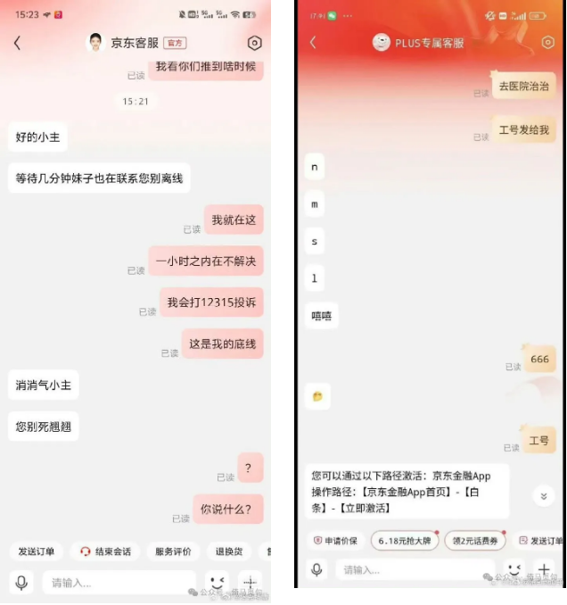
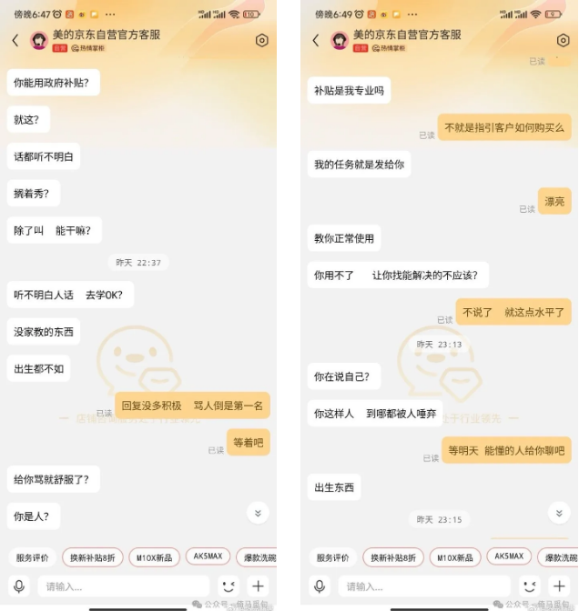
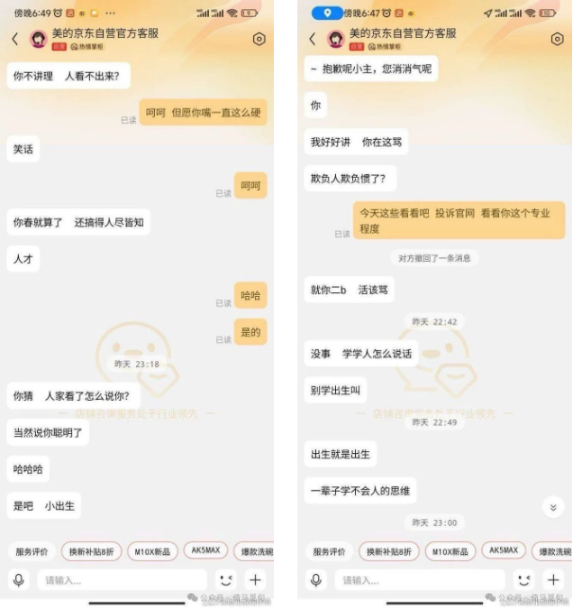
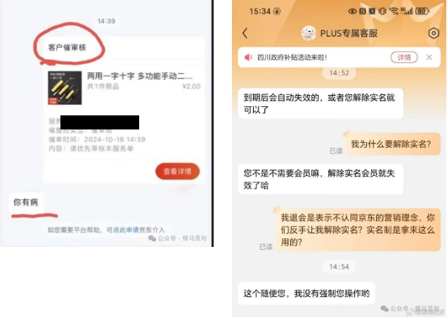
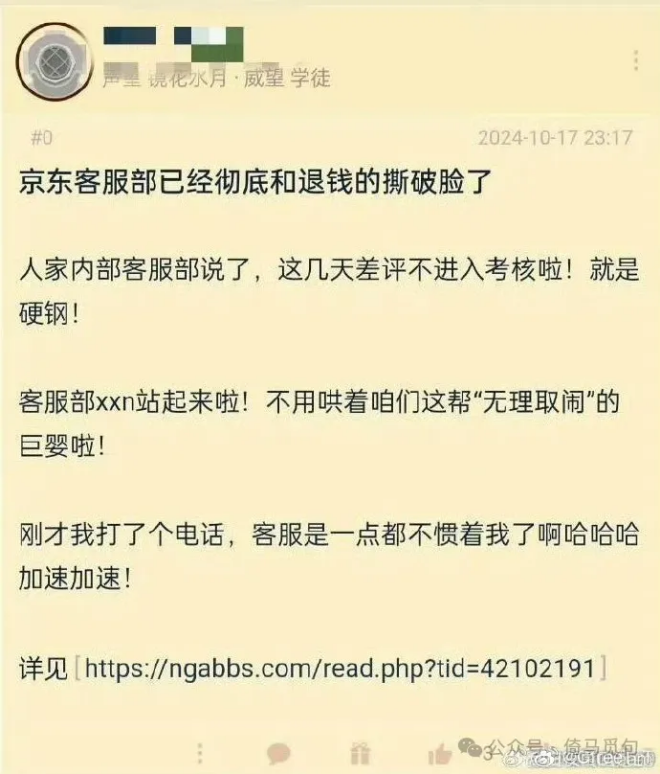

# 如何评价京东客服骂人？

这几天很多网友爆料，被京东客服骂了，相关截图在网上流传。

我们暂时不讨论其他问题，先讨论一下京东客服骂人这件事。

我曾经接触过客服这项工作，这个工作的特点，就是态度必须要好，因为客户对客服的打分会计入平台店铺的服务分中；平台本身的客服也有相应的考核机制。

所以，客户的评价是跟客服的绩效挂钩的，客户评价好，客服可能不会有什么收益，但是客户如果有很多差评，那么客服大概率是要被批评和扣工资的。

所以做客服这个工作就会有一个特点，一个客服会同时跟很多客户交涉，他们就形成了一种条件反射：开口亲亲，闭口宝贝。就算心里有再多不高兴，也要在态度上摆正位置。

也正是因为这个原因，客服这个工作更适合女生来做，因为女生更容易做到内心毫无波澜地说很多（大多数是违心的）肉麻的话（渣男也行）。

客服这个工作要受到很大怨气，不管是产品质量原因，还是物流原因，客户不会管那么多，都会把大部分气施加到客服身上（他们一般也没有别的渠道）。

比如说抖音卖女鞋女装的商家，退货率基本上都能达到60%~80%，所以这些商家的客服会有非常大的工作量，也会遇到很多不合理的需求。

说不合理其实也不对，其实是合理的。因为在抖音直播间，你要卖东西，你就必须得骗人。你不骗人，你就没有流量。没有流量，就赚不了钱。但如果你骗了人，就一定会有人来找你兴师问罪——这些疑问和咒骂全部都给了客服。

所以我们就可以看到，公司里客服的那一排工位，屏幕里的文字全是亲亲宝贝，但屏幕外呢，却是不绝于耳的吐槽。

现在据说京东出了一个政策，这几天的客服差评都不计入最终的考核。如果这事是真的，那京东客服骂人也就不难理解了。

综上所述，我们可以总结出京东客服骂人的原因如下：

1、客服这个工作本来就有很大压力，充满了怨气，很多人平时就想骂人，只不过是线下骂，你没听到而已。

2、京东现在遇到这种公关事件，公司高层不出面解决，不给个说法，导致很多消费者要求退会员、取钱，一下子增加了客服很多工作量。

3、这样就会造成两个结果，其一，客服的人均工作量增加，怨气更重；其二，京东会调其他部门的人，甚至雇佣临时工来做客服工作，这些人哪有正式客服的心理素质？当然是怨气更重了，更容易爆发了。

4、客服本来就是女性居多的岗位，女性基数大了，追星厌男的女生也会很多，她们本来就看普信男不顺眼，遇到这样的情况，只会是更痛恨。

5、京东高层宣布这几天的客服评价不计入绩效（听说），于是很多客服就放飞自我了，本来是线下口头骂的，现在很多就直接发出来了，不管后果怎么样，反正骂了真的会很爽。
