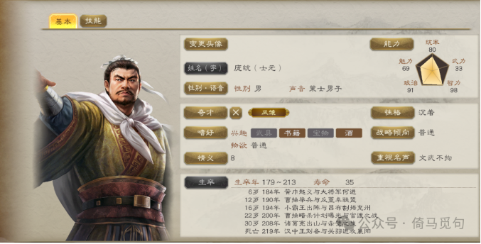

# 向庞统学习情商

庞统号称“凤雏”，与“卧龙”诸葛亮齐名，他辅佐刘备夺取益州，在攻取雒县的战役中去世。由于各种小说和游戏的影响，大家对庞统这个人耳熟能详，不过很少有人知道庞统也是一位情商很高的人。他的高情商主要表现在以下五个方面：

## 一 多鼓励别人，多说好话

> 庞统……性好人伦，勤于长养。每所称述，多过其才，时人怪而问之，统答曰：“当今天下大乱，雅道陵迟，善人少而恶人多。方欲兴风俗，长道业，不美其谭即声名不足慕企，不足慕企而为善者少矣。今拔十失五，犹得其半，而可以崇迈世教，使有志者自励，不亦可乎？”——《三国志·蜀书·庞统传》

这段文字的大意是：庞统喜欢评论人物，勤于培养人材。他每次对别人的称赞，往往超过其实际才德，当时有人对此感到疑惑，就询问他，庞统回答道：“如今天下大乱，纯正之道衰落，善人少而恶人多。要想振兴风俗，弘扬道业，如果不加以美言赞誉，那么他们的声名就不足以让人羡慕向往；如果没有人羡慕向往，就会导致行善的人更少了。现在我宁可十个人之中错赞五个，至少还能得到一半的真才实德之人，这样可以提高社会的风尚，使有志之士自我激励，不也是很好吗？”

换位思考一下，假如你是一个年轻人，没有什么名声，而且一事无成，有一天你正好遇到了一位很有成就的名人，于是请他对你进行点评。你有优点也有缺点，但这位名人仍然高度赞赏了你，并且把对你的赞美发到了朋友圈，告诉他的朋友们……你在那种情境下，难道不会深受感动并且更加努力吗？

## 二 擅长发掘别人的优点，换着花样说好话

> 瑜卒，统送丧至吴，吴人多闻其名。及当西还，并会昌门，陆绩、顾劭、全琮皆往。统曰：“陆子可谓驽马有逸足之力，顾子可谓驽牛能负重致远也。”谓全琮日：“卿好施慕名，有似汝南樊子昭。虽智力不多，亦一时之佳也。”绩、劭谓统曰：“使天下太平，当与卿共料四海之士。”深与统相结而还。《三国志·蜀书·庞统传》

周瑜去世后，庞统护送其灵柩到吴地，吴地的人大多都听闻过庞统的名声。庞统回荆州前，与当地名士们在昌门相聚，陆绩、顾劭、全琮都前来送别。庞统评论道：“陆子可以说是像一匹不出众却有奔跑之力的马，顾子则像一头虽不敏捷却能负重远行的牛。”接着他对全琮说：“你乐于施予、渴慕名声，有些像汝南的樊子昭。虽智力不算多，但也算是我们这个时代的优秀人物。”陆绩与顾劭对庞统说道：“如果天下太平，真希望能和你一起挑选四海之才。”他们与庞统结为好友，随后各自返回。

> 庞士元至吴，吴人并友之。见陆绩、顾劭、全琮，而为之目曰：“陆子所谓驽马有逸足之用，顾子所谓驽牛可以负重致远。”或问：“如所目，陆为胜邪？”曰：“驽马虽精速，能致一人耳。驽牛一日行百里，所致岂一人哉？”吴人无以难。“全子好声名，似汝南樊子昭。”——《世说新语》

庞统来到吴地，吴地的人们都与他交好。他见到了陆绩、顾劭、全琮，并分别评价他们说：“陆子就像一匹不出众却有奔跑之力的马，顾子则像一头虽不灵巧但可以负重远行的牛。”有人问道：“照您的评价，陆绩更胜一筹吗？”庞统回答：“驽马虽快，也只能载一个人而已。而驽牛一天能走百里，所能承载的岂止一人呢？”吴人无话可辩。他还说：“全子爱慕名声，像汝南的樊子昭。”

> 顾劭尝与庞士元宿语，问曰：“闻子名知人，吾与足下孰愈？”曰：“陶冶世俗，与时浮沈，吾不如子；论王霸之余策，览倚仗之要害，吾似有一日之长。”劭亦安其言。——《世说新语》

顾劭曾经与庞统夜宿交谈，问他说：“听说您善于识人，您觉得我和您相比，谁更优呢？”庞统回答：“在陶冶世俗、随顺时势方面，我不如您；但若谈论帝王霸业的策略，掌握要害之处，我似乎略胜一筹。”顾劭也心安理得地接受了他的评价。

总结一下，庞统在周瑜死后（公元210年），从荆州江陵（今荆州市附近）到吴（今苏州市），走了一千多公里。当地名士早就听说过庞统的大名，都去见他，和庞统交往。庞统评价了三个人物，分别是陆绩、顾邵和全琮，说陆绩有“逸足之力”，顾邵能“负重致远”，全琮则是“一时之佳”。

看一下庞统评价的这三个人后续的发展：陆绩后来被外放任郁林太守，219年去世，年仅三十二岁。顾邵在同年入仕，成为豫章太守，214年病逝，年仅三十一岁。全琮后来成为东吴名将，参加了石亭之战，获得大胜，官至右大司马、左军师，249年去世。

可以说，庞统当年评价的三个人都很厉害，只是陆绩和顾邵去世太早，限制了他们的成就。不过有一说一，庞统的评价很笼统，换什么人都能套上去，就是换着花样说好话。

## 三 真诚和坦率

> 《江表传》曰：先主与统从容宴语，问曰：“卿为周公瑾功曹，孤到吴，闻此人密有白事，劝仲谋相留，有之乎？在君为君，卿其无隐。”统对曰：“有之。”备叹息曰：“孤时危急，当有所求，故不得不往，殆不免周瑜之手！天下智谋之士，所见略同耳。时孔明谏孤莫行，其意独笃，亦虑此也。孤以仲谋所防在北，当赖孤为援，故决意不疑。此诚出于险涂，非万全之计也。”——《三国志·蜀书·庞统传，裴松之注》

《江表传》记载：刘备与庞统闲谈宴饮时，问道：“你曾担任周瑜的功曹。我到吴地时，听说他秘密上书，劝孙权将我留下，真有此事吗？当时各为其主，你可以毫无隐瞒。”庞统回答道：“确有此事。”刘备感叹说：“当时我处于危急之中，有求于人，因此不得不前往吴地，险些不能从周瑜手中脱身！看来天下的智谋之士，想法大体相似。当时诸葛亮也劝我不要前往，他当时竭力劝阻我，担心的也是这一点。我当时认为孙权的防备主要在北方，指望我成为他的援助力量，因此下定决心毫不犹豫。（现在看来）当时确实是冒险而行，并非万全之策。”

史书的记载是有侧重的，在这里，庞统虽然只说了两个字，“有之”，但引起刘备的一阵感慨。说明庞统是一个很坦率的人，他的坦率也使刘备更加信任他。

## 四 说出对方想说的话

> 《九州春秋》曰：统说备曰：“荆州荒残，人物殚尽，东有吴孙，北有曹氏，鼎足之计，难以得志。今益州国富民强，户口百万，四部兵马，所出必具，宝货无求于外，今可权借以定大事。”备曰：“今指与吾为水火者，曹操也，操以急，吾以宽；操以暴，吾以仁；操以谲，吾以忠。每与操反，事乃可成耳。今以小故而失信义于天下者，吾所不取也。”统曰：“权变之时，固非一道所能定也。兼弱攻昧，五伯之事。逆取顺守，报之以义，事定之后，封以大国，何负于信？今日不取，终为人利耳。”备遂行。——《三国志·蜀书·庞统传，裴松之注》

《九州春秋》记载：庞统劝说刘备道：“荆州荒芜残破，人力耗尽，东边有孙吴，北边有曹氏，三方鼎立的局势中很难有所作为。如今益州富庶强大，人口过百万，四方兵马随时可用，资源丰富，不依赖外地供给。现在可以暂时借此地以成就大业。”刘备回答：“如今与我势同水火的，是曹操。曹操急躁，我宽和；他暴虐，我仁义；他狡诈，我忠诚。只有在各方面与曹操相反，事情才能成功。现在因为小利而失去天下的信义，这是我不能接受的。”庞统说：“关键时刻的变通，本就不是单一之道所能解决的。利用弱者攻打愚昧者，是五霸的策略。先通过逆取，后以顺道守之，再以信义相报，事成之后再封给他们大国，这有什么违背信义呢？今日若不采取行动，最终也只是便宜了别人。”刘备于是采纳了庞统的建议，决定行动。

《隆中对》是刘备集团的行动纲领，益州早晚要拿下，这是刘备早就认可的，但他非要扭扭捏捏，说什么“今以小故而失信义于天下者，吾所不取也。”其实就是害怕师出无名，怕挨骂。庞统就用“逆取顺守”的道理，帮刘备画了一个“事定之后，封以大国”的饼，说出刘备想说的话，使刘备卸下道德包袱，专心执行既有的方针。

## 五 制造并解决冲突，营造双赢局面

> 于涪大会，置酒作乐，谓统曰：“今日之会，可谓乐矣。”统曰：“伐人之国而以为欢，非仁者之兵也。”先主醉，怒曰：“武王伐纣，前歌后舞，非仁者邪？卿言不当，宜速起出！”于是统逡巡引退。先主寻悔，请还。统复故位，初不顾谢，饮食自若。先主谓曰：“向者之论，阿谁为失？”统对曰：“君臣俱失。”先主大笑，宴乐如初。——《三国志·蜀书·庞统传》

刘备斩了刘璋的名将杨怀、高沛后，向成都进发，攻下了很多城池，在涪城举行盛会，设宴作乐，刘备对庞统说：“今天的聚会，真是快乐啊。”庞统回答：“攻打别人的国家却以此为乐，不是仁者的行为。”刘备喝醉了，生气地说：“当年周武王伐纣，前有歌、后有舞，难道他不是仁者吗？你的话不妥，当即退出！”于是庞统缓缓起身退下。刘备不久后后悔，便请他回来。庞统回到原位，不理会道歉，照常饮食自若。刘备问他说：“刚才的言论，是谁错了呢？”庞统回答：“君臣都有错。”刘备大笑，宴席重新恢复欢乐如初。

打益州是既定方针，现在终于有进展了，大家当然都很高兴。但是刘备显然高兴过头了，于是庞统直接提醒。

从刘备的角度看，大家正在摆庆功宴呢，庞统突然大谈仁义，真是扫兴，打益州是你坚决支持的，具体策略也是你制定的，结果你说我们不仁，你脑子是瓦特了吧？你还是快出去吧！

在当时，刘备和庞统肯定都是有情绪的，但是他们都是情商很高的人，很快控制住自己的情绪。刘备请庞统回到席位，道歉，然后问庞统刚刚谁错了，庞统顺着台阶下，说君臣都有错，于是刘备大笑，空气里再次充满了快活的气息。

这次似乎是个冲突，但这次冲突的效果呢，就是既展示了庞统的坦率和直言不讳，又显示出刘备的大度和宽容，还提醒了在座的将领：攻打益州我们是有道理的，不要纠结那么多了。

但是要想达到这样的效果，必须对方也是一个大度和高情商的人，而且你和对方关系必须很好。

庞统教给我们的这几招，其实生活中也经常可以用到，总之，记住以下几点：

1 多夸别人，换着花样夸，人才是要呵护的，而不是打压出来的。

2 坦率，关心对方的真实想法，把这种想法合理化。

3 不打不相识，有时候有了矛盾，随时激化，冲突化解以后两人关系反而会更好。

情商是一种认识、了解和控制情绪的能力。如果一个人能够敏锐地觉察到对方的情绪变化，并且能够及时调整自己的行为，使对方产生积极的情绪（或者避免消极的情绪），使双方拥有更亲密的关系，我们就称这个人“情商高”。

人总是渴望理解，总是能对照顾到自己情绪的人抱有感恩。所以情商高的人能够时刻照顾到大家的情绪和感受，从而更容易获得大家的信任。

当然，没必要对所有人都那么高情商，但你一定要认识到这一点，至少不能让对你好的人寒心。

> 转换说明：配图：第1幅暂沿用现图（指定资料目录未找到可靠且质量更好的无水印原件）。
