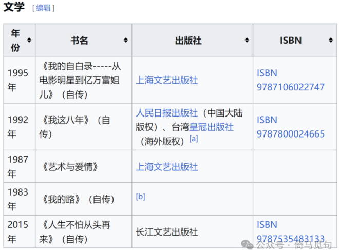
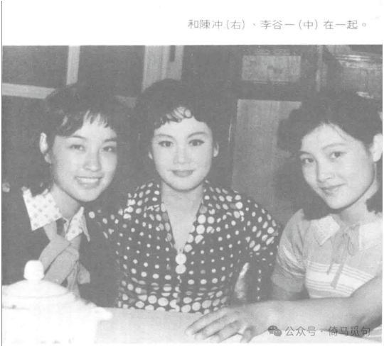
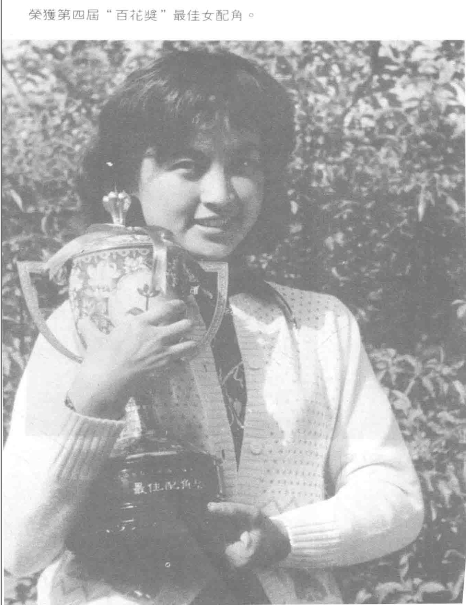
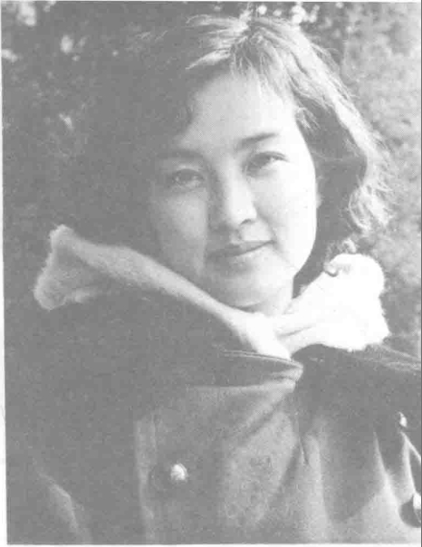
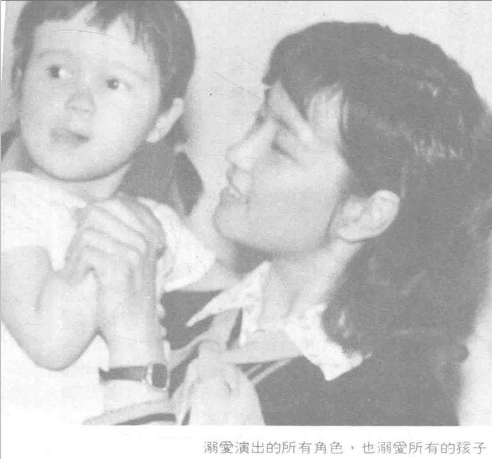
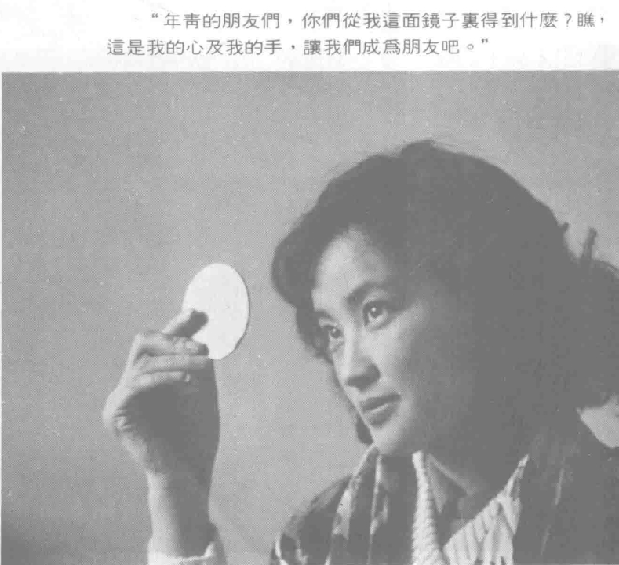
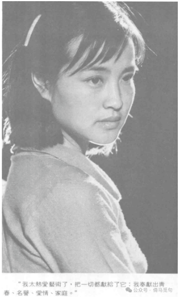

# 刘晓庆的阅读史

刘晓庆生于1950年，今年74岁了，她的一生非常成功，在很多领域都成就斐然。大部分人只知道她是演员，有些人知道她是一位成功的企业家，但少有人知道她也是一位作家。

刘晓庆出生革命家庭，从小酷爱阅读，后来写了很多本书，很早就加入了中国作家协会。本文介绍刘晓庆早年的阅读史，或许能让大家更全面地认识这位风流人物。

刘晓庆从没有见过自己的亲生父亲，根据她的自传，刘晓庆的母亲和生父“政治观点不同”，所以在刘晓庆出生前就离开了她。同时，刘晓庆的继父和舅舅都是中共川东地下党党员，所以可以推测，刘晓庆的生父很可能是反共的，说不定逃到台湾去了，感兴趣的朋友可以考证一下。

继父在刘晓庆三岁时来到她家。刘晓庆和继父关系很好，两人在感情上就是亲生父女。文革时期，继父因为出身地主家庭，被打成“叛徒”，但是刘晓庆始终没有跟继父划清界限，在继父住“牛棚”的时候，刘晓庆总是给继父送饭，有一次还把骂她继父的小孩打了一顿。

在刘晓庆小时候，继父跟她一起散步，一边散步，一边讲书。讲《东周列国志》《水浒传》《三国演义》《红楼梦》，还讲中国历史、唐诗宋词。

刘晓庆在入学前就已经能歌善舞，热爱戏剧、电影、歌唱、舞蹈，已认识很多字，会背不少唐诗。她提过曾经有一次看川剧《望娘滩》，刘晓庆在台下放声大哭，怎么也止不住，最后妈妈只好把她抱出去，可见刘晓庆小时候接触的教育很全面。她们家一开始在涪陵，后来搬到成都，所以被她舅舅称为“涪陵来的艺术家”。
上学后，刘晓庆经常觉得上课很乏味，因为她觉得上课教的东西都太简单了，很多课文她早就读过。她经常逃学，出去爬树、游泳，节奏大概是逃一天学，上两天课，但功课从来都能跟上。直到后来老师和妈妈一起联手，搞了一张“登记表”。晓庆必须拿着这张表上下学，母亲和老师分别在表上记录她的“离家时间”“到校时间”和“到家时间”，以此防止她到处乱跑。通过这个方法，才让刘晓庆慢慢老实起来。

刘晓庆的父母都是教育工作者，对她的教育非常严格。当时他们要求刘晓庆要把所有的课文都要倒背如流，很多时候背不了课文就不让睡觉……对此，刘晓庆多年后仍然耿耿于怀。

刘晓庆三年级时开始读长篇小说，她读的第一篇长篇小说是《草原烽火》，此后每逢寒暑假，母亲都会抱很多书让她读完。刘晓庆因此读了很多书，遇到喜欢的就会爱不释手，经常读到天亮。

11岁时，刘晓庆考到四川音乐学院附属中学，她的文学爱好从“线装书”改为“洋装书”，由中国古典文学转到外国文学，尤其喜欢童话小说。入学一年之内，刘晓庆几乎读完了学校图书馆的所有童话、神话小说。刘晓庆说：“它们给我以无数美好的想象，教给我纯真的感情”。

1970年，中学毕业后，刘晓庆被分配到达县专区的宣汉农场。在这个时期，刘晓庆读她能找到的一切书，她还学习针灸，照着书本给周围的农民治病，被尊称为“刘医生”。有一次她活学活用，翻开《农村医疗手册》治疗一个十四岁女孩的腹痛，第二天才知道这孩子是怀孕了……于是“刘医生”又翻开书，在“孕妇禁忌”的标题下面，找了几个穴位按。

宣传队时期的刘晓庆

有一次，刘晓庆抓住机会，成功加入解放军达县军分区的宣传队，开始她的宣传队时期。

在宣传队，刘晓庆的每日日程很简单：1 打扫宣传科的几间办公室；2 打好开水；3 到图书室登记图书。

所谓登记图书，其实就是看书，刘晓庆经常在登记一本书前，先把书看完。她在军分区时代读了很多人物传记，她说：

> 我看了好多伟人的传记，我看到了他们独特的个性，独立的奋斗精神。我看到无论伟人还是总统、明星，都是人，都是芸芸众生中的一个人，只不过是个性及环境不同而已。——《我的路》

刘晓庆后来总结，从那时起她就保持着几个爱好，看书、看电影、吃水果，加上后来的拍电影，刘晓庆称之为“四大爱好”。这四大爱好她一直保持到现在，而在这四大爱好中，看书的地位从来没有下过前两名。

关于她的读书偏好，刘晓庆回忆：

> 我偏爱女作家的作品：《飘》、《简·爱》、《呼啸山庄》、《牛虻》……在静静的屋子里，我为牛虻的坚忍精神及同琼玛的遗憾而忠贞的爱情感动得趴在桌子上哭了整整二十分钟。我偏爱梅里美的作品，他的作品色彩浓郁，像一幅幅油画；我喜欢茨威格，他描写的女人栩栩如生，入木三分。还有杰克·伦敦、雨果、罗曼·罗兰、巴尔扎克、托尔斯泰，《天涯底下》和《墨西哥人》、《九三年》、《巴黎圣母院》、《战争与和平》……这些书给我枯燥单调的生活赋予那么多丰富的色彩，它们帮助我跨进人生的大门，探索人生的真谛。——《我的路》

在宣传队待了一段时间，刘晓庆考到了成都军区话剧团，成为了一名正式的文艺工作者。1975年，八一电影制片厂重拍《海鹰》，刘晓庆被选中出演女主角，25岁的刘晓庆正式开启她的演艺生涯。

青年时代的阅读能够影响人的一生，刘晓庆在拍电影以前，总体来说生活比较平淡，但是她一直与书为伴，积累了大量知识。我们相信，她后来的成就，离不开早年的经历和阅读。

不得不说，刘晓庆早年的阅读史，还是挺励志的。

> 转换说明：配图：第1–2、7幅暂沿用现图（指定资料目录未找到可靠且质量更好的无水印原件）。
