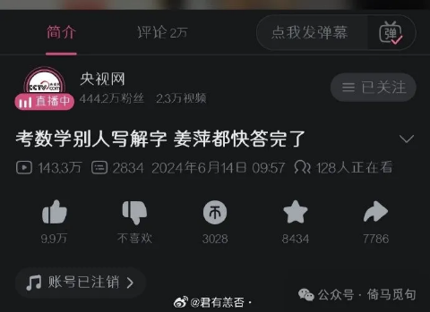
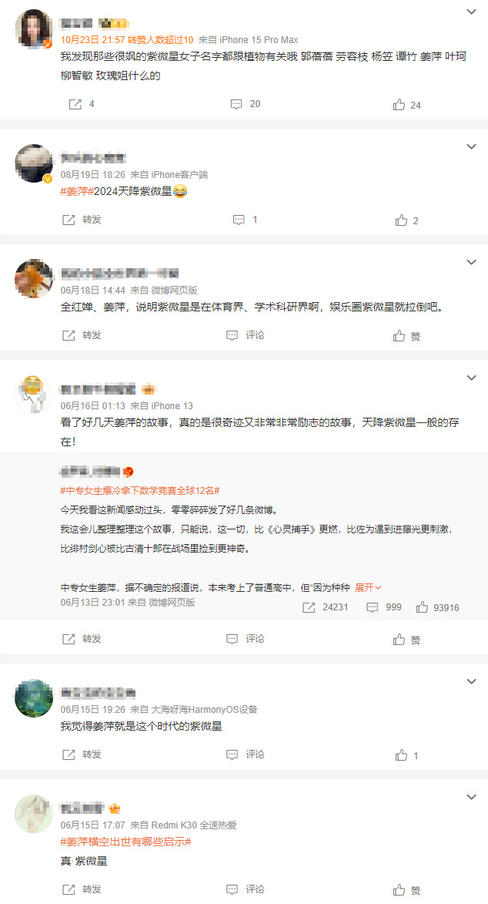
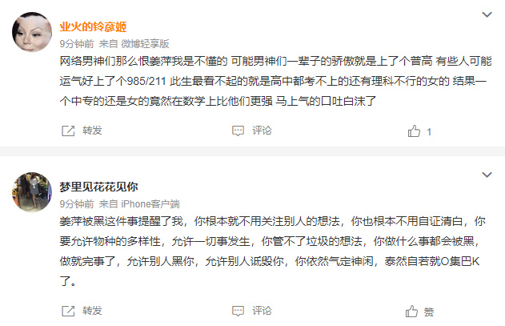
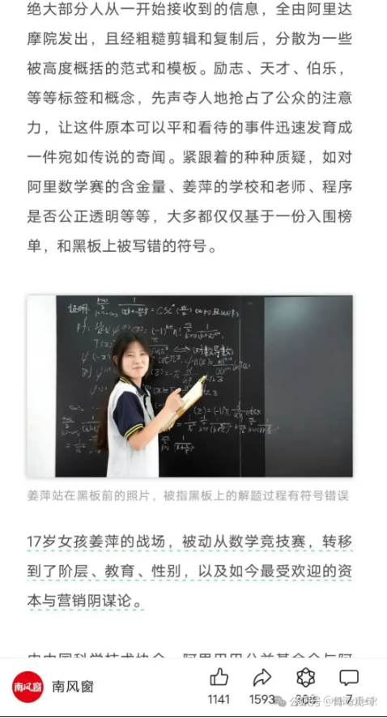
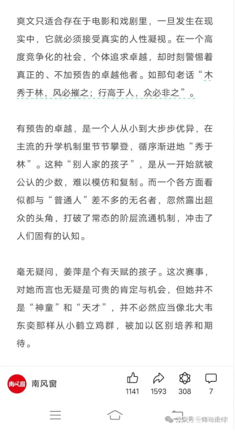
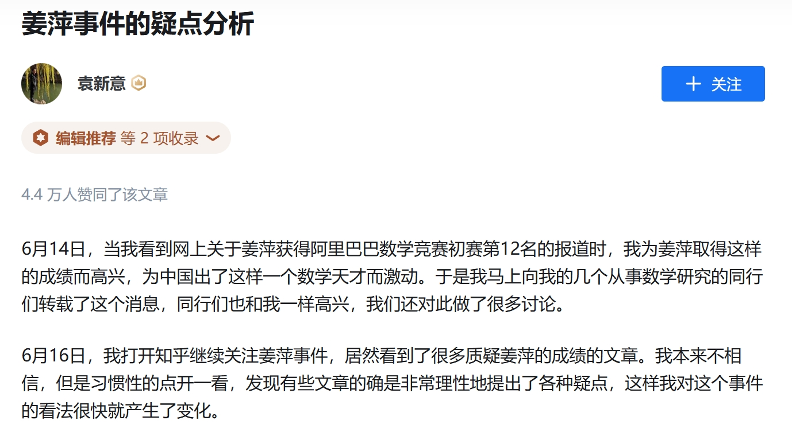
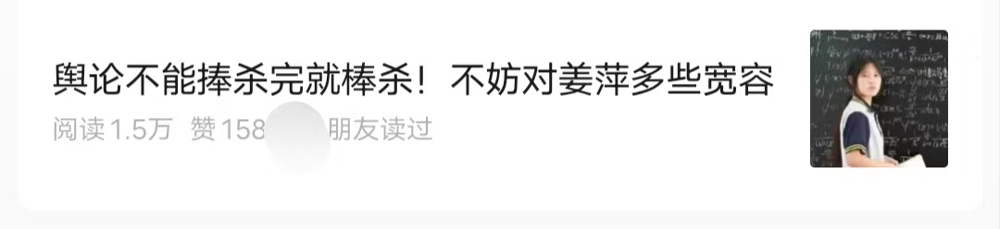

# 从姜萍事件中，普通人能够学到什么？

1 新闻的真实性只是一种追求和口号，而不是新闻的本性，新闻并不一定是真的，哪怕最权威的媒体也会犯错。

2 舆论能够反映人们的需求，但是舆论并不等同于事实。比如很多网民支持姜萍，愿意相信姜萍，只是因为这样的姜萍能够满足他们的某些想象。

3 有时候真相并不重要，大家关注热点，其实只是关注自己。一位疯狂支持姜萍的人，无非是想说明：女性是可以很牛逼的，中专生是可以很牛逼的，文科生是可以很牛逼的，农村人是可以很牛逼的，我也可以是很牛逼的。姜萍让他们充满力量，所以何必去扫他们的兴呢。

4 新闻归根到底是要满足需求：①满足媒体赚钱的需求；②满足统治者教化的需求；③满足读者获得真实信息的需求；④满足读者心理安慰的需求。知道了这些，可以在互联网时代有效避免高血压。

5 互联网时代信息普遍过剩，就像物质生产领域普遍存在的生产过剩、产能过剩一样。而过剩的信息又大多数是垃圾信息。学会筛选信息，是新时代网民的必备技能。

6 在当代各大互联网平台中，知乎的内容是最具参考价值的，在姜萍事件中，知乎最早发起质疑，且始终没有退缩，无数答主前赴后继不断顶着政治正确的压力挖掘细节。参考价值最低的是抖音，基本上全是剧本和蹭流量的。

7 现在通告公布，有些文章说：“舆论不能捧杀完就棒杀！不妨对姜萍多些宽容”。这种文章感情是热烈，但是价值为0。因为质疑姜萍的人一直在质疑，从来没相信过，更别提棒杀了，他们对姜萍本人也并没有恶意，都是就事论事。

其实相信姜萍的人都是很可怜的，因为他们对信息的分辨能力很差。他们能被姜萍的新闻欺骗，也会被其它新闻欺骗，每天被各大媒体耍得团团转。希望他们经过这次事件，能够吸取一些教训吧。

不过互联网是健忘的，比如现在还有几个人记得当年在“法国巴黎”“捡到”小学生“秦朗”寒假作业的猫一杯姐姐呢？——这件事情发生在今年2月，距今一年都不到。

每个人都要站在自己的角度看问题，从自身的需求出发，这是人之常情。政府要稳定，媒体要流量，观众要安慰——每年搞出几个乌龙事件，大家各取所需——姜萍事件会慢慢平息，但大家的需求不会彻底满足，所以类似的事件在以后还会不断发生。

> 转换说明：配图：第1、4–5、8幅暂沿用现图（指定资料目录未找到可靠且质量更好的无水印原件）。
