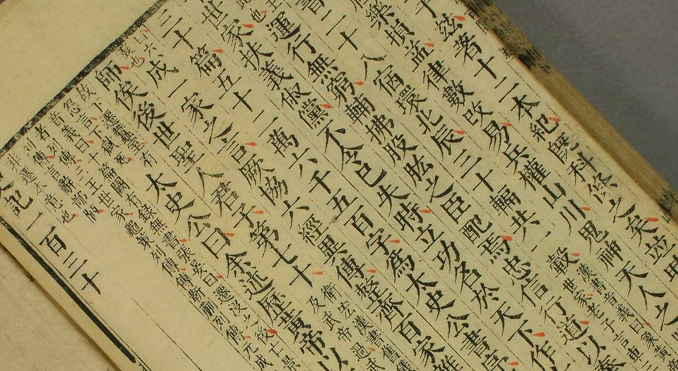
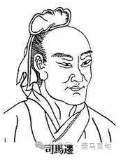
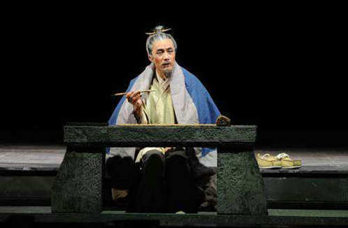

# 司马迁为什么能够写出《史记》？

太初元年（前104），司马迁开始动手著书，一直到征和二年（前91），《史记》全书终于完成。此书写作历时14年，共130篇，五十二万六千五百字，与《汉书》一起，既是后世“正史”的源头，又是最为雅正的中国古代文学经典，无愧鲁迅“史家之绝唱，无韵之离骚”的称号。

那么，司马迁是如何写出《史记》这部作品的呢？或者说，写作《史记》的条件是什么呢？本文将从五个方面进行分析，必能使你对这部作品拥有更深入的了解。

## 一 家族的传承

司马迁的父亲叫司马谈，是西汉时期的太史令。太史令这个官职，主要职责是掌管国家图书典籍、天文历算，并兼管文书和记载大事。在消息闭塞、信息流通缓慢的古代，这个职位可以让司马谈能够接触到当时最全的文献资料。

根据司马迁的说法，司马家的老祖宗就是搞历史记载的：颛顼任命“重”掌管天文，任命“黎”掌管地理，这两个人的职位是世袭的，一直到夏商时期。到了周宣王时期，重、黎的后人由于丧失职守，转为司马氏，司马氏世代掌管周史。

司马氏后来还有很多传承，例如，比较有名的有，和张仪论战并攻取蜀地的司马错，以及在殷地称王后来又归降汉王的司马昂。在汉代，司马氏也历代为官。但是，直到司马谈担任太史令，才算是重新继承起几百年前老祖宗的老活。

司马谈有两个重要成就，一是写作《论六家要旨》，大体介绍了战国时期阴阳家、儒家、墨家、名家、法家、道德家的主要观点和得失，全文收录在司马迁的《太史公自序》中；二是打算写一部通史，这是他毕生的事业。

可惜，司马谈还没有开始正式动笔，就命不久矣了。死前，司马谈握着司马迁的手，流着泪交代自己的遗愿。

> 余先周室之太史也。自上世尝显功名于虞夏，典天官事。后世中衰，绝于予乎？汝复为太史，则续吾祖矣。今天子接千岁之统，封泰山，而余不得从行，是命也夫，命也夫！余死，汝必为太史；为太史，无忘吾所欲论著矣。且夫孝始于事亲，中于事君，终于立身。扬名于后世，以显父母，此孝之大者。——《史记·太史公自序》

“我死以后，你一定会成为太史令；成为太史令后，千万不要忘记我想要撰写的著述啊！”

## 二 足够的眼界

司马谈死时，司马迁三十六岁；而在此之前，司马迁已经有了足够的眼界。

> 迁生龙门，耕牧河山之阳。年十岁则诵古文。二十而南游江、淮，上会稽，探禹穴，闚九疑，浮于沅、湘；北涉汶、泗，讲业齐、鲁之都，观孔子之遗风，乡射邹、峄；厄困鄱、薛、彭城，过梁、楚以归。于是迁仕为郎中，奉使西征巴、蜀以南，南略邛、笮、昆明，还报命。——《史记·太史公自序》

司马迁生于龙门，小时候在老家种田放牛。年仅十岁便已习诵古文。二十岁以后，司马迁开始游学天下。东边，他去过现在的河北、山东以及江浙沿海地区；南边，他去过湖南、江西、云南、贵州等地；西边，他到过陕西、甘肃、川西；北边，他到过长城附近。可以说，当时汉帝国统治的范围之内，除了几个新设置的郡县，司马迁几乎都去过。

在各地游历的过程中，司马迁做了非常详尽的调查研究。我们可以从史记原文中找到很多司马迁在各地游历的经历。

比如，司马迁提过他在魏国故都的所见所闻，听当地人讲魏国灭亡的情况：

> 太史公曰：吾適故大梁之墟，墟中人曰：“秦之破梁，引河沟而灌大梁，三月城坏，王请降，遂灭魏。”——《史记·魏世家》

比如，司马迁专门去山东临淄参观了孔子的旧宅，观看儒生练习礼仪，使他久久不想离开：

> 太史公曰：诗有之：“高山仰止，景行行止。”虽不能至，然心乡往之。余读孔氏书，想见其为人。適鲁，观仲尼庙堂车服礼器，诸生以时习礼其家，余祗回留之不能去云。——《史记·孔子世家》

比如，司马迁曾经登箕山（今河南登封市东南），看到了疑似许由的墓（传说尧想禅让给许由，但是被许由拒绝了）：

> 太史公曰：余登箕山，其上盖有许由冢云。——《史记·伯夷列传》

比如，司马迁曾经到北方边境，从直道返回，沿途考察了蒙恬修筑的长城和堡垒，感叹这样巨大的工程对百姓的损耗：

> 太史公曰：吾適北边，自直道归，行观蒙恬所为秦筑长城亭障，堑山埋谷，通直道，固轻百姓力矣。——《史记·蒙恬列传》

可见，读万卷书，行万里路，如果不是亲自到达过、调查过、实实在在地接触过祖国的大江南北，司马迁很难写出如此规模宏大的作品。

## 三 丰富的藏书

研究历史的人都知道，原始材料是多么宝贵。尤其是汉代以前，大部分文献都抄写在竹简上。一套书，可能全世界就只有这一套，没了就真的没了，再也找不到了。流行的书籍可能会抄写多套，但是在传抄和流传的过程中，很多书籍都会残缺。直到今天，版本学、校勘学和目录学，都是中国古代史研究的支柱。

在古代，很多有学问的人，其实都是拥有很多藏书。比如，老子就曾经担任过周朝管理藏书的官员；陆游是现在存诗最多的诗人，一个很重要的原因，就是他出身江南藏书世家；顾炎武也有很多藏书，他游历天下的时候，几匹毛驴拉了好几箱书，每次遇到和自己平生听到的不相符，就随时打开书验证。

所以，对当时的人来讲，没钱没势，是读不了书的——但是司马迁却恰好能读到当时世界上最全的书。

司马谈死后第三年，司马迁果然如父亲所言，继承了太史令的职务。作为太史令，他有机会看到许多史籍和藏书；汉代中央的文件、地方的行政报告，司马迁也都可以看到。

在没有造纸术和印刷术的时代，只有中央政府才有能力收集和收藏这么多资料，而且很多资料都是唯一的，所以当时的中央藏书对文化的重要性，甚至远远超过今天的国家图书馆、国家档案局。

可以说，正是太史令这个职务，使司马迁坐拥那个时代最丰富最全的文献资料。而这，正是写出那个时代最伟大的史书的必要条件。

## 四 坚定的理想

前面讲过，司马谈的遗愿，就是“无忘吾所欲论著矣”。而父亲的遗愿，也正是司马迁自己的理想。

司马迁非常尊崇孔子，尤其佩服孔子撰写了《春秋》（司马迁父子都坚信孔子著春秋）。对他而言，自己写这部史书，就是要达到跟《春秋》一样的效果。

那么《春秋》达到的效果是什么呢？

> 夫《春秋》，上明三王之道，下辨人事之纪，别嫌疑，明是非，定犹豫，善善恶恶，贤贤贱不肖，存亡国，继绝世，补弊起废，王道之大者也。…拨乱世反之正，莫近于《春秋》。《春秋》文成数万，其指数千。万物之散聚皆在《春秋》。《春秋》之中，弑君三十六，亡国五十二，诸侯奔走不得保其社稷者不可胜数。察其所以，皆失其本已。故《易》曰“失之毫厘，差之千里。”故曰“臣弑君，子弑父，非一旦一夕之故也，其渐久矣”。…故《春秋》者，礼义之大宗也。夫礼禁未然之前，法施已然之后；法之所为用者易见，而礼之所为禁者难知。——《史记·太史公自序》

> 《春秋》采善贬恶，推三代之德，褒周室，非独刺讥而已也。…汉兴以来，至明天子，获符瑞，建封禅，改正朔，易服色，受命于穆清，泽流罔极，海外殊俗，重译款塞，请来献见者不可胜道。臣下百官力诵圣德，犹不能宣尽其意。且士贤能而不用，有国者之耻；主上明圣而德不布闻，有司之过也。且余尝掌其官，废明圣盛德不载，灭功臣世家贤大夫之业不述，堕先人所言，罪莫大焉。余所谓述故事，整齐其世传，非所谓作也，而君比之于《春秋》，谬矣。——《史记·太史公自序》

这么多字，总结一下，就是：我希望我的史书能够像《春秋》那样，记录过去的事情，包括君王的得失、国家的兴亡、当代皇上的贤明、功臣的事迹；通过这些记载，后人可以引以为鉴，从而达到弘扬“礼义”的目的。

我们先不谈司马迁作为统治集团的一员，他的观点本身如何。重要的是，司马迁坚定地相信这一套价值观，这也正是他写作十几年、献祭一辈子的精神动力。

## 五 极致的屈辱

屈辱可能会让一个人沉沦，也可能会让一个人奋起。很幸运，司马迁面对屈辱并没有沉沦。

司马迁曾经和李陵共事，认为李陵为人正直、心系国家，有国士之风。所以，虽然他和李陵并没有很亲密的关系，但是，在李陵投降匈奴后，司马迁仍然为李陵说了几句好话。

没想到，汉武帝很生气，让司马迁下狱。第二年，汉武帝杀了李陵全家，处司马迁宫刑——这是一个非常耻辱的刑罚，对司马迁而言，是巨大的打击。

对当时的人来说，宦官是不被看得起的；在所有的刑法当中，宫刑是最让人受辱的。司马迁自认为才华和德行都没有什么问题，却因为一次失言而惨遭宫刑，感到无比羞耻，恨不得自杀：

> 太上不辱先，其次不辱身，其次不辱理色，其次不辱辞令，其次诎体受辱，其次易服受辱，其次关木索、被箠楚受辱，其次剔毛发、婴金铁受辱，其次毁肌肤、断肢体受辱，最下腐刑极矣！——《报任安书》

> 且勇者不必死节，怯夫慕义，何处不勉焉！仆虽怯懦，欲苟活，亦颇识去就之分矣，何至自沉溺缧绁之辱哉！且夫臧获婢妾，犹能引决，况仆之不得已乎？——《报任安书》

在经过一系列心理斗争后，司马迁选择苟活，选择带着屈辱活下去。想到过去的先贤在困境中仍然坚持下去，并且最终有所成就，而自己也有使命在身。如果能够完成这本史书，才算是死而无憾了：

> 人固有一死，或重于泰山，或轻于鸿毛，用之所趋异也。——《报任安书》

> 所以隐忍苟活，幽于粪土之中而不辞者，恨私心有所不尽，鄙陋没世，而文采不表于后也。——《报任安书》

历史上有很多享尽富贵的人，但他们最终什么也没有留下；还有一些人，虽然遭受苦难，却改变了历史，恩泽万世。每个人都有权利选择自己的一生，极致的屈辱面对崇高的理想，将变成最强劲的动力。司马迁的下述文字，不是用笔写成的，而是用血和泪写成的：

> 古者富贵而名摩灭，不可胜记，唯倜傥非常之人称焉。盖文王拘而演《周易》；仲尼厄而作《春秋》；屈原放逐，乃赋《离骚》；左丘失明，厥有《国语》；孙子膑脚，《兵法》修列；不韦迁蜀，世传《吕览》；韩非囚秦，《说难》《孤愤》；《诗》三百篇，大底圣贤发愤之所为作也。此人皆意有所郁结，不得通其道，故述往事、思来者。乃如左丘无目，孙子断足，终不可用，退而论书策，以舒其愤，思垂空文以自见。——《报任安书》

> 仆窃不逊，近自托于无能之辞，网罗天下放失旧闻，略考其行事，综其终始，稽其成败兴坏之纪，上计轩辕，下至于兹，为十表，本纪十二，书八章，世家三十，列传七十，凡百三十篇。亦欲以究天人之际，通古今之变，成一家之言。草创未就，会遭此祸，惜其不成，是以就极刑而无色。仆诚以著此书，藏之名山，传之其人，通邑大都，则仆偿前辱之责，虽万被戮，岂有悔哉！然此可为智者道，难为俗人言也！——《报任安书》

