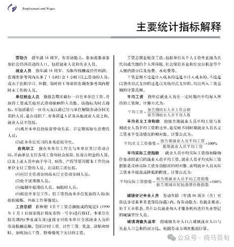
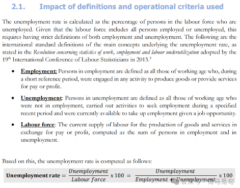
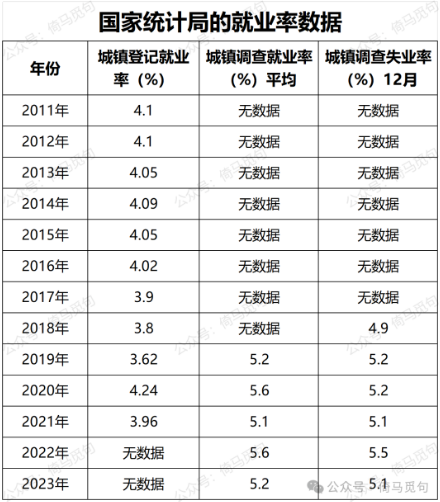
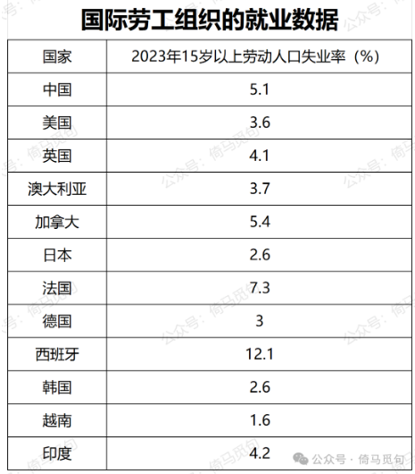
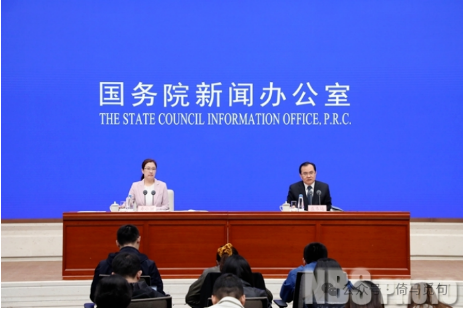

# 当前的就业形势究竟如何？基于国家统计局的数据

国家统计局对“就业人员”和“就业率”的定义，涵盖的范围是很广的。简单讲，如果你一周打了一个小时零工，你就不算失业；你在学校读书，你不算失业；单位停工三个月以内，你也不算失业；你主动辞职，说明你有就业能力而没有就业意愿，那也不算失业。

据说，这样的定义跟国际劳工组织的定义是一致的，是和国际接轨的，是国际可比的。

如果定义的标准确定，统计的方法一致，那么这样按照相同标准统计出来的数据，是能够反映出当前的就业形势的，至少能反映出趋势。

我们先来看中国历年的失业率数据。中国从2018年4月起，每月定期发布城镇调查失业率。此后每年《中国统计年鉴》的“城镇调查失业率”，实际上都是12月的城镇调查失业率，而不是全年均值，直到2024年发布的统计年鉴，才公布了全年均值。

以下是我整理出的官方公布的失业率统计数据。

可以看出，2020年和2022年，是我国就业形势最差的两年。2023年，总体形势有所好转，但是仍然不如2019年和2021年的就业形势。从12月的数据看，2018年是就业形势最好的一年，再往前，就难以比较了。

我又整理了国际劳工组织（International Labour Organization）的数据，看看其他主要国家2023年的失业率情况：

可以看到，中国的失业率确实偏高，但仍然处于可控范围以内。而且，虽然统计标准相同，但不同国家的统计方法和统计过程有所差别，所以数据仅供参考。

那么，今年中国的就业形势如何呢？

10月18日，国务院新闻办公室就2024年前三季度国民经济运行情况举行了新闻发布会。

关于就业问题，国家统计局副局长盛来运说：

> 就业总量虽然有压力，但是就业形势总体稳定。前三季度城镇调查失业率是5.1%，一季度是5.2%，二季度是5.0%、三季度是5.2%，总体是比较平稳的。三季度比二季度高一点，主要是受7月份、8月份大学生毕业季的季节性影响，但是总体上是稳定的。为什么我们国家就业形势总体是稳定的？除我刚才讲的各级党委政府高度重视就业，就业政策力度比较大以外，还有我们的制度优势以及基本面的影响。

一般来讲，第四季度的失业率会比全年平均失业率更低，所以结合以往数据可以推断，今年的就业形势，是2019年以来最好的。当然，也没有好太多，离2018年还有差距。

从基本面的角度讲，盛来运指出三点有利于就业稳定的因素：①经济在持续增长，所以对劳动力的需求也会增加；②服务业占GDP的比重在不断上升，而服务业大多是劳动密集型产业，吸纳就业的能力比较强；③人口结构变动，从2013年到去年，这十几年中间，我国平均每年16-59岁劳动力资源数量净减少500-600万左右，去年净减少约一千万人。

**总之，就业市场供给在减少，需求在增加，所以未来的趋势，就是就业稳定。**

为什么要强调稳定呢？因为在市场经济下，失业率太低也同样不利于经济发展。如果失业率太低，缺少“产业后备军”，企业的用工成本就会上升，就会面临经营困难。

目前中国的就业形势，最大的问题是“就业结构性矛盾突出”，青年就业率低，制造业招工难。盛来运说：

> 另外一个问题是就业结构性矛盾比较突出。一方面是青年就业压力比较大，失业率还偏高，另一方面，制造业存在招工难的问题，尤其是一些制造业一线的技工还是供不应求。所以，结构性矛盾是劳动力市场一个很重要的特点。

我认为这和我国的高等教育有很大关系。高等教育扩招名额太多，学校里养了太多学生，很多学生做着无意义的功课，学校教学内容和市场需求并不匹配，体制内又无法容纳那么多的研究人员。所以这方面或许还有改进的地方。

对于普通青年来讲，这些数据给我们的启发就是：不要完全跟着学校走，要根据就业市场的现实情况，有针对性地培养自己的技能，培养被市场认可的能力。如此一来，毕业以后才能把自己“卖个好价钱”。
