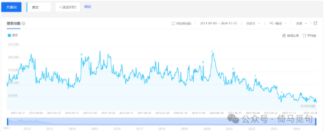
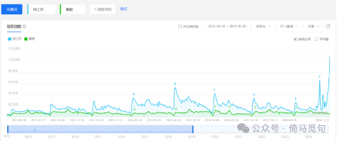
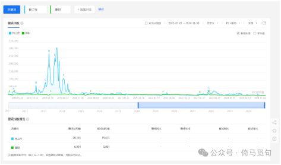
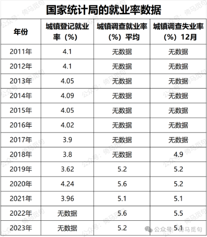
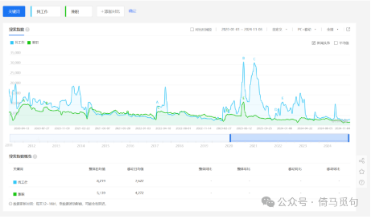
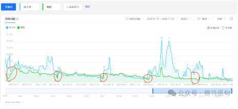
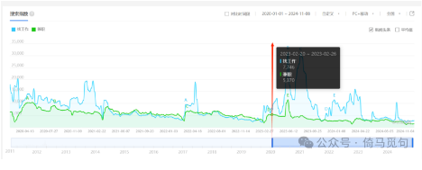
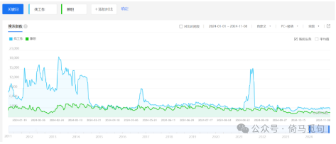
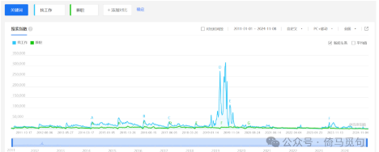

# 当前的就业形势究竟如何？基于百度指数平台的视角

百度指数是以百度海量网民行为数据为基础的数据分析平台，我们可以从百度指数中找到很多信息，尤其是可以通过各种关键词的搜索量和搜索变化，看出背后的社会需求。

当今的就业形势究竟如何？我们可以看官方统计、媒体报道或者统计周围人的就业情况。除此之外，百度指数平台也可以作为一种参考。本人前两天已经分析过官方统计局的失业率数据，本文将分析百度指数平台所反映出来的当前就业形势。

首先，为了验证百度指数平台每年数据的稳定性，我以“美女”为关键词，截取了2011年1月1日至2024年11月1日的数据。可以看出“美女”的搜索量，在2022年以后有所下降，2023年以后又下降了很大一截，在以前比较稳定。

由于中国男人的性压抑是稳定的，稳定了几千年，所以可以判断，总体来讲，中国网民在2022年以来，尤其是2023年以来，对百度的使用量下降了——也许是两年来大家习惯了使用其他搜索引擎。

现在再来分析就业情况。

我选择了两个关键词，“找工作”和“兼职”。我们先来看2011年1月1日-2019年1月1日的数据，选择这段时期是为了找到人们对就业需求的年际和年内规律，因为这段时期是不受疫情影响的。

从中可以看出非常明显的周期性，我的分析如下：

1 每年“找工作”的搜索高峰期是二月，顶峰有时是二月初，有时是二月末，大概是过年期间；次高峰是七月初，对应毕业季和暑假开始的时间。

2 在2011年-2018年期间，就业形势最差的年份是2014年、2015年和2016年，因为这三个年份的峰值明显高于其他月份。

3 “兼职”的走势总体上和“找工作”差不多，但是过年期间的高峰并不明显，它的顶峰出现在每年7月初。可知暑假开始是兼职工作需求最高的时期。

4 “找工作”和“兼职”的低谷，都是每年二月左右，也就是过年前。可以推测这个时期大家都要回家过年了，找工作的需求降低……但是过完年以后又忙着找工作了。

以上。

现在我们再截取2018年1月1日-2024年11月8日的时间段。这样截取是为了将2018年比较有规律的时间段放进来，和疫情时期、疫情后时期做个对比。另外，补充一下，2019年12月武汉发现的疫情逐渐开始引起关注，2023年2月23日，国家卫健委表示疫情已经基本结束，这两个时间点供大家作为参照。

可以看到，2018年9月-2019年9月之间，关于“找工作”的总体搜索量非常高，其增加的幅度让每年的周期性变化都变得不算什么了。可是，当时疫情还没有开始啊！这是为什么呢？

我在上一篇文章分析了官方的失业率信息，得出结论是：

> 可以看出，2020年和2022年，是我国就业形势最差的两年。2023年，总体形势有所好转，但是仍然不如2019年和2021年的就业形势。从12月的数据看，2018年是就业形势最好的一年，再往前，就难以比较了。

或许存在这样一种可能：2018年年末开始，中国的失业率就有上升的趋势，到了2019年，就业率已经非常差，到了2020年，疫情时期，国家通过加强疫情管控的方法，稳定了行将崩溃的失业率。

也就是说，不排除这样一种情况：我国通过疫情，消化了一次经济危机。换句话说，就算没有疫情，经济危机也是要来的，经济也是要下行的；而我国通过疫情这个契机，加强了政府对经济的把控能力，让我们没有感受到这场经济危机。

当然，这些只是猜测，具体情况如何，还需要未来的进一步研究！

现在，我们再截取2020年1月1日-2024年11月8日这个时间段。这样可以抛开2018年-2019年那段高峰，使我们更细致地看到最近几年的变化。

首先可以看到，虽然总体上比较散乱，但是每年年前的低谷，还是较为明显的（除了2024年），这段时期，是人们找工作需求较低的时期。

然后，我们再以2023年2月23日为轴，画一条分界线，将这张图分为疫情前和疫情后两个时期。补充一下，2023年2月23日是当年的大年初四，也是卫健委宣布疫情基本结束的时间。

可以看到，在疫情前的2021年和2022年，搜索量是比较有规律的，和以往的情况（2011年-2017年）差不多。2020年不稳定，可能是出现了几次失业潮，但也远比2018年9月-2019年9月好。2023年也不稳定，应该是刚刚放开，大家不用待在家里，就集中地找工作了。

其中2023年5月初和7月初，出现了“找工作”搜索量的两个顶峰。这段时间应该是疫情后就业压力最大的时间段。

2024年的春节是2月10日，但是这个时间段前后，却都是“找工作”搜索的高峰期，一直到今年3月底，才平复下来。此后又有两个小高峰，分别是5月10日左右和8月20日左右，之后的数据就比较平稳了。

从搜索量来说，今年年初到3月底，搜索量是比较高的，但远比不上2020年和2023年的搜索量。今年3月底以后，“找工作”的搜索量就很低了，即使算上两个小高峰，也可以说是最近几年最低的时期。

以上是具体分析。下面我总结一下我的分析和推断：

1 2011年-2018年9月，“找工作”搜索量的趋势具有明显的规律：①年前是最低点，年后是最高峰，7月初有一个次高峰。

2 2011年-2018年期间，就业形势最差的年份是2014年、2015年和2016年。

3 2018年9月开始，人们对找工作的需求突然增加，这个高峰一直持续到2019年9月，这可能是失业潮导致的，这可能是经济危机爆发的预兆。

4 2019年12月，中国进入疫情时代，其中2020年人们对找工作的需求最高，2021年和2022年相对稳定，2023年2月23日，中国基本结束疫情时代，随后一年人们对就业的需求也非常高。

5 今年年初，中国人民找工作非常积极，一直持续到3月末。（下图是今年的数据）

6 今年3月以来，“找工作”的搜索量下降，平均水平为近年来最低。5月10日左右和8月20日左右出现两个小高峰，原因不明，但不影响大局。（下图是2011年1月1日以来的数据）

以上。

我声明一下，这种分析方法肯定是不科学不严谨的，它只能给我们提供一个辅助的视角。但是，也许我们收集了更多材料以后，就能更准确地理解这些数据的含义了。

目前为止，虽然百度指数的数据和官方统计的数据有所出入，但我们根据已有材料，至少可以推断出，当前的就业形势仍然是稳定的，并且有持续向好的趋势——我认为这个结论至少比那些贩卖焦虑的无良媒体要可靠一些。

大家对此有什么看法？欢迎评论！

-END-

这是一个能涨知识的公众号，关注我，阅读更多有趣文章～

相关文章推荐：

当前的就业形势究竟如何？基于国家统计局的数据

中国官方的失业率是怎么统计出来的？参考价值有多大？
