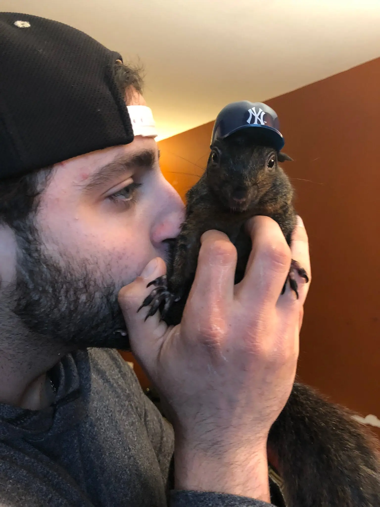
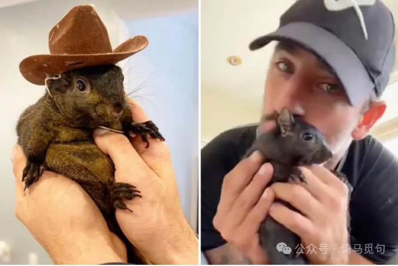
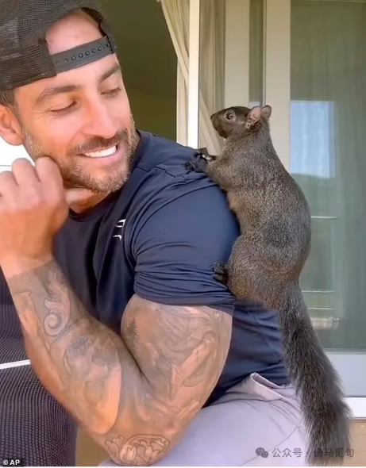
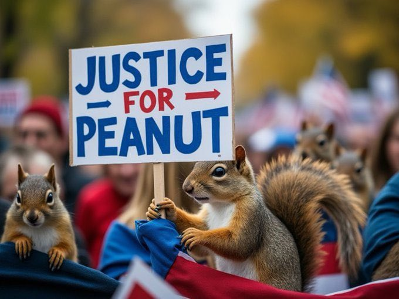
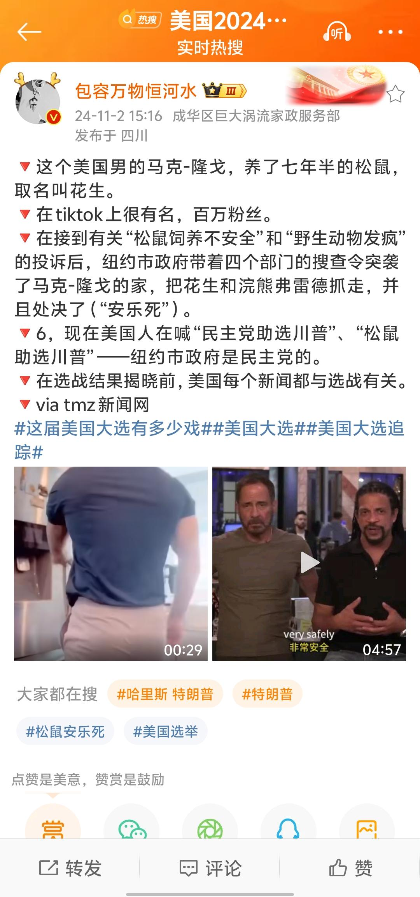
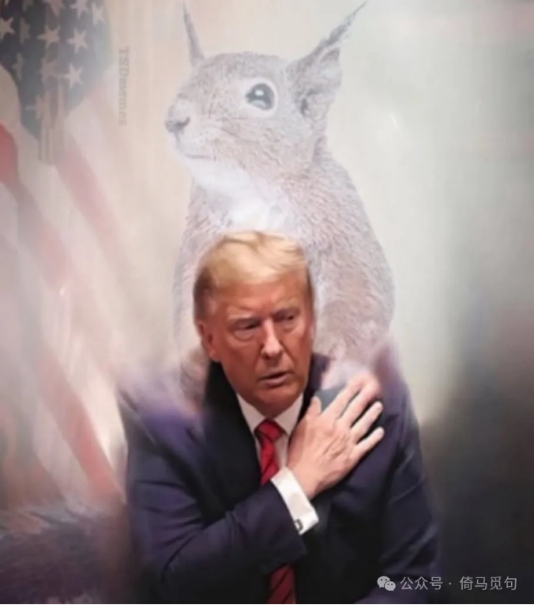
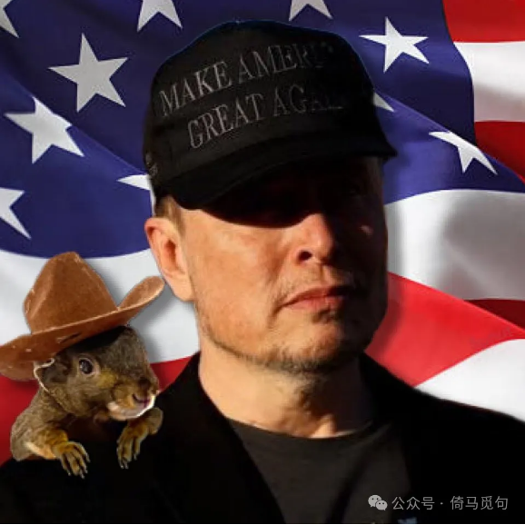
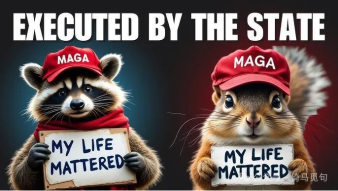
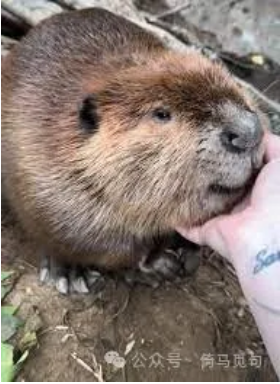
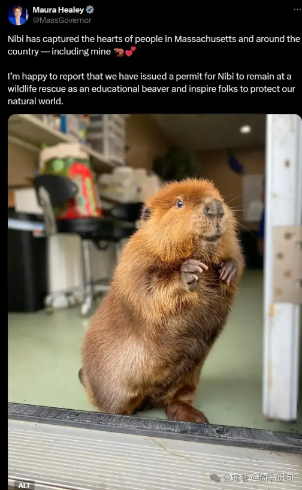

# 不要低估一只松鼠的力量

国外有一位很有名的大V，名叫马克·隆格（Mark Longo），他养了一只小松鼠，名叫“花生”（P'Nut）。这只宠物深受网民喜爱，是一只当之无愧的“网红鼠”，在今年10月，他们的Instagram上有50万粉丝。

2017年，27岁的马克在纽约曼哈顿市中心开车，碰到了这只小松鼠，当时小松鼠的母亲被车撞死了，小松鼠还非常小，眼睛都没完全睁开。

小松鼠爬到马克腿上，马克给它取名为“花生”，并把它带回家。

花生在马克家待了一段时间后，被马克在后院放生。但没过几天，花生就跑回来了，还失去了半条尾巴。

马克认为花生在自己家里或许会更安全，于是花生就在马克家里住下了，这一住就是七年。这期间，马克为花生开了Instagram账号，吸引了大量粉丝，甚至还因为这个账号认识了现在的妻子。

今年四月，他们还一起开了一家非营利组织，搞了一个很大的保护区，收养了300多只动物，有“猫、狗、马、山羊、绵羊、驴和猪”。保护区的资金，一半来自他们的社交媒体公司，另一半由捐助者提供。

转折发生在今年的10月30日。那天，纽约州环境保护局从马克在纽约州希芒县派恩城的家中，搜寻5小时后带走了花生和一只小浣熊。因为按照纽约州的法律，野生动物是不可以被饲养的。

第二天，花生和浣熊就被执行了安乐死，理由是它们咬伤了工作人员，工作人员为了验证它们有没有狂犬病毒，就必须要先搞死它们……

这件事情立即在美国激起巨大反响，有很多人表示抗议，甚至在中国互联网上引起轩然大波。

（这条国内热搜有很多错误，比如故事发生在纽约州，而不是纽约市。）

由于纽约州是深蓝州，州长是民主党人，因此，这件事被共和党充分利用，很大程度上影响了网民的感情倾向，被一些人称为“压死民主党的最后一根稻草”。

特朗普和小松鼠

马斯克和小松鼠

小松鼠和小浣熊

这个故事告诉我们，千万不要低估一只松鼠的力量！

事实上，马萨诸塞州也有一只网红鼠，叫尼比（nibi），由于这只海狸鼠很亲近人类，不适合在野外生存，但它又是野生动物，饲养野生动物不符合当地法律，跟小花生的情况差不多。

为了妥善处理这件事情，州议员给州长写信，法庭还搞了听证会，经过讨论，最终由马萨诸塞州的州长亲自给尼比发了一个“教育动物”的牌照，使它得以和人类生活在一起。

马萨诸塞州也是深蓝州，州长也是民主党人，他们能够妥善处理这件事，为什么到了纽约州就不行了呢？对一个有50万粉丝的宠物执行安乐死，竟然一点后果都不考虑？而且之前七年都不管，为什么现在突然就要查野生动物了呢？

有人说是因为马克·隆格支持共和党，所以被民主党的人突击执法……不知道这种说法真实性如何。不过这都不重要了，大选前，任何事情都可能被借题发挥，民主党算是自食其果。

一只松鼠搞得民主党陷于被动，虽不是决定性因素，但也确实在很大程度上影响了大选结果，真是令人感慨。

大家对此有什么看法？欢迎在评论区讨论。

> 转换说明：配图：第2–3、6–10幅暂沿用现图（指定资料目录未找到可靠且质量更好的无水印原件）。
