# 考据：美国的识字率真的只有79%吗？

## 一 “79%”的说法是如何产生的？

中文互联网上有一种说法，“美国的识字率只有79%”，据说这个数据是联合国和美国官网的数据。

那么，这种说法为什么能够广为流传呢？

主要是两位权威人士的宣传，一位权威人士是中国的一位外交官华春莹女士，她于2023年8月7日发了一个推特，该推特对比了中国和美国七十年来识字率的变化，其中中国1949年识字率是20%，2022年是97%；美国1950年识字率超过90%，2022年是79%。

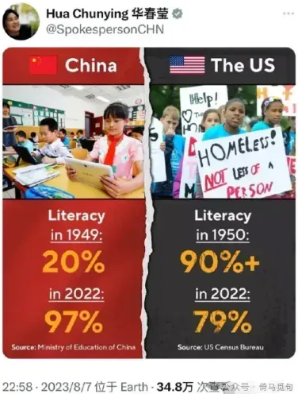

还有一位权威人士是远方青木，他在2024年6月14日发表的文章《美国文盲率21%，这是联合国和美国的官方公开数据》（时间可能更早，因为他公众号经常会发一些看不见的老文章），这篇文章影响力非常大，大到现在你问各大AI“美国的识字率是多少”，AI都会引用这篇文章。

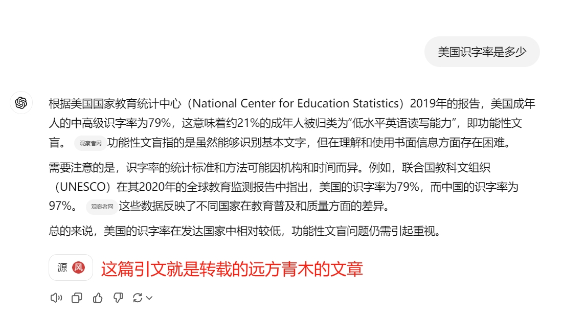

关于美国识字率为79%的说法，还有很多其他文章，但究其本源，这个热度还是华女士和远方青木带起来的。

华女士和远方青木当然是很权威、很严谨的。但他们太有名了，写文章发东西要考虑很多政治因素，有时无暇考据各种数据的来源。

鄙人才疏学浅，人微言轻，说话不必顾忌太多，就来努力考证一下这个问题，做一个学术性的探讨吧。

## 二 联合国关于识字率的标准和数据

青木的文章说：

> “首先这一数据的信源为联合国科教文组织公开发布的《2020年全球教育监测报告》，其内容显示2018年中国的文盲率为3%，美国是21%。”

我从联合国官网下载了这份报告，英文名叫Global Education Monitoring Report(2020)。

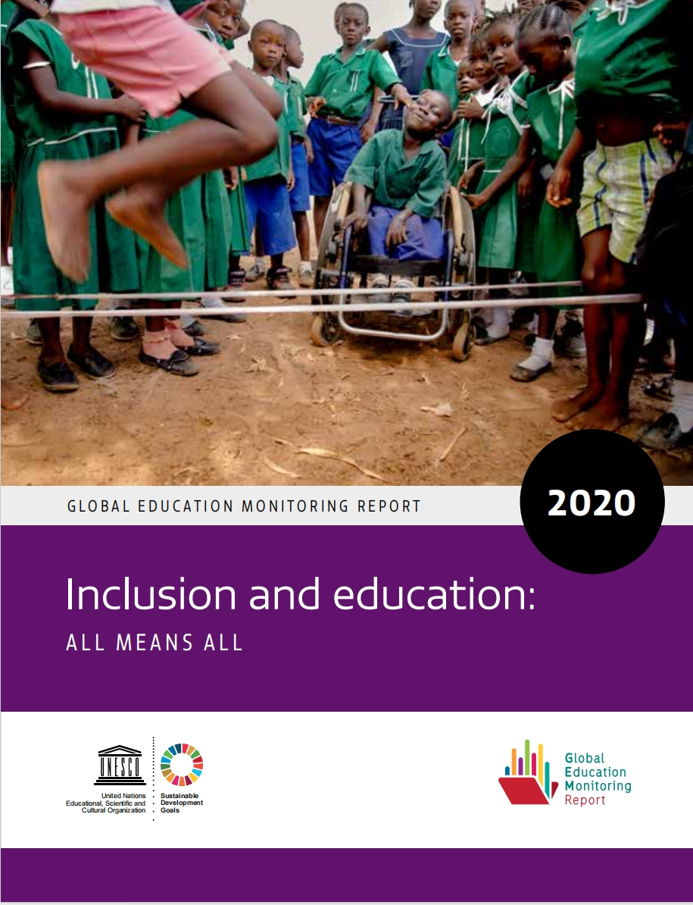

然而我们并没有找到美国的识字率数据，也就是说，这份文件的识字率统计把美国排除在外了。而且不但美国没有数据，“欧洲和北美”下面的国家列表中，一半都没有数据，其他国家识字率也都在95%以上。

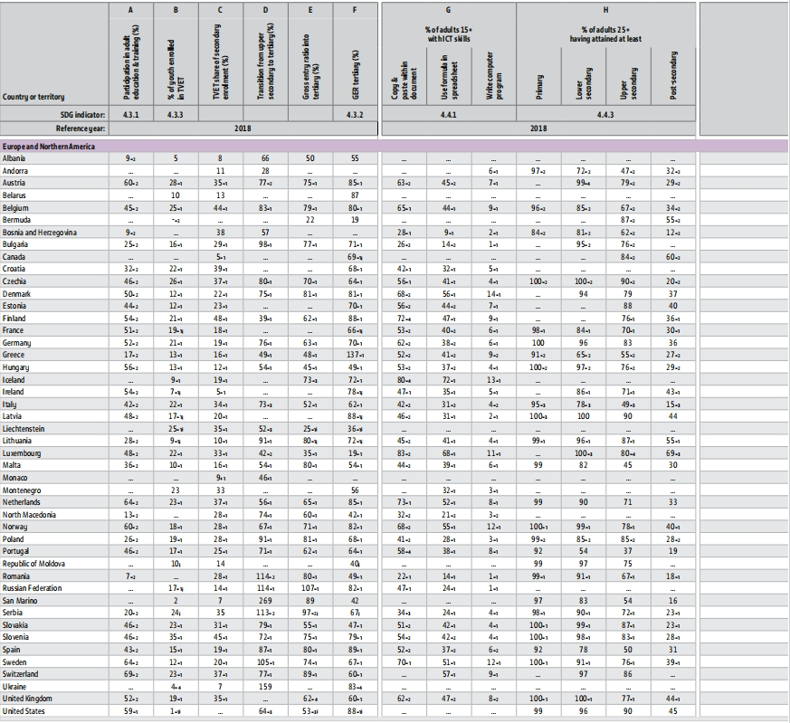

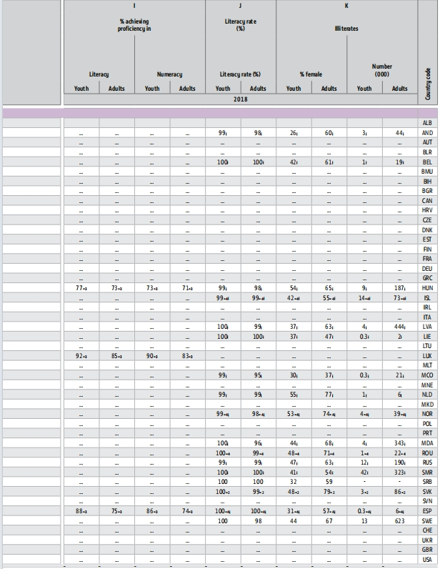

在这份报告中，印度的青年识字率是92%，成人识字率是74%；中国的青年识字率是100%，成人识字率是97%；全球平均识字率，青年是92%，成人是86%。（截图就不截了，字太小，而且分布在两页，需要原始材料的读者可以私信我。）

那么，为什么这份报告没有收入美国的数据呢？有两种可能：

①联合国更关注发展中国家的教育情况，在数据收集上更优先发展中国家；

②联合国为美国遮丑，故意不收录美国的数据。

显然，第一种可能更符合事实。

我找到了联合国的另一份文件，叫《识字率一代比一代持续提高》。

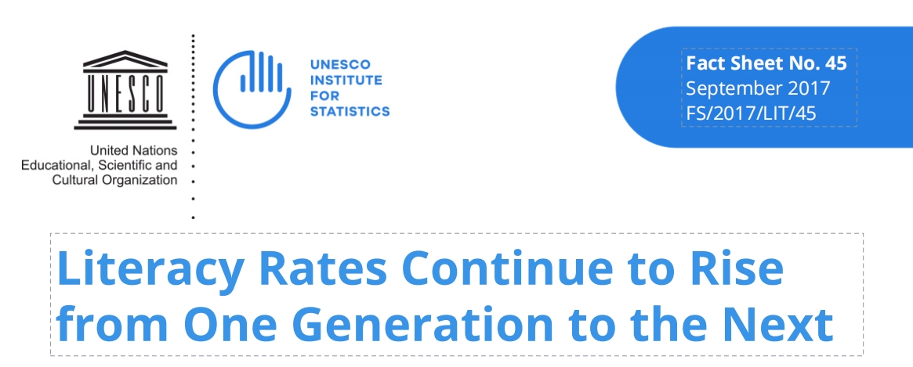

这份文件有一个识字率地图，可以看到，识字率低的地方主要在非洲和南亚，其他地区识字率都普遍很高，而欧洲、大洋洲和美洲，则压根没有数据。

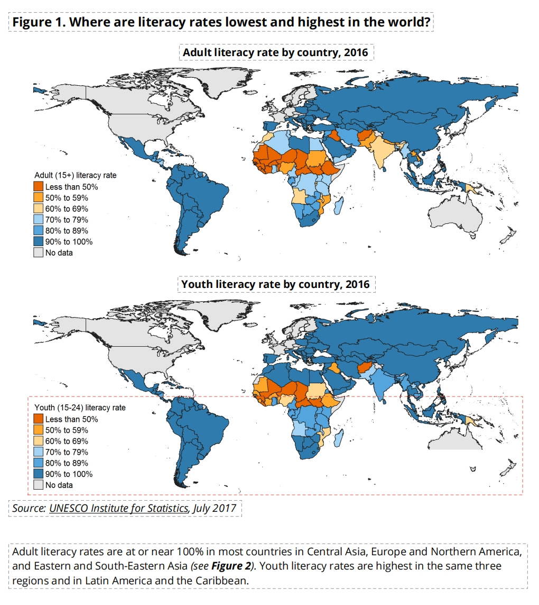

这个识字率地图的下面有一行字，明明白白地写着：

> Adult literacy rates are at or near 100% in most countries in Central Asia, Europe and Northern America, and Eastern and South-Eastern Asia (see Figure 2). Youth literacy rates are highest in the same three regions and in Latin America and the Caribbean.

翻译过来就是：

> 成年人的识字率在中亚、欧洲、北美，以及东亚和东南亚的大多数国家达到或接近100%（参见图2）。青少年的识字率在上述三个地区以及拉丁美洲和加勒比地区最高。

两个信息对比，言下之意就是：按照联合国的标准，欧洲、北美、澳洲这些地区的国家，识字率达到或接近100%是不言自明的，所以不需要再耗费资源对这些国家进行识字率调查了。

所以，到这里就可以确定，美国识字率79%，采用的标准和中国97%的识字率标准，显然是不一样的，拿这两个数据进行对比，是没有意义的。

那么联合国对识字率的标准是什么呢？

说实话，这个简单的问题，并不容易回答。因为识字率本就是很难统计、又很费钱的项目。

联合国教科文组织统计研究所（UIS）的网站上写着：

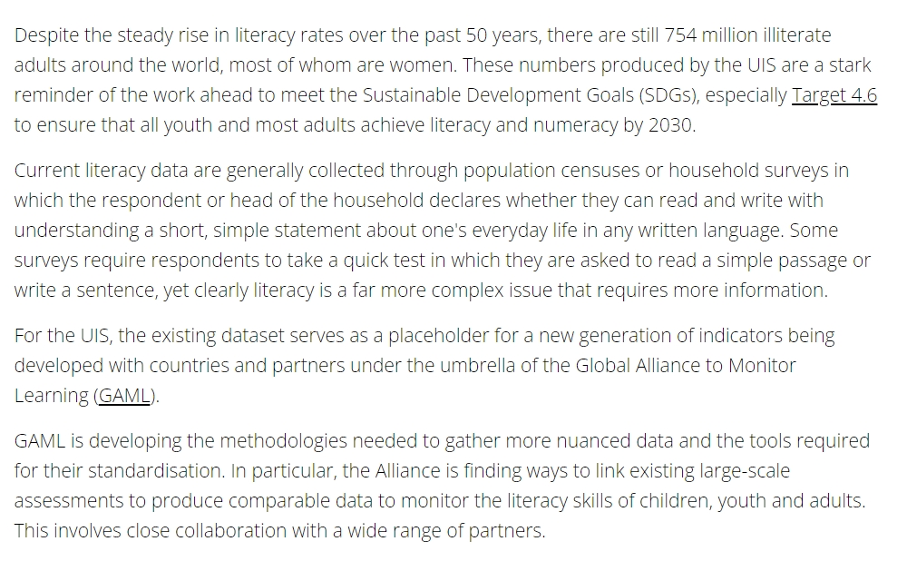

> 尽管过去50年来全球识字率稳步上升，但目前世界上仍有7.54亿成年人是文盲，其中大多数是女性。这些由联合国教科文组织统计研究所（UIS）提供的数据，明确提醒我们，为了实现可持续发展目标（SDGs），尤其是目标4.6（到2030年确保所有青年和大多数成年人掌握读写和计算能力），还有许多工作要做。

> 当前的识字数据通常通过人口普查或家庭调查收集。在这些调查中，受访者或户主需要声明自己是否能够用任何一种书面语言理解并书写关于日常生活的简短陈述。一些调查会要求受访者进行快速测试，例如阅读一段简单的文字或写一句话。然而，很明显，识字问题远比这些测试反映的情况复杂，且需要更多的信息。

> 对于UIS而言，现有的数据集只是一个临时解决方案，作为正在与各国及其合作伙伴共同开发的新一代指标的基础。这些工作是在全球学习监测联盟（GAML）的框架下进行的。

> GAML正在开发收集更细致数据的方法学，以及实现数据标准化所需的工具。特别是，该联盟正在寻找将现有的大规模评估连接起来的方法，以生成可比较的数据，用于监测儿童、青年和成年人读写技能的发展。这需要与广泛的合作伙伴进行密切合作。

说了这么多，总结一下就是：只要能用任何一种语言阅读一段文字，或者写一句话，就算是识字了。但是现在的统计方法恐怕并不科学，也不那么统一，所以仅供参考。

实际上，关于识字率的判定是非常复杂的，因为语言本来就是复杂的东西，对语言的掌握也分程度。联合国还有一个“识字评估和监测计划（LAMP）”的标准，将识字能力划分为五个等级，这里就不详细介绍了。

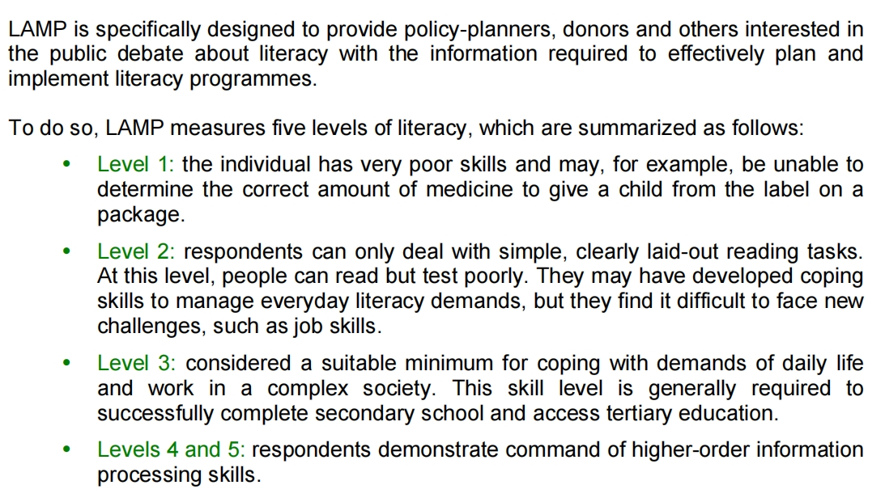

但有一点可以确定，联合国的“识字率”标准是很低的，按照它的标准，中国年轻人全部识字，发达国家也几乎全部识字。联合国搞这个统计，主要是为了促进教育和教育平等，也就是实现他们的可持续发展目标（SDGs）的第四个目标：确保有教无类、公平以及高品质的教育，及提倡学习，识字率只是这个目标中的第六个小目标而已（4.6：到2030年确保所有青年和大多数成年人掌握读写和计算能力）。

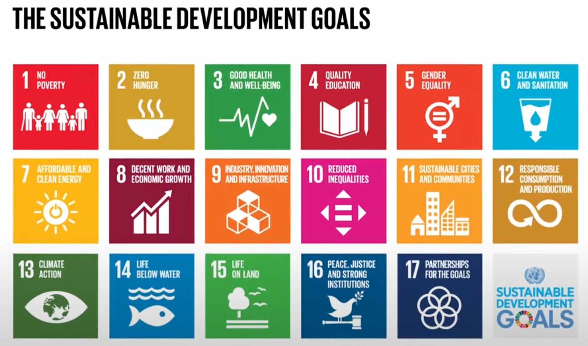

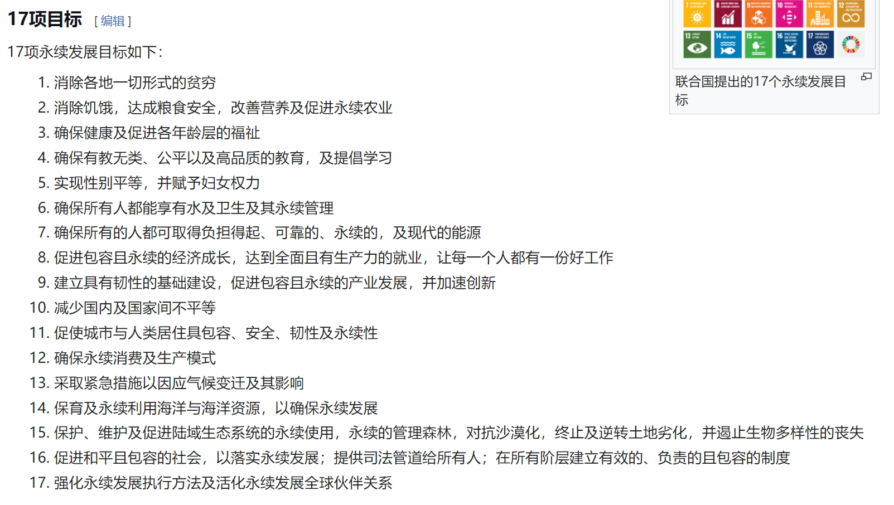

小节一下：在联合国近年来的统计数据中，美国和其他发达国家一样，其识字率并没有被统计出来，因为按照联合国的标准，美国等发达国家的识字率达到或接近100%是不言自明的，因此，美国识字率只有79%的说法另有来源，这个79%的识字率跟联合国统计的其他国家的识字率数据是无法比较的，因为标准完全不一样。

## 三 美国官方关于识字率的标准和数据

那么，美国识字率为79%的说法到底来自哪里呢？

青木的文章说：

> “美国教育部和国家扫盲研究所在2013年发布过一项调查，称美国“14%的成年人（约3200万人）无法正常阅读，19%的高中毕业生不识字，21%的人阅读能力低于五年级要求的水平”，并且“近几十年来，美国的文盲率一直非常稳定”。”

如果不太纠结字句的话，这个数据四舍五入应该算是正确的。

我找到了美国教育科学研究所（IES）国家教育统计中心（NCES）的网站。

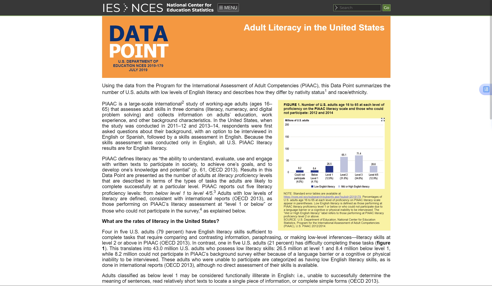

可以看到这个数据的来源：

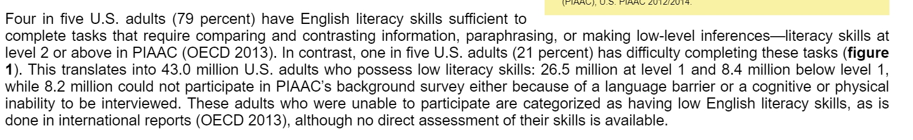

> 美国五分之四的成年人（79%）具备足够的英语识字技能，能够完成需要比较和对比信息、改述内容或进行低水平推断的任务——这些技能相当于PIAAC中的2级或以上水平（OECD 2013）。相比之下，每五名美国成年人中就有一人（21%）在完成这些任务时存在困难（见图1）。这相当于4300万美国成年人识字能力较低：其中2650万人处于1级，840万人低于1级，而820万人因语言障碍或认知或身体原因无法参与PIAAC的背景调查。这些无法参与调查的成年人被归类为英语识字能力较低群体（按照国际报告的做法，OECD 2013），尽管没有对其技能进行直接评估。

> 被归类为低于1级的成年人可能被认为是英语功能性文盲：即，无法成功理解句子的含义，无法通过阅读较短的文本找到单一的信息，或者无法填写简单的表格（OECD 2013）。

OECD是经济合作与发展组织，简称经合组织，这个网站引用的都是经合组织2013年的数据。

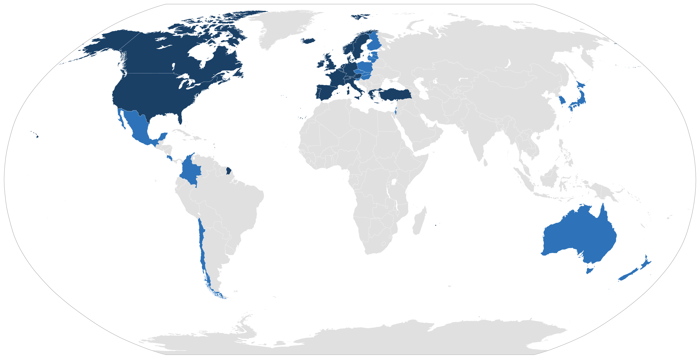

PIAAC全称“国际成人能力评估项目”，是在经合组织的协调和支持下，由经合组织的参与国制定的一项针对劳动年龄成年人（16至65岁）的国际大型研究，评估他们在三个领域的技能（识字、计算能力和数字问题解决能力），并收集有关成人教育、工作经验及其他背景特征的信息。

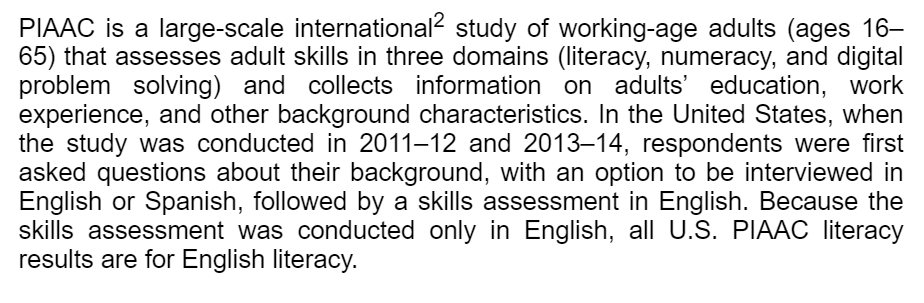

PIAAC将识字能力划分为五个等级：从低于1级到4/5级。而把这个标准的1级及1级以下的人视为“文盲”，1级以上的人视为“识字”，那么21%的文盲率和79%的识字率，就出来了。

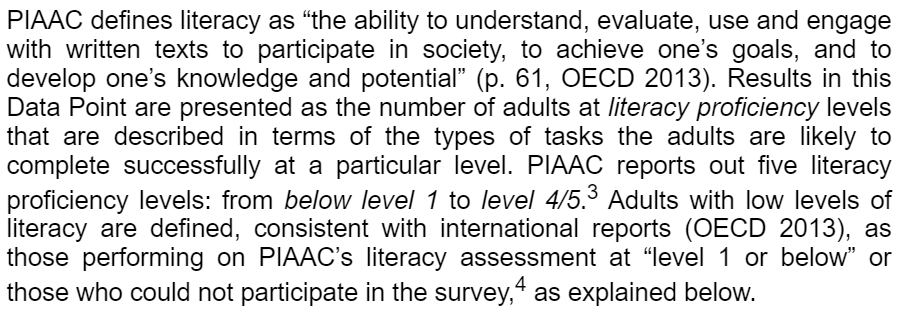

现在我们来看看这些“文盲”的水平如何。

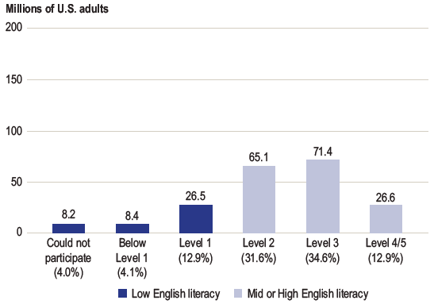

这21%人中，有4%的人无法参加测试，原因是“语言障碍或认知或身体原因”，也就是残疾人。2010年发布的全国残疾人口数据估计，中国残疾人总人数约为8,502万，占总人口比例6.34%。所以美国有4%因为残疾无法参加评估测试，我认为这个比例是正常的。

这21%人中，有4.1%的人低于PIAAC的1级水平，我找到了PIAAC的样题PPT。

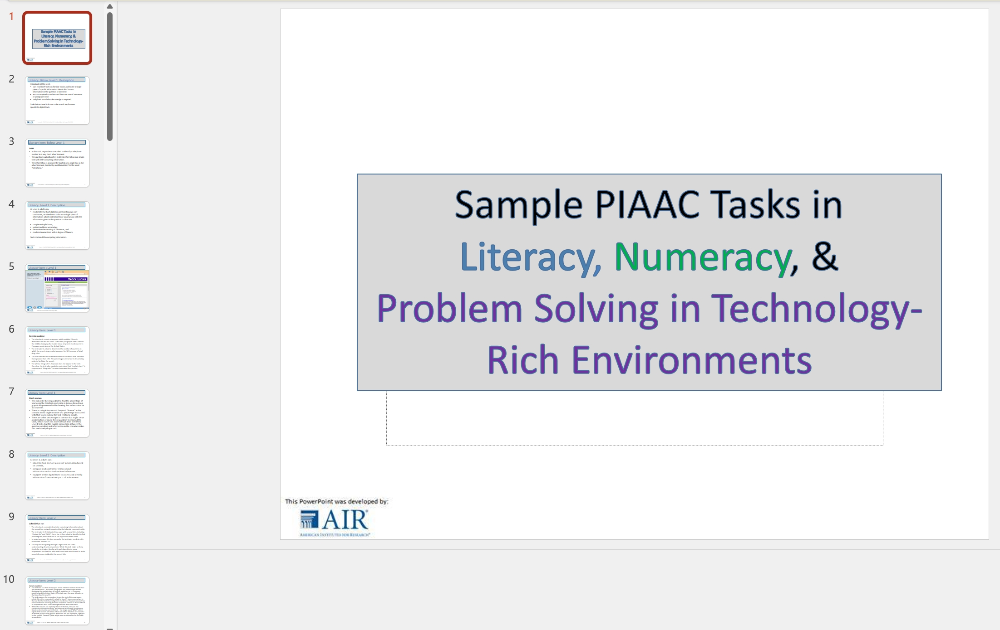

其中对“低于1级”的描述如下：

> 能阅读关于熟悉主题的简短文本，并找到与问题或指示中完全相同的特定信息。

> 不需要理解句子或段落的结构。

> 只需掌握基本的词汇知识。

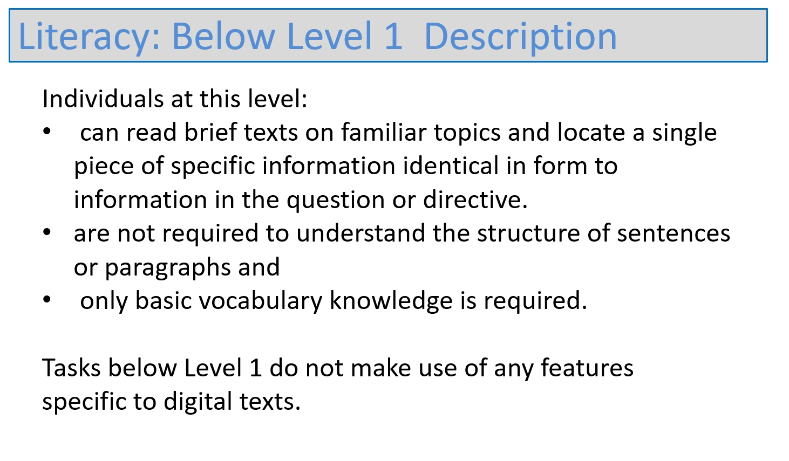

“低于1级”的任务如下：

> 在此任务中，受访者需要从一个非常简短的广告中找到一个电话号码。

> 题目明确要求从简单文本中提取文字信息，并且干扰信息极少。

> 所需信息显著地位于广告中的单独一行，并由“telephone”（电话）的缩写标注。

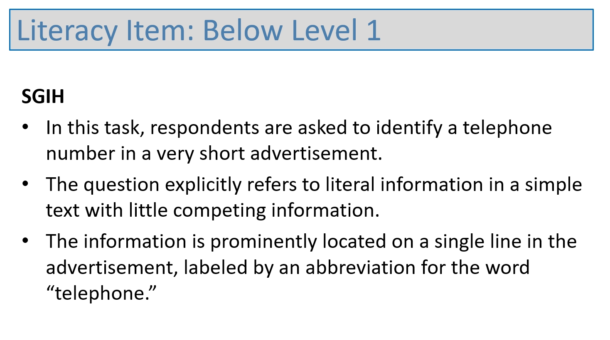

可见，即便是“低于1级”，也绝对不是我们认知中的文盲，至少不是联合国定义的那种文盲。这种文盲被称为“功能性文盲”，前文已有提过。

> 功能性文盲（Functional illiteracy）是指具有阅读、书写或计算能力，但是却缺乏利用这些能力“来处理某些日常生活事务或应聘的能力”。与之相对的是文盲，指不能用任何语言阅读或书写，甚至不能够读写简单的句子。

> 照此逻辑推断，一位无法在生活社群读写当地文字的外地人，亦算是功能性文盲。——维基百科“功能性文盲”

这21%人中，剩下的12.9%是“1级”。

“1级”的描述如下：

> 在1级，成年人可以：

> 阅读相对较短的数字或印刷版连贯文本、非连贯文本或混合文本，从中找到与问题或指令中给定信息相同或同义的单一信息。

> 填写简单的表格。

> 理解基础词汇。

> 确定句子的含义。

> 以一定的流畅性阅读连贯的文本。

> 这些文本包含的干扰信息较少。

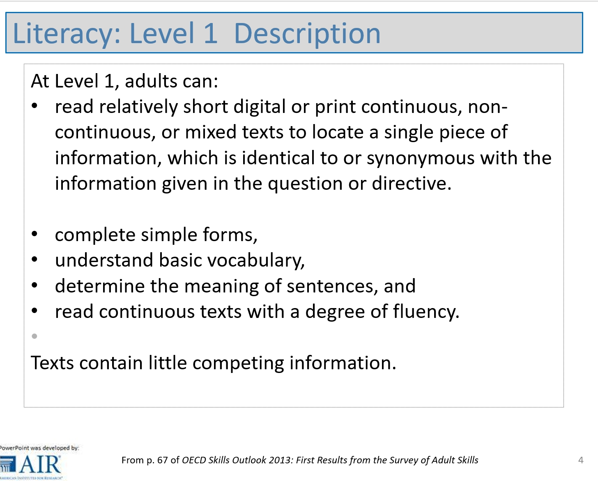

“1级”有三个样题，第一个题目是在一个招聘网站中找到正在招夜班员工的公司。

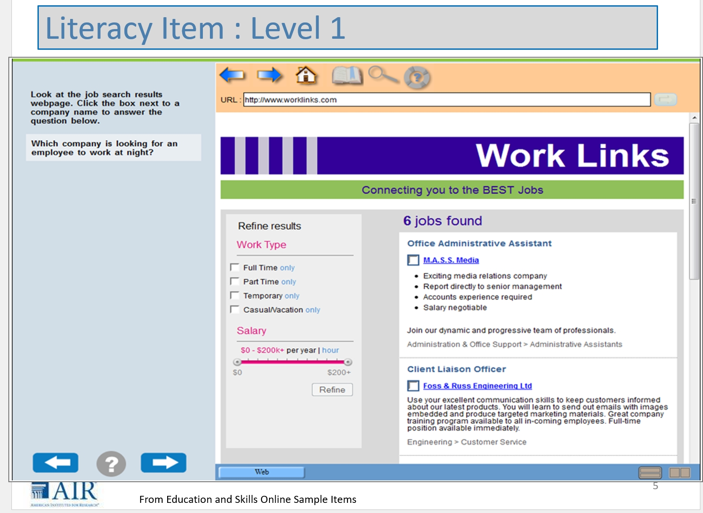

第二个题目是看一篇题为“仿制药：不适合瑞士人”的简短报纸文章，文章包含两个段落，中间有一个表格，展示了仿制药在14个欧洲国家和美国的市场份额。

测试者需要确定有多少个国家的仿制药市场占总药品销售额的10%或以上。

测试者需数出市场份额大于10%的国家数量。表格中的百分比按降序排列，以便于搜索。然而，文章中并未出现“药品销售额”这一短语，因此测试者需要理解“市场份额”是“药品销售额”的同义词，才能正确回答问题。

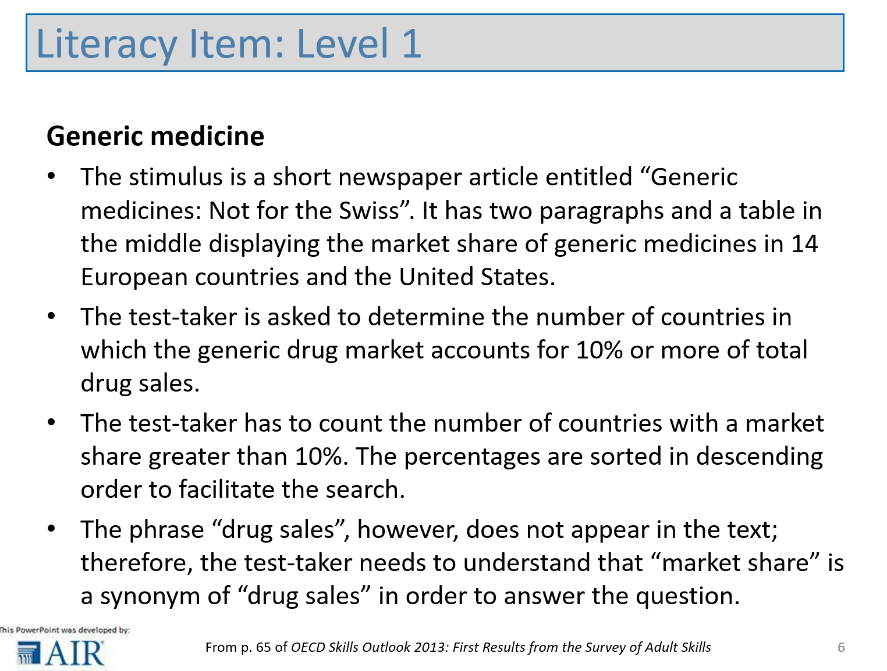

第三个题目要求受访者根据一个图表找到希腊教学行业中女性的比例。图表显示了10个国家的相关信息。

在材料中，“希腊”一词只出现一次，并且只有一个与之关联的百分比，这使得任务相对简单。

然而，文本中还有其他百分比可能会干扰或导致受访者误读图表，这使得该任务比低于1级的任务更具难度。这个题中，问题措辞与材料中的信息有明确的对应关系，因此比较简单。

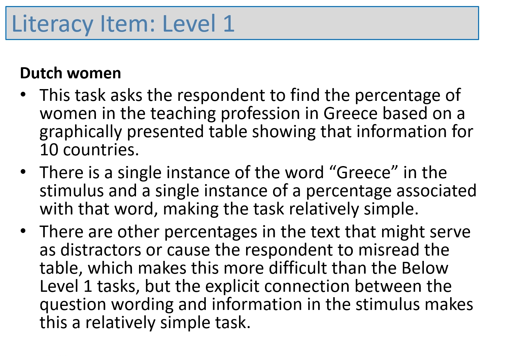

正确做完以上题目后，你仍然是“文盲”，因为你还要做“2级”的题目，才能避免成为那21%的一员，证明自己不是文盲。

那么2级的题目是怎么样的呢？

我们看一个例题，你需要通过在学前班规则列表中标记信息，回答左侧面板中显示的问题

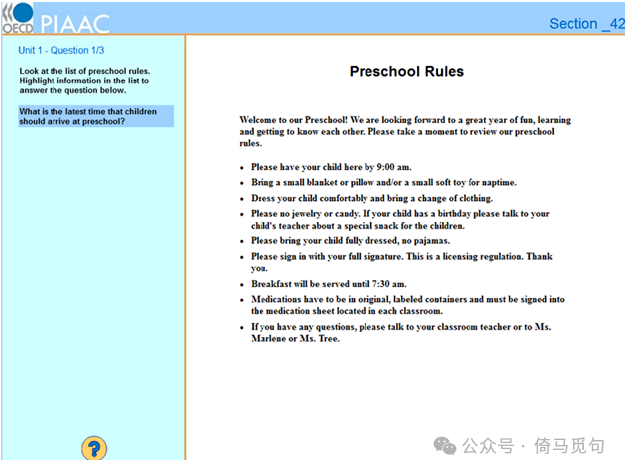

图可能看不清，我提取其中的文字，大家可以做一下这个题。

> Preschool Rules
>
> Welcome to our Preschool! We are looking forward to a great year of fun, learning and getting to know each other. Please take a moment to review our preschool rules.
>
> Please have your child here by 9:00 am.
>
> Bring a small blanket or pillow and/or a small soft toy for naptime.
>
> Dress your child comfortably and bring a change of clothing.
>
> Please no jewelry or candy. If your child has a birthday, please talk to your child's teacher about a special snack for the children.
>
> Please bring your child fully dressed, no pajamas.
>
> Please sign in with your full signature. This is a licensing regulation. Thank you.
>
> Breakfast will be served until 7:30 am.
>
> Medications have to be in original, labeled containers and must be signed into the medication sheet located in each classroom.
>
> If you have any questions, please talk to your classroom teacher or to Ms. Marlene or Ms. Tree.
>
> 问题是What is the latest time that children should arrive at preschool?

如果做不出来，你就会按照某种标准，被判定为“文盲”。

当然啦，这个问题确实很简单，答案就在第一条校规里面的“9:00 am”，其他全是干扰。

另外，这个技能评估只用英语进行，所以，不管你母语是什么，都必须做同样的英文测试，也就是说，如果你只会说自己种族的语言，而不会说英语、读英文，那么你在这个测试中也会获得较低的分数。

事实上，同样的阅读能力，在欠发达地区可能被认定为“识字”，在较发达地区可能就会被认定为“功能性文盲”了；移民另一个国家，如果你不会说他们的官方语言，也容易被认定为“功能性文盲”。比如说，假设我现在移民法国了，我就立马变成纯正的文盲。

小节一下，21%的文盲率和79%的识字率，这个数据来自于经合组织的“国际成人能力评估项目”，这个识字率的标准跟联合国识字率的标准完全不一样，在前者的标准中，即使是“低于1级”，你也需要掌握“基本的词汇知识”；而联合国的标准呢，我们前面说过，只要能用任何一种语言阅读一段文字，或者写一句话，就算是识字了。

知道“美国官方”的信息后，我们再一次体会到把这两种标准的“识字率”混合起来比较，是没有意义的，是没有道理的。

## 四 美国低识字率反映的问题

在中文互联网上，大部分媒体都将中国识字率97%和美国识字率79%对比，然后把原因归结于美国的快乐教育。这个大家随便在网上搜一下就能知道。

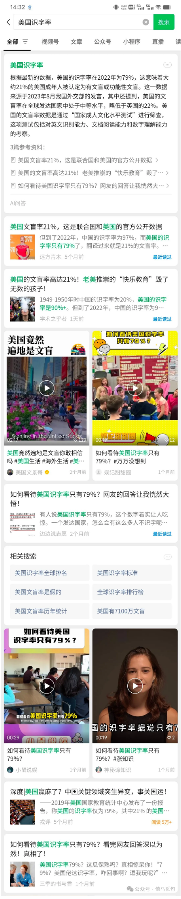

这样的对比当然是不讲武德的，但是不管怎么讲，79%的数据毕竟不好看，那么这种低识字率背后反映了什么问题呢？

《福布斯》有一篇文章，叫《美国成年人低识字率每年可能给经济造成2.2万亿美元的损失》，发布于2020年9月9日。文章引用盖洛普公司为芭芭拉·布什家庭识字基金会进行的研究，指出美国54%的16至74岁成年人识字水平低于六年级。提高这些人的识字能力可以显著增加个人收入，从而对整体经济产生积极影响。文章是从经济的角度分析的，美国成人低识字率每年可能给经济造成2.2万亿美元的损失。

其实美国根本没损失，损失是臆想的，就像我说“我当年没有好好读书，也错过了房地产和互联网的风口，这让我损失了很多别墅和跑车”一样，都是臆想。这篇文章无非是想说：如果将美国人识字能力的下限再提高一点，就会使经济增长2.2万亿美元。

社会发展是不断进步的，对美国来说，联合国那种识字率标准已经没有意义了。试想，如果美国政府还天天统计联合国那种标准的识字率，今天99.7%，明天99.8%，男性99.9%，女性99.8%，那有什么意思？马斯克又要闹麻了，直接列入“政府最蠢支出榜单”。

所以，对美国来讲，识字率的标准是一定要提高的，这样才能制定新的目标，促进社会进步。标准提高以后，数据是一定会变难看的——但是数据难看不难看不重要，重要的是找到不足，促进发展。

## 五 我的思考

新中国建立75年以来，中国人民的物质和精神生活都发生了翻天覆地的变化，其发展之快可以说是冠绝古今，识字率的提高只是我们众多胜利中的一个小项而已。就这点来说，作为中国人，我们都是充满自豪之情的。

我们已经取得了这样伟大的成绩，我们以后还将取得更大的成绩，所以我们有底气不卑不亢地面对外国人。对于外国，我们既不用跪舔，也不用歧视，只需要平静地接受现实，并且继续努力，就足够了。

中国有些人仍然羡慕发达国家的优越生活，想着“润”到国外去，但是他们未曾想过，他们和他们的先辈为这些国家的繁荣付出了什么？他们想加入这些国家需要付出什么样的代价？我还是认为与其想办法“润”出去，真不如堂堂正正作为一个中国人去奋斗——即使你是为了个人享福，在中国奋斗也是更划算的。

还有些人空有一身爱国热情，但缺乏思考，所以不能总是了解国外的真实情况，总是受到欺骗。我相信这些人都是最朴素正直的人，他们会不断提高自己的水平，和共和国一起成长。

回到识字率这个问题，中国现在的识字率，按照联合国的标准，已经达到97%了，青年人更是达到了100%。但中国人民的文化水平还将继续增长，毕竟解决基本的识字问题以后，我们会发现还有很多人是“功能性文盲”；我们还有严重的阅读问题，很多人的阅读水平较低，一年可能看不了几本书……我们必须正视这些现实。

中国的知识分子不要骄傲，不要总想着润，要知道你们有时间有资源学习知识，是因为有更多底层劳动人民拿着微薄的工资，夜以继日地干活。只有他们的日子好过了，只有他们的文化提高了，中国才会实现真正的富强。
