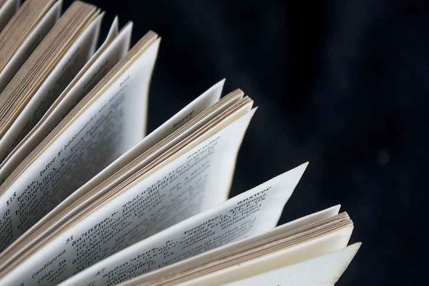
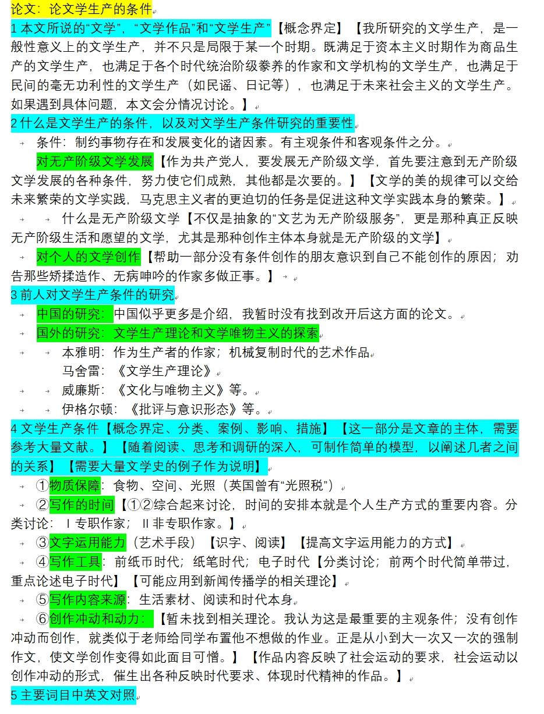

# 我为什么放弃了研究文学？

## 一

我的专业是“英语语言文学”，我们学校有英美文学领域最好的老师，我在大一的时候，导师给我开了书单，也包含大量文学相关的书籍。但是我在四年的学习之后，竟然在这个领域一事无成，并且决心不再研究文学。

这其中有两个原因。

第一个原因是我的外语水平太低，文学著作读得太少，所以研究文学缺乏根基。

第二个原因是我看不懂西方文学理论，例如结构主义、接受美学、现象学和阐释学等，越往后的理论越看不懂。连理论都看不懂，还怎么研究？

然则，这两个原因又都有一个共同的原因，那就是“志不在此”。

我大学至少有一半时间都在做这三件事：1读马列著作；2广泛阅读其他学科的书籍；3搞调查研究。代价就是没有时间读文学，没有时间学英语，本专业的课程学得很艰难。

对于西方文学理论，与其说是看不懂，不如说是不知道怎么批判。也就是说，作为读过马恩著作的人，两相对比，我内心认为这些西方文学理论都是错误的。既然是错误的，自然没有必要花费太多精力去研究。

那么国内的马克思主义文学理论呢？似乎童庆炳的《文学理论教程》是最好的。但我当时只是大致读了一下，没有深入思考，毕竟英专生的文学论文要是用到国内的文学理论，通过的概率恐怕不大。我必须先保证毕业。

去年年初，我开始构思我的毕业论文，于是看了很多西方文学理论的材料，写下了以下文字：

## 二

在文学中，关于“文学性”、“美”，所有文学作为艺术的研究，马恩列斯毛都研究得很少，事实上研究美的规律本就是一个科学问题，不太关乎意识形态，西方文学理论家的很多方法都可以使用，例如形式主义、结构主义、接受美学、精神分析理论、现象学和阐释学等。作为方法，都是可以共享的，不同的方法是不同的研究视角，可能都在某种程度上揭示了真理。西方很多马克思主义文艺理论家，事实上就是把各种研究方法纳入到马克思主义的总体理论之下的。

但是，句子如何排列，意象怎样组合，他们怎样使人产生愉悦的感觉，这些都是细枝末节的事情；况且，那些完全脱离社会的文学研究，很难说是完整的文学研究，而且有史以来的文学都是带有意识形态色彩的文学。

西方的马克思主义文艺理论家，做得比较好的，就是对“文学生产”的研究，把文学作为一种特殊的艺术生产来研究，其集大成者是英国的伊格尔顿（此人很好，而且现在还没死）。伊格尔顿提出要从“一般生产方式、文学生产方式、一般意识形态、作者意识形态、审美意识形态”的复杂关系中去研究”文本“，但是伊格尔顿根本不懂一般生产方式，对文学生产方式的论述也很有限。他的重心和落脚点在于强调文学批评的重要性，最后的结论无非是文学批评是对意识形态的颠覆行为，很重要。仅此而已了。西马都很努力，但是理论失去了社会基础，西欧缺少真正的工人运动和社会主义运动，尤其是上世纪八十年代以后，西马的理论家们每天躲在书斋里，很用功，很让人感动，也做出了一些成绩，但是作用很有限。

我一向认为对一般生产方式的研究，即对资本主义生产方式、封建社会生产方式等的研究，要更重要些。文学生产方式的研究也不能脱离一般生产方式的研究，比如资本主义文学生产方式的研究就不能脱离资本主义生产方式本身的探讨。但是形势所迫，我作为英语专业的学生，为了能够顺利毕业，就只好退而求其次，去研究文学了。当然，这并不是坏事。

当我们研究一般生产方式的时候（“一般生产方式”的说法，是相对于“文学生产方式”来说的，从广义上讲，生产方式当然是包括文学生产方式的，文学创作当然是社会生产的一部分），最重要的着眼点，就是个体如何谋生，以及社会如何运转。当我们研究文学生产方式的时候，首先也应该注意到作者们是如何获得生活来源的，很多时候就能从中看出某种文学活动的性质。有人写作是靠政府资助，有人是靠卖钱（例如畅销书、网文等），有人是为了搞政治鼓动，有人并非专职作家，写作只是情感的抒发。搞清楚作者的生活来源，这很重要。

生活来源是从事写作的前提，是写作的一个重要条件，所谓条件，就是制约事物存在和发展变化的诸因素；文学创作条件不满足，文学创作活动就不会发生和发展。文学创作还有许多其他条件，例如写作时间、识字、创作素材的积累、书写工具、创作冲动等，都是和社会本身息息相关的，都很重要，文学的阶级性、意识形态等，都可以以此为起点来进行研究。从伊格尔顿的文艺批评模型看，研究文学生产的条件，就是研究一般生产方式和文学生产方式的关系，虽然只是研究这个关系的一部分，却是非常重要的一部分。

我直觉上认为这是很重要的研究课题，值得认真研究。但是一流的马克思主义理论家往往没有精力做这种旁支的工作；专门的文学研究者往往不懂得马克思主义的精髓，所以历史把这个任务交到了我的手上。我也有决心完成这个历史使命。而要做好一个学术项目，既要坚持科学的研究原则，又要坚持政治原则，还要尽量迁就现有的学术规范，也算是对我的一个磨砺。（二零二三年四月二十七日）【这个作品或许可以让西马的重心，从文艺又返回到政经。果真如此，则不胜荣幸之至。】

## 三

于是，我将我的论文题目暂定为“论文学生产的条件”，并且写好了写作大纲。但是写完大纲以后，我发现这篇论文需要的材料太多了，成文后的规模也会很大，根本不是几千字的学士论文能够说清楚的。

况且，我采用的这种视角很少有人注意到，所以能否获得学者的承认，乃是一个未知数——尽管我至今仍然认为我的分析思路是符合马克思主义的。

当然，最重要的是我的能力尚不足以完成这个著作。正如我之前所说，“文学生产方式的研究也不能脱离一般生产方式的研究，比如资本主义文学生产方式的研究就不能脱离资本主义生产方式本身的探讨。”

例如，封建时代的文学创作，作者的生活来源、文化水平、写作材料、写作环境，以及读者的需求等，都跟资本主义时代的作者有所不同，所以才会有文学体裁和文学语言的更迭。

要把文学生产方式和一般生产方式联系起来，需要对一般生产方式本身有足够的了解。我说伊格尔顿根本不懂一般生产方式（他的那本《马克思为什么是对的》本意是为曲解马克思的人进行辩解，但这本书本身就是对马克思的曲解），其实我自己也对一般生产方式缺乏研究，所以我也暂时写不好这本著作。

我放弃了这篇论文的写作，最终以《许渊冲古诗英译音美实现策略研究——基于25首诗的综合分析》为论文题目，勉强通过了答辩。

当然，人都是会不断成长的，也许以后我学识增加，时间和精力富余，就能写好那本构想的著作了。

后来的有心者如果读到我的这篇文章，能够从我的论述和大纲中得到启发，并完成著作，那也是极好的。

