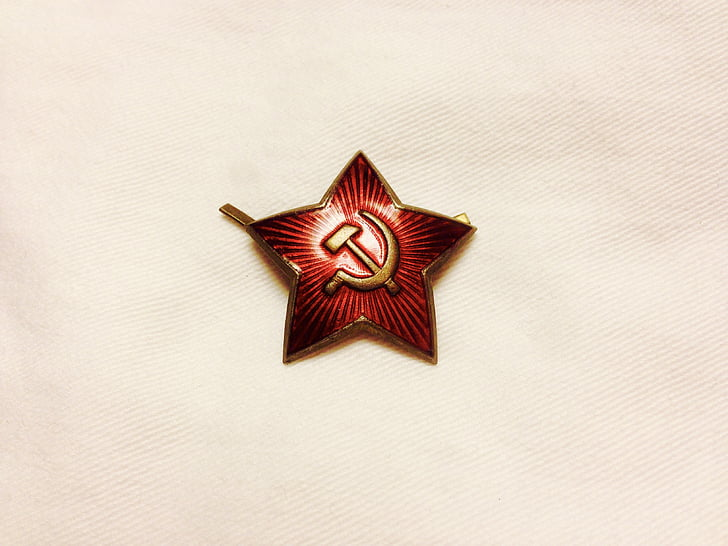
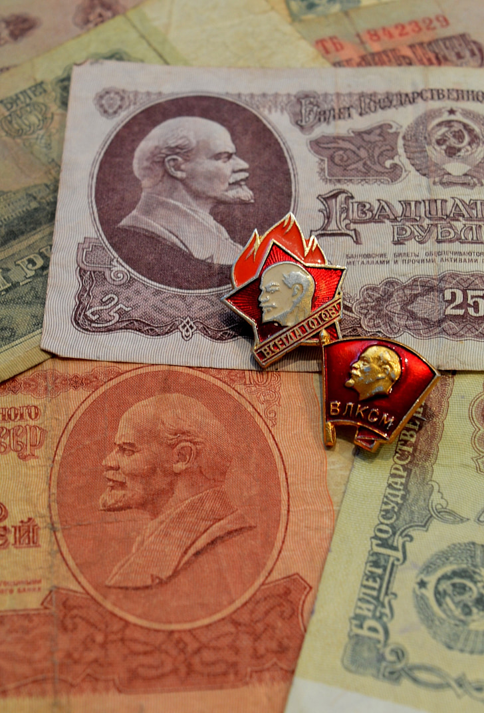

# 什么是社会主义？

（本文写于2022年夏天，我更改了第8段、第12段和第13段的部分表述，将其发表出来。本人坚决拥护中国共产党的领导，但料想很多人会误解我，会发表一些不利于团结的言论，所以本文评论区不会全部放开。）

1  在《共产党宣言》中，马恩列举了各种各样的“社会主义”。共分为三类：a “反动的社会主义”，包括“封建的社会主义”、“小资产阶级的社会主义”、“德国的或‘真正的’社会主义”；b “保守的或资产阶级的社会主义”；c “批判的空想的社会主义或共产主义”。这些社会主义都不是马恩所推崇的，列举这些形形色色的社会主义正是为了和他们倡导的共产主义作对照，而他们倡导的共产主义观点就是《共产党宣言》的主要内容。

2 以上的“社会主义”、“共产主义”，既可理解为一种观点或理论，也可理解为一个社会制度或社会阶段。在马恩的时代，一般不说自己是“社会主义”，而说自己是“共产主义”。共产主义作为一种学说，就是我们现在所说的马克思主义；共产主义作为一个社会阶段，就是取资本主义社会而代之的“自由人的联合体”（“代替那存在着阶级和阶级压迫的资产阶级旧社会的，将会是这样一个联合体，在那里，每个人的自由发展是一切人自由发展的条件”）。

3 在《哥达纲领批判》中，马克思首次将共产主义社会划分为共产主义第一阶段和共产主义高级阶段。高级阶段相比第一阶段的发展有：a迫使个人奴隶般地服从分工的情形已经消失；b劳动已经不仅仅是谋生的手段，而且本身成了生活的第一需要；c 个人的全面发展程度提高；d各尽所能，按需分配。这共产主义的第一阶段，就是后来所说的社会主义阶段。

4 按照马克思在《哥达纲领批判》中的划分，马恩的所有有关未来社会的设想，大多讲的是共产主义社会第一阶段的措施，例如夺取政权、剥夺地产用于国家支出、剥夺继承权等等。

5 按劳分配是资产阶级法权，但即使是完全按劳分配（每一个生产者，在作了各项扣除以后，从社会领回的，正好是他给予社会的。），迄今为止也没有一个国家做到过。按这个标准，这个世界上还没有所谓的社会主义国家，人类也更谈不上进入社会主义阶段。

6 列宁在《国家与革命》中把“资本主义到共产主义的过渡”、“共产主义的第一阶段”、“共产主义的高级阶段”分别详细地讲述了一遍，在他的叙述中，“社会主义社会”和“共产主义第一阶段”是同义词。

7 苏联和新中国将马克思主义付诸实践。1936年，苏联宣布已建成社会主义；1956年，中国完成三大改造，宣布进入社会主义。其依据都是生产资料所有制基本上变为了公有制，即生产资料归无产阶级专政的国家所有或归集体所有。

8 后来，原先的社会制度在苏联和新中国都遇到了阻碍，苏联解体，中国实行改革开放，事实上放弃了原先的路线。新中国相继采取“计划经济为主，市场经济为辅（1979-1982）”、“有计划的商品经济（1983-1986）”、“国家调节市场，市场引导企业（1987-1992）”、“社会主义市场经济体制（1992年以后）”等政策，最终，在坚持四项基本原则的前提下，做出了一些妥协。

> “坚持社会主义道路，坚持无产阶级专政（1982年《中华人民共和国宪法》将无产阶级专政改为人民民主专政），坚持中国共产党的领导，坚持马列主义、毛泽东思想。”——邓小平 四项基本原则

9 邓小平有名言：“贫穷不是社会主义”、“社会主义的本质，就是解放生产力，发展生产力，消灭剥削，消除两极分化，最终达到共同富裕”。邓小平是一流的政治家，这句话引导大家将注意力放在发展经济上。事实上，发展生产力是生产关系改变后的结果，而不是判定社会形态的标志，更不是其本质。至于“消灭剥削，消除两极分化，最终达到共同富裕”也就随着改革开放的深入，变成了越来越艰难的目标。

10  当代也有许多马克思主义者进行了反思。我认为，社会主义国家至少要满足两个条件：**a 无产阶级专政；b 社会主义方向。**无产阶级专政，至少要保证无产阶级在这个国家能说上话；所谓社会主义方向，就是使社会逐步地朝着共产主义高级阶段的方向过渡的趋势，这个可以单独讨论。

11 在社会主义方向中，当代马克思主义者研究最多的问题有两个，一是公有制问题，二是共产主义生产方式问题。有马克思主义者（阳和平）提出，要把“公有制”的说法换成“共有制”，这种说法更击本质：劳动人民共同占有生产资料，而不是“公家”的人占有生产资料。共产主义的生产方式暂无系统学说，其主要特征大概有：以更大范围内的协作完成生产，逐步消灭分工。我认为最重要的是生产方式问题，而不是所有制问题，因为所有制是结果，生产方式才是原因，只追求结果而不管原因，就注定会遭到失败。

12 总而言之，按照马克思在《哥达纲领批判》的标准，人类历史上没有一个国家进入过社会主义。按照邓小平的标准，中国当然是社会主义。但是这些都不重要，重要的是探索新的生产方式。如果没有新的生产方式去代替旧的，革命者就算掌握了政权，也不得不采取原先的统治方式，最终革命团体会成为新的权贵阶级；相反，如果在一个社会中，共产主义的生产方式占据了主导地位，那么不管这个国家的政体是啥，不管它的统治者叫“皇上”还是叫“元首”，这个社会都会无可避免地发展成为共产主义社会。

13 马克思主义者将人类的社会活动理解为受一定规律支配的自然史的过程，因此，社会的发展和变革是必然的。当前的马克思主义者，应该多读书，多了解社会，多探索社会规律，未来自然大有可为——盲目地进行各种社会运动，我是不赞成的。
