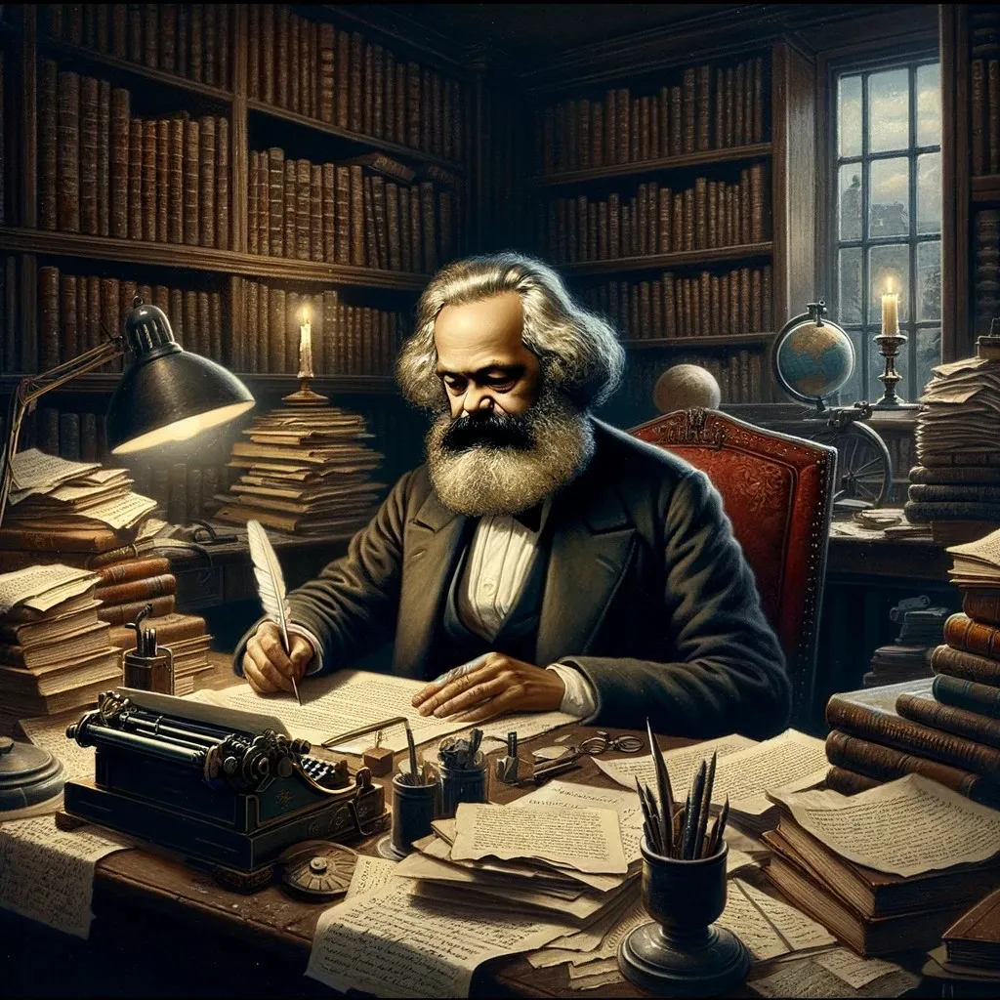
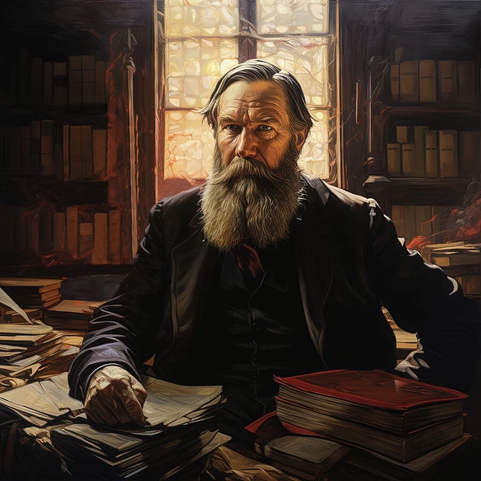
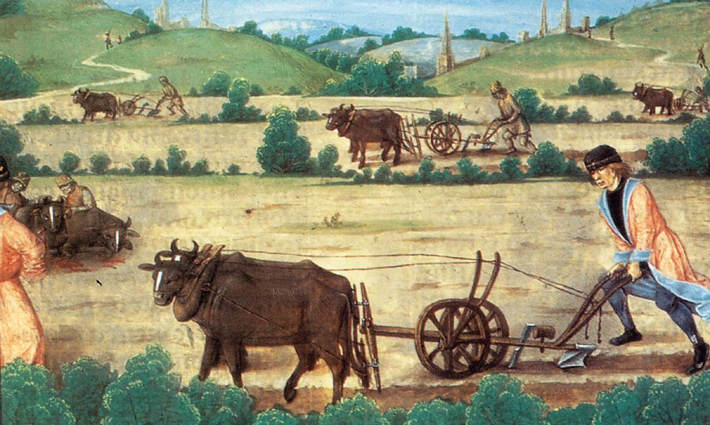
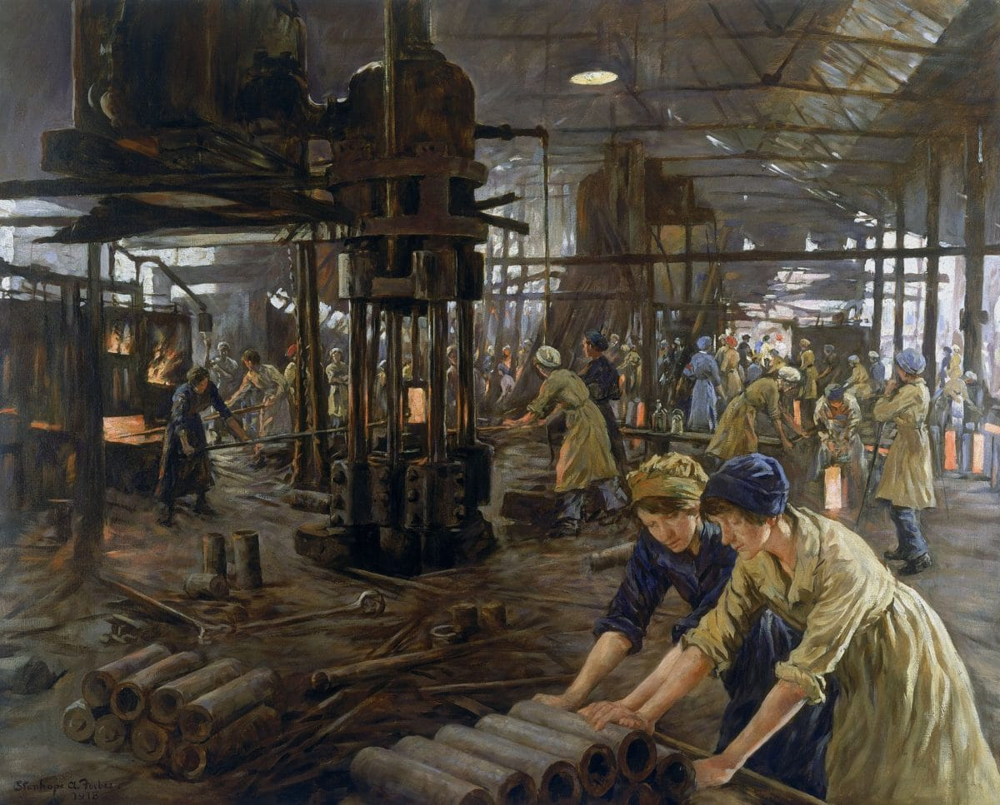
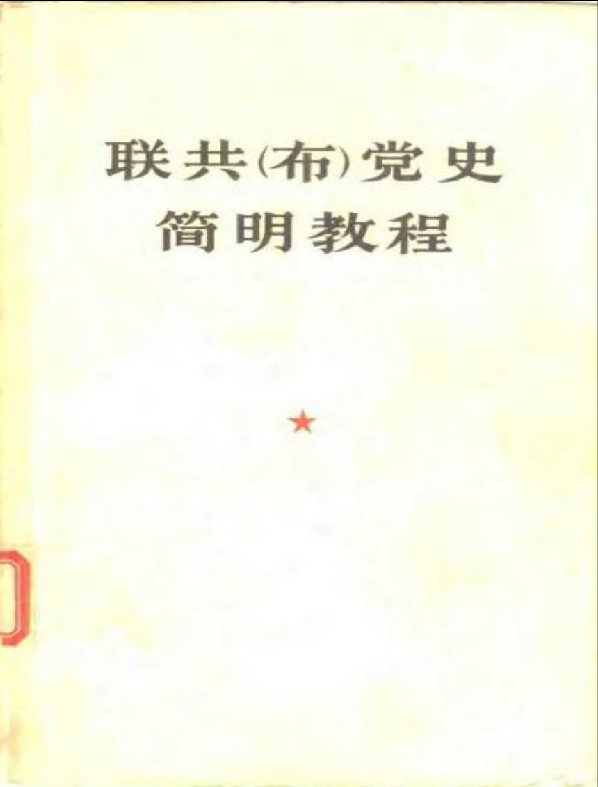
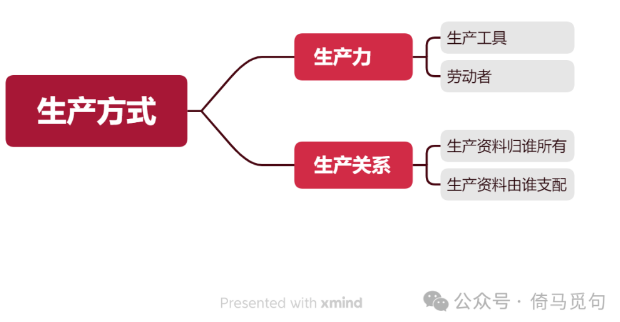
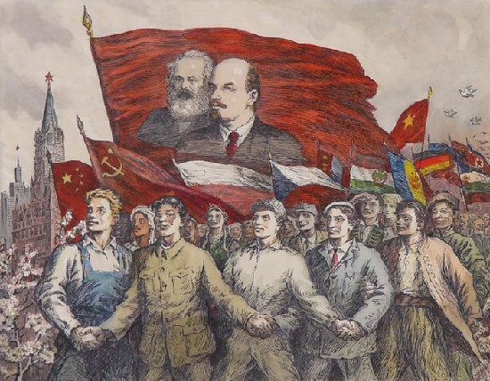
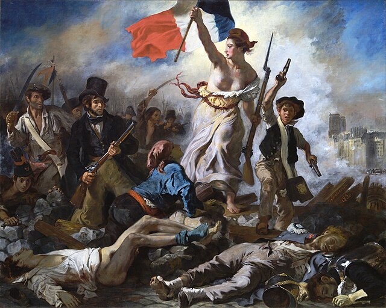

# 生产方式问题是社会科学的核心问题

## 一　唯物主义历史观：马克思的重要遗产

如果我们要选出一个最理解马克思思想的人（除了他本人以外），我们一定会选出马克思的战友和继承者恩格斯。

如果我们要选出一篇概括马克思理论的最简短最准确的文章，那我们一定会选出恩格斯的那篇《在马克思墓前的讲话》。

《在马克思墓前的讲话》只有1200字左右，但非常简明扼要地概括了马克思一生的成就：作为革命家，他创办各种报纸，创立了国际工人协会（史称“第一国际”）；作为科学家，他发现了“人类历史的发展规律”和“现代资本主义生产方式和它所产生的资产阶级社会的特殊的运动规律”，前者就是“唯物主义历史观”，后者就是“通过剩余价值揭示资本主义生产的秘密”。

第二个发现自有厚厚的《资本论》作为说明。我们今天只谈马克思的第一个发现，唯物主义历史观。

恩格斯对此的总结是：

> 正像达尔文发现有机界的发展规律一样，马克思发现了人类历史的发展规律，即历来为繁芜丛杂的意识形态所掩盖着的一个简单事实：人们首先必须吃、喝、住、穿，然后才能从事政治、科学、艺术、宗教等等；所以，直接的物质的生活资料的生产，从而一个民族或一个时代的一定的经济发展阶段，便构成基础，人们的国家设施、法的观点、艺术以至宗教观念，就是从这个基础上发展起来的，因而，也必须由这个基础来解释，而不是像过去那样做得相反。——马恩文集第3卷第601页《在马克思墓前的讲话》

这里的“直接的物质的生活资料的生产，从而一个民族或一个时代的一定的经济发展阶段”，指的就是生产方式以及由某种生产方式主导的社会阶段。

例如，以封建生产方式为主导的社会就是封建社会，以资本主义生产方式为主导的就是资本主义社会。这是最本质的视角，因为与之配套的一切制度和文化，都是这种生产方式发挥作用的结果。

《资本论》的研究内容，就是“资本主义生产方式以及和它相适应的生产关系和交换关系”。当代马克思主义者的一个重要任务，就是探索共产主义的生产方式。

对于社会科学研究者来说，不管研究什么领域，必须将自己的研究对象和一定的生产方式结合起来，这样才能使自己的研究足够扎实，足够科学。

## 二　如何理解“生产方式”？从原文探讨

那么，什么是“生产方式”呢？

马克思第一次指出“生产方式”一词的含义，是在《德意志意识形态》一书之中（此书写于1845-1846年之间，由马恩两人合著）：

> 人们用以生产自己的生活资料的方式，首先取决于他们已有的和需要再生产的生活资料本身的特性。这种生产方式不应当只从它是个人肉体存在的再生产这方面加以考察。更确切地说，它是这些个人的一定的活动方式，是他们表现自己生命的一定方式、他们的一定的生活方式。个人怎样表现自己的生命，他们自己就是怎样。因此，他们是什么样的，这同他们的生产是一致的——既和他们生产什么一致，又和他们怎样生产一致。因而，个人是什么样的，这取决于他们进行生产的物质条件。——马恩文集第1卷第520页《德意志意识形态》

在这里，“生产方式”指的是“人们用以生产自己的生活资料的方式”。而且这段话也从个人层面写了生产方式的重要性，一言以蔽之：你生产什么，你怎样生产（劳动），决定了你是一个什么样的人。

在1847年发表的《哲学的贫困》第二个说明中，马克思写道：

> 经济学家蒲鲁东先生非常明白，人们是在一定的生产关系中制造呢绒、麻布和丝织品的。但是他不明白，这些一定的社会关系同麻布、亚麻等一样，也是人们生产出来的。社会关系和生产力密切相联。随着新生产力的获得，人们改变自己的生产方式，随着生产方式即谋生的方式的改变，人们也就会改变自己的一切社会关系。手推磨产生的是封建主的社会，蒸汽磨产生的是工业资本家的社会。——马恩文集第1卷第602页《哲学的贫困》

在这里，马克思明确指出：“生产方式”就是“谋生的方式”。我认为这是理解“生产方式”这个词的核心，和《在马克思墓前的讲话》的那段对历史唯物主义的概括（人们首先必须吃、喝、住、穿，然后才能从事政治、科学、艺术、宗教等等）是一样的意思。可以说，抓住生产方式问题，历史唯物主义就能得到贯彻。

此后，“生产方式”成为马恩的常用词，但在不同语境下，有不同的含义，或者说侧重不同的方面。参考《中国大百科全书·经济卷》“生产方式”的词条，“生产方式”一词主要有以下几种含义（这部分可以略读）：

1　使用某种生产资料和劳动方法进行生产的方式，马克思常常把劳动资料（首先是生产工具）或劳动方法（如协作、分工等）或两者一起发生的变革，称为生产方式的变革。

> 例如，一个鞋匠使用一定的劳动资料，在一个十二小时工作日内可以做一双皮靴。如果他要在同样的时间内做两双皮靴，他的劳动生产力就必须提高一倍。不改变他的劳动资料或他的劳动方法，或不同时改变这二者，就不能把劳动生产力提高一倍。因此，他的劳动生产条件，也就是他的生产方式，从而劳动过程本身，必须发生革命。——马恩文集第5卷第366页《资本论第一卷》

2　不同类型的生产方法或不同部门的生产方法。前者如手工业生产方式、工场手工业生产方式、大工业生产方式、家庭劳动生产方式等；后者如工业生产方式、农业生产方式等。

3　指生产的社会形式（包括社会经济形态和经济制度）。如封建制生产方式、资本主义生产方式等。

> 大体说来，亚细亚的、古希腊罗马的、封建的和现代资产阶级的生产方式可以看做是经济的社会形态演进的几个时代。——马恩文集第2卷第592页《政治经济学批判》

> （雇佣劳动在资本主义社会是）起决定作用的、占支配地位的生产方式。——马恩全集第47卷，第151页，转引自《中国大百科全书·经济卷》“生产方式”词条

4　指物质资料的再生产和生产关系再生产的统一。

> 资本主义的生产方式，和任何别的生产方式一样，不仅不断再生产物质的产品，而且不断再生产社会的经济关系，即再生产物质产品形成上的经济的形式规定性。——马恩文集第7卷第987页《资本论第三卷》

以上的含义都是《中国大百科全书》的分类，不一定完全准确。但是综合各种材料，可以看到马克思对“生产方式”的理解，核心就是“谋生的方式”，或者“运转的方式”、“存在的方式”，或者干脆叫“再生产的方式”、“运动的方式”，因为生产不只是生产一下，更重要的是维持（甚至扩大）这个生产的过程，维持这种生产所需的各种条件。毕竟世界是过程的集合体，而非既成事物的集合体，且万事万物之间都充满了繁多复杂的联系——这也是辩证法的重要内容。

“生产方式”这个概念可大可小。从个人层面讲，一个人如何谋生，决定了这个人的性质；一个部门如何工作，决定了这个部门的性质；一个社会如何运转，决定了这个社会的性质——所以马克思才说：“大体说来，……的生产方式可以看做是经济的社会形态演进的几个时代。”就是因为他认为，一个社会主要的生产方式决定了这个社会的性质。至于“亚细亚的、古希腊罗马的、封建的和现代资产阶级的生产方式”，则是他对当时材料进行具体分析的一些总结。真正的马克思主义者应该抓“生产方式”的原则，从现实材料中总结新的结论，而不应该将马克思举的几个例子作为原则，将现实材料和这些例子强行配对。

综上所述，我认为：历史唯物主义使社会科学成为科学，而生产方式则是贯彻历史唯物主义的中心线索。

## 三　生产方式的内容：苏联的影响

中国对马克思主义的学习和理解，很大程度上受到了苏联《联共（布）党史简明教程》的影响。这本教程诞生于1938年，由斯大林亲自主持编定，这并不是简单的历史书，它同时也是一本理论学习书和思想政治书，被称为“马列主义基本知识的百科全书”和“联共（布）历史和马列主义基本问题的正确解释”。在历史上，党的很多干部都是通过这本书速成了马克思主义；在今天，这本书的影响仍然可见于中国高中政治必修四《生活与哲学》和大学“四大神书”之一的《马克思主义基本原理概论》。

《教程》的第四章第二节名为《论辩证唯物主义和历史唯物主义》，这篇文章由斯大林亲自撰写，介绍马列党的哲学基础：辩证唯物主义是马列党的世界观，历史唯物主义是辩证唯物主义在人类社会领域的应用和表现。

这篇文章有三个特点：①水平很高，作者显然阅读过大量马恩的著作，并且有深刻的理解；②通俗易懂，条例清晰，易于学习；③服务现实，这篇文章可以培养干部、统一思想、加强斯大林的权威，一举多得。

这篇文章将生产方式分为生产力和生产关系两个方面，其中，生产力包括生产工具和劳动者，生产关系包括生产资料归谁所有（所有制）和生产资料由谁支配（分配制）。

这其中的层次如此简单明了，以至于可以用思维导图来表示：

这种分类的好处，就是把生产方式问题简化成了四个要素和指标，这样，大家就可以理直气壮地说：我们国家有大工业，有当权的工人阶级，我们国家绝大部分生产资料属于集体和全社会，我们按照劳动的多少进行分配……我们不是社会主义，谁是社会主义？按照这个标准，一国建成社会主义当然是可行的，而且有苏联这个榜样，社会主义国家在世界各地（主要是东欧和东亚）纷纷建立起来了，在二战以后作为一个阵营和资本主义阵营二分天下。

这种分类的坏处，也是把复杂的生产方式这个整体问题简单化了，变成了四个孤立的指标。可是，孤立地看待各种指标必然会出错：资本主义国家难道没有大工业？当权的工人党干部难道不会成为新的权贵阶级？权贵阶级当权，国有制企业的生产资料难道还会是全体工人说的算？资本主义下工人的工资难道不能解释为按劳分配？于是，苏联到了后期，从这几个指标看，苏联仍然可以被称为社会主义国家，但从生产方式整体看，就很难称苏联为社会主义国家了。

也正是这本《论辩证唯物主义和历史唯物主义》，提出了著名的人类历史“五阶段论”，原文如下：

> 历史上有五种基本类型的生产关系：原始公社制的、奴隶占有制的、封建制的、资本主义的、社会主义的。——《联共（布）党史简明教程》第137页人民出版社

我们再对比马克思的说法：

> 大体说来，亚细亚的、古希腊罗马的、封建的和现代资产阶级的生产方式可以看做是经济的社会形态演进的几个时代。——马恩文集第2卷第592页《政治经济学批判》

两种表述，可以总结出三个不同点：

1　马克思的语气是留有余地的，“大体说来”、“可以看做”，表示他举的几个例子只是自己的暂时性总结，重点当然也不在这几个例子上，这些名称也无关紧要；而斯大林的语气是肯定的、斩钉截铁的，就像是直接公布了标准答案，除此以外都是错的一样。

2　马克思的方法是归纳法，是研究了很多现实材料后做出的初步总结；斯大林的方法是演绎法，或者说是为我们用演绎法提供一个定理……天文学家用牛顿定理计算天体运行速度，而马克思主义历史学家则用“五分法”来划定古代历史的不同阶段——事实上，郭沫若和范文澜在西周是奴隶制社会还是封建社会这个问题上，争论了很久。

3　马克思划分历史阶段的标准是生产方式，而斯大林划分历史阶段的标准是生产关系，或者说，按照他的分类，标准是生产资料归谁所有和生产资料由谁支配。

总的来说，马克思是科学家，斯大林则是一位政治家。当然，斯大林的理论水平也很高，比如“五阶段论”基本没啥大问题，党的干部了解到这个层面，已经足够了。但是历史学家不能太受制于这个结论，例如，中国古代的封建社会还要细分为“封建领主制”和“封建地主制”，或许才能更好地理解（这个问题我以后会写文章探讨）。

这些都不重要。重要的是，《论辩证唯物主义和历史唯物主义》巩固了斯大林在党内的地位，促进了苏共内部的团结，还培养了大量苏共乃至中共的干部，解决了当时的现实问题。包括生产方式问题，斯大林将其分为几个指标，也有利于当时的现实工作（前面讲过，这里再强调一遍）。

有些人批评斯大林误人子弟，还有些人则仍然以斯大林的观点为永恒的真理，这些都是缺乏唯物主义历史观的表现——斯大林作为一个政治家和领袖，面临内忧外患的局势，为了社会主义事业，写这篇科普文章，当然要有所侧重，有所简化。有些地方有瑕疵，那不是很正常吗？非要抓着这些瑕疵批判九十年前的斯大林，这难道不是耍流氓吗？

## 四　生产方式：社会科学的核心问题

当今世界，几乎每个国家都有研究社会科学的机构，比如美国有美国艺术与科学院（American Academy of Arts and Sciences）社会科学部，法国有社会科学高等研究院（École des Hautes Études en Sciences Sociales），中国有中国社会科学院。即使没有专门研究社会科学的机构，也有类似的智囊团和智库；中国古代的翰林院也有类似的功能。

这些社会科学院（或者说智库）有三个功能：①促进社会科学（文化、学术）发展；②为统治阶级的统治提供合法性解释；③为统治阶级的统治提供工具、方法和建议。

社会科学的研究者自己也是社会的一部分，在社会中处于一定地位，他们的研究也受制于自己的条件和利益，所以，他们当然不能完全按照科学的原则进行研究，也不能按照自己的想法进行研究，他们必须还得考虑国家的需求，毕竟没有国家给他们发工资和奖金，没有国家给他们提供研究经费，他们就要丢工作。

所以，当今的社会科学研究者要想有所作为，必须将自己的科学理想（如果有的话）和国家的现实需要结合起来，否则，就很难活下去，不明白这一点，一把年纪了还是纯粹的理想主义，就容易得抑郁症。

那么，在考虑国家需求的前提下，怎样才能使自己的研究更接近科学呢？我认为是抓住生产方式问题。

之前我说过，历史唯物主义使社会科学成为科学，而生产方式则是贯彻历史唯物主义的中心线索。只要抓住生产方式问题，就能贯彻历史唯物主义；只要贯彻历史唯物主义，那就是坚持了科学的原则和方法；坚持了科学的原则和方法，再加上现实材料的收集和整理，就一定能得出相对科学的结论，发现更多社会规律。可以说，生产方式问题就是社会科学的核心问题。

社会科学本不分家，现在分成各种学科只是为了适应现实需要……就社会科学本身来说，无非是收集材料和分析材料两个程序，也就是“调查”和“研究”两个步骤。

在收集材料方面，历史学的古籍整理工作就做得很好，社会学的各种调查报告、各种机构的数据收集、文件整理，都是宝贵的材料……社会到处都是材料，有些整理了，有些没整理。加快收集和整理行将丢失的材料供后人研究，这本身就是为社会科学做贡献。

在分析材料方面，就有了各种理论观点（每个学科都有xx理论和xx理论史），如果在此时多多考虑生产方式问题，能使自己的研究更扎实更科学——尤其是理论很多很杂的学科。

比如，新闻学作为一个学科如此强盛，就是因为我国我党长期依靠报纸、电视进行新闻报道、科学普及、政策宣传和政治宣传，所以需要一系列理论来指导相关工作，来培训相关工作人员。后来，电视普及了，市场经济发展了，互联网兴盛起来了，新闻学就不够用了，所以引进了传播学。所以大家可以发现，虽然按理说新闻学应该包含在传播学里，但实际上新闻学的理论相对独立，且具有浓厚的中国本土色彩，而传播学则引进了大量西方理论。现在网络传播学发展起来，已经成为一个独立的课程，这也是跟社会生产力的发展息息相关的。

现在的新闻传播学是被新闻传播实践的飞速发展拉着走的，理论走在实践后面。如果新传学者能够深刻认识到现在是市场经济时代，政府要求稳定，各大传媒公司要追求利润，内容创作者要想办法生存，要努力满足内容消费者的需求同时不违规；而要研究消费者的需求，就要研究他们的工作和生活，研究他们的思想状态……总之，要研究生产方式。这里面有太多有意义的课题可以做。

当然，我说的是社会科学研究者，大部分新传学生最重要的是练好业务找到工作，还有一部分是为了读研考编谋个职称，本质上也是找工作。我并不是鼓动大家都不吃饭了，都去研究人家怎么吃饭（生产方式），我只是给大家提供一个角度，仅此而已。

文学也是一样，现在还有人写古诗，其实古诗早已失去生命力了，大家普遍不擅长写，写出来也少有人看；有人鼓励大家读古典名著，其实很大一部分也不合时宜了。美是客观的，审美是主观的，现在的人无法创作和欣赏以前的文学作品，这不是世风日下、道德沦丧，而是生产方式变了——现在流行的是网络小说和短剧，还有论坛帖子、知乎回答、公众号文章（当然传统的书也有大量人再看）……这里面当然也有文学，只不过形式和以前不一样了，还需要文学理论家们的进一步研究总结。

总之，新的事物每天都在茁壮成长，理论工作者不应该受限于自己的学科，一方面，要努力学习研究古代的生产方式，学习研究资本论（资本主义的生产方式）；另一方面，要收集整理和研究现在的各种新现象，总结新规律——这些都包含着未来社会新的生产方式的萌芽。这就是我的观点。

其实我这篇文章没什么新东西，都是马恩列斯毛的老调重弹。如果能帮助大家更多地了解马克思主义，则不胜荣幸之至。
