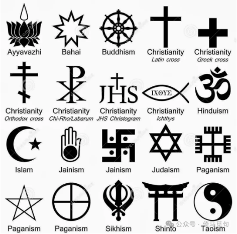
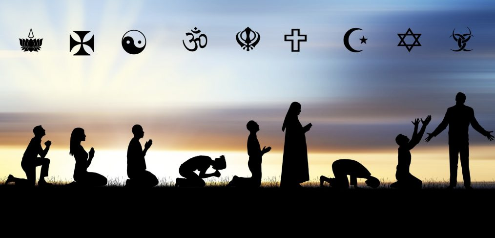
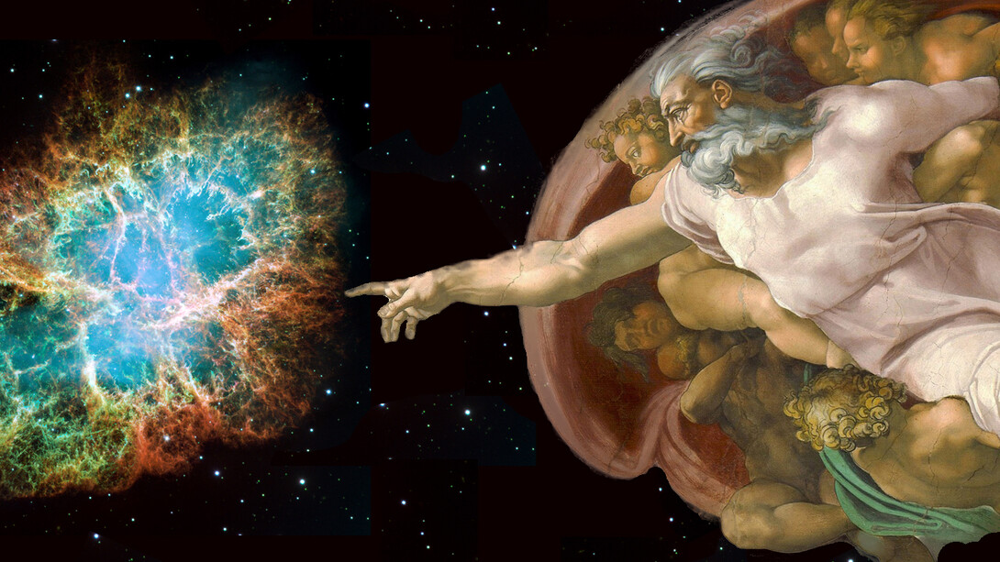
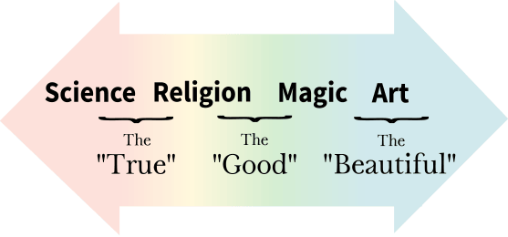

# 谈谈科学和信仰：内心强大的人都是自洽的

## 一 自洽的体系

内心强大的人都有一个自洽的体系，这个体系包括了一套完整的世界观和价值观。

有一个自洽的体系，于是你脑子里的各种事实和观点就都会相安无事地待在一起——换句话说，不会内耗。

有一个自洽的体系，于是别人的评价，不管是赞扬还是指责，都不会太影响你的情绪，因为你自有一套成熟的自我评价标准。

有一个自洽的体系，于是任何新的事物，你都能快速地融入到自己的体系之中，你接受新事物的速度也会比其他人更快一些。

有一个自洽的体系，你做事情就会充满动力，因为你坚信自己做的事情是有意义的——人总会对自己认为有意义的事情保持热情。

这种自洽的体系一旦建立起来，这个人就会充满力量，做事就会很有动力，很难受外界影响。表现在外部，就给人一种内心强大的感觉。

至于这个自洽的体系是什么，是科学还是神学，是共产主义还是实用主义，是自由民主还是精致利己，其实并不重要。

## 二 自洽的信仰

商朝流行占卜，他们将自己的预言和验证结果记录在龟甲上，上面的文字后来被称为“甲骨文”。现在看来这种方式很傻，但当时的人真心相信这种预测方法，商朝也仍然存在了500余年。

汉朝流行谶纬之学，大部分有文化的人相信歌谣和古书里面的只言片语蕴含着未来的预兆。他们还相信天人感应，相信祥瑞代表政治清明，而自然灾害则说明君主政治上有过失。这种毫无道理的联想，在当时少有人质疑，也不影响他们的正常生活。

唐宋开始，八字命理学渐渐流行起来，经过完善和传播，成为一个不小的思潮，很多名人都用这种方法算过命，而且这种预测方法至今仍然流传。从官方到民间，用八字为自己算命的人大有人在，其中不乏富人和当权者。不管他们对不对，他们手上就是掌握了大量社会资源。

不同的时代有不同的预测方法，也有各式各样的信仰。不过大家总是认为自己相信的才是真理，而别人相信的则是迷信。

不同的信仰相差如此巨大，那么究竟哪种才是正确的呢？难道都是错的？或者难道都是对的？

其实，这些都不重要。

重要的是，大家都不是傻子。每个人都会根据自己的生活经验和所见所闻，选择相信一系列事实和观点。他们相信的东西如果能跟自己的现实生活兼容，那么这种相信只会对他们有好处。

比如，对一些商人来说，商业信息繁多复杂，自己的选择也很多，有时候他们的问题也许不在于选择哪条正确的道路，而在于他们能不能坚定地选择某一条道路。如果一个商人非要搞科学，而他又没能力做那么大规模的科学论证，每天陷入纠结之中，白白错失了商业机会，那他还真不如当时直接找个算命的，给他算一下自己到底适合“水”的行业还是“木”的行业。

再比如，有人嘲笑教徒：都现代社会了，人类都登上月球了，你们怎么还相信那些几百年前创造的神呢？但殊不知大部分信教的人因为信仰，有了一个自洽的体系，坚定地做着自己认为正确的事情，过了幸福的一生——而人类的追求，归根到底不就是幸福吗？

## 三 信仰和科学

话说回来，那些相信科学，相信共产主义的人，那些在党旗前宣过誓的人，他们又有几个人读过马克思的著作呢？他们能严密地论证马克思主义就是正确的理论吗？

大多数人都没时间论证（或者无心论证），大多数人都是瞎几把过，不少人宣誓的时候说的都是违心之言；还有些人也只是根据自己过去的经历和所见所闻，做了一个判断——这本质上依然是信仰，还谈不上科学，因为科学是需要实证材料和逻辑的证明的。

我自己也一样，虽然我根据我自己的经历和所见所闻，认为马克思主义是科学的理论，并相信这个理论，努力学习马克思主义，形成了一个自洽的体系，但我清楚地知道现在的马克思主义还没有到达让大家都接受的时候。所以我从不像其他左派那样传教，我只是介绍马克思主义的观点，读者反对也毫不在意；而且我更愿意从实际的材料里面得出一些结论，在更具体的地方和大家达成共识。

历史的经验告诉我们，世界观和价值观科学不科学，并不影响社会的运行，也不影响一个人的成就和幸福，所以我选择尊重每个人的信仰。因为尊重一个人的信仰，就是尊重一个人的过去，尊重这个人的经历和所见所闻，而这些经历和所见所闻则都是客观存在的事实——尊重事实，这难道不是科学的精神吗？更何况，如果你连尊重别人都做不到，又有什么资格改变别人呢？

## 四 不要正确，要幸福

社会分工的细化造成社会思想的多元化，这已成为既定事实；这些多元的思想在互联网的虚拟空间中不断碰撞，让人感到眼花缭乱。很多人相信了网上的某些观点，而这些观点正好和自己的实际生活无法兼容。这让人痛苦，让人内耗，因为自己心中的体系无法自洽了——这就是现代社会大部分焦虑和抑郁的根源。

所以，要想摆脱焦虑和内耗，就必须尊重自己的感受，尊重自己的眼睛和耳朵。先不要管法律和道德，不要管宗教和科学，先想办法解释自己观察到的世界，找到一个说服自己的体系，然后不断完善这个体系。

当你拥有一个自洽的体系时，你会发现自己变自信了，变果断了，变得积极向上了，变得内心强大了，人生有意义了——变得幸福了。

所以，我不祝福大家变成一个正确的人，我祝福大家变成一个幸福的人，也就是变成一个有自洽体系、内心强大的人。

-END-

这是一个能涨知识的公众号，关注我，阅读更多有趣文章～

相关文章推荐：

《资本论》问对录1.15：如何理解商品的拜物教性质？

关于互联网，我的十点思考

> 转换说明：配图：第1–2幅暂沿用现图（指定资料目录未找到可靠且质量更好的无水印原件）。
