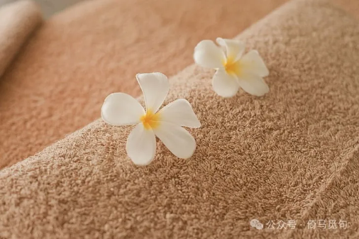

# 那一夜，我对重男轻女有了更深切的感受

我以前一直以为中国的男女平等观念已经深入人心了，网上的女权主义者多多少少有些危言耸听。在中国，不管男性还是女性，大家都很辛苦，女权主义者她们只看到一个性别的苦难，并且强调这种苦难，这虽然正确，但总归不是全面的。不管怎么讲，根据我自身的经历，现在的中国男女平等已经实现得差不多了。

不过昨天发生的一件事，让我开始相信中国的重男轻女观念在很多地方仍然根深蒂固。

昨天晚上，我一个人在某城市落脚，已经很晚了，就找了一家按摩店，这样既能按摩，又能过夜，比较划算。

给我按摩的技师很高，有一米七，看着并不小，而且活泼，喜欢聊天。她对我很好奇，非常细致地问我各种问题，让我一度怀疑她是潜入足疗店搞社会调查的研究生。

我问她多大，她说她是06年的。

我僵化了一秒钟，然后掰着手指数了数，最后还是问她：“你成年了吗？”

她说：“我已经成年半年了，来这里上班也半年了。”

我问：“那你父母是做啥工作的？”

她说：“我爸爸是包工的，妈妈没上班。”

这下我没绷住，因为我爸爸也是包工的，我妈妈也没上班。

但两个家庭出身相似的人，一个在按脚，另一个却在躺着享受……

我很好奇她的经历，就继续问她，了解了她的故事。

原来，她是安徽人，但父母很早就到江苏打拼，并且在江苏买了房，定居下来。

她家一直重男轻女，她妈妈和几个姨姨很小辍学，给她舅舅赚学费；她爸爸在家里处于主导地位，从不洗碗做饭。可以说重男轻女在她家是一种文化和传统了。

到了她这一辈情况也一样，没有任何改观。

弟弟出生前还好，她7岁时弟弟出生，从此以后父母就对她爱管不管了。每次暑假的时候，其他同学都出去旅游，她的父母却让她出去打暑假工，因为父母觉得他们自己十二三岁就开始打工赚钱了，这根本不算什么。

家里什么好事都轮不到她，也不怎么给她拿钱，父母的财产跟她几乎没有关系。父母甚至还说，以后弟弟的彩礼钱要她来挣。

初中毕业，上五年制的专科学校，但学校管理实在太烂，气氛压抑，甚至有人跳楼。她自己也有点抑郁，所以读了一年就辍学了。在她看来，打工比读书更开心，因为不用看老师脸色，也不用听父母唠叨，资本家比老师和父母都仁慈不少。

所以，这姑娘年纪轻轻，就已经在厂里打过好几个月的螺丝，还换过很多其他工作，全靠自己赚钱养活自己，非常了不起。

她爸爸还好点，还会经常问候她，给她转点钱，劝她回家工作，只是她看不上那边三五千的工资。她妈妈则是根本不管她了，微信对话框都是白的。

对于她的遭遇，我是唏嘘不已，这是我第一次深切感受到中国的重男轻女现状。以前虽然也听过类似的说法和故事，但远不及这一次给我的震撼。

当然，这小姑娘文化水平是比较高的，在江苏，上专科并不意味着成绩很差。而且她长得很高，脸也丰满，看来营养是跟得上的，她爸妈没让她饿肚子。另外，她之前去过新疆、重庆、东北、上海、北京等地，都是旅游去的，说明她平时生活条件也不差，只是跟弟弟相比，确实有很大落差。

现在她当技师每个月工资1万多，远高于当地平均水平，还很自由，算是找到了很好的工作。我相信以她的见识和聪明才智，以后一定会有所作为。

祝她一切顺利吧。
