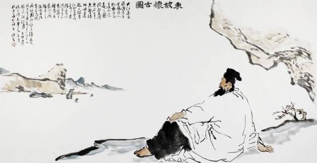
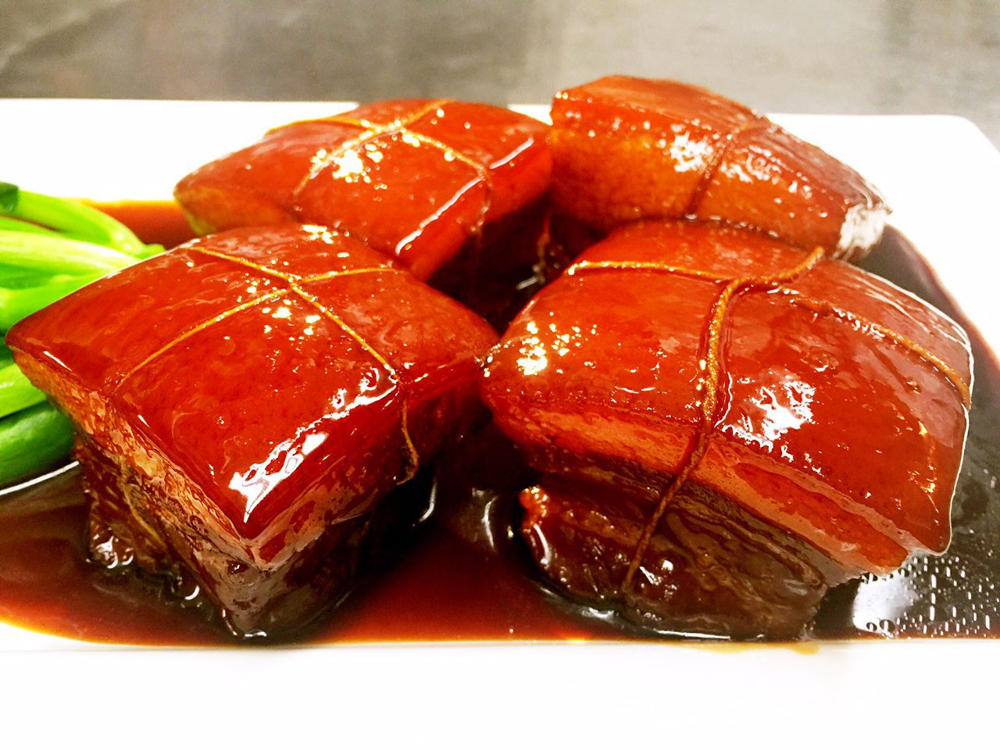
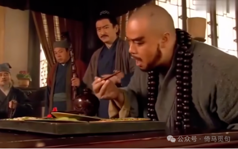
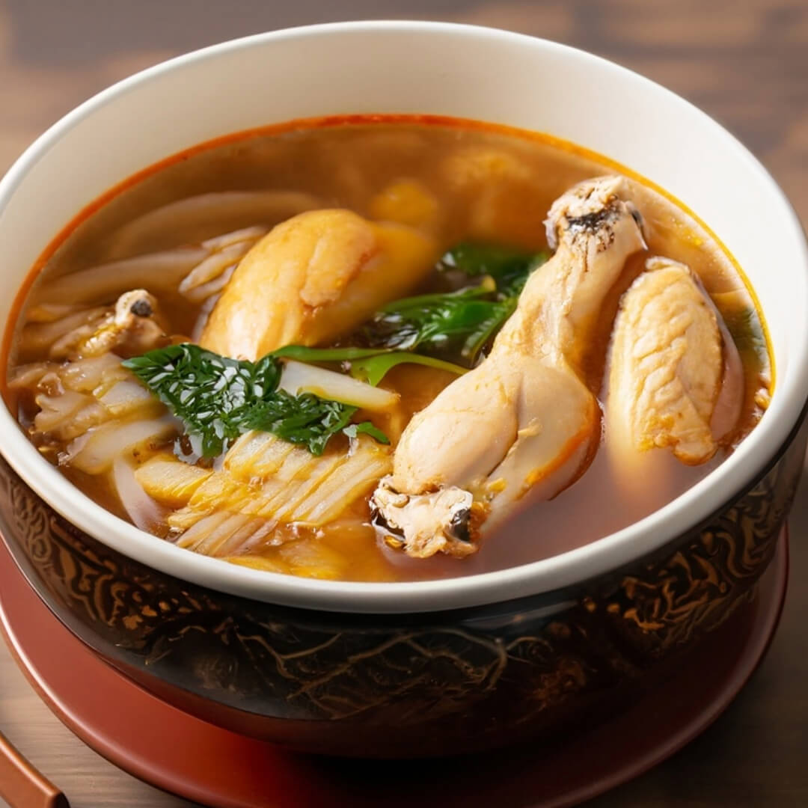
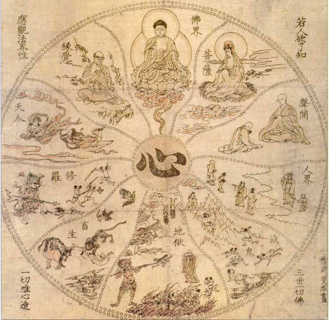

# 苏轼学佛又吃肉，他是如何做到不内耗的？

## 一 苏轼与佛禅

苏轼是一位美食家，这个全中国的人都知道，因为“东坡肉”实在是太有名了，还有那句“日啖荔枝三百颗，不辞长作岭南人”也是广为流传。

但是苏轼还是一位学佛之人，这个可能很多人都没啥深切的感受。

“南朝四百八十寺，多少楼台烟雨中。”佛教自汉朝传入中国以来，经过魏晋南北朝、隋唐五代的发展，在宋朝，佛教已十分兴盛，整体佛教氛围非常浓厚。

苏轼就是在这样的氛围中长大。苏轼的父亲苏洵就好佛喜禅，经常与僧人往来；他的家乡眉州以峨眉山得名，而峨眉山是佛教名山，山中有很多寺庙，苏轼小时候就经常在寺庙中游玩，早早地与佛结缘。

苏轼七岁时，曾经遇到一位姓朱的老尼姑，听老尼讲后蜀皇帝孟昶和花蕊夫人纳凉撰词的故事。

到了苏轼二十六岁任凤翔府签判时，留下了苏轼最早喜读佛经的材料。根据记载，苏轼阅读、抄写、题跋和刊刻的佛经主要有《楞伽经》《金刚经》《华严经》《莲花经》《多心经》等。这些佛经各有侧重，可见苏轼读佛经重在哲理思辨，追求个人解脱，并不囿于一宗一典。

苏轼从政时，将儒家的“兼济天下”理念和大乘佛教的“普度众生”宗旨结合起来，济贫救苦、修桥补路、施医施药、助葬埋骨，是封建社会典型的清官、好官。

南开大学的李庚扬认为，苏轼于佛教、佛禅的心路历程，大体分为三个阶段。

> 第一个阶段，青少年时直至因“乌台诗案”入狱以前。这时他好读佛书，以僧为友，但并不信佛，基本上是立身于儒教。第二个阶段，因“乌台诗案”入狱以后至被贬岭南之前。这一阶段可用“儒表佛里”来概括，即在官场仕途主要依据儒家思想来立言行事，而为人处世，特别是个人的精神生活方面，主要靠参禅悟道来调节。第三个阶段，被贬岭南直至去世。大概是由于生活的磨炼和接近劳苦百姓，他的儒家理念和佛禅思想都有某种程度消退，更多地以自己的经历、自己的观察、自己的认识为判断是非的标准（当然这也是禅宗，特别是临济禅的特点），也就是说唯物主义的因素在增长。——《苏轼与佛禅》第43页

元丰四年（1081年）五月，苏轼在黄州，由于是罪臣，朝廷不发工资，自己家人又多，生活较为困顿。于是苏轼自号“东坡居士”，在城东坡地要了几十亩荒地，带领家人开荒种地，自耕自食。

居士，是指在家修行的佛教徒。汉代以后，凡是自称“居士”的人，都多多少少跟佛教有关系，例如白居易晚年自号“香山居士”，欧阳修晚年别号“六一居士”。

看来，苏轼受佛学的影响，确实比我们想象中要大一些。

## 二 佛教徒不吃肉

出家人要遵守的戒律非常繁杂，而对于在家修行的居士来说则要简单得多，一般只遵守“五戒”或“八戒”就可以了。

“五戒”包括一不杀生，二不偷盗，三不邪淫，四不妄语，五不饮酒。而“八戒”则是在五戒的基础上又加上了“不以华冕装饰自身，不歌舞观听”、“不坐卧高广华丽床座”、“不非时食（过午不食）”三条。

佛教在汉代传入中国时，并不是完全禁肉的，但南北朝时期的梁武帝萧衍——他笃信佛教，并且四次出家，当然他同时也是一位文学家——为了弘扬佛法，根据佛经里的“断杀生”，作了一篇《断酒肉文》，绝对禁止佛教徒吃肉喝酒，连上供的猪羊头都改用面做。从此以后，佛教徒就彻底断肉了。

持斋本来是说“不非时食”，也就是中午以后不再进食，但到了后面就更侧重到吃素上了。

所以，不吃肉是由“不杀生”衍化而来，并且在南朝以后成为学佛之人的基本纪律，即使是现在的居士，大多也不吃肉。

然而，苏轼素不嗜素食（这句话可以收入主持朗诵队训练材料）。

自称居士的苏轼偏偏爱吃肉，也不免杀生，尤其喜欢吃猪肉。

苏轼有一首小诗，非常有名：“宁可食无肉，不可居无竹。无肉使人瘦，无竹使人俗。”虽然说的是“宁可食无肉”，但也侧面反映他喜欢吃肉，没少吃肉，“无肉使人瘦”嘛。

苏轼还有一篇文章，叫《猪肉颂》，全文如下：

> 净洗铛（音“称”），少著水，柴头罨（音“演”）烟焰不起。待他自熟莫催他，火候足时他自美。黄州好猪肉，价贱如泥土。贵者不肯吃，贫者不解煮，早晨起来打两碗，饱得自家君莫管。——苏轼《猪肉颂》

翻译如下：

> 洗干净锅，放少许水，燃上柴木、杂草，抑制火势，用不冒火苗的虚火来煨炖。等待它自己慢慢地熟，不要催它，火候足了，它自然会滋味极美。黄州有这样好的猪肉，价钱却贱得像泥土一样；富贵人家不肯吃，贫困人家又不会煮。我早上起来打上两碗，自己吃饱了您莫要理会。

据说人们根据这个记载，制作出了“东坡肘子”这道菜。但很显然，现在的东坡肘子也好，东坡肉也好，很难说是苏轼本人的发明，毕竟《猪肉颂》实在算不上操作性强的菜谱。

吃肉就算了，苏轼不但爱吃肉，还爱高调吃肉，甚至在寺庙吃肉，更离谱的是，有和尚还在寺庙专门烧猪肉招待苏轼。

苏轼访问金山寺时，佛印亲自烧猪给他吃。苏轼还为此作诗《戏答佛印》：

> 远公沽酒饮陶潜，佛印烧猪待子瞻。采得百花成蜜後，不知辛苦为谁甜。

## 三 苏轼：为念佛吃肉开脱的集大成者

历史上有很多人信佛又不免杀生吃肉，为此给自己找了许多借口或补救措施。

第一种方法是受到孟子的启发，远离厨房，所谓“君子远庖厨”。

> 君子之于禽兽也，见其生，不忍见其死；闻其声，不忍食其肉，是以君子远庖厨也。——孟子《梁惠王·上》

不忍心杀生，人之常情，佛儒先贤对此看法一致，并不稀奇。而眼不见心不烦，确实是一种方法。

第二种方法是写忏悔文，代表人物是南朝梁朝的沈约。

> 弟子沈约，稽首上白诸佛、众圣：……又暑月寝卧，蚊虻啮肤，忿之于心，应之于手，岁所歼殒，略盈万计，手因怒运，命因手倾，为杀之道，事无不足。迄至于今，犹未顿免。——沈约《忏悔文》

在佛祖面前，虔诚地交代自己曾经打过蚊子，虽然蚊子对此表示毫无意义，但沈约本人在心理上确实能够感到宽慰。

第三种方法就是换名字，也就是自欺欺人。苏轼在一篇文章中写道：

> 僧谓酒为“般若汤”，谓鱼为“水梭花”，鸡为“钻篱菜”，竟无所益，但自欺而已，世常笑之。然人有为不义，而文之以美名者，与此何异哉？

可见，按照当时的舆论，佛教徒不能吃肉喝酒，但仍有不少僧人想尽办法为自己开脱。

但说到开脱，其实苏轼才是开脱的集大成者。他的方法如下：

### 1、专吃死物之肉。

陶宗仪《说郛》卷七记载了苏东坡的一段话：

> 某昨日买十鸠，中有四活即放之，余者幸作一杯奠。今日吾家常膳，买鱼数斤以水养之，活者放而救渠命，殪者烹而悦我口。虽腥膻之欲，未能尽断，且一时从权尔。

买了十只鸟，把四只活的放了；买了几斤鱼，把死的吃了。“一时从权”，就这样暂时迁就一下吧。

### 2、为被吃掉的生灵念佛诵经。

袁中道《书〈戒杀文〉后》说：

> 东坡学佛，而口馋不能戒肉。至惠州，尤终日杀鸡，既甘其味，又虞致罪，故每月为转两日经，救拔当月所杀鸡命。

苏轼在惠州杀鸡比较频繁，又害怕佛祖怪罪，就每个月专门拿出两天时间为当月所杀之鸡超度。这样，鸡能升天，自己能修行，还不耽误自己吃肉，可谓一举三得。

### 3、自我安慰：鸡都是要死的。

袁中道《书〈戒杀文〉后》说苏东坡吃鸡的另一个理由是“世无不杀之鸡，均为一死”。

既然鸡生来就是要被杀掉的，那么自己不杀，也会有别人杀。自己多杀一只鸡，意味着别人少杀一只鸡，意味着别人的罪孽就减少了。看来，杀鸡也算是一件善举。

### 4、狡辩。

苏轼曾经作过一篇《禅戏颂》：

> 已熟之肉，无复活理。投在东坡无碍羹釜中，有何不可？问天下禅和子，且道是肉是素，吃得是吃不得是？大奇大奇，一碗羹，勘破天下禅和子。

禅和子是“参禅之人”“和尚”的意思，这段话的意思是：

已经煮熟的肉，无法再成为活物了，那么把它们放进汤碗中，又有何不可呢？请问各位大师，这碗汤究竟是肉还是素？究竟吃得还是吃不得呢？你们是不是答不上来了？真是奇怪，一碗汤难倒了这么多大师。

### 5、漱口。

苏轼在《东坡志林·卷二诵经帖》中写道：

> 东坡食肉诵经，或云：“不可诵。”坡取水漱口，或云：“一盎水如何漱得！”坡云：“惭愧，闍黎会得！”

闍黎（音“舌离”）是高僧的意思。这段话意为：

苏轼一遍吃肉一遍念经，有个僧人说：“别念了。”东坡端水漱口，僧人说：“一碗水怎么漱得干净？”苏轼说：“惭愧惭愧，大师还挺有经验嘛。”

## 四 苏轼的佛禅态度

在“乌台诗案”以后，苏轼对于佛教有时笃信，有时动摇，但很显然，苏轼从没有执着于经书上的教义，而是对佛禅有自己的理解，让佛禅的智慧服务自己的生活。

苏轼嘲笑僧人将酒称为“般若汤”，嘲笑高僧自己应该也有吃肉漱口的经验，说明自己认为这些戒律并不十分重要，那些强调这些戒律，又没有做到的人，还真不如自己这样高调吃肉。

苏轼不问戒律，寺院饮酒，读经吃肉，携妓访僧，但是这又怎么样呢？历史上很多高僧都不戒酒肉，释迦牟尼本人也曾是王族贵子，29岁才出家修道，此前也没少犯戒。

所谓“酒肉穿肠过，佛相心中留。”我认为只要心怀慈悲，多行善事，佛祖必然不会怪罪。

佛教讲“六道轮回”，就是按照生前的因果，会进入不同的道。其中有三善道：天神道、人间道、修罗道；有三恶道：地狱道、饿鬼道和畜生道。

苏辙《亡兄子瞻端明墓志铭》记载：

> 未终旬日，独以诸子侍侧曰：“吾生无恶，死必不坠，慎无哭泣以怛化。”问以后事，不答，湛然而逝，实七月丁亥也。

苏轼死前对自己的儿子们说：我这辈子没做过什么恶事，死后一定不会坠入三恶道，你们不要哭了。然后坦然逝去。

主要参考文献：

李庚扬，李勃洋.潇洒人生：苏轼与佛禅[M].郑州：河南人民出版社，2001

袁黄.了凡四训[M].张景，张松涛，译注.北京：中华书局有限公司，2016
