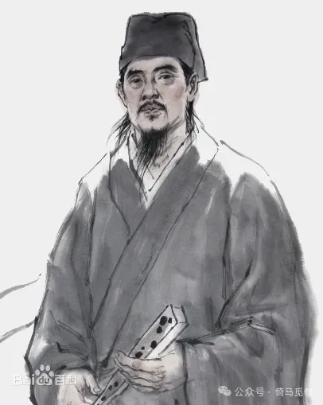
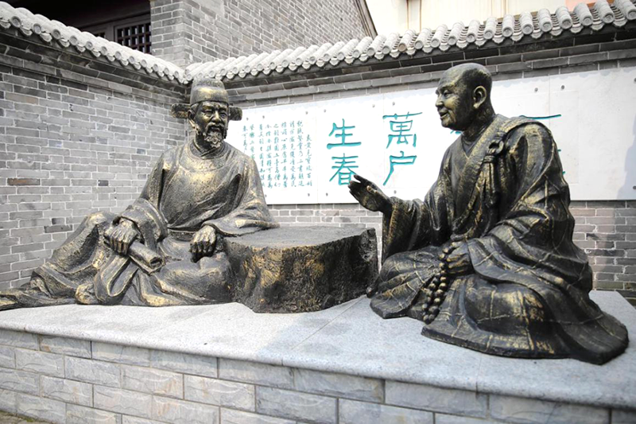
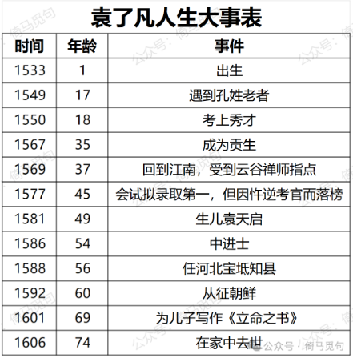
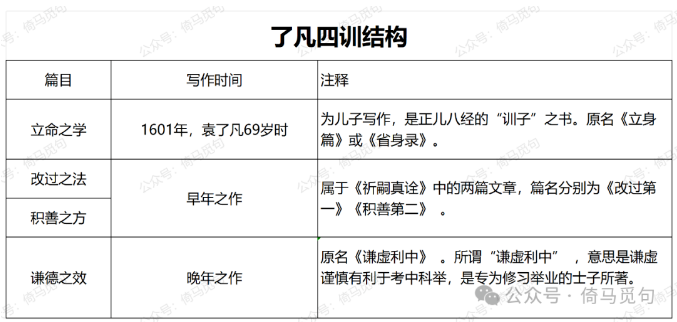
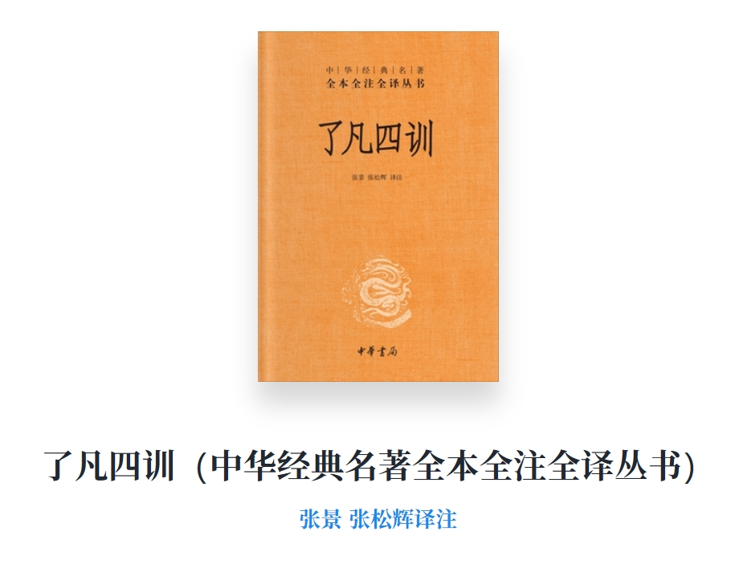
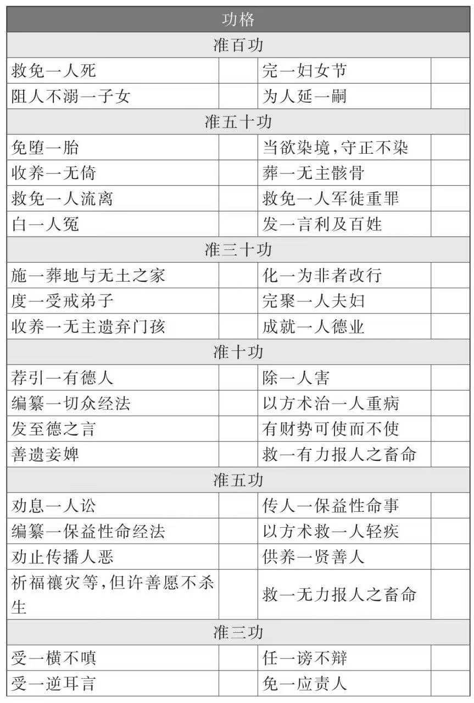
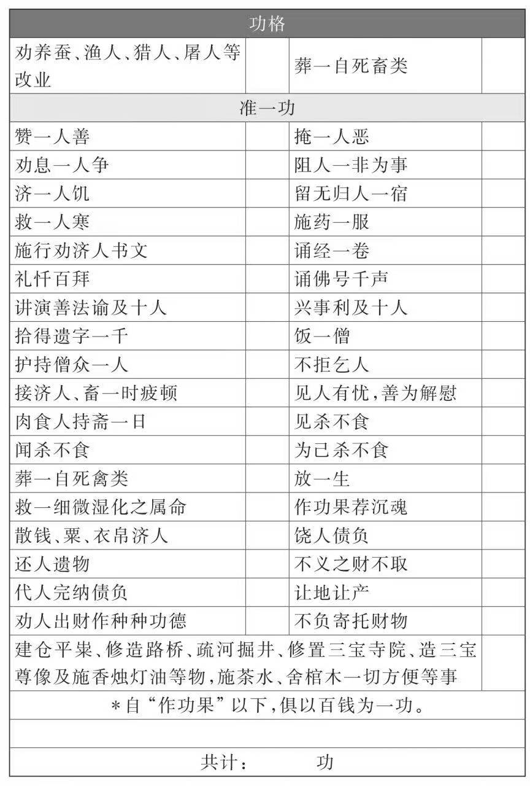
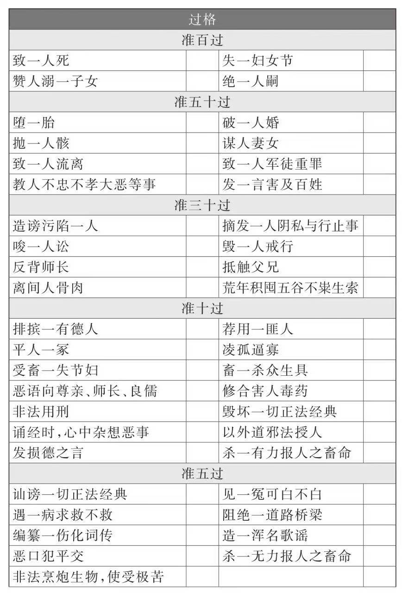
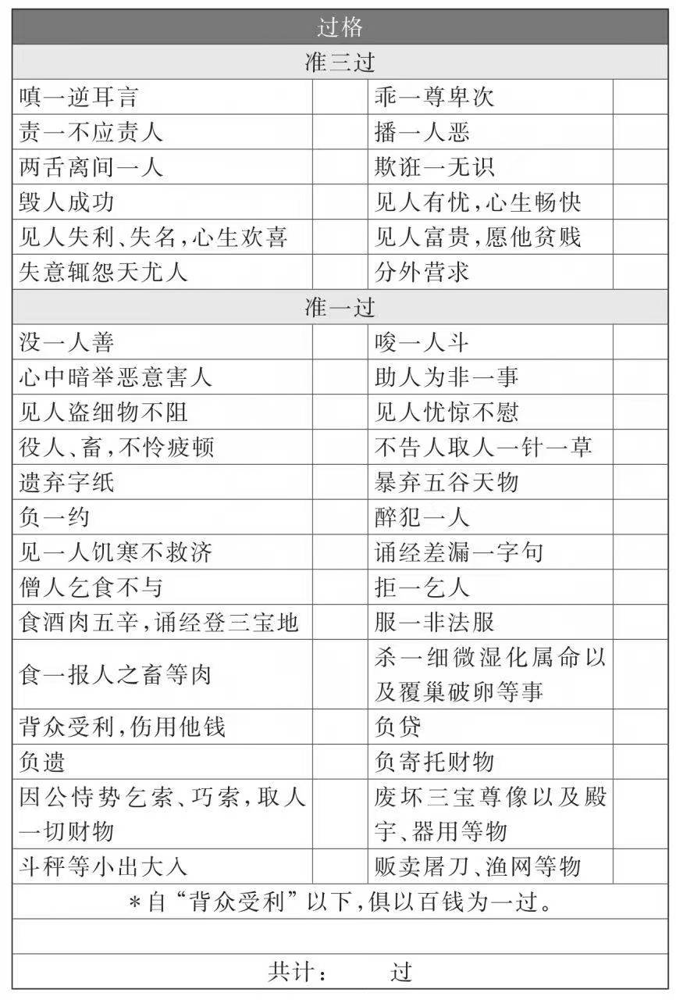

# 命由我作，福自己求——读书报告：《了凡四训》

## 一 袁了凡的故事

在“命由我作，福自己求”这个句子中，“由”和“自”意思类似，“我”和“己”意思类似，这句话的意思是说：命运的好坏是由我们自己决定的，福祉也要靠我们自己去追求。

这句话是《了凡四训》的核心价值观。要说明这个观点，还得从一个故事说起。

话说作者袁了凡原先不叫了凡，他叫袁黄，字庆远，号学海，江浙人士。童年丧父，老母亲让他不要走科举道路，而是学医完成父亲的遗愿。

17岁时，袁黄在慈云寺遇到一位很会算命的老人，姓孔。孔先生建议袁黄走科举道路，并且给他算命，预测袁黄第二年的科考成绩如下：参加县级的童生考试，可以考到第十四名；府考能够考到第七十一名；提学考能够考到第九名。

第二年，袁黄参加考试，三次考试的结果和孔先生的预测完全相符，袁黄成功成为秀才。

然后，孔先生为袁黄预测了他一生的吉凶祸福：

> 某某年的年考你能够考取第几名，某某年你能够补为廪生，某某年你能够成为贡生，成为贡生后的某某年，你能够当选为四川的一个府县长官，在做知县的三年半以后，你就应该辞职回家。到了五十三岁那年八月十四的丑时，你将会在家中去世，可惜你这一生没有儿子。

此后，每次考试，孔先生的预测没有不灵验的，后来补为廪生，35岁又如期成为贡生。于是，袁黄更相信了人的命运是先天注定的，所以他变得淡泊，后来在北京待了一年，连书都不读了，终日静坐。

37岁，袁黄回到江南，去栖霞山拜访了云谷禅师。他俩对坐一室，谈了三天三夜没有合眼。

云谷禅师很赞赏：凡人不能成圣，就是因为无法抛弃妄念，而袁黄却三天没有起一丝妄念，这是怎么做到的呢？

袁黄说：孔先生已经将我的一生荣辱算定，一切都有定数，所以没什么好妄想的。

云谷禅师对此表示反对：我原来还把你看作人中豪杰，原来只不过是一介凡夫俗子而已。

接着云谷禅师提出自己的观点：

> 一个人如果不能消除虚妄的世俗之心，那么他就会自始至终被万事万物所束缚，怎么能够没有注定的命运呢？但是只有那些普通人才有注定的命运；极为善良的人，原本注定的命运就根本无法使他的吉凶祸福一成不变；极为凶恶的人，原本注定的命运也根本无法使他的吉凶祸福一成不变。你二十年以来的命运，都被孔先生预测准确，不曾有丝毫的改变，你难道不是个凡夫俗子吗？

袁黄问：那么可以逃脱已经注定的命运吗？

云谷禅师说：

> 命由我作，福自己求。《诗》《书》所称，的为明训。我教典中说：“求富贵得富贵，求男女得男女，求长寿得长寿。”夫妄语乃释迦大戒，诸佛菩萨，岂诳语欺人？”

随后，云谷禅师劝说袁黄，只要你多做善事，命运一定会有所改变。

并且还说了很多鸡汤，给袁黄打鸡血，比如：

> 从前种种，譬如昨日死；从后种种，譬如今日生：此义理再生之身也。

> 《太甲》曰：“天作孽，犹可违；自作孽，不可活。”《诗》云：“永言配命，自求多福”。……《易》为君子谋……开章第一义，便说：“积善之家，必有余庆。”

袁黄对此非常赞同，并且做了三件事，以示诚意：

1、在佛祖面前坦白自己过去的过错，发誓要做三千件善事。

> 因将往日之罪，佛前尽情发露，为疏一通，先求登科，誓行善事三千条，以报天地祖宗之德。

2、接受云谷禅师的“功过格”，记录自己每天的功过。

> 云谷出功过格示余，令所行之事，逐日登记；善则记数，恶则退除；且教持《准提咒》，以期必验。

3、改号，原先号“学海”，改为“了凡”，意为不落凡人的窠臼。

> 余初号“学海”，是日改号“了凡”，盖悟立命之说，而不欲落凡夫窠臼也。

从今以后，袁了凡谦虚谨慎，努力去恶扬善。

第二年，袁了凡38岁，继续参加一次礼部主持的考试，孔先生算他能考第三名，但袁了凡却考了第一名。后来又成功考上举人。49岁时，三千件善事做完，生了一个儿子，叫袁天启。51岁立誓再做一万件善事，54岁中进士，当了宝坻县令，在任上又行仁政，继续做善事。

原先孔先生预测袁了凡53岁寿终正寝，但袁了凡写这篇文章时，已经六十九岁了。后来他活了74岁，可以说完全改变了自己已经注定的命运。

## 二 《了凡四训》介绍

以上就是《了凡四训》里的“第一训”《立命之学》的主要内容，也是这本书最重要的内容。这一部分通过讲袁了凡自己的故事，表达出自己的核心思想：“命由我作，福自己求”。

“命由我作，福自己求”的核心，就是在不否认“宿命论”的基础上，更加侧重“报应论”，袁了凡将当时关于命运的两种最流行的理论巧妙地融合在了一起，并且结合自己的亲身经历，所以很有说服力。《了凡四训》也被称为“中国第一劝善书”。

《了凡四训》的四篇文章并不是一起写作的。第一篇文章《立命之学》是袁了凡69岁为儿子写的，是劝告儿子多做善事。第二篇文章《改过之法》和第三篇文章《积善之方》则是袁了凡早年的作品。第四篇文章《谦德之效》则是他晚年的作品。只是后人将这四篇主旨类似的文章编在一起，成为现在的《了凡四训》。

《改过之法》认为，一个人在行善之前，首先要改正已有的措施。改正的方法，首先是要有羞耻心、敬畏心和勇敢心；其次是知道三种改过的途径：“从事上改”“从理上改”“从心上改”；最后，作者举了一系列改过自新的例子。

《积善之方》列举了十个行善的事例，证明“积善之家必有余庆”的道理。这一篇还讨论了行善的八个问题：真与假、端与曲、阴与阳、是与非、偏与正、半与满、大与小、难与易。最后，作者还列举了十大行善内容：与人为善、爱敬存心、成人之美、劝人为善、救人危急、兴建大利、舍财作福、护持正法、敬重尊长、爱惜物命。

《谦德之效》开头引用《周易》和《尚书》的格言，说明谦虚的好处，然后讲述了五个故事，证明“满招损、谦受益”的道理，最后将落脚点放在科举上：只要你立下志向，努力追求功名富贵，并且谦虚谨慎，处处给人方便，就一定能考取功名。

《了凡四训》的内容大体如此。

## 三 我的感想

我在《谈谈科学和信仰：内心强大的人都是自洽的》一文说过：

> 内心强大的人都有一个自洽的体系，这个体系包括了一套完整的世界观和价值观。……至于这个自洽的体系是什么，是科学还是神学，是共产主义还是实用主义，是自由民主还是精致利己，其实并不重要。

> 谢雨卿，公众号：倚马觅句
> 《谈谈科学和信仰：内心强大的人都是自洽的》

很显然，《了凡四训》中的世界观和价值观，就是一个非常自洽的体系。在这个体系中，袁了凡不否认宿命论，但是更强调报应论，还把行善和现实中的功名富贵绑定在了一起，所以，一旦你相信这套说法，你就会非常心无旁骛地追求功名和行善，你越相信，就越能发挥自己的主观能动性，最后成功的概率也就越大。

从社会的角度讲，《了凡四训》虽然也鼓动大家追求功名富贵，但其途径却是利他的，他鼓励大家行善去恶，谦虚谨慎，为他人着想，具有儒家“兼济天下”和佛家“普度众生”的理想主义成分，这比现在的“优绩主义”和“精致利己主义”有格局多了。

让部分为富不仁的权贵和只知内卷的学生多读读《了凡四训》，我相信没有什么坏处，所以总体上我是支持这本书的。

不过《了凡四训》也有一些时代性，比如作者重视生儿子和考取功名，这一点当今读者可以自行变通。

最后，我读的版本附录了一个《功过格》，就是云谷禅师给袁了凡的那个东西，记录自己善恶功过的一本簿册。附录的这本功过格有很多不合时宜的思想，不过非常有意思，附之于后，供诸君讨论。

主要参考文献：

袁黄.了凡四训[M].张景，张松涛，译注.北京：中华书局有限公司，2016
