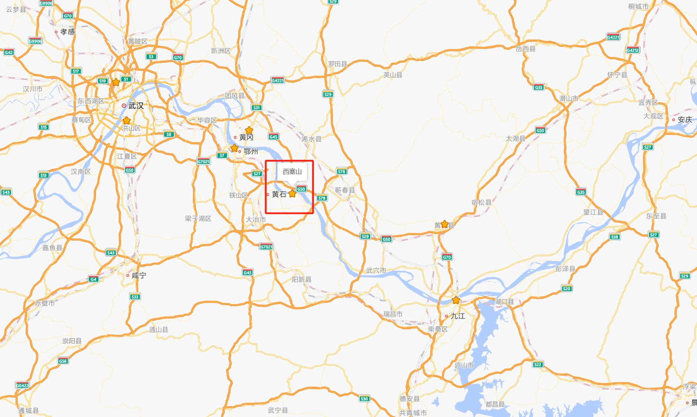
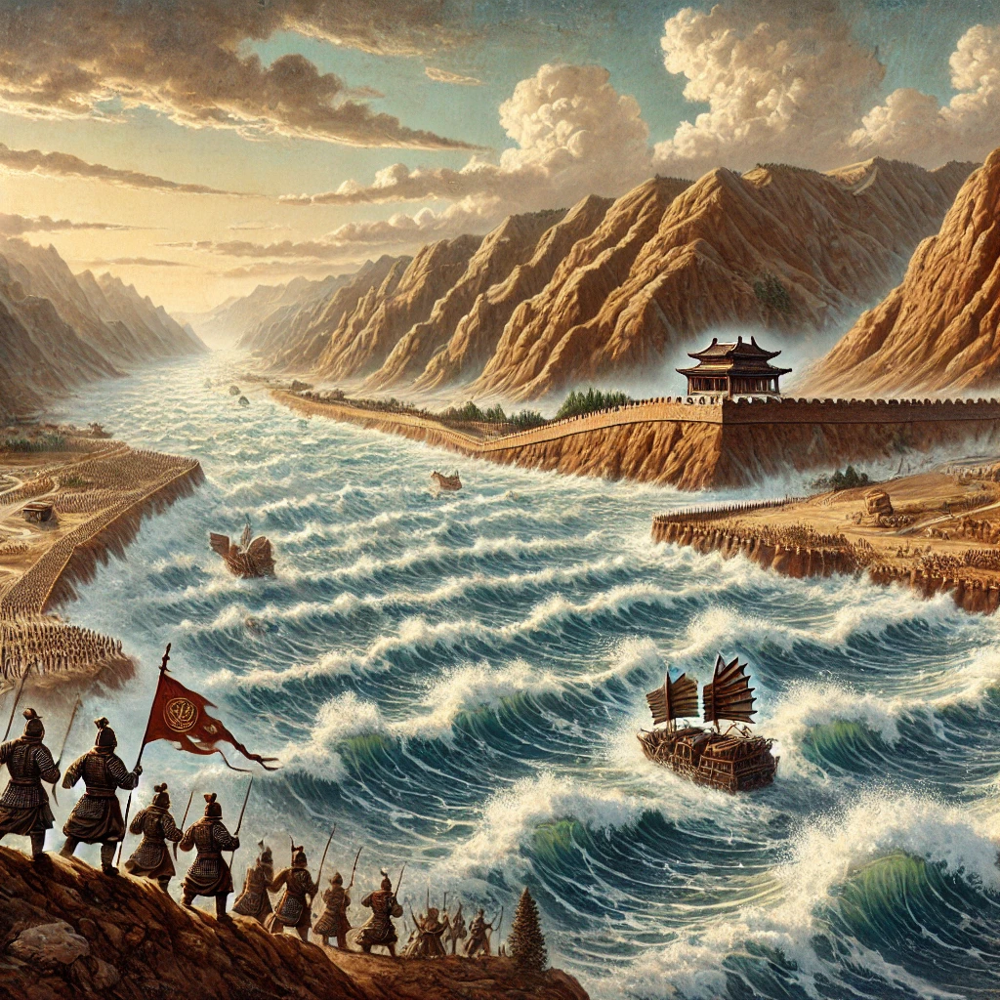

# 人世几回伤往事，山形依旧枕寒流——诗歌赏析《西塞山怀古》

## 一

我的微信签名是“人世几回伤往事，山形依旧枕寒流”，此句出自刘禹锡的《西塞山怀古》，全文如下：

> 王濬楼船下益州，金陵王气黯然收。
> 千寻铁锁沉江底，一片降幡出石头。
> 人世几回伤往事，山形依旧枕寒流。
> 今逢四海为家日，故垒萧萧芦荻秋。

刘禹锡擅长写咏史诗，但我认为这首咏史诗或许是他写的最好的一首。

不过要读懂这首诗，还需要一些背景补充，尤其是“人世几回”一句，本身并不出彩，但在这首诗中却是绝笔。下面我就给大家讲解一下。

## 二

### 1、西塞山怀古

西塞山在湖北黄石东面的长江边，是六朝有名的军事要塞，据说此地地形险要，发生过上百次战争。

（图西塞山位置图）

唐朝韦应物有诗《西塞山》形容这里的景色：

势从千里奔，直入江中断。

岚横秋塞雄，地束惊流满。

由于东南政权往往政治中心在苏南浙北，荆州地区作为吴越地区的上游，所以必须尽早控制。而由于此地距离较远，又往往另外派遣将领进行兼顾。西塞山位于荆州地区和吴越地区之间，且位置险要，所以对东南政权来说，政权开创和政权将要灭亡的时候，西塞山要塞就显得非常重要，反而东南政权强大的时候，这个地方就不那么重要了（类似清朝的长城）。

有这样的地理位置，西塞山更让人感受到朝代之兴亡。

824年，52岁的刘禹锡由夔州刺史调任和州刺史，从现在的重庆去往现在的南京西（安徽和县），走的当然是水路，途中路过西塞山，有所感触，写下这首诗。

### 2、王濬楼船下益州，金陵王气黯然收

王濬（音“俊”）是西普初年的益州刺史，他担任益州刺史后，造了七年船，一直在为灭吴做准备，又由于他当时年已古稀，不知什么时候就要死了，迫切地想要建功立业，所以对灭吴这件事，他是枕戈待旦，志在必得。

公元279年11月，晋武帝司马炎决定攻吴；280年正月，王濬作为主力部队（至少是水军主力），率领高大战船从益州（治所在今天的成都）出发；三月中旬，王濬进入建业（南京），接受吴主孙皓投降，三国遂归为一统。

在“王濬楼船下益州，金陵王气黯然收”一诗中，上一句我们才看到王濬率领着战船从四川出发，沿着长江浩浩荡荡地前进，下一句我们就看到这支部队已经来到了金陵城下，一个朝代就此灭亡。上一句是“下”，下一句就“收”了，这中间没给我们任何反应时间，让人感到王朝的灭亡非常迅速，胜者摧枯拉朽，败者一溃千里。

### 3、千寻铁锁沉江底，一片降幡出石头。

从整个晋灭吴之战来看，这句写了更多的过程和细节；从镜头视角来看，这句则是从吴国的视角来刻画这场战争。

话说吴国为了抵挡晋国的水军，在长江险要的地方放置铁锁拦截，又在江中放置铁锥，长达数丈。可是这又有什么用呢？王濬用木筏清理了铁锥，又用火炬烧断了铁锁，大船依旧通行无碍。

石头城原先是南京石头山上的一座军事要寨，后来成为南京城的代称，南京在汉朝称为“秣陵”，孙权改名为“建业”，后来又被称为“金陵”。

吴主孙皓就是在石头城向王濬等人投降。“幡”是旗帜的意思。“寻”是长度单位，“八尺曰寻”，也有人说是六尺、七尺，反正1寻大概长于1米，短于2米。

所以，在这一联，前一句写几千米的铁锁全部沉入江底，后一句写石头城上插满了投降的旗帜。这些既是实写也是虚写，“铁锁”象征着东吴的防线，“降幡”象征着东吴的投降和失败。这一联和上一联意思差不多，只是换了一个角度描写。

### 4、人世几回伤往事，山形依旧枕寒流

这两句单看并不算什么，但是连着前面四句，就让人拍案叫绝了。原先以为刘禹锡只是写东吴，但实际上却是在感叹整个历史。

东吴是六朝的第一个王朝，六朝包括：东吴、东晋、宋、齐、梁、陈。前两句用四个片段展现了晋灭吴的过程，而这一联的“人世几回”则让我们联想到了东吴以后的各个朝代。

就好像刘禹锡在前两联放映了电影的开头，而“人世几回伤往事”则让读者按照这个逻辑，在脑海中自动播放了剩下的电影。

可是这又怎么样呢？任凭你朝代兴亡，西塞山依旧枕着长江，山依旧是当年的形状，水依旧流。

这样的古今对比，让人感慨。怀古诗之所以动人，很多时候都用到了这个处理手法，这一点我们后文再讲。

### 5、今逢四海为家日，故垒萧萧芦荻秋。

现在恰逢国家统一，原先的西塞山要塞，以前的营垒已经荒废在芦荻秋风之中。

这一联感情比较复杂，有人说这只是对前几联感叹的继续，继续伤感王朝更迭；还有人说这里面有一种哲学观点，一切事物都有辉煌和衰败，暗示唐王朝也会像过去的朝代一样遭遇灭亡；还有人说这两句有借古讽今之意，提醒当时的统治者应该励精图治，否则就会像东吴那样亡国；还有人说这句诗是针对唐朝的藩镇割据势力，国家统一是历史趋势，分裂国家的人不会有好下场。

不同的人，不同的心境，会读出不同的意思，这也是这首诗耐读的原因。

## 三

刘禹锡的咏史诗是有公式的，其中一个就是“兴废由人事，山川空地形”。换个说法，就是“物是人非”：人间的事情发生了很多，但是山川却没有什么改变。通过这种对比，更加能够加深我们对人事的感叹。

比如刘禹锡的《石头城》和《乌衣巷》：

> 山围故国周遭在，潮打空城寂寞回。
> 淮水东边旧时月，夜深还过女墙来。

> 朱雀桥边野草花，乌衣巷口夕阳斜。
> 旧时王谢堂前燕，飞入寻常百姓家。

其他诗人也应用这个手法，这种手法往往能够营造出一种史诗的感觉。

例如杨慎的《临江仙》，这首词作为《三国演义》的开篇词，意境非常合适，也是用到了这种手法。

> 滚滚长江东逝水，浪花淘尽英雄。是非成败转头空。青山依旧在，几度夕阳红。
> 白发渔樵江渚上，惯看秋月春风。一壶浊酒喜相逢。古今多少事，都付笑谈中。

再比如苏轼的《念奴娇·赤壁怀古》：

> 大江东去，浪淘尽，千古风流人物。故垒西边，人道是，三国周郎赤壁。
> 乱石穿空，惊涛拍岸，卷起千堆雪。江山如画，一时多少豪杰。

这样的例子数不胜数，就不再列举了。

不过，这种手法也就只适合古诗了，现在适用性大大降低。因为现代社会发展太快，以前“沧海桑田”可能要几千年几万年，现在可能只要几十年。十几年前的小城，可能现在已经完全变了样子。而且现在的景观复杂，很难再用几句话就把景观的特点给总结出来，必须要用到更加复杂的文体。

当然，这也不影响我们欣赏以前的诗词。

