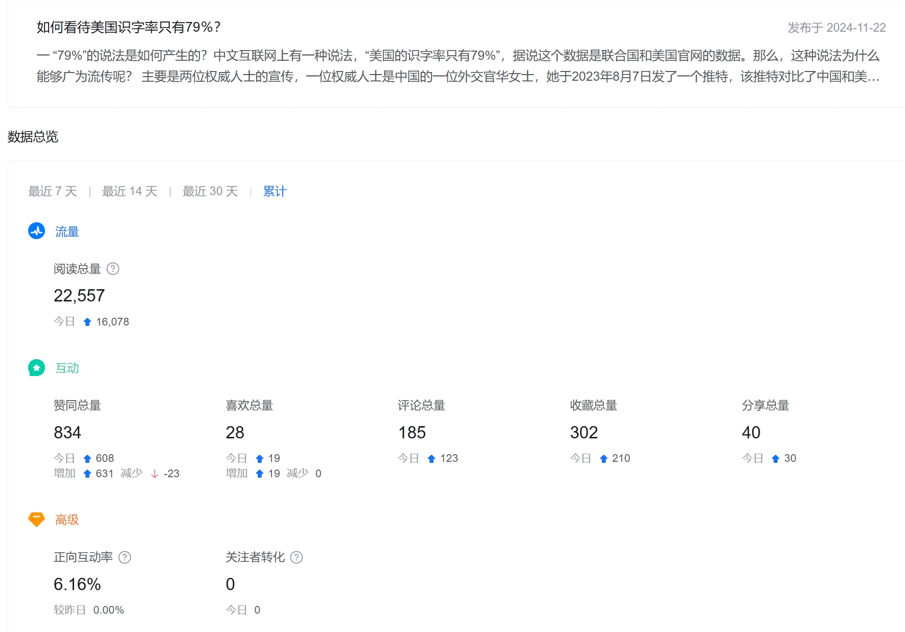
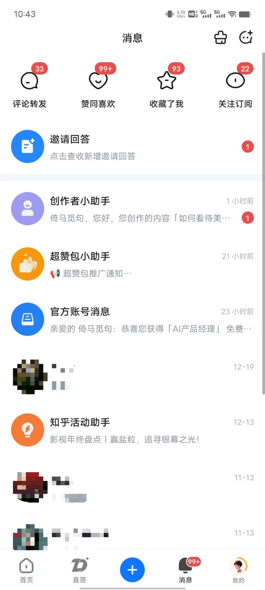
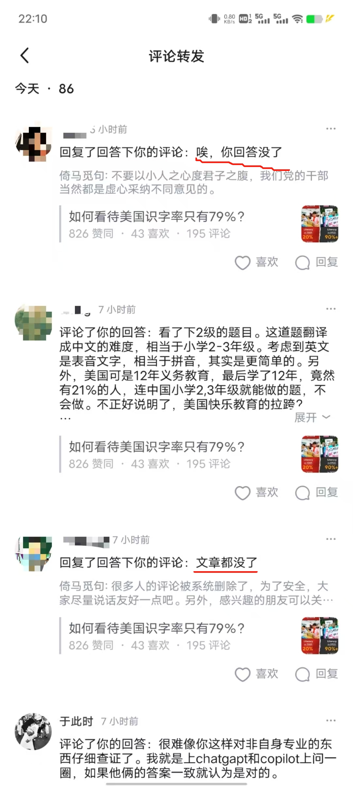
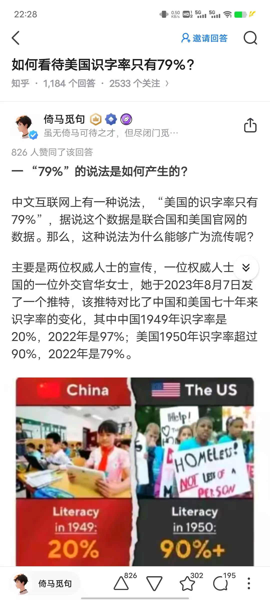
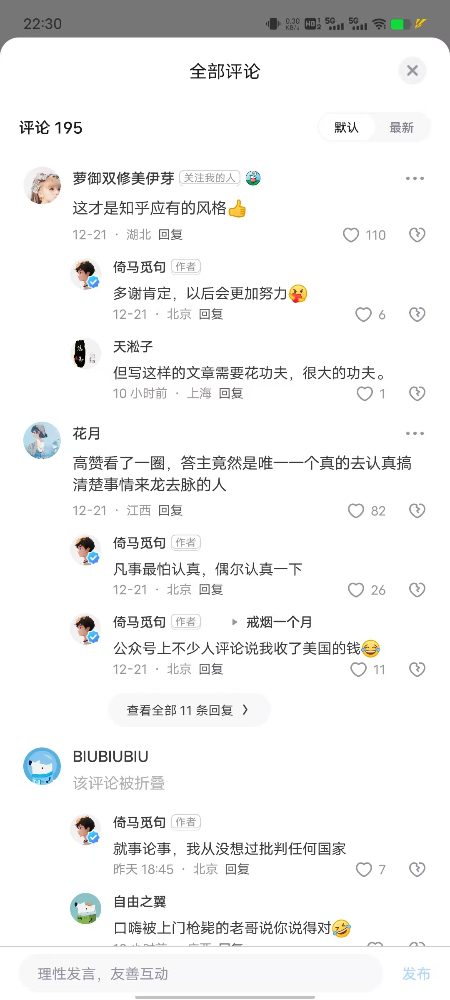

# 做人，一定要谨言慎行

昨天我用知乎送的流量抵扣券，给《如何看待美国的识字率只有79%》的回答增加了两千曝光，这个回答是11月22日发布的，正好一个月。但这一个月以来，这个回答几乎没什么流量，点赞量只有两位数。

没想到，曝光后反响很大，触发了系统的流量机制，短短两日，这个回答就从几十个点赞量增加到八百点赞量，而且评论也是以正面为主，这让我感到非常开心。

可以说，几个小时不看手机，就会有99+的消息。

然而，这波流量在今天下午3点钟左右戛然而止，从我的账号看，回答并没有被删除，但是其他用户却看不到这个回答了，打开回答链接，只能显示“知识的荒原”。

由于我没有收到知乎发的违规通知，所以我判断回答被隐藏的原因，应该是文中提及了华女士和木先生的小错误，评论区也有不少人对这二位不太友好。

我自问自己没说什么过分的话，只是就事论事地指出他们的一些瑕疵，还在评论区维护两人的形象，毕竟人都有失误的时候，有时候说话不严谨再正常不过了，他们二位当然是谦虚有包容心的人，怎么可能跟我这个晚辈过意不去呢？

知乎应该也不是有意针对我，只是有些评论确实有风险，他们也不想惹麻烦。

于是，我把这篇回答的不友好评论全部折叠，并且关闭了评论区，然后把文中两位的名字抹去，但愿知乎审核能给我通过吧。

当然，我也不抱太大希望，就当是给自己一个教训吧，以后一定要更加如临深渊，如履薄冰。

至少做到以下几点：

1 多说别人的好话，不说别人的坏话。即使一定要提到别人的负面信息，也尽量不点名，给对方留以情面。

2 多宣传正能量，不宣传消极观点和消极态度，即使是提到发展中的问题，也要强调道路是曲折的，前途是光明的。

3 争议性大的文章，评论不能全部开放。正常讨论的评论可以放，正反方的观点都可以放，但是只要涉及人身攻击，一律不展示。

我认为这不是妥协，而是以退为进。如果我连号都没了，那我就什么也发不了了，必须尊重游戏规则，给其他人留以情面，不让其他人难堪，让大家都有所收获，这样才能长久地写下去。

而且我相信，只要我能够妥善处理这些敏感言论，就一定能在求索真理的同时，让国家满意，让平台满意，让读者满意，大家都各取所需，实现共赢。

-END-

这是一个能涨知识的公众号，关注我，阅读更多有趣文章～
