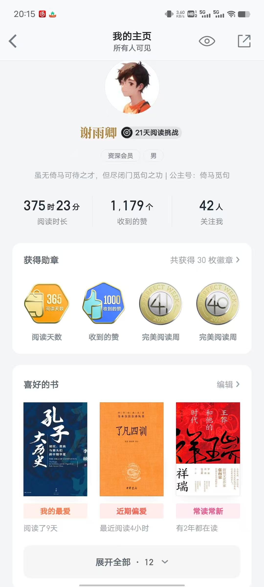
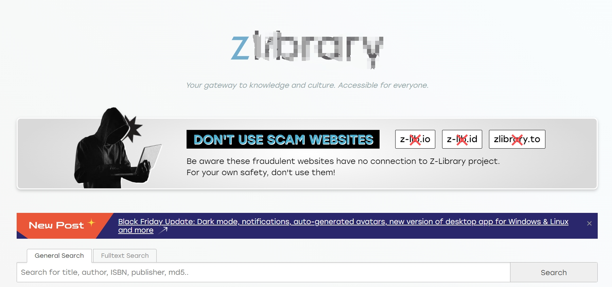

# 谈一谈我是如何找书的

我还算喜欢读书。大学以前，家里买书的消费都达到上万块，十几年来买的书装满了三个房间的书架。我当时没什么别的消费，多的钱都用来买书了。

但是大学以后，我基本没买过书，原因就是我习惯了电子化阅读。

我探索过很多读书软件和读书网站，现在，用的最多的只有两个：微信读书和z站。

先说微信读书吧。这个软件的好处就是后台比较强大，而且藏书丰富。我以前用过vivo读书，但是后来换了华为手机，以前的阅读数据和笔记就找不到了。而微信读书则没有这个烦恼，从现在的局势看，微信读书基本不会倒闭，而且微信读书的笔记会被点赞，阅读过程中也可以读到别人的评论，还可以加好友互相交流，让人颇有成就感。

就其藏书来讲，微信读书也比较全，而且在不断更新，只要开一个会员，基本上能满足你的大部分阅读需求。对普通人来说，这个软件就能解决90%的阅读需求，因为流行的书、经典的书，这里都有。

当然，一开始使用新的阅读软件可能会不习惯，但习惯以后，就会发现这个软件非常方便，很适合碎片化阅读。

微信读书还有下载功能，下载一本书，坐飞机的时候读，可以解决旅途中断网时期的娱乐问题。

如果你想找的书微信读书里没有，那么就可以试试z站。

基本上只要不是太冷门的书，这个网站都有收录。如果一本书连z站都没有，那就只好去更专业的地方找了，比如专业网站、图书馆。

Z站的缺点是，它必须在海外访问，而且据说这个网站被很多国家宣布为非法，所以要想访问这个网站，最好找一个合法的国家。

我每次都是请在国外的朋友帮我下载，然后传过来，而且不用于商业用途，所以我是合法的。

如果有朋友想要什么电子书，可以联系我，我一定在不违法的前提下帮助你。

我大一的时候还经常使用中文马克思主义文库，马理论的经典著作都有收录，而且国内也能访问。不过自从我把马恩文集下载到电脑以后，这个网站我也不怎么看了。

图书馆也是一个好地方，有很多书都是外面找不到的，所以如果你的住所周围有图书馆，可以去里面看看，说不定会有新的发现。

我偶尔也去书店看看，书店里的书以畅销书居多，虽然水平参差不齐，但可以看到大众的普遍水平。

知识就是这样，知道的人觉得习以为常，但不知道的人却对此却毫无概念。我今天分享的两个找书方法，对一些人来说是常识，但对另一些人来讲却能让他们省去很多时间。希望能对大家有所帮助。
