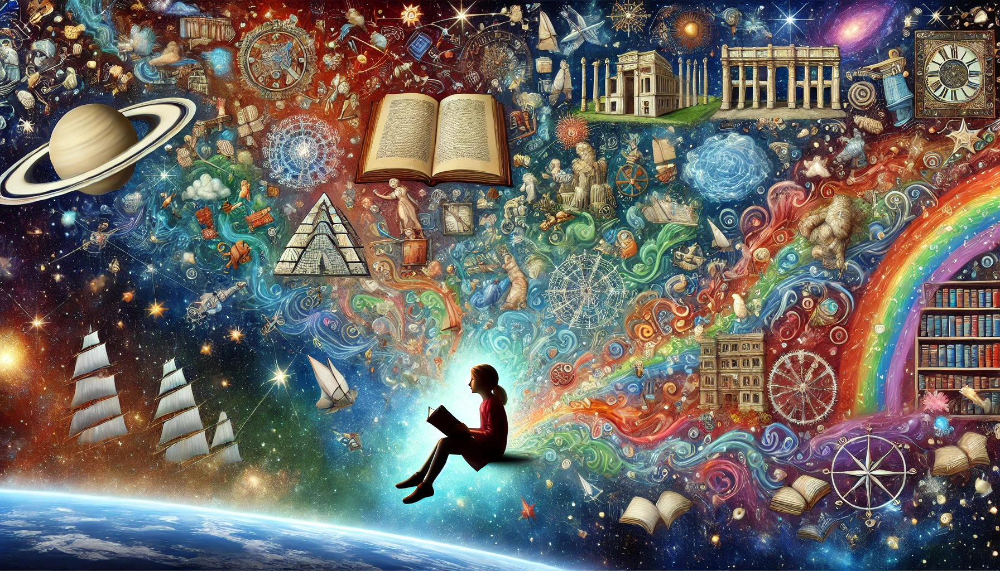

# 读文学类书籍有很多好处，但……

读文学类书籍有很多好处：

1 读其他人的故事，从中吸取经验教训，好像多活了好几次。

2 了解不同地方、不同时代的风俗、地理、文化，增加知识面。

3 了解不同的生产方式和不同的职业。

4 了解不同人群的内心世界。

5 学习各种文学的语言，提高表达能力，从而提升人格魅力。

6 将书中的故事和现实经历作对照，互相印证，所以爱读书的人在生活中也更智慧，学东西也会更快。

7 看书也是一种娱乐，让人放松心情，而且这种娱乐没有什么心理负担。

8 由于在书中见证过各种人生和各种思想，所以对社会的了解也会更深刻更全面，更具有同理心，更有包容心。

9 提升想象力。人总会受限于自己的生活环境，但是读文学作品却能让你在各种时空之间遨游。

综合上述读文学类书籍的好处，我们可以推断，在多媒体的互联网时代，文字的很多作用都被图片和视频代替了，所以随着漫画和影视作品的流行，文学也很少有人看了（从比例上讲），尤其是那种大部头的经典文学作品。

比如雨果的《悲惨世界》，原文简直是又臭又长，各种无聊的环境描写整篇整篇地出现，分支剧情和人物也太复杂了，读一段时间可能就搞忘了。也许只有那个没有手机的年代才会有那么多人有耐心地看完吧。但《悲惨世界》的电影则好看多了，让人两三个小时就了解了整个故事，上述读文学的好处，电影大部分也都有了。

所以真不能怪现在的人都不怎么读书了，大家都不傻，都会挑对自己有利的事情做。电影、长短视频、公众号和知乎文章，都是很好的阅读材料，有时候同样能达到读一本好书的效果。

但是，互联网上大部分信息都是垃圾信息，对现代人来讲，信息早已过载，更重要的问题是如何找到优质的信息来源。一个好的信源，胜过好几本书。

比如关注我的公众号，总能学到新知识、新技能，而且多了一个看世界的角度，让你打开眼界：哇！原来有人是这样思考问题的。

我的公众号没有怎么宣传，连朋友圈都没转过，但仍然有很多厉害的人通过各种途径找到并关注了。这些人都是有眼光有远见的，历史将证明他们做了正确的决定。
