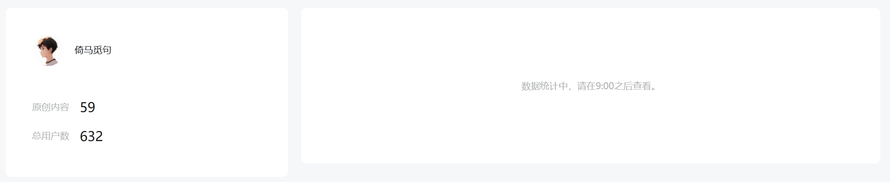

# 2024年公众号创作报告：没有经验，全是教训

我从今年9月13日在公众号发表第一篇文章[《范仲淹没有见过岳阳楼，李白也没去过天姥山》](2024-09-13-%E8%8C%83%E4%BB%B2%E6%B7%B9%E6%B2%A1%E8%A7%81%E8%BF%87%E5%B2%B3%E9%98%B3%E6%A5%BC%EF%BC%8C%E6%9D%8E%E7%99%BD%E4%B9%9F%E6%B2%A1%E5%8E%BB%E8%BF%87%E5%A4%A9%E5%A7%A5%E5%B1%B1.md)一文，至今已105天，共发表60篇原创文章，粉丝632人。说实话，挺失败的，必须反思。下面是我的创作报告，谈不上什么经验，全是教训。

## 1 孤芳自赏的公众号名称。

当时我想到“倚马觅句”这个名字的时候，感觉自己真是个天才，因为这名字暗含“虽无倚马可待之才，但尽闭门觅句之功”的意思。“倚马可待”用到了一个历史典故，表示写文章很快，靠在马背上写，很快就能写好拿去用；“闭门觅句”说明自己写作努力、踏实，有根有据，质量上乘；“倚马”又暗示本公众号以马克思主义为指导，本人也读过很多马克思主义经典著作。

这四个字，真是微言大义，既谦虚又装逼。

但是现在看来，这个名字真是太失败了，因为没几个人有时间思考这些含义，很多人看到我的公众号名字，看不懂，又看了看功能介绍，好像是一首诗，疑惑了两秒钟，不知道这公众号是干啥的，就走了。

一个别人读不懂的名字，起得再好，也只是孤芳自赏。

看来还是得改一下。

## 2 互关没什么卵用，数据焦虑必须得治。

做过自媒体的人应该都会有数据焦虑，辛辛苦苦做的内容，发布以后总希望有很多人看，这也是人之常情。不怕你们笑话，很多时候我发表完文章，都会守在后台界面，不断刷新，期待着有新的消息。但是大部分时候都会事与愿违，根本没什么人看。

我还加了互关群，几个公众号主一起互相关注，折腾了好几天。但是后来证明，这些靠互关取得的粉丝，都没啥卵用，他们根本不会看你发的内容，还会逐渐取关。

好在数据焦虑问题也并不难治，最主要的方法就是降低预期，享受创作本身的快乐。求仁得仁，又有何怨？写东西不要有太多功利心嘛。

## 3 公众号不是学术平台，而是服务平台。

我一开始写公众号，是想督促自己研究一些东西，所以很多内容都耗时非常长。

其实这些文章本身都没啥问题，主要是太打击我的积极性了。比如两篇读书报告[《边水往事》](2024-09-20-%E8%AF%BB%E4%B9%A6%E6%8A%A5%E5%91%8A%EF%BC%9A%E3%80%8A%E8%BE%B9%E6%B0%B4%E5%BE%80%E4%BA%8B%E3%80%8B.md)和[《我不是废柴》](2024-09-23-%E8%AF%BB%E4%B9%A6%E6%8A%A5%E5%91%8A%EF%BC%9A%E3%80%8A%E6%88%91%E4%B8%8D%E6%98%AF%E5%BA%9F%E6%9F%B4%E3%80%8B%EF%BC%88%E7%94%B5%E8%A7%86%E5%89%A7%E3%80%8A%E5%87%A1%E4%BA%BA%E6%AD%8C%E3%80%8B%E5%8E%9F%E8%91%97%EF%BC%89.md)，一篇11万字，一篇20万字，这两本书都读了大半天，读完以后休息半天，然后接着又写好几个小时，最终结果就是只有十几二十个阅读量。

再比如《资本论问对录》系列，我为了严谨，每个部分都参考了五本书，分别是马克思《资本论》、徐禾《政治经济学概论》和余斌的《45个十分钟》《引读》和《正义》。但是写出来以后仍然无人问津。

再比如[《考据：美国的识字率真的只有79%吗？》](2024-11-22-%E8%80%83%E6%8D%AE%EF%BC%9A%E7%BE%8E%E5%9B%BD%E7%9A%84%E8%AF%86%E5%AD%97%E7%8E%87%E7%9C%9F%E7%9A%84%E5%8F%AA%E6%9C%8979%25%E5%90%97%EF%BC%9F.md)，这篇文章也查看了很多资料，而且我怕读者反驳，于是把所有图都保留了下来，一张一张贴上去，尽量做到有图有真相。结果发表出来还是只有几十个阅读量。

当然，这些文章后来阅读量都逐渐上来了。美国识字率那篇在知乎也爆了，2万阅读量得到了800多赞，点赞率非常高，说明文章质量是非常好的，只是运营有问题。

我阅读量最多的文章是[《如何评价京东客服骂人？》](2024-10-20-%E5%A6%82%E4%BD%95%E8%AF%84%E4%BB%B7%E4%BA%AC%E4%B8%9C%E5%AE%A2%E6%9C%8D%E9%AA%82%E4%BA%BA%EF%BC%9F.md)。这篇文章平平无奇，跟我的其他文章相比，简直是一坨大便。但这篇文章却达到了1.7万阅读量，让我赚了七十多块钱。

这篇文章能火，就是因为踩上热点了，而且及时地提供了一些新闻，并给大家提供了一个讨论平台。

所以，这让我明白一个道理，公众号文章应该努力满足读者需求。硬核文章当然也能满足需求，但我的这些文章太杂，不垂直，读起来也费精力，很难精准传递到有需求的读者，只创作这样的文章，长期来看当然没问题，问题是根本坚持不到长期，因为太消磨人的积极性了。

所以必须让自己的文章满足更多人的需求。说白了，就是让大家通过我的公众号，知道一些别人不知道的东西，或者比别人知道得更早，总之，我现在的公众号定位，就是帮助大家装逼。

## 4 不要动不动就长篇大论，短一点的文章也是可以的。

我总是写着写着，就一不小心写多了，现在看来这样未必好。

比如[《苏轼学佛又吃肉，他是如何做到不内耗的？》](2024-12-20-%E8%8B%8F%E8%BD%BC%E5%AD%A6%E4%BD%9B%E5%8F%88%E5%90%83%E8%82%89%EF%BC%8C%E4%BB%96%E6%98%AF%E5%A6%82%E4%BD%95%E5%81%9A%E5%88%B0%E4%B8%8D%E5%86%85%E8%80%97%E7%9A%84%EF%BC%9F.md)这篇，我本来就是想介绍一下苏轼给自己吃肉找的几个理由，这些理由都挺有趣的。但我总感觉少些什么，又介绍了北宋的佛教发展状况以及佛教对不吃肉相关规定，这其实是三个主题了。读者看着标题点进去，却发现我在不厌其烦地讨论其他内容，很快就没了耐心。

现在看来，这篇文章分为2-3篇发，也未尝不可。

比如[《生产方式问题是社会科学的核心问题》](2024-12-11-%E7%94%9F%E4%BA%A7%E6%96%B9%E5%BC%8F%E9%97%AE%E9%A2%98%E6%98%AF%E7%A4%BE%E4%BC%9A%E7%A7%91%E5%AD%A6%E7%9A%84%E6%A0%B8%E5%BF%83%E9%97%AE%E9%A2%98.md)，这一篇内容也很丰富，但题目很难吸引大家点进去看，或许未来可以将其中一些具体问题单独拿出来写几篇文章。

其实这是一个观念问题。以前总觉得写东西就是放大招，必须憋一坨大的。现在态度摆端正了，写东西就是为了给大家提供养料，所以经常弄一些小的也完全没有问题。

## 5 公众号运营还是需要看专业的书籍

像我们这种读了几本臭书的人，多多少少有清高的毛病，总觉得自己懂的很多，写东西也厉害，坚决不向营销号学习。

其实这种观点是错误的。

现在的公众号运营早已成体系了，市面上有很多相关书籍，去学习他们的运营方法，不会有什么坏处，跟你自己创作好的内容并不冲突。

运营真的很重要，比如我的文章很多都会在公众号和知乎两个地方发，有时候在公众号火的内容，知乎没啥反应，有时在知乎火的内容，在公众号没啥反应，说明这跟文章质量本身关系不大，就是看能不能触发平台的推荐机制，能不能吸引读者点赞转发和评论。

好的运营可以放大内容的价值，更能够继续激励作者去创造更多内容，形成良性循环。运营，自媒体之大事，生死之地，存亡之道，不可不察也。

网上有很多运营经验，都可以看，但我觉得仍然有必要读一些专业书籍，因为这些书讲得更具体、更系统，汇集了很多人的智慧。我昨晚就读了一本，真是大有启发，发现自己原先很多事情都做错了，怪不得没啥流量。

综上，我总结出几条改进措施，引以为戒：

1 不断学习和研究公众号运营知识，改进公众号的名称和运营方式。

2 只要是对读者有用的内容，都可以发，不要给自己设限。我的口号就是提高大家的姿势水平，历史、政经、文学、时政、小故事等等，都可以发，但是要发得有见解，能提供新信息，让读者有收获。

3 要发硬核文章，也要发更多简短的文章，这样读者也轻松，作者也轻松，最重要的是没啥心理负担，能够触发良性循环。

当然，这些都是我个人的感受，肯定是不全面的。大家有什么建议，欢迎在评论区留言。

非常感谢！
