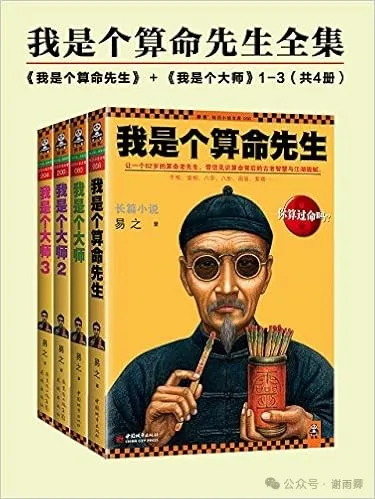
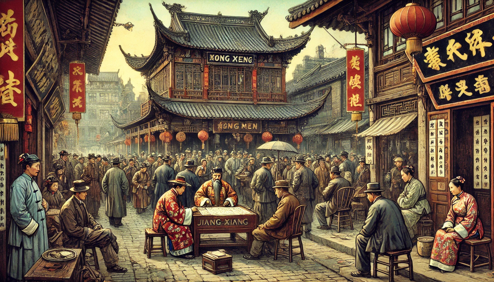
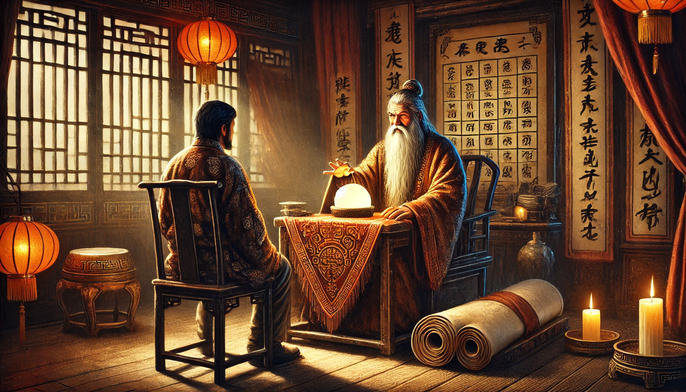
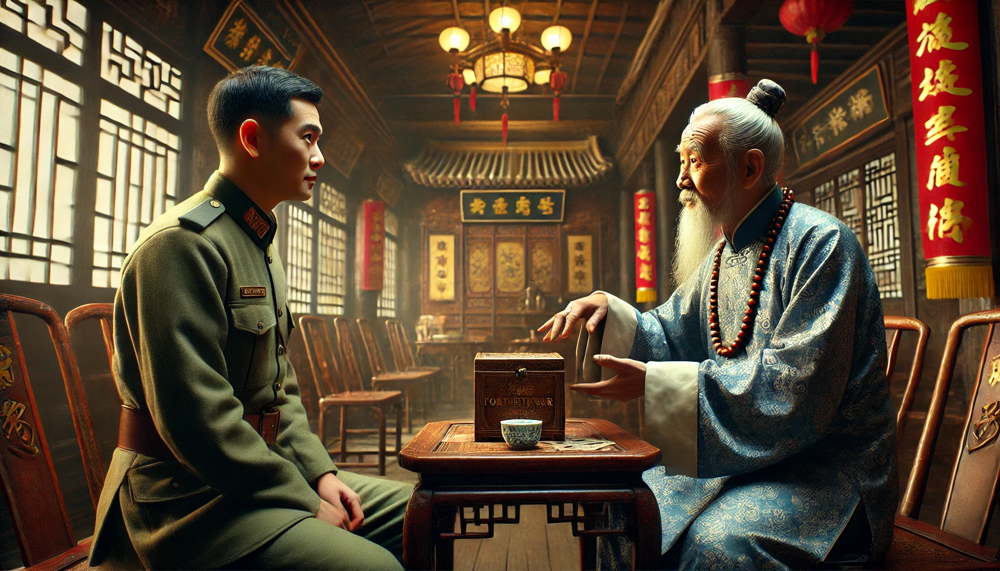
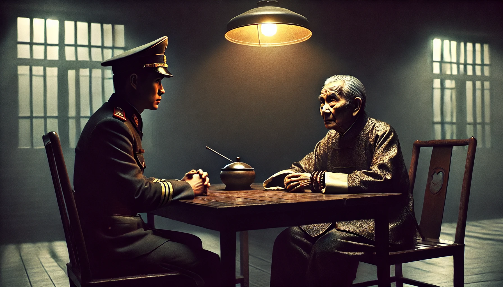
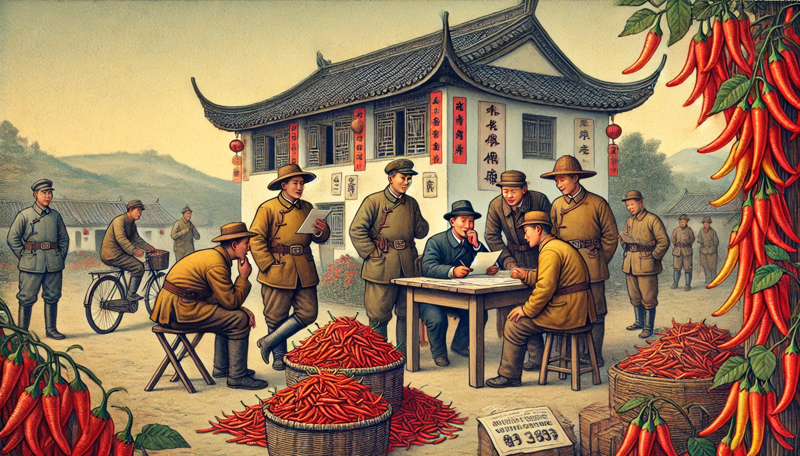

# 算命先生其实都是彻底的唯物主义者

## 一

这个世界太复杂了，未来会发生什么，有时候真是预料不到。心中实在疑惑，总想知道一个确切的结果，于是就想算命——不管准不准，反正是个参考嘛。

很多人去算命都是这个心态。

算命有很多流派，比如八字命理、称骨算命、面相学、风水学等等，还有来自国外的星座和塔罗，反正总有一款适合你，能够安慰你动荡的心灵。

我以前一直以为，对算命先生来讲，学习这些理论是最重要的，因为按照他们的说法，人的命运在出生的时候就已经注定了，算命先生要做的只是推算，而推算当然要依据一定的理论，理论错了，方法就会错，自然也就会算错。

然而，当我读了《我是个算命先生》这本书后，才知道算命先生其实都是最彻底的唯物主义者。为什么这么说呢？请容我细细道来。

## 二

话说江湖中有个流派，叫“江相派”，乃“洪门”的一个分支，而“洪门”则是大名鼎鼎的“天地会”，该会以反清复明为己任，存在了300多年。

“江相派”的一大特点，就是打着算命的旗号坑蒙拐骗，一开始还是为了通过算命活动“替天行道”，不断壮大反清势力，到了清末民国，渐渐失去了初心，变成了纯粹的坑蒙拐骗团体。新中国成立后，这个团体作为一个群体灭亡了。但他们的骗术却一直隐秘地流传着。

有一位老人生于1928年，是“江相派”的传人，他1948年加入“江相派”，1952年入狱，1957年出狱。后来，这位老人把自己的经历讲述出来，于是就有了《我是个算命先生》这本书。

这位老人，就是本书作者的姨爷爷。这本书，就是以这位老人的口吻写成的。通过这本书，我们可以看到当时的算命团体是怎样运作的。

## 三

根据书中记载，“江相派”有四大堂口，老人当年加入的是东派“木子莲”堂口，掌门人被称为“祖爷”。祖爷手下的头领被称为“坝头”。

我们先来看看祖爷手下的几个坝头是怎么被祖爷看中的吧。

大坝头原先是个杀猪的，有一次路上遇到几个混混抢他熏肉，他很生气，把这些混混打了一顿，手段非常残忍，一个人被捏碎了蛋，一个人被插瞎了眼睛，还有一个人则被砖头拍爆了脑袋。大坝头因此被判死刑。但祖爷觉得此人是个人物，于是将其赎了出来，收为己用。

二坝头15岁就跟了祖爷，当时江南流行“妖妇摄魂”的传言，说有妖女在孩子头上摸了几下，孩子立马脸色惨白，四肢僵硬，被夺去了魂魄。当时这个传言遍布南京城，周围很多地方也在传。祖爷趁着这个机会，以驱妖招魂为由大赚了一笔。当时他在街上遇到了后来的二坝头，二坝头没有带辟邪的红头绳，祖爷问他不怕死吗？二坝头回答：“鬼才相信呢！”祖爷因此认为此人不凡，将其收入麾下。

三坝头原先也是个算命先生，但没有组织。他文质彬彬，天文地理、阴阳八卦，没有不知道的，还熟读《论语》《孟子》，出口成章，文采斐然。当时他在祖爷的地盘算命，于是被祖爷亲自请他算命，把他带到自己的宅子里，然后大坝头、二坝头把他打了一顿。然而此人坚决不承认自己是在骗人。祖爷看上了他的口才和胆子，尤其是那种装腔作势、死不认账的精神，于是让他跟了自己。

看见了吧，凡是被祖爷重点培养的，都是不信命的狠人，只有自己不信命，才能真正忽悠到别人，才能成为门派的栋梁。

## 四

根据书中记载，老人加入“江相派”后，经历了四个环节，才算真正入行。

第一个环节就是学习阴阳五行，这叫“打底子”，就算是骗，也要有点基础，所以打底子是必须要有的。不过这个环节只持续了一个月，没有其他人说的那么神奇，要钻研好几年。

第二个环节是学“英耀”。所谓“英耀”，就是骗术心理学。其核心口诀如下：

> 1 入门观来意，出言莫踌躇  
> 2 天来问追欲追贵，追来问天为天忧  
> 3 八问七，喜者欲凭七贵，怨者实为七愁  
> 4 七问八，非八有事，必然子息艰难  
> 5 士子问前途，生孙为近古  
> 6 叠叠问此事，定然此事缺；频频问原因，其中定有因  
> 7 僧道从清高，不忘利欲  
> 8 庙廊达士，志在山林  
> 9 一哥要狠刀，二哥要抛刀，三枣要跳蚤

大家不用细看，因为这些很多都是黑话，我根据作者的解释，将大概意思列举于下：

1 别人来算命，你要少说话，多观察，先确定他们的来意，多收集他们的信息；信息收集足够多的时候，就冷不丁地说一句，务求一语中的，直击要害，说的时候千万不要犹豫踌躇，显得不专业。

2 父母为儿女算命，基本都是问儿女是否会富贵，父母望子成龙、望女成凤的心理是普遍存在的；儿女为父母算命，绝对是因为父母身体不好了，否则平时儿女不会想起为父母算命。

3 妻子为丈夫算命，往往喜怒形于色，如果面色开心，说明丈夫最近有富贵的迹象，这时要顺着她说，少不了赏钱；如果妻子面色忧愁，则说明丈夫最近不太顺利，这时往凶的方向断，让她解灾，这时妻子不但会给你钱，还会感谢你。

4 丈夫为妻子算命，只有两件事：要么怕妻子给他戴绿帽子，要么就是妻子生不出儿子，除此之外，丈夫绝不会给妻子算命！

5 读书人算命，多是问能不能高中，能不能当官；商人算命，多是问自己能活多大岁数，人生路上有没有大灾大坎。

6 反反复复询问一件事，说明这件事肯定不如意；总是揪着一个问题问，说明这个问题就是他要询问的事情的起因。

7 真正的出家人是不会算命的，凡是算命的出家人，不是问利，就是问欲。以利欲许之，其必然大喜。

8 做官的人野心更大，仍然要以利欲许之。

9 对容易上钩的人，下手一定要狠，多宰点钱；对你有所怀疑的人，不能有贪心，不该收的钱一分钱也不要；碰到来找茬的人，马上逃跑，请祖爷摆平。

第三个环节就是初次算命了，新人需要一个人单独进行一次算命活动才能算是入行，也就是将之前学的东西付诸实践。

完成算命后就算是入门了，经过一段时间的磨砺和锻炼，新人就要进行第四个环节，学习六字真言，由祖爷亲自授课。

所谓六字真言，就是审、敲、打、千、隆、卖。可以理解为：观察、试探、下结论、骗、奉承、收钱。将这六字熟练运用，就能炉火纯青，成为一名优秀的算命先生。

六字真言也有一个口诀：

> 1 先审后敲，急打慢干  
> 2 隆卖齐施，敲打并用  
> 3 十千九响，十隆九成  
> 4 先千后往，无往不利  
> 5 有千无隆，帝寿之才

让我们看看作者的解释吧：

> 简单地讲，审，就是审度，包括对方的衣着、气质，贫贱富贵都是带相的，一眼就可定这个人的档次。审的第二层意思，是倾听，让对方说出来，多说话，话越多，信息就越多。  
> 敲，就是试探，所谓：一敲即中随棍打，再敲不吐草寻蛇。是在审的基础上，突然“敲”一下，如果说准了，那就可以用“打”字诀了，如果两次都没敲准，那就危险了，如同草中寻蛇，弄不好被蛇咬口。到了“草寻蛇”的地步，一般阿宝就“抛刀”了。

> 打，就是坚定地批断。“打”贵在一个急字，突然出口，落地有声。打的更深一层意思是，摧毁对方的意志。因为你“敲”准了，所以他对你深信不疑，那么你就说他未来要倒霉，高官说他要丢官，巨贾说他要破财，怨妇说她要被甩，“打”得对方心理防线彻底崩溃。  
> 千，就是骗。可以当场出千，也可以通过布局的方式。“千”是融汇在其他五个字之中的，贵在一个“慢”字，出千不能着急，否则就露了马脚，所以叫“急打慢千”。

> 隆，就是奉承，说对方爱听的，许之以希望。因为你“打”了他，他很害怕，心情落到低谷，此时你“隆”他一下，告诉他也不是没有希望了，如果按照你说的办，还是能够化险为夷，逢凶化吉。然后再“隆”一下，告诉他如果过去这个坎，那么就会大富大贵，长命百岁，他自然非常高兴。  
> “打”和“隆”是对应的，先让对方绝望，再给他希望，此时，对方已被牢牢拴住。“打”和“隆”其实都是“千”的手段，是不能分开的。如果只是出“打”千，千出得再好也没用，因为对方绝望了，反正就是这命，认了，也就不会上钩了。所以说：有千无隆，帝寿之才。“帝寿”是黑话，蠢材的意思。

> 最后一个字是“卖”，是一种挥洒自如的境界。你怎么说，对方就怎么听了。卖的第二层含义就是该收钱了。所有的一切，最后都是为了对方兜里白花花的银子，所以卖也要卖得干净利索。  
> 祖爷传大家口诀时，是理论和实践相结合的。每讲一个字，他就把他经历的事情详细地讲出来，加以印证。

看到这，相信大家都会拍手称妙。

这些口诀是玄学吗？显然不是。这些都是社会现实的总结啊！从实践到理论，再从理论到实践，这不就毛主席在《实践论》里面所倡导的正确的认识方法吗？

所以，对这些“江相派”算命先生来说，阴阳五行当然要了解，但这并不是最重要的，算命的关键在于学习人情世故，学习在当时那个社会下，人们的一些心理规律，学习如何利用这些规律，去让对方信任自己，达到自己的目的。

所以，阴阳五行只是其表，实事求是才是其里，如果不是彻底的唯物主义者，就当不了算命先生。

## 五

我们再讲一个书中的算命故事吧，据说这是祖爷唯一一次失手。听完这个故事，你将彻底明白为什么我说算命先生都是彻底的唯物主义者了。

话说祖爷很少亲自上阵，除非是有什么大单子。

民国二十八年，当地黑社会头子魁爷给祖爷介绍了一个单子，让他去骗一个军统高官，说肯定能大捞一笔。

魁爷向高官介绍祖爷，帮高官约祖爷，但是约了三次都没约上。这就是所谓的“欲擒故纵”。

在此期间，祖爷通过魁爷的叙述，对高官的情况已经了如指掌。

第四次，祖爷和高官在一个茶楼见面。

> 祖爷先让他报八字。祖爷说：“你28岁时，差点做枪下鬼。”  
> 那高官说：“是。”  
> “你29岁时提的干。”  
> 那高官说：“是。”  
> 祖爷又说：“你命里有三个太太。”  
> 那高官说：“是。”  
> 祖爷说：“你明年就有一劫，会丢掉官位。”  
> 那高官说：“哦？”  
> 祖爷说：“按我说的去办，我给你调一下风水。”  
> 祖爷详细为他说了如何调整风水格局。最后那高官握着祖爷的手说：“先生高人啊！”  
> “来人。”那高官让手下拿来一个箱子，打开后全是厚厚的钞票，“先生辛苦，还请笑纳。”

这时，祖爷突然感觉不对，于是改变计划，拒绝了这些钱财。

果然，出事了。

祖爷回家的时候，被特务跟踪，然后被带回了局里。

原来，这个高官一开始就怀疑魁爷，于是故意放出假消息给魁爷，编造他28岁差点被毙。没想到这个编造的谎言竟然被祖爷算出来了，这难道不能说明这两位有勾结吗？这难道不能说明算命先生在骗人吗？

祖爷故作轻松，微微一笑，解释说：魁爷怕他算错了，就给他提供了一些信息，希望他算准点，之后钱财平分。祖爷不敢得罪魁爷，只好按照魁爷说的算。所以最后钱财分文不取。

于是，高官让祖爷再算一次。

> 那局长一笑，说：“那好啊，现在你就给我算，算准了，我就放了你，算错了，老子立马崩了你！”  
> 祖爷永远是祖爷，否则他都死十八回了。他微闭双眼，念念有词，过了一会儿镇定地说：“局长是这家生，那家养。”  
> 那局长一愣，“什么意思？”  
> 祖爷说：“把你养大的不是亲生父母。”  
> 那局长说：“你……你接着算。”  
> 祖爷说：“你家老宅南面应该有条河，或者有个水塘，否则局长不可能做官。”  
> 那局长沉默了一下：“你接着说。”  
> 祖爷说：“局长不说对与错，我不敢说了。”  
> 局长早已收敛了火气，说：“对，是有一水塘，后来大旱，早就没水了。”  
> 祖爷说：“那个风水让局长占尽了，局长高升了，水自然没了。”  
> 那局长呵呵笑起来。

到这里，如果我们是那位高官，肯定也就深信不疑了。

那么事实如何呢？

原来，祖爷早在前几个月，就留了一手，他不但听了魁爷给他的信息，还派了几个手下根据魁爷提供的线索，走了几千里路，找到那高官的祖籍，将他老宅的地势和地貌完整地记录下来，那几个手下还化装成卖辣椒的，与左邻右舍闲聊，打听到高官小时候的一些事情。

现在你知道了吧？算命先生面对这种大单子，要做更加充分细致的调查研究，他们怎么可能把自己的人身安全寄托在虚无缥缈的八字命理上面？事实证明，要想了解过去和将来，只有调查研究才是最可靠的，而这也正是一个唯物主义者的觉悟。

## 六

真正的毒枭一定是不吸毒的，真正的算命先生也一定是坚定的唯物主义者。信命的人算不了命，能算命的人一定是调查研究和理论联系实际的好手。

当然，有需求才有市场，真不能怪算命先生骗人，实在是现在迷信的人太多了，算命太赚钱了。

那么迷信的人为什么那么多呢？因为社会变了，商品经济是迷信的温床。具体论述可以参考商品拜物教的相关理论。

当然，我写这些不是为了说服大家什么，更不是想砸谁的饭碗，我只是想分享故事。

希望大家能喜欢这个故事。

参考资料：

易之．我是个算命先生（全集）[M]．北京：中国城市出版社，2012.
