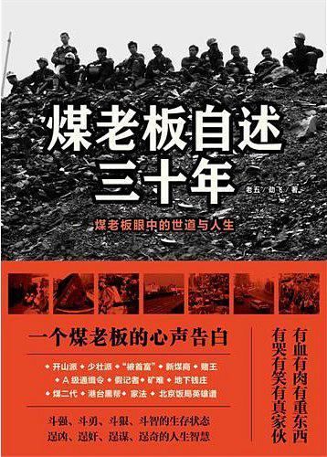
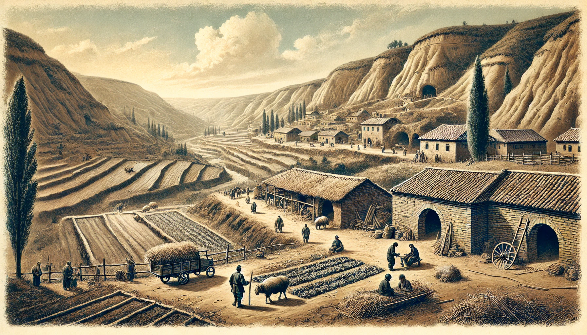
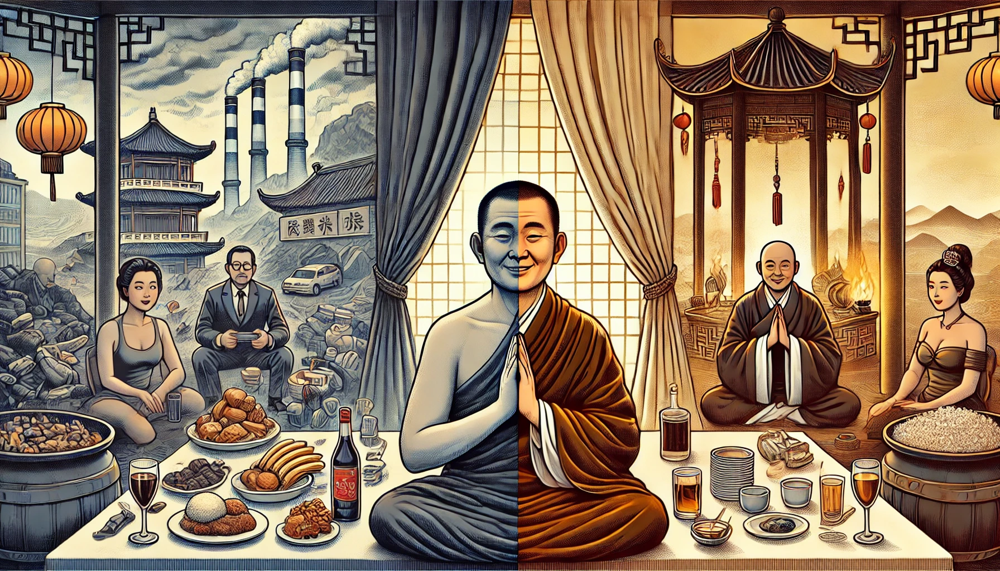

# 小姐、情妇和女演员——煤老板的生活烦恼

半个月前，我看完了《煤老板自述三十年》，一直想介绍这本书，但此书信息密度太大，看来还是分几次介绍比较好。

从哪里讲起呢？就从他们的私生活讲起吧。

我把书中关于煤老板私生活的内容整理成以下八个部分，供大家研究和批判。

## 1煤老板的原配夫人都是些什么人？

总体来说，煤老板的原配夫人都是普通农村人。

煤老板可以分为两代，元老级煤老板和少壮派煤老板；煤炭生意开始于20世纪80年代初。

但是不管是元老派还是少壮派，在他们在做煤炭生意富起来以前，大多已有家室。而且由于一开始煤矿生意是不被看好的，又危险，又不稳定，所以很多做煤炭生意的人都不太顺利，他们的原配夫人当然也不会是富贵小姐。

比如作者“老五”的父亲“郝二铁”，出生于1926年，到1984年开煤炭加工厂的时候，已经58岁了，他的老婆是村里的哑巴。“郝二铁”的几个儿子那时也不小了，等不到富起来就成家立业，所以娶的也只能是普通人。

还有更惨的，压根没有原配夫人，比如曾经做过山西省首富的“二旦”，在八十年代初当小混混的时候，被一个开饭店的寡妇看上了，他们同居了两年，最后还是下不了决心娶一个寡妇。

“二旦”直到三十岁才开始做拉煤生意，慢慢富裕起来。在他三十岁富起来之前，都是光棍。所以我们可以认为他没有原配夫人。

我们在网上看到的“煤老板高调嫁女”这样的新闻，这些说明少壮派煤老板的子女一般都是找的明星、富家子弟，但他们已经不叫“煤老板”了，他们被称为“煤二代”，不属于本文讨论范围。

## 2煤老板的找小三普遍吗？

元老级煤老板还好一点，少壮派的确很普遍。但煤老板的离婚率不高，对原配夫人还算可以。

对此，作者感叹道：

> 至于包养二奶和小三的风气，在少壮派煤老板群体中确实比较普遍。有意思的是，煤老板们虽然在外面花，但离婚率不高，正房大多还是从前的糟糠之妻。从这点看，煤老板群体好像比演艺圈、富二代要正派些。

## 3 煤老板是怎么嫖娼的？

我总结了一下，煤老板有嫖娼和找情妇这两种婚外情方式。

先说嫖娼，作者本人就嫖过，虽然他只提到一次。作者2001年在吉隆坡赌场的酒店，叫了一个小姐，名叫“小果”。这个小姐能被作者专门提到，是因为她太受作者喜爱，被作者带到北京卖别墅，最后业绩非常不错，自己创业开了公司，实现了翻身。

嫖娼的场所很多，主要是娱乐场所（包括“澡堂子”）和酒店。比较有名的就是北京的“天上人间”，还有就是作者专门提到的“花城”。“花城”的小姐更新频繁，对身材要求也严格。作者说：

> 曾经有段时间，花城推出了一批小姐，都在一米八五以上，都是从模特、退役运动员中精选出来的。她们在T台上一走，台下的一票矮客像些大肚子小孩，看着既荒诞，又白痴。

根据书中的信息，嫖娼与其他方式相比，特点是：要付现钱、要戴套。

## 4煤老板是怎么找情妇的？

情妇就是长期的非婚性伴侣，有时叫“姘头”，俗语叫“小三”，有时候还会被当成“妾”。如果怀孕了，还可能晋升成为“二房”或“二老婆”。

90年代初，老板找小三还很随意，只要长得漂亮，不是有夫之妇，就可以笑纳。那时老板的普遍想法就是找小三不用戴套，而且纳妾不问出处，所以很多小姐都因此成为煤老板的二房。

随着时间的推移，煤老板有钱了，审美水平也提升了，要求更高了：

> 进入新世纪后，老板们找小三比以前挑多了。妖艳的不找，腻了，也祸害身体；没能力的不找，现在应酬多，压力大，单纯找个花瓶性价比太低；首付太高的不找，按揭太高的不找，老板的钱再多也是有数的，为了女人，不至于。

找小三比找小姐容易，因为大老板很少，但是符合小三条件、有当小三意愿的人却很多，严重供大于求。而且找小姐要付先前，但是找小三有时候只需要亮出身份就可以了。

很多煤老板都有不止一个老婆，而且彼此之间还不吵架。比如作者的二哥，就至少有三房老婆。

## 5小三都有哪些烦恼？

小三主要有两个烦恼：寂寞和孩子。

寂寞是因为煤老板不像以前那样饥渴了，性欲如果被极大满足，就会极大减弱，所以都发展了很多其他爱好。小三没人陪，那能不寂寞吗？

还有就是小孩问题。当了大老板的小三，生娃就能有几个亿遗产，不生娃就有被抛弃的风险，所以小三都会想尽办法尽量怀孕。有些小三偷偷下春药，还有些小三则铤而走险，偷偷找其他人让她受孕，谎称是煤老板的孩子。

## 6煤老板和女演员、女明星

大家知道当年有很多煤老板投资电视剧，不少煤老板投资的目的之一，就是和女演员亲密交流。不过看作者的意思，不干净的可不止是煤老板：

> 选女演员的时候，我惊讶地发现，女演员真多啊，感觉比我省的矿工都多。多了就有竞争，有竞争就有潜规则，这真不是女演员的问题，世道本如此。在挑女一号到三号时，从花少、资深导演到副导演夜夜择新娘，一通乱睡，还不用给钱。难道这他妈的算行业福利嘛，想想一些弱势女演员比矿工都惨，矿工卖的是命，弱势女演员除了不卖命，啥都给卖了。少数女演员或许是潜规则潜入戏了，都潜到深海了，非常放得开。那天雷四来剧组探班，一个女演员知道雷四是煤老板后，小半瓶红酒还没喝完，就把雷四拉到酒店房间里狂干，不求感情酝酿，只求马上拥有，搞得雷四有被强奸的不爽感觉。

除此之外，作者还提到，煤老板可以通过赌场和黑帮的关系，“约一线女明星吃饭、二三线女明星上床……统统能做到”。

## 7性病问题

这里直接贴作者的原话：

> 作为过来人，奉劝大家远离色情场所，有些病不是戴套就能隔离开来的。我的两个朋友现在都是资深严重性病患者，饱受煎熬。大夫说不是被小姐传染的，属于自己体内发出来的，真是色毒攻心啊。还有个朋友得了艾滋病，他一向比较注意，随身总带着最贵的套套，有什么用呢，不还是得了嘛。

## 8作者对找小三的态度

从之前的信息也可以看出来，作者对找小三有以下态度：

a承认现实。作者不否认煤老板嫖娼、找二奶的问题，也不否认自己和自己的家人有这毛病。

b理解尊重。他自己也嫖娼，他的圈子的人普遍找小三，他当然能够理解这种行为，对找小三本身是不反对的。

c“找小三还是看人品，当然能戒掉更好”。这是作者的原话，但是有多少煤老板能做到，那就不知道了。

马克思说：

> 我决不用玫瑰色描绘资本家和地主的面貌。不过这里涉及的人，只是经济范畴的人格化，是一定的阶级关系和利益的承担者。我的观点是把经济的社会形态的发展理解为一种自然史的过程。不管个人在主观上怎样超脱各种关系，他在社会意义上总是这些关系的产物。同其他任何观点比起来，我的观点是更不能要个人对这些关系负责的。（马恩文集第5卷第10页）

以上内容都是根据书中的信息，总结出的一些社会事实（当然，并不保证完全真实）。这些社会事实的成因是什么，以及背后隐藏着什么社会规律，才是我们真正感兴趣的。

希望以后能看到更深入的分析。

参考文献：老五，劲飞．煤老板自述三十年（煤老板眼中的世道与人生）[M]．北京：文化艺术出版社，2011.
