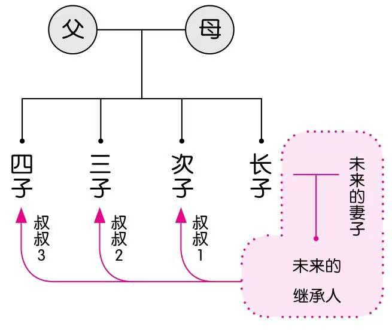
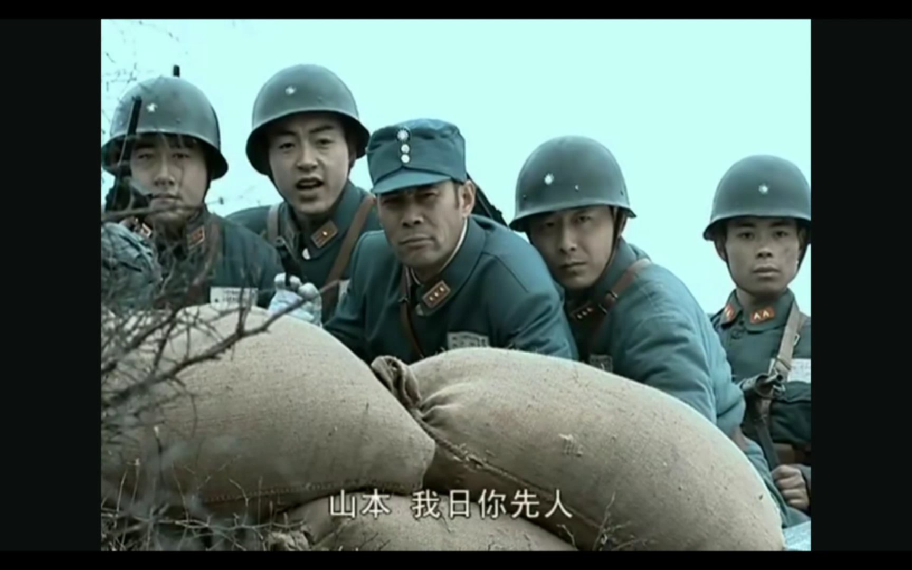
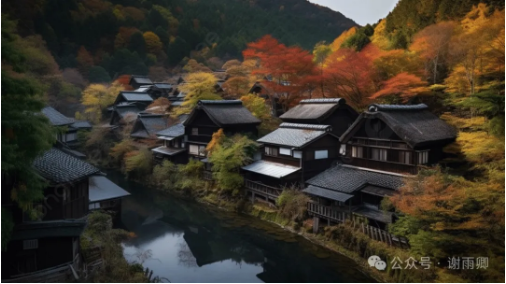
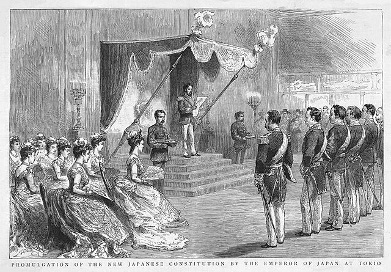

# 苦一苦老二吧，为了家族！——谈谈日本家督继承制度及其影响

在中国，如果一个家庭有两个儿子，这两个儿子的待遇是不会有太大差别的；但是在日本，两个儿子的待遇则完全不同。当一个日本家庭诞生了第二个儿子之时，这位次子就注定要度过一个更艰难的人生。

在《从零开始的女性主义》中，上野女士对田房女士说：

> 你在东京长大，所以可能不清楚。日本其实也挺大的，外地有很多很多农村。东北地区管长子后面的儿子叫“神武”（jinmu）。这个名字很厉害吧，就是来自神武天皇。如果用那边的方言来讲，就是“zunmu”，也有人叫“叔叔”。比如“田房家生了个叔叔”。人家可是婴儿啊。你可能会想：“为啥要管婴儿叫叔叔？”因为，长子将来肯定也会有自己的男继承人，在那个将来的继承人眼中，刚出生的婴儿可不就是叔叔嘛。所以这个称呼意味着，他们将来只有成为叔父的命运。

> 次子、三子除非入赘，否则基本无法结婚，要一辈子留在家里为长子一家干活。日语管分田叫“田分け”（tawake），这就是“混账”（tawakemono）的语源。因为长子会继承所有田地，因此会有叔叔1、叔叔2、叔叔3等人物。这些叔叔全都生活在一个房间里，一辈子不结婚。说白了就像长子家的家奴。长子以外的儿子就是这样的存在。直到日本进入经济高度成长期，这些人才有机会走向大都市，并且成家立业。

此外，张宏杰的《简读日本史》也提到这一点：

> 在电影《楢山节考》中，次子利助三十五岁了，还没有结婚。因为有体臭，他一直没有尝过女人的滋味，只能与狗交欢。这并非编剧的虚构，而是有历史事实为基础：传统日本有些地区，其他儿子根本没有结婚的资格。“在过去日本的东北部农村，社会习俗对长子和非长子之间的不平等的认可有时达到极端的程度。如有的村落中有这样的情况：只有长子才允许结婚。”

上面提到的日本东北地区，次子地位之悲惨，算是比较极端了，在日本其他地方要稍好一些。不过在日本，次子、三子长时期以来都是长子的备胎，饱受侮辱和歧视，却是事实。这都是日本封建时期“家督继承制度”的影响。

在古代日本，“家”是一个以家业的延续为目的的经济共同体，家督是一家之长。为了使家业能够长久延续下去，日本社会普遍实行长子继承制度，长子在上任家督死亡或隐居后，继承家督的所有社会地位和家庭财产。更有甚者，家督继承人还会独自继承家主的姓——而家督的其他儿子连父亲的姓都无法继承，必须改姓。

不过，长子继承制度的核心并不在于长子，而在于一人，在于不要分家。比如，如果家主认为长子不够优秀，他有权力让其他儿子成为新的家督继承人，甚至收养养子成为继承人。日本人不在意辈分，甚至不太在意自己的传宗接代，他们更在意自己的家业。

其实山本可能也并不在意他的先人被……

虽然日本已不再是封建社会，但家督继承制度深深地影响了当代日本人的文化和价值观。家督继承制度在日本的社会转型中也扮演了重要角色。以下是这种制度的影响：

## 1 家督继承制有利于家族稳定和资本积累

中国有“贫不过三代，富不过三代”的说法，这种现象的一个重要原因，就是中国人会分家，导致家族的财产无法在代际之间稳定传承。一个富有的家族，每一次分家都会削弱主家的实力，稍微有点意外，这个家族就没落了。

但日本不同，日本家庭的长子从小就被精心培养，家主的技能和事业当然也会被很完整地继承下来，财产更是一分也不会分出去，所以家族抗风险能力强，传承下来的可能性也高。也正是因此，古代日本很多职业都是世袭的，有的甚至传了上百年。

近现代的日本，家督继承制的观念也促进了日本家族企业的发展壮大。邓慧娟《日本家督继承制度》中说：

> 明治维新后的政商及后来的财阀，也都是采取资本的家产形态，为避免家产的分割导致的不良后果，由家督继承人继承全部或大部家产。在日本有着悠久历史的财阀，它们从德川时期开始，一直维持着同族经营的模式，如三井财阀，它的事业之所以能够越做越大，与十几代继承人之间实行严格的家督继承不无关系。鸿池财阀也是如此，在其家训中规定家督继承人继承家产的大部，而次子等人仅留10%－20%，以此来维持家族企业财产的完整性。而在明治时期维新后才形成的三菱、住友等新财阀，在其企业核心组织的构造上也与老牌财阀一样，体现出鲜明的同族经营特征。

所以，不得不说汉武帝的“推恩令”确实是遏制大家族的最好做法，也是维持封建社会稳定的最好做法。因为分家会不断创造新的小农，大地主再大也大不到哪里去。而大地主在商品经济发达、商业政策宽松的时代，是很容易积累资本，发展出资本主义经济的。

可以说，分家制度和重农抑商加在一起，使中国的封建社会异常稳定，持续千年。

## 2 家督继承制有利于形成产业后备军

德川幕府时期，社会上出现了很多“浪人”，他们都是家庭的次子、三子，跟家业无缘，又不愿意从事其他行业，于是仗着自己的武艺，四处惹事。

家督继承制将次子、三子与生产资料分离，使他们不得不另谋生路，很多都成为无业游民。在封建社会，这些人无法安置，但是在资本主义发展时期，他们就会成为产业后备军，成为雇佣工人，促进资本主义的发展。这种情况和西方的“圈地运动”是类似的。

当然，这一点跟中国难以进入资本主义社会没啥关系。因为中国古代不缺流民，如果存在资本主义经济，这些流民很容易转化为雇佣劳动者，根本不需要再额外搞“圈地运动”和“家督继承制”，中国古代封建社会缺的是商业和大商人。

## 3 家督继承制有利于个人成长

在家督继承制下，长子作为当成继承人，从小受到不遗余力和细致入微的培养，正如《日本家督继承制度》所说：

> 此外，家督继承下对长子的培养在人才培养方面所起的作用也极为重要，前文已提及日本的家非常重视对家督继承人才干的培养，如前所述的索尼创始人盛田昭夫，他从6岁起便与父亲一起参加公司的新年庆祝会，10岁就被要求参加董事会会议及家里进行的久作工门与公司管理人之间的秘密会议，中学时就要参与存货的核对、清点并学习清酒的制造工艺，等等。由此可见，日本传统家庭对家督继承人的培养是不遗余力而细致入微的，20世纪初的盛田家仍是如此，不难想象在家督继承通行于全民的明治时期是何种状况，如在明治维新的功臣当中长子出身的就占了将近一半。

次子也因为从小就断绝了对家业的念想，不得不靠自己自谋生路，他们的选择很广，各行各业都可以尝试，也可以做别人家的养子，改变自身地位。很多次子将自己在家庭中遭受的不平等待遇转化为拼搏奋斗的动力，最终有所成就。

由此可见，社会制度很难以“好坏”作为评价的标准，更多是以“合不合适”来进行评价。日本的家督继承制，虽然使很多次子、三子生活困顿悲惨，但对整体的日本社会来说，是有好处的。

事实上，日本在镰仓幕府时期（1185年-1333年）在经济上是庄园领主制，在继嗣方面虽然也实行嫡长子继承制，但在财产的继承上却是按照平均分配的原则的。这种财产继承制度就导致大领主的旁支不服从管教，拒绝履行义务；也导致武士的财产一分再分，不得不投靠地方实力派，最终导致地方大名崛起，社会动荡。

在日本当时的经济基础和历史经验下，他们才选择了与之相适应的家督继承制度。这也印证了马克思主义的唯物主义历史观。

我在这里姑且下个结论：财产长子继承制有利于大地主和大资本；财产继承平分制则有利于小农经济和小市民经济（也有利于形成“中产阶级社会”）；共产主义社会则会逐渐废除财产继承制。当然，具体细节更复杂，这只是一些初步结论。

不知道对不对，请大家评判。

参考文献：

邓慧娟. 日本家督继承制度[D]. 西南政法大学, 2011.

张宏杰. 简读日本史[M]. 长沙: 岳麓书院, 2021.

上野千鹤子, 田房永子. 从零开始的女性主义[M]. 吕灵芝, 译. 北京: 北京联合出版公司, 2021.

-END-

这是一个能涨知识的公众号，关注我，阅读更多有趣文章～
