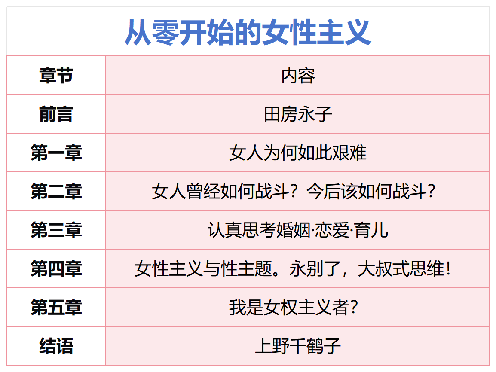
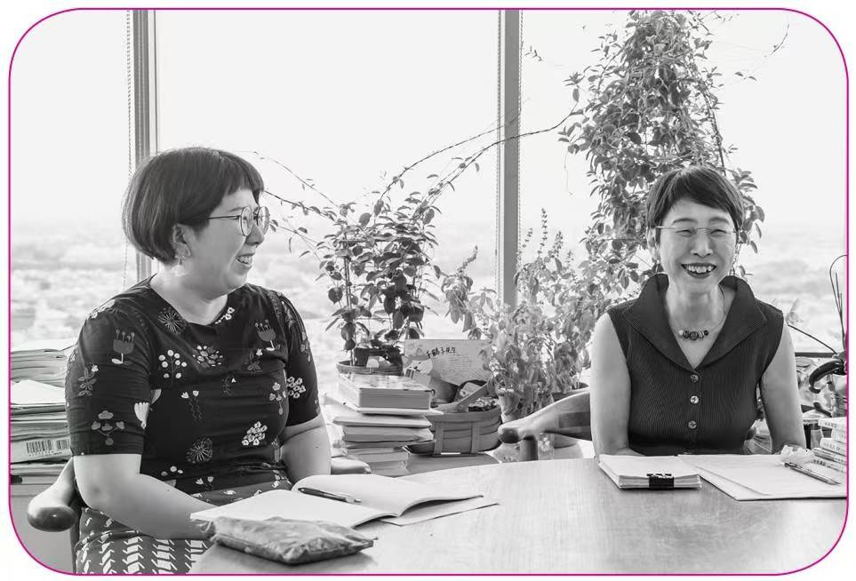
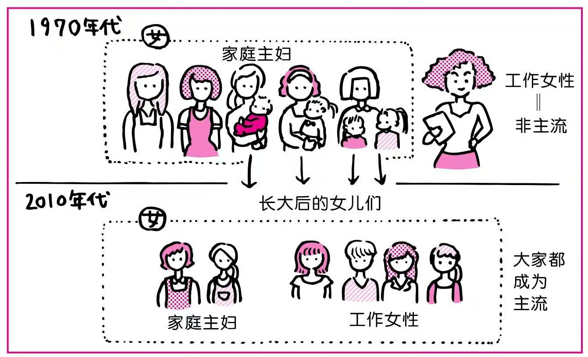
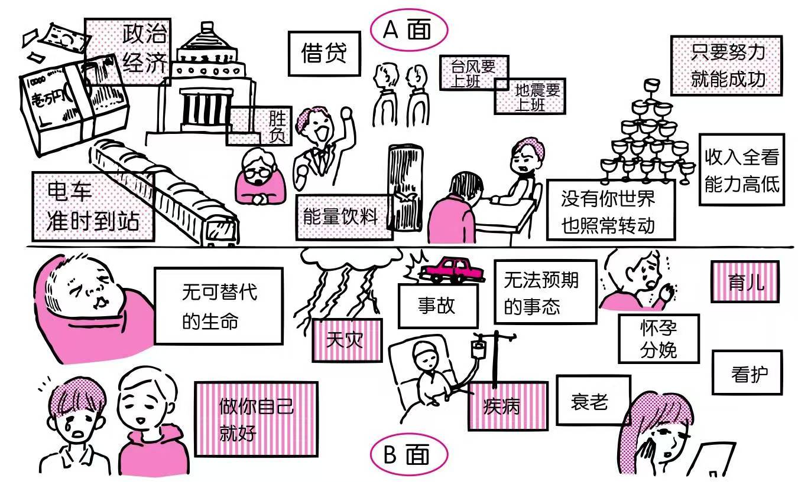
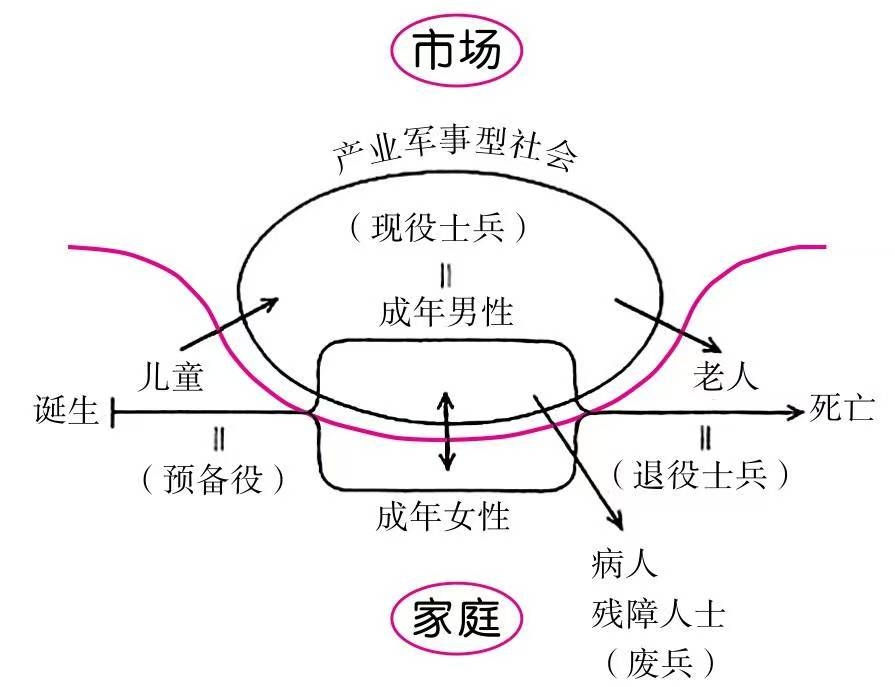
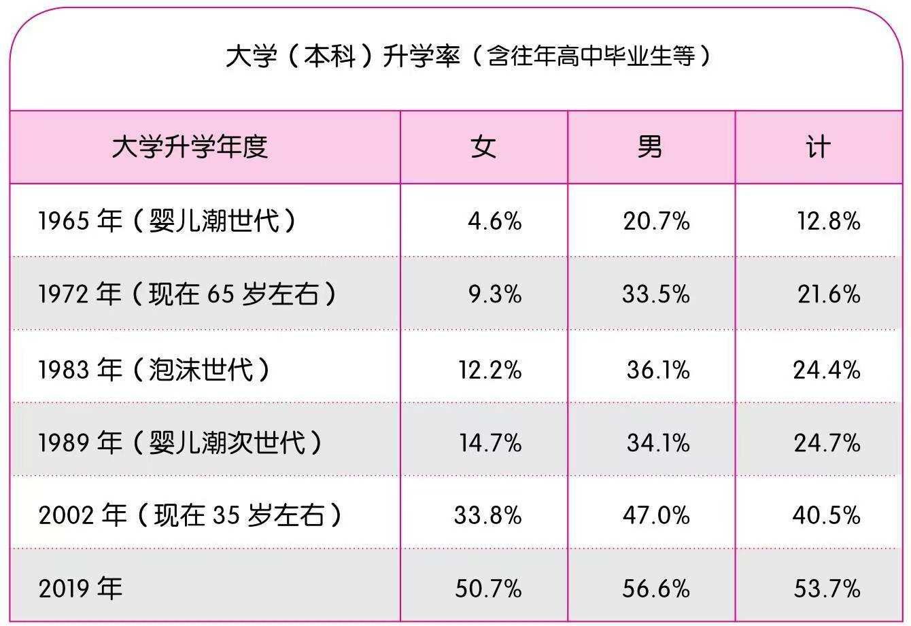
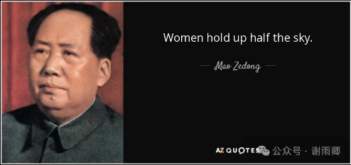
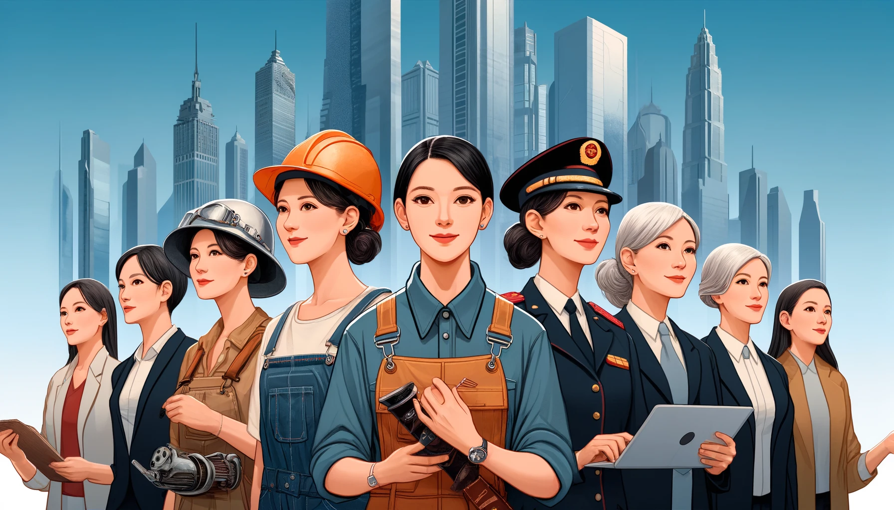

# 不能抱以太高期望——读《从零开始的女性主义》

## 一 通俗的传播方式

这两天看完了**上野千鹤子**和**田房永子**合著的《从零开始的女性主义》，这里简单做个报告。

**上野女士**是当代最有名的女性主义者，生于1948年，属于“婴儿潮一代”；**田房女士**是日本的一位漫画家，生于1978年，属于“婴儿潮次世代”，她们正好是两代人。这本书全文以她们两人的对话展开，讨论女性主义的各种话题，每一章都有田房女士的漫画总结，书中其他地方也有不少田房女士画的插图。

书中，上野女士感叹：

> 事情做得再好，也要看传承，因此需要很好的方法。在这一点上，田房女士就掌握了方法。听说雨宫处凛女士年轻时同时参加过左翼和右翼团体。她说，**左翼团体喜欢使用晦涩的言辞，右翼则会用简单易懂的话语，而且右翼的大叔们都很和蔼**。我觉得这个方法也不错啊（笑）。

诚如斯言，她们在这本书上更新了表达方式，其“对话+漫画”的形式，让人读起来轻松愉快，非常具有传播效果。

我本人既不懂日本，也不懂女性主义，这本书介绍了很多相关知识，我读完后感触良多。

其中最大的感触就是：**女性主义是一种视角和思潮，它反映了很多问题，也促进了社会进步，但我们不能对它抱以太高期望。**

女性主义是敏感话题，料想大部分人都不会完全认同我的看法，脾气直的甚至直接开骂。没关系，容我细细道来，骂不骂由你。

## 二 日本女性的困境

本书最大的价值就是将**女性的视角**展现出来。所谓视角，就是站在某一个点去看一个特定的问题。同一个事物，站在不同的角度看，面貌也许完全不同，所以只有多角度观察，才能对这个事物有更**全面**的认知。

对社会问题也是如此。可能同样的社会现象，男性的感受和女性的感受完全不同，男性如果不站在女性的角度看问题，替对方考虑，那么就无法理解女性的感受，就很容易冒犯女性，也就活该女性对你有怨言了（此句男女互换，结论亦然）。

本书从上野女士和田房女士的视角，阐述了日本女性的困境。这些困境有些是所有女性共同面临的，有些是日本某个时代独有的，还有些只是这两位女士的私愤。当然，这不重要。我将书中提到的女性困境总结列举如下，大家心中自有说法：

### 1 工作问题

不管日本还是其他国家，在传统社会中，妇女只负责家里的事务，社会上几乎没有女性的工作岗位。在这样的社会环境下，女性个体最明智的做法当然是找个优秀的男人结婚，料理好家务，相夫教子，这样就可以过得比其她人好了。在那个时代，妇女没有反抗的条件，也没有反抗的意愿。

然而，随着现代工业和商业的发展，社会上出现了很多女性岗位，越来越多的女性参加工作，靠自己养活自己，不再依靠家庭和丈夫，开始独立起来；社会思想也开始发生变化。

社会在变化，新旧观念随之发生冲突。很多问题都来自于此。

日本的观念比现实发展更快。在20世纪70年代，当时日本年轻女性都是在“表面平等的社会中”成长起来的，从小就被灌输男女平等的意识。但是到了社会上，她们就会不禁感叹“这跟学到的不一样啊！”

那时，日本社会缺少女性岗位，女性很难找到工作，尤其是女大学生，当时甚至出现“女性只要有学历，就养不活自己”的情况。上野女士说：

> 因为企业压根不懂如何培养女大学生。我问过少数找到工作的女大学生，她们都是派遣或者临时工，而且得靠关系入职，还被当作“干到结婚就走”的“短期工”。当时的头婚年龄很低，所以工作时间只有两三年，一眨眼就过去了。请记住，你母亲年轻时就处在那样的时代。

上野女士认为，这种落差就是造成她们那代女性很多人成为“毒母”的原因。所谓“毒母”，就是那种过度干涉、过度管理自己的孩子，把自己的价值观强行加在孩子身上的那种母亲。

上野女士和田房女士都跟自己的母亲关系不好，所以在这方面她们两位吐槽了很多。上野本人不结婚（前两年才结）不生子，很大程度上就是受到了自己原生家庭的影响。

到了八九十年代，日本还有**“新娘候选”**的说法，也就是“女员工是男员工的新娘候选”，很多公司“女员工的录用标准是脸、门路，还有与父母同住。”

上野女士说：

> 那时企业录用女性的感觉是“公司代替家长照顾未婚的千金”“让其与我司的优秀员工配对”。所以与父母同住表达了一个态度，就是“我们要招聘好人家的千金”作为新娘候选。

不过，这种情况在慢慢发生改变。20世纪70年代，日本家庭主妇还是主流，而工作女性则是“非主流”；到了21世纪10年代，日本的家庭主妇和工作女性则都是主流了。

在上野女士母亲的时代，100%不存在“不结婚”这个选项，当时的氛围是“女人工作丢人”。上野女士年轻的时候，女性工作仍然是违背母亲意愿的行为，仅3%的女性没有结婚，上野这种参加工作且不结婚的人是极少数。而到了田房女士的时代，女儿出去工作已经成了符合母亲意愿的行为，甚至可以说是母亲的强制要求了。

恩格斯在《家庭、私有制和人类的起源》中写道：

> 在这里就已经表明，只要妇女仍然被排除于社会的生产劳动之外而只限于从事家庭的私人劳动，那么妇女的解放，妇女同男子的平等，现在和将来都是不可能的。妇女的解放，只有在妇女可以**大量地、社会规模地参加生产**，而家务劳动只占她们极少的工夫的时候，才有可能。——马恩文集第4卷第181页

可以说，妇女参加社会化劳动越多，她们的社会地位就越高，妇女也就越能实现解放。

所以我认为，工作问题是女性面临的关键问题，其他所有问题都是这个问题派生出来的。

### 2 家务问题

传统社会里男性在外工作赚钱，女性的劳动则局限在家庭之中，不被市场承认。现在女性也进入市场工作，但是历史的惯性使女性仍然要承担更多的家务劳动。这是女性面临的又一个困境。

比如说，很多女性在忙完工作以后，仍然要打扫卫生、照看小孩、照顾老人，而自己的丈夫竟然躺着享受，这当然会发生矛盾。

这时女性必须通过坚决的抗争，才能实现平等。上野说：

> 我们那一代的女性可是对男性紧紧相逼。一直逼迫，一直逼迫，直到他们无路可走。就算是去托儿所接孩子这种小事，我们也会逼问：“为什么非得我去？”“为什么你不能请假？”甚至做一顿饭，也会逼问：“谁来做？”“你当我是煮饭婆？”“你以为你算老几？”

> 婴儿潮男性都是被老一辈人养大的，哪怕他们脑子里是革命，身体还是老古董。他们全身心地认定家务和带孩子都是女人的工作。我认识的好几个女性都与那种男性激烈对峙，咄咄相逼，一点都没放过他们。

针对这个问题，上野女士提出一个模型，叫“公私分离模式”或者“市场家庭二元模式”。田房女士则总结出“A面B面”模型。

上野女士对田房的提法很赞叹，认为她看到了自己也发现的问题；但她又感到遗憾，因为自己总结的理论没有被后人继承。

其实，这个问题马克思主义者早就提到了。恩格斯在《家庭、私有制和人类的起源》中说：

> 妇女的解放，只有在妇女可以大量地、社会规模地参加生产，而**家务劳动**只占她们极少的工夫的时候，才有可能。而这只有依靠**现代大工业**才能办到，现代大工业不仅**容许**大量的妇女劳动，而且是**真正要求**这样的劳动，并且它还力求**把私人的家务劳动逐渐溶化在公共的事业中**。——马恩文集第4卷第181页

恩格斯不愧是人类历史上数一数二的社会科学研究者，所言一点也不差，而且非常精准地点明了这种现象的原因、条件和结果。随着现代大工业的发展，社会**越来越需要妇女的劳动**了，而且还将很多家务劳动溶化进“公共的事业”，这种妇女的进一步解放，在社会主义国家表现为“妇女能顶半边天”，在资本主义社会则表现为“市场化”。

不管是日本还是其他国家，都出现了托儿所，这使女性一定程度上从育儿中解放出来。家务外包、食堂以及护理行业的发展，也都大大减少了家务劳动，从而进一步促进了妇女解放。

社会观念也随之变化，现在的日本，男性参与家务、育儿已经比以前好多了。

不过，上野女士和田房女士对此的主张是**“一人一杀”**，也就是说，她们认为男性不做家务是“**既得利益**”，没有人会主动放弃“既得利益”，所以女性必须去斗争，每个人必须从改变自己的丈夫开始。

田房女士说：

> 我身边那些家里有小孩的男性，但凡自动自觉做家务、带孩子的，都经过妻子的严格督促。现在参与家务、育儿的男性已经比以前多了很多，但我觉得，**几乎没有哪个人是自发性的**。

田房女士说：

> 梦幻般的男人（笑）。正如刚才上野老师所说，男性不主动从事家务和育儿，肯定有既得利益的因素在里面。因为那是他们从社会上得到的“男性权益”，谁也不会主动放手。所以这正是**斗争的重点**。为了让他们放开“男性权益”，我们必须**拼上性命**。

我认为这是小题大做，把人民内部矛盾硬生生变成了敌我矛盾。有什么话不能好好说吗？又是“斗争”又是“拼上性命”，那你何必要跟他结婚呢？

当然，也可以将这些话理解为牢骚，不必过于在意。

### 3 教育问题

其实这也是社会发展和观念的矛盾问题。

长期以来，女性的受教育水平都低于男性，不过近几十年来有了很大改善。以下是日本男女大学升学率：

可以看到，到2019年，男女大学升学率已经很接近了，有了巨大的进步。

据说在中国，本科入学比例女性早就超过男性了，可以说教育上的男女歧视已基本被消除。

### 4 性骚扰

这一段我没有任何发言权，因为这个问题跟个人感受有关，而我既不是女性，也没有被男性骚扰过。我只引用两位女士的话。

田房女士说：

> 跟踪狂的受害者有89%是女性，而加害者有84%是男性。不仅是跟踪狂，咸猪手、强奸、性骚扰这些性暴力的受害者几乎都是女性。现在这个社会，不仅是女性自己，连女儿都有可能成为性暴力的受害者，然而外面到处都能看到专为男性制作的色情内容，甚至日常生活中随处都能看到萝莉控性质的色情产品。我觉得这种状态很异常，但也有人主张这是“表达的自由”。我们无法对一个实际存在的东西说“你不要存在”，对吧。难道真的只能接受吗？

田房女士还说：

> 以前在办公室被上司摸屁股好像很正常。

看来，日本当时的性骚扰还是很严重的。

不过，她们对性骚扰的定义可能比我们想象的更广泛。

上野女士说：

> 我们女权主义者一直以来做的事情，就是定义“这是性骚扰”“这是家暴”。只要事先掌握了概念，人就会意识到“这是性骚扰”。哪怕很晚才知道这些概念，也可以重新定义自己以前的经历，比如，“**当时心里那种不舒服的感觉，原来是遭到了性骚扰**”。如果不把感情变作话语，就无法成为经验。

而且，有时候男性对女性产生欲望本身，就是性骚扰。

> **田房：**话说回来，为什么女性既可以对男权社会心怀愤怒，同时又希望男性对自己产生欲望呢？
>
> **上野：**这很简单，要看女性想在什么情况下被什么人产生欲望。你想接连不断地成为很多男人的欲望对象吗？那不就是性骚扰的环境嘛。只要从这个角度去思考，无论什么人都会明白。我想在这里激发这个人的欲望，但是不希望那个人对我产生欲望。我不想在这种时候、这种地方成为任何人的欲望对象。这都是理所当然的呀。仅仅如此罢了。这怎么会成为问题呢？

### 5 性爱问题

这方面我完全不懂，也不感兴趣，还是贴一下她们的原话。

> **田房：**很可悲。我们这一代人的性爱观、男女观、恋爱婚姻观都特别薄弱，而且在处理夫妻关系时也一样。其中，对于性的理解尤为欠缺，一点都不充分。
>
> **上野：**现在发生性行为的难度下降了，可是性爱依旧不自由。
>
> **田房：**因为这一代人被植入了性爱是男性主导行为的想法。他们认为女性主导性行为有违自然，必然会带上“倒贴”的标签。还有“淫乱”。我读高中时，日本正值女高中生热潮。可是当时的性爱和男女交往，显然都是男生掌握主导权。可能因为我们还是高中生吧，女生们从不考虑自己想要什么样的性爱、如何去选择伴侣。她们想的都是如何打探对方的真心、如何防止被玩弄。
>
> **上野：**就是能够以被动的身份做出选择。

> **田房：**是的。与此同时，媒体又在积极塑造强大的女高中生。
>
> **上野：**女高中生这个群体被消费了。
>
> **田房：**比如卖原味，还有援助交际。我们十几岁就被暴露在这种价值观里了。现在仔细想想，我觉得那就是性暴力，但是在当时，我们只能接受。我曾经跟泡沫世代的女性谈过性，并且十分震惊。我觉得，我这一代人就是口交世代。
>
> **上野：**你是指在性爱方面为男性服务？
>
> **田房：**是的，已经配成一套了，就像汉堡包配薯条一样，性爱一定有这个。
>
> **上野：**那男女之间互相的性服务没有配成一套吗？
>
> **田房：**没有配成一套！我认为泡沫世代是男性服务女性。因为我跟泡沫世代的人聊起这件事，对方很惊讶地问：“为什么要服务男性？”

田房女士还说：

> 虽然我说的话不一定有代表性，但还是要说，我们这一代的男性也十分欠缺性爱的价值观。我跟女性聊天时，总会很快聊起性爱的话题，但是从未听过有谁称赞自己的男朋友或丈夫技巧非凡，经常让她们得到满足的性体验。凡是对性爱满足的女性，其对象100%只是性伴侣。所以我很感叹，难怪夫妻之间的无性关系会越来越常见。他们好像根本不在乎女性的心情，而是优先男性的欲望和性快感，觉得那才是性爱。那些人该不会觉得女性根本没有高潮吧？

### 6 文化中的性别歧视

田房女士是漫画家，她和上野女士也聊到了文化中，特别是漫画中的性别歧视。

田房女士说：

> 粗略划分一下，那些动漫作品里登场的女生角色大致有两个类型，一种是前凸后翘，让男主人公喷鼻血，欲拒还迎，肯定男性性欲的角色。还有一种是男主人公喷鼻血时，会抄起纸扇猛敲对方的角色。我认为，在这些动漫作品中，已经出现了对女性用途的划分。

上野女士认为，应该多创造独立和积极主动的女性角色。

她说：

> 我们那一代人中，最积极投身这件事的就是石坂启女士。虽然她只是少数派。另外，冈崎京子女士虽然是少女漫画家，但也描绘了许多积极主动的女性角色。如果不通过那些对抗的文化发出信息，就什么都无法改变。并不是说要完全摧毁男生的文化，而是要壮大与之对抗的文化，让两者势均力敌。能否巧妙地向儿童表达，决定了事情的成败。总不能让小学生看我的书吧（笑）。

她还说：

> 少女漫画研究者藤本由香里女士说过，少女漫画的登场人物正在不断变化。现在的女性角色好像都是既肯定自己的性欲，又在事业上能够独立的人。迪士尼动画不也一直在改变吗？大众文化与社会变迁是一种互相影响的关系。

上野女士认为，男性看的这种漫画是不健康的，应该鼓励男性来看少女漫画：

> **田房：**确实，给女孩子看的动漫作品正在改变。然而，针对男生的作品好像没什么改变。
>
> **上野：**这会导致认知的鸿沟越来越深。如果这些女生长大后不再选择那种男性，就是最好的结果。我们可以用这种方式渐渐淘汰掉认知落后的男性，但是如果对方跳起来反咬一口，那就麻烦了。
>
> ……
>
> **上野：**应该让更多男生来看少女漫画。
>
> **田房：**而且少年漫画讲的多数都是屎尿屁。
>
> **上野：**啊哈哈哈！
>
> **田房：**有一次，我在电视上看到给小学男生看的动画片竟然还有“嘲笑人妖”的场景，特别惊讶。
>
> 通过上面的引文，可以看出两位作者对漫画的看法。

以上是我总结出的书中提到的女性困境，原书比较松散，我按照自己的理解重新排了序。当然还有很多没有总结到的，比如书中很大篇幅都提到了母女之间的矛盾，因为她俩都跟母亲关系不好；比如书中提到上野女士在学生运动中受到了伤害，让她一直耿耿于怀。这些我们之后再提。当然，书中还有太多吐槽男性的地方，比如“无趣”“自我认同非常脆弱”“叔味浓郁”，等等。被男性恶心当然也是女性的困境，这两位女士则无时无刻不在被男性恶心。

## 三 女性主义只是一个视角，不是科学

读完这本书，我当然支持两位作者对自身境遇的控诉，我也承认自己学到了很多。但我更大的感触是：女性主义只是一个视角，它可以成为一个思潮，最多演变为一场规模不大的社会运动，但是女性主义不是科学，无法使女性获得真正的解放。

原因有三。

### 1 女性主义理论缺乏科学的态度和方法

上野女士提起自己成为女性主义的初衷，就是因为她在七十年代参加学生运动受到的委屈。为什么受委屈？因为学生运动中的男人背刺了女人。

正如米津知子所言：

> “（大学斗争中）我身在街垒之中，从不化妆打扮，跟男人混在一起战斗，但是那些会化妆、打扮的女生却成了那些男人的女朋友。这就是我参加女性解放运动的契机。”

上野女士认同这个观点。她说，当时参加学生运动的男性给女性分了类，一类是和他们一起参加运动的女性，但是这些女性找不到男朋友：

> 当时东大有一群女生跟男人一样手持武斗棒，被人戏称为“武斗罗莎”。罗莎就是女性革命家罗莎·卢森堡。他们不会跟女战友成为恋人，而是选择更隐忍、更愿意等待的女人。这就是男人的双重标准，跟现在的“综合岗位女性和普通岗位女性”（参照P161）差不多。

一类被称为“慰安妇”，被用来发泄男人的欲望：

> 他们按照用途给女性分了类。大学斗争的现场还有另一类女性，那就是“慰安妇”。当时在性方面较为主动的女生都被男人称作“公共厕所”。是不是特别侮辱人？很多人一边占女战友的便宜，一边在背后嘲笑她们。

还有一类则是“枪后之妻”，也就是在后方搞后勤的女生：

> 到处都能听到“妻子一边忍受蛮横丈夫的虐待，一边支撑家庭”的故事。如果那个男人还顶着革命或阶级斗争的旗号，那就更无法违逆了。这些人的妻子就会成为**枪后坚忍的贞女**。这种性别分工也存在于街垒之内。你问我们在那里干什么，捏饭团啊。所以我们捏饭团的经验足足有半个世纪！

捏饭团的经历以及在学生运动中女性受到的不平等待遇，最终使上野女士成为一个女性主义者：

> 做饭团的都是枪后之妻、厨房妇女，而枪后之妻与慰安妇又形成互补关系。运动其实不分男女，但我最后还是亲身体会到了性别鸿沟有多巨大，女人有多吃亏。**我之所以成为女权主义者，是出于私愤。**

上野女士在后面控诉：“我为私人怨怒而战有什么不对？！”

当然没问题，没有人说你不对，任何人都有怨恨别人的自由。

但是，这种态度绝不是科学的态度。

我们先不说日本七十年代的学生运动性质如何，就姑且算它是一场“进步运动”吧。即使这是“进步”的社会运动，它本身也是很有问题的。请问哪个进步的社会运动会出现“慰安妇”这个群体？会这样不尊重女性？

六七十年代西方很多国家都发生了学生运动，这些学生运动基本上都是受当时中国的影响，可是，当时的中国是要打倒当权派，尝试一种新的组织方式，上到国家主席，下到基层干部，没有不接受审判的，虽然最终的结果很失败，但仍然是人类社会进步的一次伟大尝试。

可当时的西方呢？他们的学生运动只是抗议、游行、静坐、乱交，既不敢招惹权贵，也不敢发动工农，只是口中喊着“革命”，等他们过完“革命家”的瘾后，又都回去当官、当资本家、当大学教授去了。

上野女士在这种幼稚的运动中，被所谓的“男革命家”侮辱，从而引发怨恨，成为女性主义者——她觉得自己大义凛然，而我却觉得这是她们日本小资产阶级女性的另一种娱乐方式。

马克思也反对资本主义，也会控诉社会的不公，但他却不会怨恨资本家本人（他更不会怨恨某个性别，更不会把有慰安妇的运动和革命联系在一起），甚至他还接受资本家恩格斯的接济。他说：

> **我决不用玫瑰色描绘资本家和地主的面貌。**不过这里涉及的人，只是经济范畴的人格化，是一定的阶级关系和利益的承担者。我的观点是把经济的社会形态的发展理解为一种自然史的过程。不管个人在主观上怎样超脱各种关系，他在社会意义上总是这些关系的产物。**同其他任何观点比起来，我的观点是更不能要个人对这些关系负责的。**

恩格斯说：

> 正因为这样，所以马克思是当代最遭嫉恨和最受诬蔑的人。各国政府——无论专制政府或共和政府，都驱逐他；资产者——无论保守派或极端民主派，都竞相诽谤他，诅咒他。**他对这一切毫不在意，把它们当做蛛丝一样轻轻拂去，只是在万不得已时才给以回敬。**现在他逝世了，在整个欧洲和美洲，从西伯利亚矿井到加利福尼亚，千百万革命战友无不对他表示尊敬、爱戴和悼念，而我可以大胆地说：**他可能有过许多敌人，但未必有一个私敌。**——马恩文集第3卷第602-603页

两者之格局，高下立判。而且说实话，上野女士只是个普通人，不管就人格还是就理论本身来说，她都没有资格和马克思相提并论。只是她现在影响力确实很大（就像当年的杜林一样），所以我们只好杀鸡用牛刀，大炮轰苍蝇了。

马克思“可能有过许多敌人，但未必有一个私敌”，而上野女士“之所以成为女权主义者，是出于私愤。”

这就是科学家和普通人的区别。

上野女士带着怨气写书，很难不让人对她理论的科学性产生怀疑。

实际上，综观全书，我没有看到什么科学的精神，反倒看到了宗教的影子，大家请看：

上野女士说：

> 女权主义者是自主申告的概念，**只要一个人说自己是女权，她就是女权**。就算我不愿意看到某个人说自己是女权主义者，也不能阻止她这样做。

我们可以说：

> 伊斯兰主义者是自主申告的概念，**只要一个人说自己是穆斯林，她就是穆斯林**。就算我不愿意看到某个人说自己是穆斯林，也不能阻止她这样做。

上野女士说：

> 女权是多样的，可以说一人一派，甚至更多。不同的思想会互相碰撞，**但从不存在正统和异端之分**。

我们可以说：

> 伊斯兰教是多样的，可以说一人一派，甚至更多。不同的思想会互相碰撞，**但从不存在正统和异端之分**。

上野女士说：

> 我们女权主义者一直以来做的事情，就是定义“这是性骚扰”“这是家暴”。只要事先掌握了概念，人就会意识到“这是性骚扰”。哪怕很晚才知道这些概念，也可以重新定义自己以前的经历，比如，“当时心里那种不舒服的感觉，原来是遭到了性骚扰”。如果不把感情变作话语，就无法成为经验。

我们可以说：

> 我们穆斯林一直以来做的事情，就是定义“这是宗教迫害”“这是信仰侵犯”。只要事先掌握了概念，人就会意识到“这是宗教迫害”。哪怕很晚才知道这些概念，也可以重新定义自己以前的经历，比如，“**当时心里那种不舒服的感觉，原来是遭到了宗教迫害**”。如果不把感情变作话语，就无法成为经验。

我无意冒犯穆斯林，众所周知，我尊重所有人的宗教信仰，我本人也爱读宗教典籍，我认为宗教蕴含着无穷的智慧，可以给人们带来安慰和幸福，可以促进社会进步，是全人类永恒的瑰宝；我也无意冒犯女权主义者，就像我无意冒犯穆斯林一样。

我只是想说明，上野女士的态度和方法不是科学的态度和方法，而是宗教和政治的态度和方法。上野女士不是科学家，而是政治活动家，是宗教领袖。

### 2 女性主义理论缺乏足够充分的材料

科学的研究方法，应该是充分占有材料，然后从中找出各种事物之间的本质联系，找出规律。要想使自己的结论符合客观规律，必要条件就是“充分占有材料”。

充分的材料，首先当然要**数量多**，但更重要的是全面。马克思写《资本论》，广泛研究了前人的著作，不管这些人是什么领域，也不管这些人的观点与自己是多么不同；他还读过大量原始数据，甚至自学外语去看原始材料。三卷资本论，留下了几十本阅读笔记，耗尽了他一生的精力。

但是上野女士则没有做到这一点。

**首先，上野女士只收集女性方面的材料，不收集男性方面的材料。**

女性主义者是很奇怪的，当女性遭受不公、感到不舒服时，她们就会说这是男权社会对女性的压迫。而当男性遭受不公、感到不舒服时，她们第一反应就是嘲笑；有时候感觉必须严肃一下，就说男性是“既得利益者”，这点苦难与他们的既得利益相比，实在不算什么；有时候又觉得有些男的实在有点惨，就说：“其实很多男性也是男权社会的受害者”。

不管怎么样，在女权主义者的眼中，只要你是个男的，你就有“既得利益”，你就对全世界女性实现了压迫，如果你什么也不做，你就是男权社会的帮凶。

那么做点什么吧，但不管怎么做，你都不会被她们接纳，她们会说你“脑子里装的都是革命，身体却是父权制的同谋。”

反正只要你是男性，你一出生就有原罪。

那怎么办，于是日本很多男性不禁感叹：“**生而为男，我很抱歉。**”

田房说：

> 他们心里清楚得很吧！心里清楚却不明说，这也是一种权力呀。其实也有人假装毫无察觉吧。一旦提到女性主义的话题，有的男性就会说“我代表广大男性向你道歉，对不起”，还说什么“生而为男，我很抱歉”。每次听到这种话，我都会浑身不舒服。

> 那些都是心里没有恶意，反倒想站在我们这边的男性吧。所以我很难对那些人说什么坏话。本来女性歧视的问题就是个深远而宏大的话题，个人对个人道歉完全无法解决。一听到他们说什么“我代表广大男性道歉”，我就特别生气。

总而言之，道歉也不行，女性主义者不会领情。

那怎么办呢？如果你足够幸运，还是有机会接受她们的“一人一杀”的，她们愿意多花点时间改变你，让你逐渐被她们的理念感化。当然，大部分男人都通不过她们的初次筛选。

我想说的是，社会是一个整体，如果仅仅考虑女性的切身感受，而对男性的切身感受视而不见、丝毫不尊重，那么材料收集得再多，也是不充分的，得出来的结论只会是偏见。

**其次，上野女士的理论局限于一时一地一阶级。**

马克思主义认为西方经济学是庸俗经济学，就是因为西方经济学把资本主义制度看成是永恒的制度，一切理论都建立在当前制度不改变的条件下。西方经济学只认为现在的社会制度是合理的，以前的社会制度是不合理的，以后也不会出现新的社会制度。

马克思在《哲学的贫困》中说：

> 经济学家们的论证方式是非常奇怪的。他们认为只有两种制度：一种是人为的，一种是天然的。封建制度是人为的，资产阶级制度是天然的。在这方面，经济学家很像那些把宗教也分为两类的神学家。**一切异教都是人们臆造的，而他们自己的宗教则是神的启示。**经济学家所以说现存的关系（资产阶级生产关系）是天然的，是想以此说明，这些关系正是使生产财富和发展生产力得以按照自然规律进行的那些关系。因此，这些关系是不受时间影响的自然规律。**这是应当永远支配社会的永恒规律。于是，以前是有历史的，现在再也没有历史了。**——马恩文集第1卷第612-613页

上野女士也是一样。她认为男权社会是恶的，女权主义是善的，她从来不会去思考，人类社会为什么会发展成为男权社会，男权社会产生和发展的条件是什么，它会在什么条件下灭亡。

她作为日本小资产阶级女性，从自己的个人感受出发，看了点其他理论的皮毛，研究了一下女性主义历史，总结出了一些模型，然后就认为这是永恒的真理了。她不会重点研究一个社会的生产方式，更不会把社会发展当成一种自然史的过程，她只会告诉你，只要女性不舒服，那就是受到了压迫，就是父权制的迫害，她只会鼓励女性上街游行、“一人一杀”，但她真的在意全世界妇女的真正解放吗？

**其实，上野女士的理论甚至连一时一地一阶级一性别都包含不了。**

之前说过，上野女士和她的母亲关系非常差，书中说：

> **上野：**刚才你不是说“等母亲成了病人，或许能多爱她一些”吗？其实我也一样。因为一旦卧床不起，母亲就成了绝对的弱者。只有这样，我才能对她产生恻隐之心。
>
> **田房：**恻隐之心？
>
> **上野：**恻隐之心，也就是怜悯之情。佐野洋子女士在《静子》这本书中提到，母亲得了阿尔茨海默病之后，她才真正触碰到了母亲，第一次接纳了母亲。最后，她和母亲实现了和解。她还在书中提到，**很高兴母亲死前患了阿尔茨海默病。**
>
> **田房：**母亲总会让人产生生理和心理上的抵触呢。

> **上野：**如果有生理上的抵触，就无法看护。佐野女士是因为小时候想牵母亲的手，却被母亲甩开了。这件事成了决定性的阴影。尽管佐野女士更优秀，但她母亲还是更疼爱长子，对长子寄予厚望。就像你外婆那样。她哥哥去世后，佐野女士本以为轮到自己了，结果她始终没能代替哥哥。这个情绪一直阻拦着她和母亲的关系。她还写道：“母亲是不是情愿我代替哥哥去死呢？”如果只是偶然碰见的可怜老人，我们都会想温柔以待。然而亲子之间还存在着漫长的历史，就算对方成了弱者，也很难做到“抛却恩仇”。明明已经卧床不起，气息奄奄了，还是会忍不住诘问“当时你为何这样？”（笑）。再怎么忍耐，也不可能完全压抑那种感情。

> **上野：**有一次，我对卧病在床的母亲说：“妈妈，我是在离开这个家以后，重新养育了自己。”**那时真的是用尽了所有力气，有生以来头一次说出了那句话。**当时母亲的回答让我特别震惊。她说：“那还不是因为我教得好。”
>
> **田房：**啊啊啊啊啊……
>
> **上野：**厉害吧？
>
> **田房：**厉害！哈哈哈哈！母亲真是啥都能回收啊！
>
> **上野：**谁也敌不过名为母亲的女性。
>
> **田房：**想想就脱力（笑）。
>
> **上野：**真的很脱力。我都无言以对了。这根本就是**异文化**，我们无法交流（笑）。

母亲固然有错，但按照你的理论，你母亲的苦衷你不是很清楚吗？为什么清楚她的苦衷，却仍然无法和她和解呢？非要等到母亲在病床上才能和解？

你说这是一种“异文化”，所以无法交流。可是，每个人都不是傻子，都会根据自己的经历和所见所闻形成自己的价值观。你凭什么假定你的观念就是对的，而你母亲的观念就是错的呢？就算母亲的观念是错的，你的理论这么厉害，为什么还要等母亲在病床上才能对她产生一点怜悯之心呢？甚至到了病床上，你还是只想着自己的委屈，一点也不肯让步。你连自己母亲都说服不了，凭什么说服其她女性？你连对自己的母亲都如此没有耐心，你又有什么资格对其她女性画大饼呢？所以，你的理论注定只是非常狭隘的经验总结，不可能解释所有女性的境遇，更不是社会规律。

与之相反，毛主席就对自己的母亲怀着深深的感恩之情，他在母亲死后悲伤欲绝，写下了字字泣血的《祭母文》。可是，毛主席是坚定的马克思主义者，而他的母亲则是一位佛教徒，他们的观念可以说毫不相同，绝对比上面提到的“异文化”更加“异文化”，但是毛主席仍然尊重她、感激她、歌颂她、怀念她。

不管是田间劳作的信佛妇女，还是信仰基督的国民党贵妇；不管是前线作战的红军女战士，还是旧社会沦落为妓女的苦命人；不管是工厂里汗流满面的女工，还是校园里童稚未泯的女孩，毛主席都尊重她们，包容她们，鼓励她们用自己的劳动成果证明自己的价值，让她们靠自己的力量获得男人的尊重，当男女一起进行社会化劳动，妇女对社会的贡献摆在大家面前的时候，脑子里封建思想再顽固的人也不得不承认：“妇女……确实能顶半边天。”

请问，一位是连自己的母亲都无法包容的日本资产阶级女教授，另一位则是对一切妇女都怀着慈悲之心的无产阶级领袖，究竟谁的理念才能带领中国人民实现妇女解放呢？答案不言而喻。

### 3 马克思主义理论已经指明妇女解放的道路

上野女士从自己的感觉出发构建了一个女性主义理论，她还厚着脸皮在《父权制与资本主义》一书中自称自己是“马克思主义女性主义者”。我实在不知道，以她这样的格局和宗教热情，会创造出什么样的“马克思主义”。

实际上，马克思主义早就指出了妇女解放的道路，可惜，上野女士显然对此并不感兴趣。

中国古代也是一个非常严重的男权社会，重男轻女的观念根深蒂固，但中国共产党成立以来，非常重视妇女解放工作，也做出了不错的成绩。

短短几十年时间，中国妇女的社会地位和社会待遇，在各个方面都发生了翻天覆地的变化。这种变化不只是表面上和形式上的平等，也不只是几项冷冰冰的数据指标，而是**一种触及灵魂的改变**。通过共同的社会劳动和社会主义教育，男性对女性有了一种发自内心的尊重，这种灵魂上的改变虽然暂时无法完全实现的男女平等，但它埋下了妇女彻底解放的种子。

而女性主义给中国妇女带来了什么呢？我只看到网上越来越加重的男女对立和性别歧视。在中国互联网，女权的名声一直不好，因为很多女权信奉者和上野女士一样，只考虑自己的感受，从不考虑别人的感受，根本不尊重其他人，也不懂得怎么去赢得别人的尊重。很多人谈女权色变，避之不及。甚至还有一部分人，为了对抗女性主义，竟然又燃起了男权思想，开始把女权主义者对他们的谩骂，加之于全体女性身上。——这些都是正在发生的事实。

其实，马克思主义和女性主义都能让一个女性获得别人的尊重，但两种尊重是不一样的。马克思主义者获得的尊重，是“妇女能顶半边天”的感叹，是一种发自内心的尊重，尊重你的人格、你的劳动，还有你们两人之间真实的感情。而女权主义者获得的“尊重”，则是出于“政治正确”的压力，出于一种“惹不起我躲得起”的担忧，这种尊重是虚假的，是奉承的，甚至是不怀好意的。

现实究竟是否如此？相信读者冷暖自知。

## 四 最后的总结

总之，这本书确实写得很好，它从两位女士的角度给我们提供了很多信息，可以帮助读者更好地了解日本，了解女性主义。

这本书也让我们知道，女性主义只是一种视角和思潮，它反映了很多问题，也促进了社会进步，但我们不能对它抱以太高期望。

当然，我不是批评上野女士，也不是批评女性主义，我对上野女士是很尊重的，但我只是想提醒大家，上野女士只是一个普通人，女性主义只是一个很平常的理论，仅此而已。

马克思和恩格斯在《共产党宣言》中说：

> 代替那存在着阶级和阶级对立的资产阶级旧社会的，将是这样一个联合体，在那里，**每个人的自由发展是一切人的自由发展的条件**。——马恩文集第2卷第53页

只要剥削和压迫的关系存在，男性和女性、资本家和工人、压迫者和被压迫者，就都不会获得解放。

所以，我相信，只有在马克思主义和毛泽东思想的指导下，在全世界人民的共同奋斗下，所有人才都会获得解放，不管是男性还是女性，也不管是工人还是资本家。

我相信，这条路很艰难，但却是唯一正确的道路。
