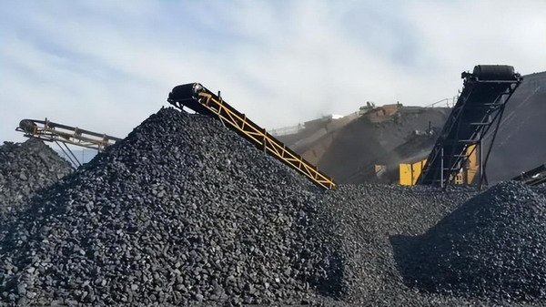
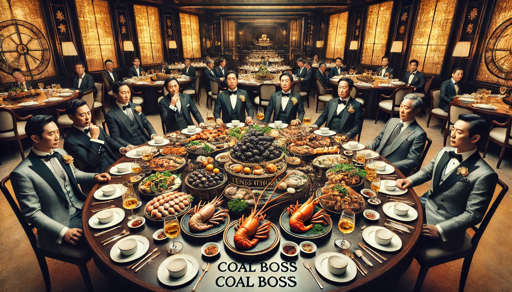
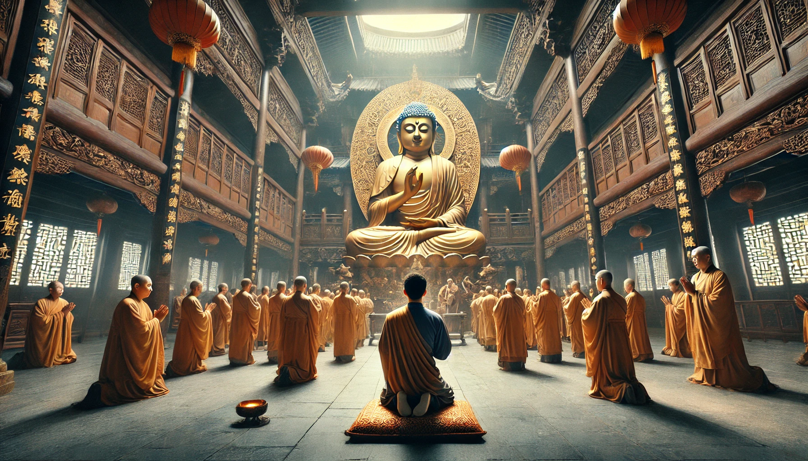

# 有钱人的烦恼：读《煤老板自述三十年》

没钱肯定不幸福，但是有钱就一定幸福吗？我一直不这样认为。据我所知，有钱人每天也是吃喝拉撒，也会得肠胃病，也会出现痔疮；有钱人也要做家务，上班的时候还是要受委屈，回家也一样被老婆骂。如果你认为有钱了，很多烦恼就会自动消失，那么等你真的有钱以后，一定会失望，甚至会更不幸福。

你可能觉得我的所见所闻有限，不具备说服力，那么我们来看看煤老板的自述吧。

《煤老板自述三十年》的作者是老五和劲飞。老五本人就是个煤老板，他的家族有一半人是煤老板，生活圈子有80%是煤老板，所以他对煤老板的生活状态是了如指掌、信手拈来，他家的财力在山西省也是前几名，混的也是上层圈子，跟很多商人官员都经常往来，是不折不扣的“有钱人”；而劲飞则是老五的“文人朋友”，给本书进行了一些语言上的润色。

我们之前已经通过本书研究了煤老板的私生活，今天我们来研究一下煤老板的烦恼。总结如下：

## 1 女人问题

这个我们之前在[《小姐、情妇和女演员——煤老板的生活烦恼》](2024-12-28-%E5%B0%8F%E5%A7%90%E3%80%81%E6%83%85%E5%A6%87%E5%92%8C%E5%A5%B3%E6%BC%94%E5%91%98%E2%80%94%E2%80%94%E7%85%A4%E8%80%81%E6%9D%BF%E7%9A%84%E7%94%9F%E6%B4%BB%E7%83%A6%E6%81%BC.md)已经探讨过。

首先，就是性病问题。书中说：

> 作为过来人，奉劝大家远离色情场所，有些病不是戴套就能隔离开来的。我的两个朋友现在都是资深严重性病患者，饱受煎熬。大夫说不是被小姐传染的，属于自己体内发出来的，真是色毒攻心啊。还有个朋友得了艾滋病，他一向比较注意，随身总带着最贵的套套，有什么用呢，不还是得了嘛。

其次，就是管不好小三，被小三算计的问题，书中说：

> 一个老板的小三为了怀孕，几次三番偷偷在酒里下春药，孕没怀上，老板被弄得彻底阳痿了，五六年都没治好。还有一个老板的小三，老怀不上孕，花大价钱在北京委托一家群众演员经纪公司，专职帮她找跟此老板很像的人。结果真找着了，小三把这个群众演员偷偷包养下来，专职帮自己受孕，期望能生出个高仿版的A货富二代。要不是被意外抓了现行，这个创意十足的小三差点成功了。

有一位老板叫“大利”，多年求子不得，有一次，终于有个老婆怀孕了：

> ……大利的一个小妾生儿子了。兴奋的大利还没来得及给孩子过满月，就收到线报，误会了，儿子不是他的，绿帽子是他的。

这些还都是被发现的，不被发现的更多。毕竟哪里有压迫，哪里就有反抗嘛，谁能完全控制得了另一个人呢？作者不禁感叹：

生活好了，世道坏了，找小三还是看人品，当然能戒掉更好。

## 2 子女问题

煤老板的子女也叫“煤二代”。煤老板很多都是过过苦日子的，从底层摸爬滚打，但他们的孩子却从小生活在优渥的环境中，很多都不争气。

首先是学习不好，博士还无所谓，可以靠关系运作比较简单，但是高考和硕士生考试可都是要考的啊，如果实力不行，运作起来就得花很大力气。所以很多人没有办法，只好把孩子送出国，混个文凭。

学习不好也就算了，煤二代还总是会沾染一些不良嗜好，有些作风不好，不要说继承家业，不败家就谢天谢地了。

比如有一位煤老板的儿子叫小臧，他从小学习不好，在家里人的运作之下才硕士毕业，最终取得博士录取通知书。在家里人的帮助下，小臧迎娶了原省委领导的女儿。

然而，在他俩度蜜月的时候，读博士的事却黄了，因为小臧读研的时候名声太差，总是开着豪车到处转悠，睡人家的女朋友，所以被人挖了黑历史，发现他英语水平不如饭堂的打饭师傅，汉语水平不足以写好一张简历，研究生也是买来的……

不但如此，三个月后，小臧的老婆也受不了了，要闹离婚，因为小臧实在是弱智，见了领导直接要官，说想进部委当处长，“三百万够不够”，丢尽了脸。还整天买一些所谓揭露官场黑幕的书，和一群富二代朋友天天研究谁要下台啦，谁要上台啦这样的幼稚问题。实在是没救了。

不过这也不能全怪煤二代，因为煤二代从小缺乏父母关爱，爸爸的老婆多，家庭关系复杂，这样的环境性格很难健全。

有些煤老板制定了严格的家法，比如有位煤老板的家法规定，儿子赌博要鞭刑，吸毒要用夹棍夹，女婿贪污要剁手指，这些家法都执行过，有一定震慑力，但毕竟是治标不治本啊。

书中记载：

> 大煤老板张忠奎，1935年生人，结过两次婚，三儿五女，四世同堂。张忠奎绰号曹操，有能耐，有胆量，是个人物。可惜子女大多不成器，有的好赌，有的吸毒，还有的两样都爱。为了不让儿女们彻底堕落为败家子，张忠奎在过完六十五岁大寿后，以咬牙切齿的强硬态度，制定了“家法”。家法细则不得而知，从执行情况看，大致是这样的，凡参与赌博的，发现一次三十皮鞭，两次五十皮鞭，三次永久不得在集团内担任任何职务，遗产减半。对吸毒的处罚更为严厉，好像先是拿夹棍夹，如果死性不改，继续复吸，就会享受被净身逐出家门的待遇。

## 3 健康问题

除了性病以外，煤老板也会得其他病。因为煤老板的饭局很多，而饭局又很腐败，去多了身体也好不了。作者说：

> 煤老板饭局多，这是必须的，煤老板的饭局还必须贵，否则没面子。煤老板的饭局吃的是场面，吃的是规格，而不是营养，太他妈可笑了。因此吃的多，吃的贵，不见得身体壮，反之，身体负担变重，体能变差，有病好得很慢，这些都是真实体会。“绿豆神医”张悟本出现后，生茄子、绿豆汤出现在煤老板埋单的饭局上，真挺好的，不是说这东西省钱，而是够简单，让饭局变得清新了些。中国人吃的实在太丰富、太复杂，五六个人一顿饭吃几万，你说人体怎么消化这么些复杂的玩意，吃多了身体好真见鬼了。

> 我不相信绿豆包医百病，长条茄子、白萝卜天下无敌，我相信张悟本的学历可能确实有问题，但我还是挺感谢他的。他让腐败的饭局清新许多，多喝些绿豆汤，多吃些生茄子，好过鹅肝、大闸蟹，他提倡的简单饮食，在中国太缺乏提倡了，造了多少浪费啊，绿豆价格再高，能有多高。

> 我的一位亲戚听张悟本的话，一直喝绿豆汤，高血压下来了，过去吃多少药，都没多大效果。我相信专家们对张悟本的批评指责，也相信身边发生的真事，很遗憾怎么中国一直没出现能起到张悟本作用的真专家呢。如果有个伪专家出来，让我们大搞空腹疗法，简单饮食，狂吃绿豆、长茄子，能治癌症、糖尿病、高血压，以及诸小病。我要是老百姓，我真愿意信他，早信能防病，晚信呢，也有个精神寄托，总好过化疗一通，匆忙死掉。

我们普通人一桌吃一两千就已经很体面了，这些煤老板竟然五六个人吃几万，真是营养过剩。吃饭也免不了喝酒，所以虽然文中没直接说，但是酒局的危害大家也知道，对身体不好。

除此之外，煤老板还容易得精神病，这跟他们的其他烦恼有关。

## 4 赌博问题

当煤老板，每天都日进斗金，还有什么比做煤矿更刺激的呢？那就只有赌博了。所以很多煤老板都喜欢赌，但是没有几个真的赚到了。

书中说：

> 占便宜的思想是人类通病，不付出或者少付出就有收获是人类的梦想，赌博虽然成功几率低，但毕竟也是有的。人人都想成为偶然的幸运儿，疯狂在所难免。倾家荡产的不少，家破人亡的见过，但在赌徒眼里，只看见那几个赢大钱的。赌博就是世道人心的缩影，想快速发财的人十有八九不是赌徒，就是骗子。

煤老板赌博数额都是以千万计，很多人因此负债累累，有些煤老板赌上头了，把几十亿的煤矿都给抵押了，真是一个不稳定因素啊。

## 5 生意问题

煤老板虽然日进斗金，但他们的生意也不是万无一失的。

比如，以前发生矿难还好，后来一旦发生矿难，就会遭受重大损失，会影响生产，也会有社会舆论压力。书中说：

> 煤价高，风险也高，哪天踩翻了矿难这扇井盖，伤筋动骨是一定的。除此之外，上头时不时搞搞资源整合，给煤老板们再补两刀，伤口太大，双面胶都补不住。

所以很多煤老板都会想办法投资别的东西：

> 对于我们煤老板来说，今天日子好过，不代表明天日子好过，转型是必须要考虑的事。房地产行业好，却是山大王、烂仟、微博潘等老混子们的天下。高科技产业看上去挺美，政府提倡，政策支持，挺受尊敬的。

但是，天有不测风云，人有旦夕祸福，煤老板可能会遇到其他问题，比如政治风波、经济危机等等。

做生意上面都要有人，如果有个好后台，生意自然就坏不了。但关键是后台倒了怎么办呢？如果煤老板影响大了，他自己本人也要面临站队问题，如何保证自己不出错呢？很多煤老板感到天威难测，那能不烦恼吗？

经济危机也一样，2008年的经济危机，让很多煤老板损失惨重，不乏很多人欠下了很多债。这种经济危机也是难以预料的。

## 6 信仰危机

但是，以上其实都是小事，最重要的是信仰危机。

作者老五的父亲叫“郝二铁”，是穷苦人出身，小时候父母双亡，很早就参加了共产党组织的抗日儿童团，建国后经历了很多事，但一直坚定自己的共产主义理想。

所以郝二铁后来成为煤老板以后，也没有信仰危机，他有钱后，给全县人民免费供应煤气和暖气，还给自己的老家建设了新村，并承诺办村镇企业来解决村里所有人的就业问题。书中说：

> 说实话，父亲从来都不是个聪明人，我们认为对的道理，很多时候他不懂，他只是向我们强调，人一辈子很短，能做的事很少，你们有吃有喝就行了，让老子搞搞共产主义怎么了，迟早会搞成的，急什么。柳湾新村快建好的时候，父亲快不行了。武喜拐着腿，拿着两瓶酒、一条烟来找父亲，问新农村建好了，有没有他的一套房。父亲点点头，让他一定要把下一代教育好，不能走歪路。父亲去世前，让我们把他火化了，把骨灰洒在太行山上。母亲说，“太远了吧，孩子们上坟不方便”。父亲说，“不用上，老子是共产主义者”。

> 父亲去世后，哀荣备至，他为全县免费提供了十年的暖气、煤气，价值六个多亿，他为建柳湾新村花了一个多亿，他为各项教育事业捐了两个多亿。而他一辈子吃苦受罪，不愿享受，吃的用的都很简单，还始终不肯搬离老屋，睡了一辈子土炕。我们终究没有火化父亲，把他土葬在一座很气派的墓园里，不知道父亲在天有灵，会不会骂，谁让你们把老子埋这儿的。在父亲死后的第二年，我们开始向全县人民征收暖气费和煤气费。

但这样的煤老板实在是少数，到了少壮派煤老板的时代，这样的人就压根没有了。但他们却都遇到了信仰危机。

如何解决呢？信仰宗教是最好的办法。比如作者的一个好朋友邢猛，就在2005年出家了，成为全省第一个出家的煤老板。

为什么说信仰宗教好呢？因为信仰宗教，病没有了，矿难少了，各种瘾都戒了，生意也好了。书中说：

> 邢猛被重度抑郁症折磨了两年之后，一张光盘救了他，净空法师讲的《和谐拯救危机》。邢猛信佛了，真信，跑到新加坡去找一位老法师，求学佛之道。老法师告诉他，平时为人做事，按《弟子规》办，天天忏悔。邢猛从新加坡回来，直奔葛村，挨家挨户地磕头，并拿出两个亿在葛村建学校，修医院，修养老院，还盖了座庙。邢猛真的脱胎换骨了，不赌博，不好色，不杀生，不吃肉，时时捻着念珠念佛，天天跪在佛前忏悔，挣多少钱捐多少钱。

> ……说来也怪，邢猛越是热心公益，他煤矿的效益就越好，而且就是不出事故，连正常范畴的小事故都不出。这年头，矿难一出，啥都玩完，所有的煤老板都怕。好多迷信的老板觉得邢猛信佛得了益，就跟着邢猛信了佛，但终究没他那么猛，该偷税一定偷税。

作者自己也在2009年10月皈依了佛门，天天和寺庙高僧探讨佛经。佛门子弟不打妄语，这本书出版于2011年，可能也有一些忏悔的意味在，所以我基本相信这本书的真实性——当然，人都会将自己的行为合理化，所以这本书就算适当美化自己和自己的亲友，也是可以理解的，聪明的读者自然能分辨出来。

另外，作者非常信奉的一本书就是《了凡四训》，他竟然将《了凡四训》的全文附在本书末尾，可能这也是他做好事、劝人向善的举措吧。

李商隐有句诗：“如何四纪为天子，不及卢家有莫愁。”你唐玄宗当了四十多年的皇帝，享尽荣华富贵，但是那又怎么样呢？最后还不是丢了长安，逃去四川，被自己的儿子逼着退位，看着自己的女人自缢而死？还真不如我们普通人老婆孩子热炕头呢。

所以，煤老板这么有钱，那又怎么样呢？最后还不是天天研究《了凡四训》？而我年纪轻轻就看到了这本书，从这个方面讲，我觉得自己实在比大多数煤老板都更有智慧。
