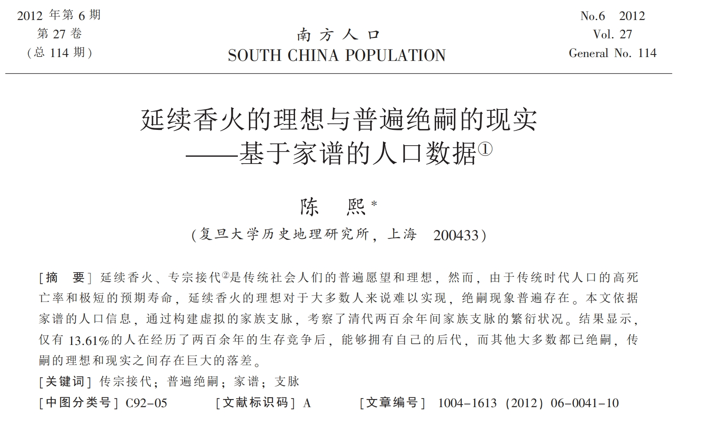
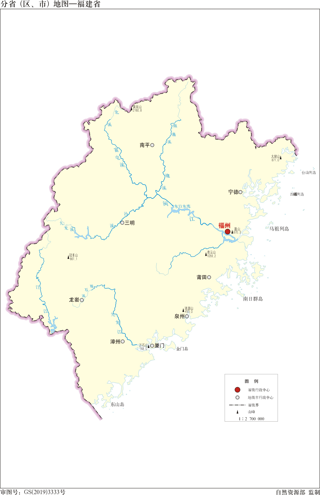
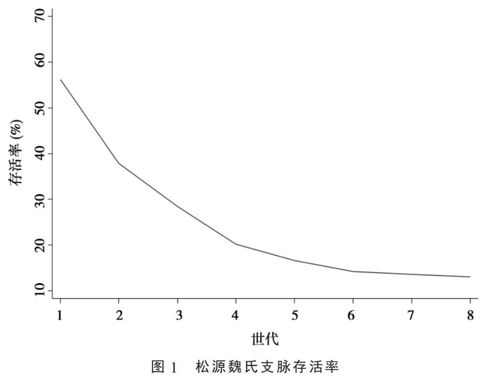
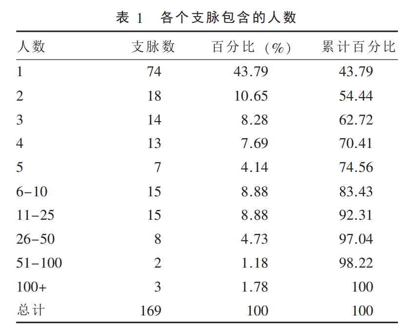
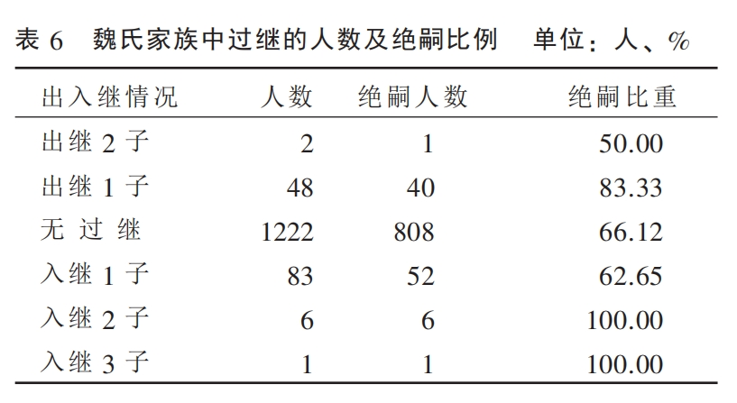
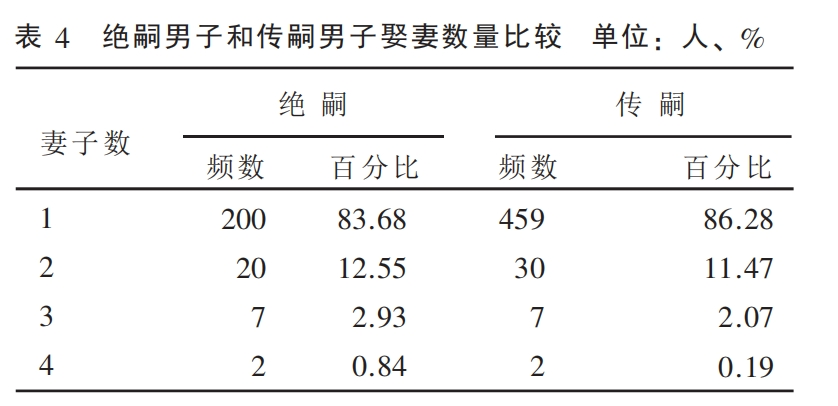
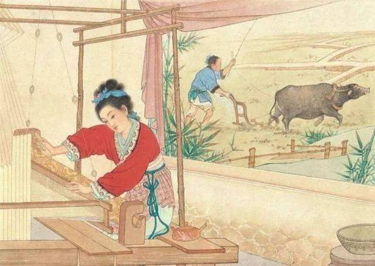
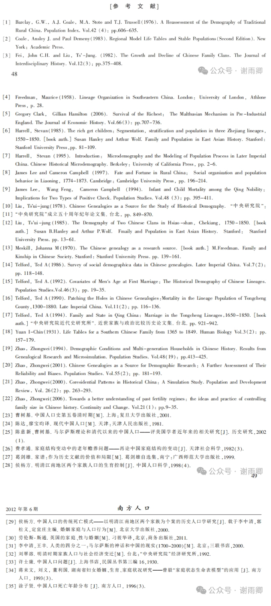

# 在古代，86.39%的男性注定在267年后断子绝孙

## 一

2012 年，复旦大学历史地理研究所的陈熙博士在《南方人口》发表了一篇论文，名为《延续香火的理想与普遍绝嗣的现实——基于家谱的人口数据》，文中指出：

仅有13.61%的人在经历了两百余年的生存竞争后，能够拥有自己的后代，而其他大多数都已绝嗣，传嗣的理想和现实之间存在巨大的落差。

这就意味着，在社会环境不变的条件下，将近86.39%的男性将在200多年后没有自己的男性后代，也就是传统观念中的“断子绝孙”。

这也意味着，在座的各位，你们200多年前的父系祖先，都属于13.61%的生存竞争的胜利者，实在是不容易。

那么，这个数据是如何得出的呢？

作者的结论来自对《松源魏氏宗谱》的分析。松源镇位于福建省西北山区（应是现在的松溪县松源街道，在南平市东边），此地乃河谷盆地，较为封闭，受外界影响较小，即使是太平天国这样的运动也没有对其造成重大人口损失，可以反映正常情况下中国古代农村地区的人口繁衍状况。

《松源魏氏宗谱》最早编修于明代正德八年（1513年），其后历次增修，民国六年（1917年）完成了第五次增修。作者的研究范围，就是从家谱的第20世开始，到第五次增修时结束。家谱第20世设为研究的第1世，这一世共169个男性，将其看成169个支脉。第1世最早出生的时间是顺治七年（1650年），作为观测开始时间；1917年是第五次修谱时间，作为观测结束时间，历时267年。

研究发现，松源魏氏经过第一代繁衍后，就有43.8%的男性绝嗣，超过四成人断子绝孙；第二代淘汰了62.13%的支脉；第三代淘汰了71.60%的支脉；到1917年，原先的169个支脉中，86.39%的人已先后绝嗣。

据说，这个结论和赵中维做的微观人口模拟实验的结果相近。在赵中维的实验中，3000人经过9代的繁衍后，只有398人有自己的后代，传嗣比例也只有13.27%。

所以，这个研究结果我认为是有说服力的，能够反映古代社会的普遍趋势。结果当然不能推广到所有人，但至少能说明：在古代，尽管很多人都想着延续香火，但实际上绝嗣才是普遍现象。

退一步讲，绝嗣率即使达不到267年的86.39%，偏差也不会太大，这大概就是俗语所说的“穷不过三代，富不过三代”吧。因为穷人过几十年很可能就绝后了，富人过几十年就没落了（至少存在大量没落的分支），长久兴旺的家族少之又少。

那么，影响传宗接代的主要因素有哪些呢？

文章指出，生子数的影响最为直接，生子越多，传嗣的概率越大；但是生子数又和这个人的经济社会地位有关，比如“族长”和有“功名”的人，他们往往更容易留下自己的后代。其他因素影响很小，比如妻子数量和过继。大部分人都只有一个老婆，老婆多的也未必孩子多；过继则兼有正反两方面的影响，因为过继虽然可以增加传嗣的概率，但是过继也说明自己家族已经很没落了。

## 二

以上是这篇论文的核心观点，但这篇论文引用了很多资料，内容很丰富，我将其中一些有意思的结论列举出来，供大家参考。括号后会标记来源，文末会列举论文的参考文献，供大家查证。

1 延续“香火”的观念深入民间，是中国社会最重要的信念（费孝通，1982）。

2 清代人口出现了爆发式增长，从康熙十八年（1679）的1.6亿增加到宣统二年（1910）的4.36亿（曹树基，2001），但人口的死亡率仍然居高不下，预期寿命也非常低，人口再生产依然是处于传统的高出生、高死亡的状态，出生预期寿命可能低于30岁（Zhao，2000）。

3 早婚被认为是中国历史人口的一个重要特征，但是最近的一些研究表明，仅仅是女性早婚，而男性有不少人是在30、40岁才结婚，超过5%的男性甚至终生未婚（李中清、王丰，2000)。

4 在人口总量的快速增长的同时，绝嗣现象却普遍地发生，这两个看似相互矛盾的现象，让我们推出这样的假设：即清末规模庞大的人口，可能就只是清朝初期一小部分人的后代，而清初的1.6亿人中的绝大多数，在后来的两百余年间，都陆续绝嗣了。这就意味着传嗣的理想对于大多数人可能都是难以实现的，只有少数人能够拥有自己的后代（陈熙，2012）。

5 人口条件对家庭的制约，主要表现在较短的人均寿命限制了大家庭的实现。由于人均寿命较短，多代同堂难以实现，使得核心家庭是主流的家庭模式(Zhao,1994,2000)。

6 早期Freedman等对中国传统宗族的研究显示，家族内部成员之间的社会经济地位是呈现分化状态，既包含富有的商人，也包含落魄的贫民；既有拥有功名、地位显赫的士绅，也有处于社会底层的农民（Freedman，1958）。

7 John C.H.Fei（1982）等对十个家族人口的发展历程进行考察，发现家族人口的增长存在一个CMV(critical maximumvalue)，即当家族人口增长到最高点时，家族就不可避免地走向瓦解，这可能归因于在特定区域内土地资源的短缺带来的竞争导致。

8 家族中那些拥有功名的人，能够较早地结婚和生育，这使得他们更容易获得子嗣，可以说是“富人拥有后代”（Harrell 1985）。

9 对英国工业革命以前的人口研究发现，财富状况和子嗣数量之间有着明显的相关性，最富有的人留下的后代数量是最贫穷的人的两倍（Gregory Clark and GillianHamilton,2006)。

10 贫穷推迟了男性结婚年龄（Freedman，1958），并成为导致35岁以上男性未婚的主要原因（陈意新、曹树基，2002）。

11 已有的研究显示，传统中国的人口生育行为存在人为控制，并非处于纯粹的“自然的状态”，人们会根据家庭经济状况和对未来的预期进行生育控制，当人们拥有足够保证传嗣的儿子数时，就可能停止生育，以减轻经济负担（James Lee&Cameron Campbell，1997;侯杨方，1998;Zhao,2006）。婚后推迟生育、提早结束生育年龄、延长生育间隔是形成低生育的三种人口机制（李中清、王丰，2000)。

## 三

看完这篇论文后，大家可以对传统社会的一些观念有更深刻的认识。比如为啥传统社会那么重视传宗接代和延续香火，那是因为传宗接代是需要努力的，是需要不懈斗争的，是需要绞尽脑汁、全力以赴的，那些稍微不够重视的人都断子绝孙了，留下后代的人都对这方面非常重视。

这篇论文也告诉我们，当前很多人不婚不育其实没啥好感叹的，无非是以前的人被动断子绝孙，现在的人主动断子绝孙。新的社会需要新的思想，不然地球人口就会越来越多，资源不够用了。

也就是说，古代社会经过一代的繁衍，将近40%的人绝嗣，那么现在的年轻人就算有三分之一的人不生育，也是非常正常的现象，长期看不会对人口结构造成太大的影响。

以前是商品滞销，现在是产能过剩；以前是被动断子绝孙，现在是主动不生育。这说明人民群众的思想觉悟在不断提高——儿孙未必有儿孙福，但是不生儿孙我一定会享福。

参考文献

陈熙.延续香火的理想与普遍绝嗣的现实——基于家谱的人口数据[J].南方人口，2012，27（06）：41-50.

