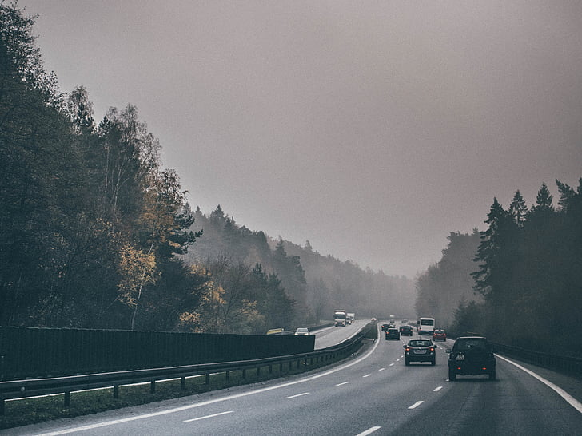
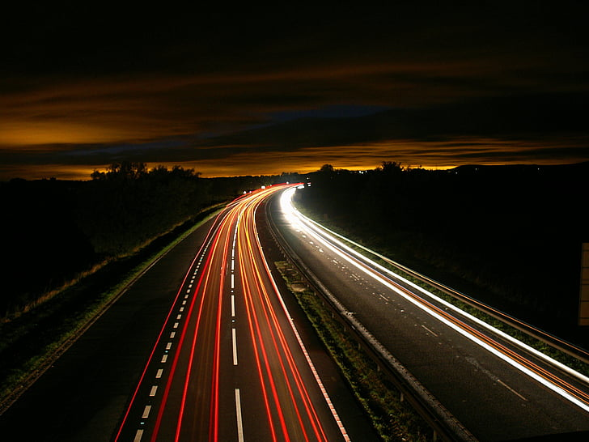
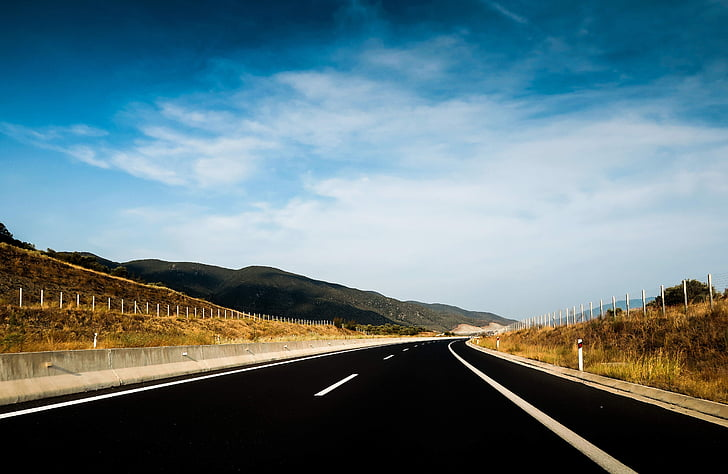

# 用牛顿第一定律开车，平稳又省油

今年回老家仍然是几个亲戚一起自驾，我们1月21日中午十一点半从嘉兴市海盐县出发，1月22日下午四点半到达绵阳安县，开车加休息，花了29个小时左右。

这一路，有三个感想。

一是感觉天气变热了，记忆里回老家的路上是很冷的，有些年头还会下雪，有的地方路面结冰，很容易打滑。但今年却一点也不冷，出发的时候阳光明媚，甚至还觉得有点热，直到晚上才有一些凉飕飕的感觉。

第二个感想是人变少了。以前春运非常夸张，自驾回家少不了堵车，有时候路上可以堵几千米，很长时间都在高速路上龟速前进。但这次我们回家，只是开始的时候堵了一下，而且多是因为前方出现了交通事故，一旦堵过了事故发生点，车流速度就会重新变快。尤其是后半夜在襄阳附近的时候，高速路上的车辆寥寥无几，有一种“此路是我开”的感觉。

第三个感想，就是发现我的开车水平有所上升。我们是轮流开车，我开了大概有8个小时，其中有一段是从晚上0:50开到凌晨5:20，四个半小时开了500公里，是移动速度最快的一段，因为这一路车少、路好、没啥洞。

我发现，开车是一件非常复杂的事情，但就速度控制来讲，其实开车仍然遵循着牛顿第一定律。

牛顿第一定律的内容为：

> 每个物体都会保持静止状态，或做匀速直线运动，除非它被施加在其上的力改变这种运动状态。物体有保持原有运动状态的趋势，这被称为惯性。而力是改变物体运动状态的原因。

具体到开车上，就是说车辆本身是要保持静止或匀速直线运动的，但是在现实中，车辆在开动的时候会持续地受到一个向后的摩擦力，所以会不断减速。

而踩油门就是为车辆提供一个向前的动力，所以，在车辆行驶的时候，右脚轻踩油门，使踩油门给的动力刚好抵消车辆受到的摩擦力，车辆就会保持匀速行驶。至于这个力度如何控制，则需要靠自己的经验和感觉了，车技好的人，对这个力度的控制也越好，开车也就会更平稳。

我们再考虑其它因素，比如坡度和路面状况。上坡可以看作摩擦力增大，此时要想保持匀速，则必须加重油门；下坡可以看作摩擦力减小（或者看成有一个新的动力），此时要想保持匀速，则必须抬起油门，或者轻踩刹车；路面如果有减速带，则同样可以看成摩擦力增大。

所以，把牛顿第一定律和现实情况充分结合，我们就可以把车开得既平稳，又省油。

要想平稳，就是不要让车的速度变化太快；要想省油，就是要充分用好油门给车施加的动力，不要让这些动力浪费。说白了，就是少踩刹车、轻踩刹车。

如何实现少踩刹车呢？最重要的就是充分利用车辆行驶带来的摩擦力。

很多人开车不稳，就是因为他们总在必须减速的时候才踩刹车，刹车踩太重太急，这样既不舒适，也不省油。

如果充分利用摩擦力的话，就可以在需要减速的时候，提前抬起油门，这样车辆自然会逐渐减速。我认为这是实现平稳和省油的关键。

所以，保持车距和注意观察就非常重要。

比方说，现在我正在高速路上行驶，高速上最高限速是120码。

如果此时，我放眼望去前面没车，那么我就可以加重油门，把速度提到135码，然后保持这个速度。

如果此时，导航播报前方500米有测速监控，而车辆行驶速度是135码。这时不要慌，我们松开油门，把右脚收起来放松放松，车辆慢慢减速，等到车辆行驶到监控下面，一定会减到120码左右，绝对不会超速（超速10%以下不会罚款计分）。

如果此时，我们看到前方有车，那么我也会松开油门，使车辆速度降到120码，然后轻踩油门维持这个速度，并保持两车距离在80米以上。然后就是观察这辆车的情况。

如果这辆车是货车，那么它最多开100码，顶天开110码，所以不要跟在它后面，可以找机会超车。

如果这辆车是汽车，而且它前面也没车，那么它一定会保持120码左右，这时可以进一步判断，如果它开得很快，就可以跟着它；如果它开得很慢，就可以找机会超车。

如果这辆车是汽车，但是它前面还有车（此时其它车道一般也有车），那么就需要谨慎了，可以适当抬起油门减速，观察进一步的情况。此时一定不能贪快，要保持车距，这样一来，就算前面急刹车，我们也有缓冲的时间，可以保证安全。

如果前面有一辆车正想超车，那么就不需要太紧张，它大概率会加速，我们保持车速即可，甚至也可以跟上。

如果前面有量车，平时跑得挺快的，前面也没车，但是突然减速，那么大概率是因为前面有测速监控，它只是减一下速保证不扣分，过了监控还会继续加速的。此时我们也不用慌，抬起油门即可，不必踩刹车。

总之，要学会揣摩前车的意图，学会观察路况，然后预判之后是需要加速还是减速，提前做出动作。物理定律就那么几条，具体情况千变万化，开多了，自然能够熟练驾驶。

当然，对于开车，我只是略有心得。班门弄斧，希望各位老司机不要计较。

-END-

这是一个能涨知识的公众号，关注我，阅读更多有趣文章～
