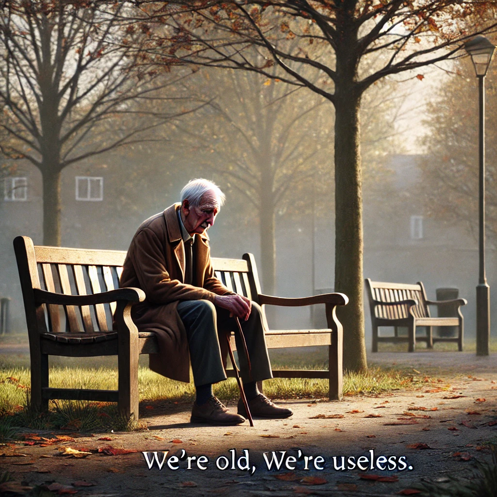
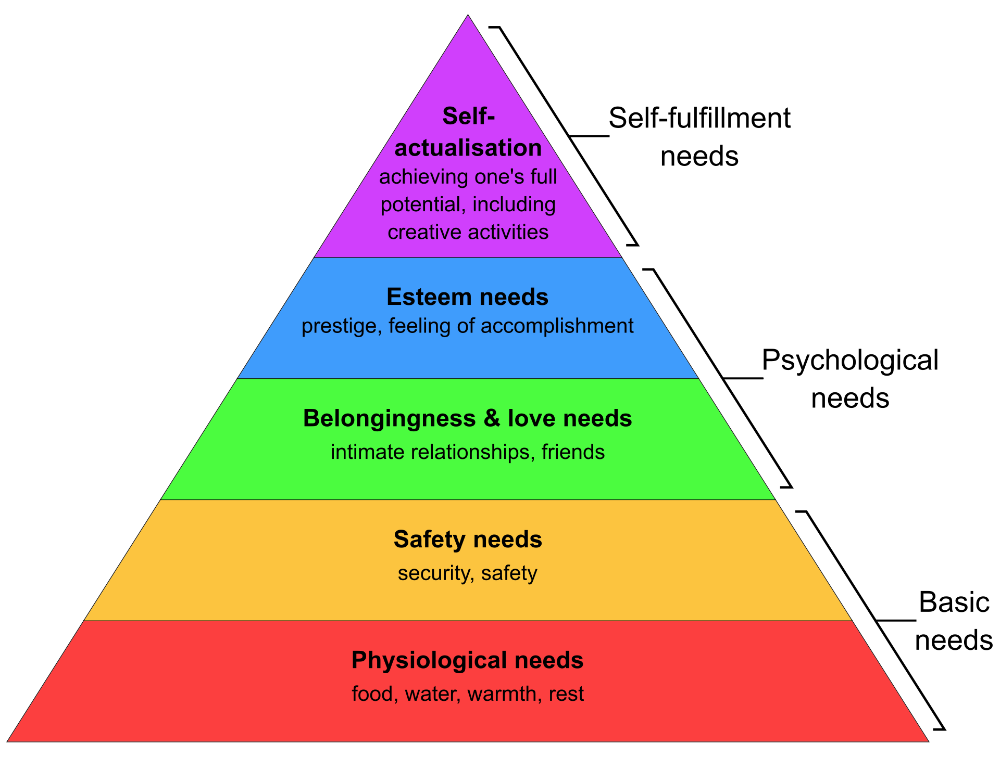
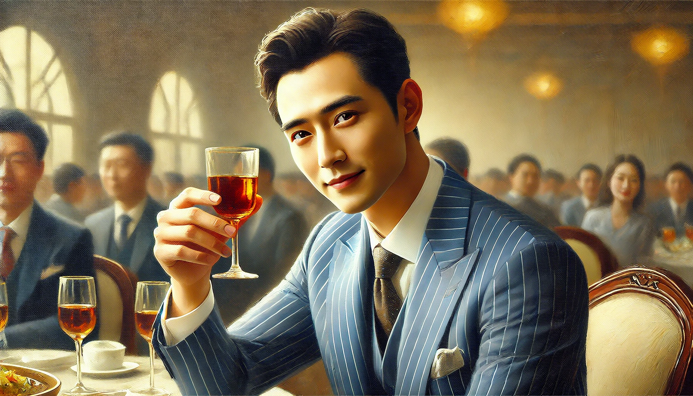
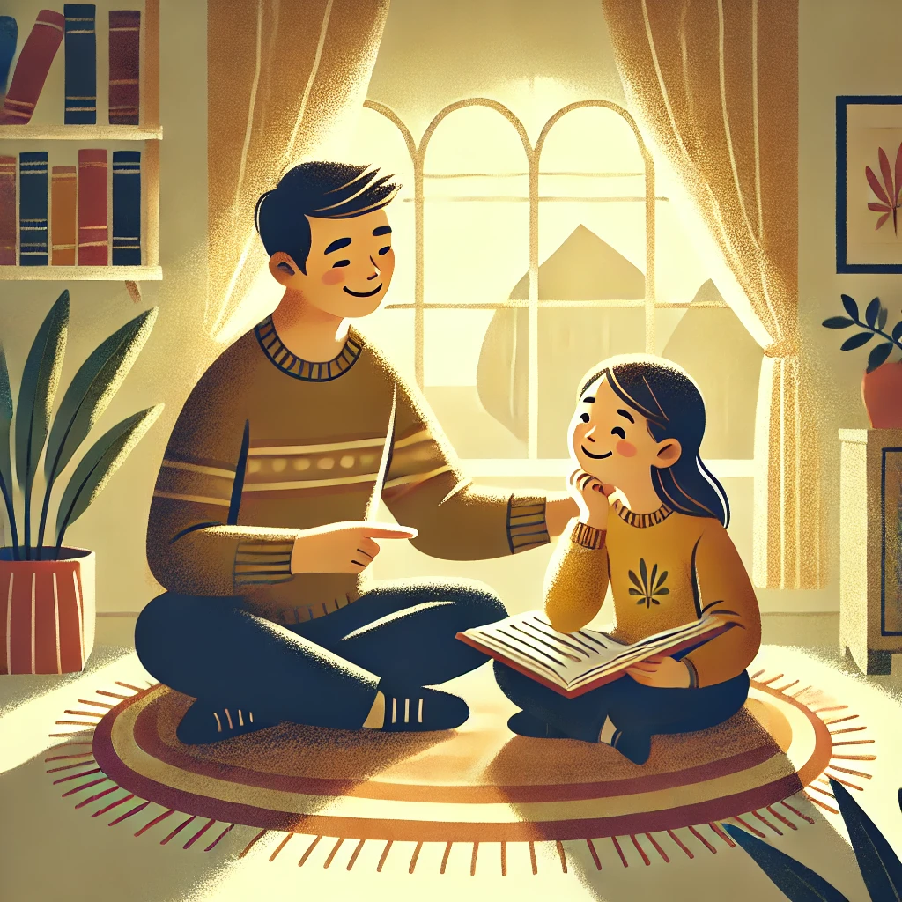

# 满足需求和尊重价值——处理人际关系的核心

有人的地方就有江湖，有江湖的地方就有人情世故。那么人情世故的核心是什么呢？我认为是尊重。尊重什么呢？尊重人的价值。价值意味着什么呢？意味着满足别人的需求。

人是一种社会性的动物，他除了要吃饭睡觉以外，他还要获得别人的认可，认可他是一个对社会、对集体、对他人或者对其他某种东西有价值（或者说有作用）的人，找到了自己的价值，生活就有了动力。

这里的价值不是政治经济学的“价值”，政治经济学中的“价值”可以理解为“商品价值”；这里的价值倒像是政治经济学中的“使用价值”，强调能够满足人们某种需求的属性。

有一句话非常形象地体现出“价值”这个词的意义，那就是很多老人的那句感叹：“我们老了，不中用了……” “不中用”就是无法满足其他人的某种需求了，就意味着没有价值了。

自尊，就是自己认可自己的价值。尊重，就是一个人认可另一个人的价值。每个人的价值观不一样，对同一个东西的价值认定也不一样，比如有些人重义轻利，有些人注重实效，有些人信奉自由，有些人崇尚公正……价值观不一样，但渴望成为一个有价值的人，却是人之常情。

在马斯洛需求层次理论中，人的需求从底层到高层分别为：生理需求、安全需求、归属需求、尊重需求和自我实现五层。在我看来，第四层是寻求别人对自己价值的认可，第五层则是自己对自己价值的认可和超越——最高的两层都是关于价值的。

而且，人是社会的动物，人要满足生理需求、安全需求以及归属需求，也离不开跟其他人打交道，跟其他人打交道，就一定会涉及价值问题。比如你还是婴儿的时候，什么好事都没做，麻烦事还一大堆，你的父母凭什么要养育你呢？归根结底是因为养育你使他们实现了自己的价值，还因为他们认定你未来也会成为一个有价值的人。

所以研究人际关系问题，就离不开这两个词：需求和满足需求的价值。

而要想处理好人际关系，也可以从“满足需求”和“尊重价值”两方面入手。

以上都是理论层面的探讨，但相信聪明的读者已经能够联系实际了。我这里举出一些例子，算是抛砖引玉，供大家探讨：

1 要想获得别人的尊重，最根本的办法是成为一个有价值的人，也就是成为能够满足别人需求的人。具体地说，你可以通过有钱有势赢得尊重，可以通过高超的专业技能赢得尊重，也可以通过乐于助人、甘于奉献的口碑赢得尊重。

2 反过来说，追求其他表面的东西来寻求别人的尊重，通常是无法长久的。比如有些名媛拼单购买奢侈品，发朋友圈炫富，终究只能骗人一时，这些人没有真正的朋友，得不到真正的尊重，是很正常的事情。我还听说有些青少年通过纹身、抽烟和自残的方式吸引别人的注意力，证明自己是“有人在乎的”（这些都是真事），这样也无法获得真正的尊重。

3 同样，如果你无法满足某些人的需求，你对他们就是没有价值，你就不用向他们强求额外的尊重。比如一个富豪在大街上走着，但是我们对他和对其他人不会有什么区别的对待，因为他再有钱，也跟我们没关系，我们没必要走过去舔两口。再比如很多父母用自己的方式对儿女好，但是儿女却并不领情，因为一种行为父母觉得好不代表子女也觉得好。

4 在人际交往中，如果一个人总是认可你的想法，对你很客气很尊重，那么你就会感觉到自己的价值被他认可了，于是你就会对他另眼相待，会觉得这个人很好相处，也更倾向于跟他合作。反之，如果你尊重别人，别人也会对你有很好的印象。

5 反过来讲，如果有个人总是跟你对着干，每次你提出一个想法，他都要找茬，都要否定你，平时也总是数落你的毛病，却对你的优点视而不见。对于这样的人，你能感受到他在不断否定你的价值，你当然不会想跟他打交道，甚至想找机会报复一下。

6 所以，和人相处的时候，首先要学会寻找对方的闪光点，尊重对方的价值，多赞美对方，这样一来你们的关系就不会差到哪里去。在对别人有意见的时候，也要注意语气，不能因为一时一事而否定他整个人，只有基本肯定一个人，他才能在心理上接受你对他某些地方的意见。也就是说，肯定一个人，才有资格改变这个人。

7 很多中国式家长都会在第6点犯错，他们虽然很爱自己的孩子，但恨铁不成钢，每次说话就是挑毛病，孩子当然不愿意跟这样的父母说话。所以对孩子应该以鼓励式教育为主，多发掘孩子的闪光点，多鼓励孩子实现自己的价值，这样才能真正帮助孩子成长，亲子关系也会好很多。

8 带团队、培养下属也是一样，如果你用PUA的方式打压下属，下属虽然一时会服从你，但这非常影响这位下属的心理健康和长久发展，不但如此，人都不是傻的，等他以后想明白了，想到你一次，就要咒骂你一次。相反，如果你爱护下属，善于发掘他的优点，培养他的潜能，那么他一定会成长得很快，很快就能独当一面，这样就算他以后离开了你，也会一直对你心怀感激。

9 不但要善于找别人的闪光点，还要善于找自己的闪光点。找到自己的优点，肯定自己的价值，才会有较高的自尊心，这样做事就会充满动力。

10 最重要的还是要有一个自洽的价值体系，这样别人骂你的时候，你也不会因此轻易否认自己的价值。

总之，类似的例子数不胜数，比如在婚姻中，在职场中，在饭局上等等，各种场合，规矩很多，情况很复杂，但只要围绕着“满足需求”和“尊重价值”这两个点，就一定能够极大改善人际关系。

当然，以上都是个人的一些浅见，欢迎大家补充讨论。
