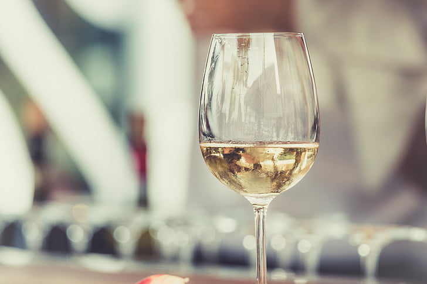
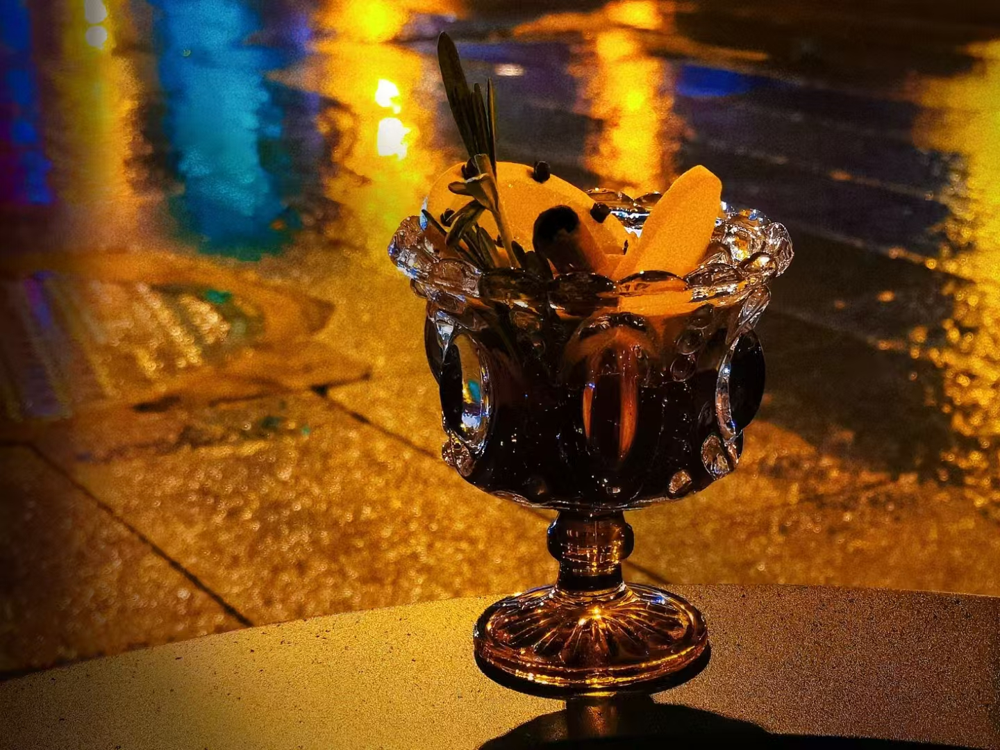
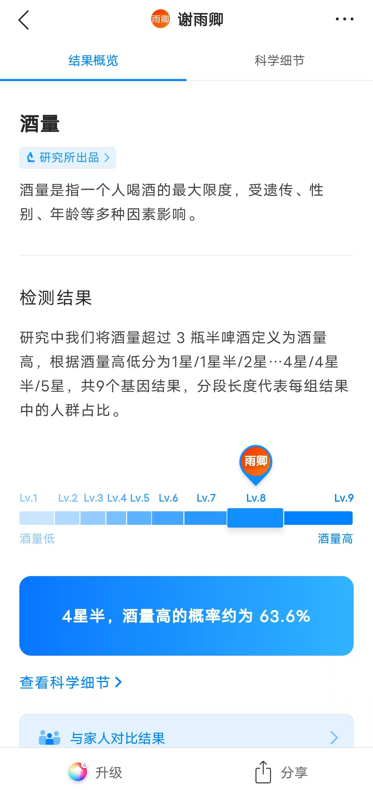
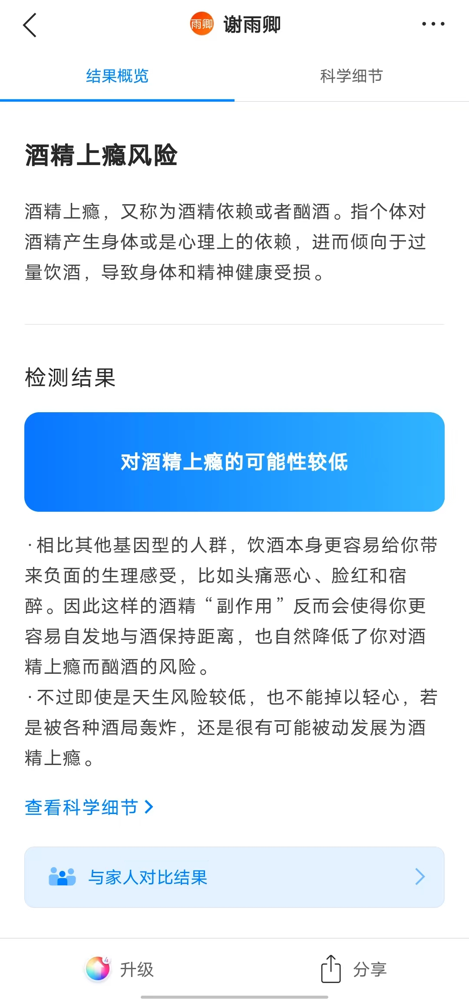

# 酒精的作用：抑制人的抑制功能

我本来是不喝酒的，直到大二的某一天下午，我跟几个同学在校外散步，在良乡南关附近，突然路过一家酒坊，觉得好奇，就进去看了看。

说是酒坊，其实严格讲应该是卖酒的店，因为在店内没有看到酿酒工具和原料，只是有很多黑色陶瓷制的酒缸和酒罐，瓶身都有红底黑字的“酒”字，下面标着“10元”“20元”“50元”“100元”不等的价格，还有不同的品种，据说都是自己酿的。

我买了一斤20元的酒，老板娘把酒装在一个矿泉水塑料瓶中，我付了钱，接过塑料瓶，出了门，继续散步。

在路上，我时不时喝一口酒，一开始并不觉得好喝，毕竟白酒不像其他饮料，既不甜也不解渴，喝起来还有一种火辣辣的感觉，有时候要皱着眉头才能咽下去。

但是，喝了几口以后，我逐渐感觉到酒精的作用了。身体发热，精神亢奋，小脑控制的动作已不精准，难以保持平衡；但是大脑却变得活跃，话也更多了。

边走边喝，不知不觉到了学校，那天晚上正好有个读书会，我们简单吃完饭，就按原计划开展读书会活动。

我本来是一个很内向的人，公众场合能不说话就不说话，读书会更不怎么讲话。但那天在酒精的作用下，我在读书会上口若悬河，滔滔不绝，差点把读书讨论会变成单口相声，真有一种“斗酒诗百篇”的感觉。

读书会结束，我想着再喝一口，却发现瓶里的酒早已见底，1斤酒已经喝完了，实在是意犹未尽。

从此以后，我便爱上了喝酒。

我发现，酒精的作用，一言以蔽之，就是抑制人的抑制功能。

平时与人相处，我们会考虑很多东西，会想这么做合不合适，这么说合不合适，总想着自己的言行会有什么样的后果，说白了，就是脸皮太薄。但是喝了酒以后，就不会考虑那么多了，想做什么事就会直接去做，脸皮变厚很多。

比方说，平时看到一个美女，又喜欢又不想承认，脑海里思绪连篇，好像有两个观点在打架，一个说：“这么漂亮，去勾搭一下吧。”另一个说：“不行，你可是正人君子，一世英名，不能就这么毁了。”所以内耗了好久，却什么行动也没有。

但是喝酒以后就不一样了，看到美女也是有两个观点，一个观点说：“这么漂亮，去勾搭一下吧。”另一个观点还没准备开口，我们就已经听从第一个观点，去勾搭美女了，平时觉得肉麻的话一股脑地都输出了出去。

可以这样理解，平时我们说话做事，会有一个抑制功能，但喝了酒以后，这个抑制功能就没有了，或者说抑制功能被抑制了，用一个成语形容就是“无拘无束”，用一句流行语形容，就是“放飞自我”。

所以，喝酒是可以展现真性情的。喜欢一个人，喝酒以后就会忍不住用各种方式表达自己的喜欢；讨厌一个人，酒后也会表现出来。酒后做的事，都是平时内心想做的事。如果有些诱惑你连喝醉了都能够抵制，有些原则你连喝醉了都能坚守，说明这种原则已经真正“内化于心，外化于行”了。所以诸葛亮说“醉之以酒而观其性”，俗语也讲“酒品见人品”，都是这个道理。

正是酒精的这个作用，使得很多场合都离不开酒。

比如，在饭局上，喝酒可以迅速破冰，活跃氛围，使大家能够快速熟悉彼此，从而判断这些人是否适合进一步交往与合作。

比如，独自一人或朋友相聚的时候，喝酒能够快速排遣压抑的情绪，把负面情绪宣泄出来，保持身心健康。

比如，在酒吧里，喝酒也发挥着类似的作用，既可以让陌生人快速结识，也可以一个人排遣忧愁。

再比如，有些文人，素材和感情都已经积累足够，就像水库里的水，积累了很多，但是墙和大坝太高了，水被堵住了，无法流出来形成作品。这时酒精可以改变这种情况，就好像是在水库边缘炸开一个缺口，所有灵感都喷涌而出，就很容易形成作品了。

总之，酒精就像是化学反应中的催化剂，可以大大加快化学反应的反应速率。在合适的时候，酒精可以快速推进两个人的关系，也可以加快创作效率。

但是催化剂并不会改变化学反应本身，你不能奢求酒精会使本来就不投缘的两个人关系变好，也不能奢求一个肚子里没货的人酒后能说出什么有价值的话来。

把酒精当成手段，当然能使生活变好；但要是把喝酒当成目的，则只会徒增烦恼。

一年前，我集中参加了一些商务酒局，喝醉好几次。由于体质原因，我每次喝醉都会非常难受，晚上喝醉酒，第二天就废了。所以，我一度对酒产生了厌恶，甚至有时候闻到白酒的味道，都会联想到第二天头疼的感受，完全喝不下去。

喝酒这件事非常看状态，有兴致的时候酒量很好，不醉不休；没兴致的时候连闻都不想闻。所以我现在是非必要不喝酒，毕竟喝酒伤身，还是少喝为妙啊。
