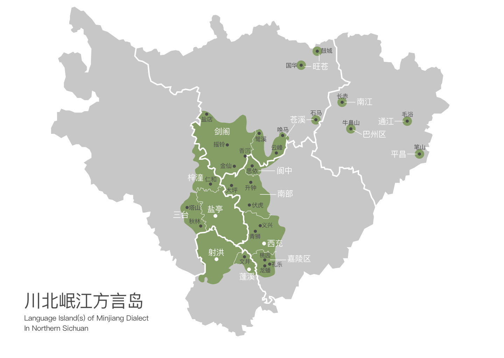
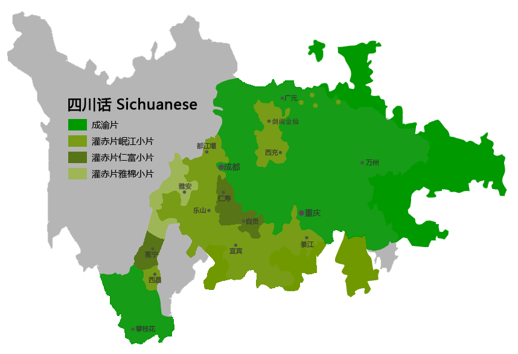
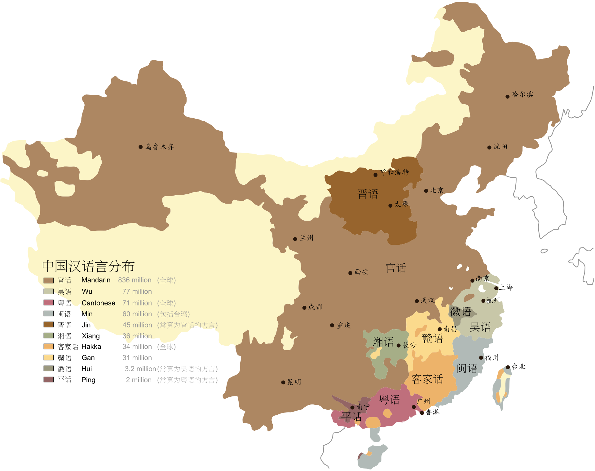

# 拿不出手的四川话

每次回到四川，我都有一个烦恼，那就是四川话说不好。

有人可能就要问了：说不好就说不好呗，怎么就成烦恼了？

因为四川的方言普及率很高，生活工作基本上都说四川话，方言氛围浓厚，农村地区尤甚，所以在这样的环境里操普通话，多少有装逼的嫌疑。

两年前我曾在成都一家公司实习，正好遇到公司接待四川某本科院校的校长，这位校长和公司老板就用四川话交流，相谈甚欢。闲谈中校长还说了这么一句话：“有些领导干部连四川话都不会说，高高在上，哪个做得好群众工作嘛？”

外地人不会说四川话当然是可以理解的，但要是四川人不会说四川话，那就有点过不去了；但说不好四川话却要硬说，又难免遭人嘲笑。我就有一次因为四川话说得奇怪，被朋友无情地取笑了一番，从此以后，我就在说四川话方面变得更自卑了。

那么，我为啥说不好四川话呢？

初中以前，我在浙江上学，每天白天在学校说普通话，晚上在家说四川（绵阳）话，四川话的基础薄弱，受到普通话的影响，很不地道。

初中我在四川省西充县上学。西充是个方言岛，因为位置偏僻，当地方言带有更多古代汉语的元素，音调和用词跟主流的四川话都有较大差别。

在西充这座方言岛待了三年，我的四川话里夹杂了西充话、绵阳话和普通话的各种元素，总之，非常奇怪，实在拿不出手。

这种“拿不出手”的心理，影响还是很大的。可以这样理解，我说四川话跟很多中国人说英语一样，有羞耻感，总觉得不标准，需要鼓起勇气才能开口。

要鼓起勇气才能开口，就会影响平时的工作和生活。比如，同样一件事，我用普通话就可以侃侃而谈，但是用四川话，就总觉得不那么顺溜。

其实，我之前那个老板也有这个问题，不过他是说四川话很顺溜，随时能用四川话做一番精彩的演讲，而到了必须说普通话的场合，他的气场就会明显变小。

或许，每个会说多种语言（方言）的人，他们不同语言（方言）的应用水平都是有差别的，只是我这种情况比较极端一点而已。

话说回来，我的语言天赋可真算差的，不光四川话我说不明白，我待了十几年的浙江，他们本地话我也完全听不懂，信息全靠对语气的判断。不但吴语听不懂，就连河南、河北、山东、陕西这些官话区的方言我也一样听着吃力。听说几十年前普通话还不是很普及的时候，行走江湖的人都能听懂各地不同的方言，各地方言也都能说两句，这项能力真是令人敬佩啊！

四川考生上川大相对其他省份要容易一些，我当时高考的分数也是可以上的，但我却没有报考四川大学，其中原因，除了“少不入蜀”的古训外，就是对自己四川话不够自信，不想后半生用四川话作为自己的工作语言，那对我来说简直是一种煎熬……

当然，逃避肯定是不可取的，克服心理障碍、加强学习，才是这个问题的根本解决方法。
