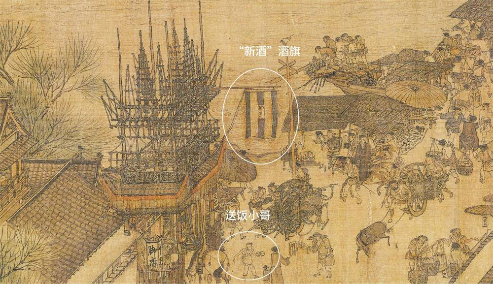
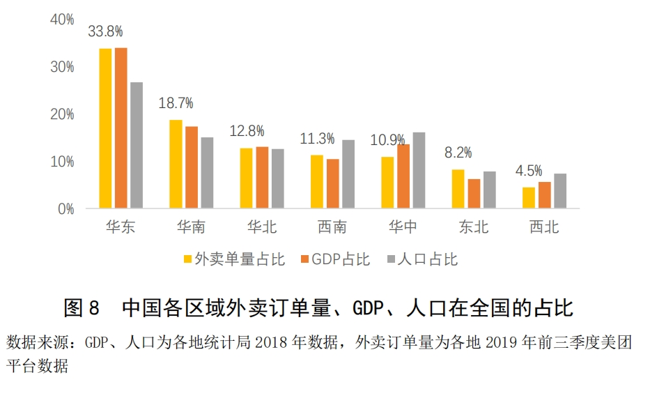
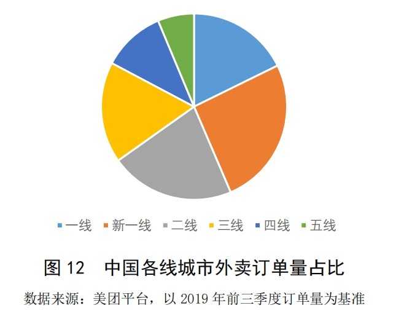
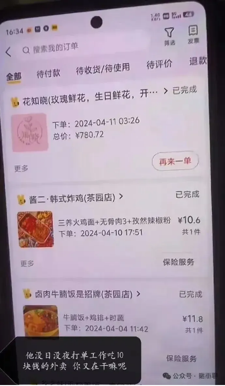

# 外卖，是穷人吃得多还是富人吃得多？

## 一 外卖，是穷人吃得多还是富人吃得多？

这个问题恐怕没有那么好回答。

从外卖的方面讲，外卖消费以美食和甜点饮品为主，但仍然有生活超市、生鲜果蔬、医药健康、鲜花绿植等多个品类。

从人的方面讲，穷人和富人本就是相对的定义，比如《凡人歌》中的沈磊，部委公务员，工资税后7000，房补1500，公积金2000出头，年底一两万奖金，对大多数普通人来说，这是妥妥的富人；但在他老婆谢美蓝眼中，沈磊不思进取，不要说跟自己的领导比，就是她自己，工资也是沈磊的三倍，沈磊怎么能算富人呢？

所以，这个问题需要更细致的分析。

## 二 外卖送餐，古已有之

外卖送餐，古已有之，于今为烈。《东京梦华录》卷二的“饮食果子”条目就记载：

> 更外卖软羊诸色包子、猪羊荷包、烧肉干脯、玉板鲊、把鲊、片酱之类。

当然，这里的“外卖”可以理解为“自提”或“打包”。

《东京梦华录》卷二的“民俗”篇记载：

> 其正酒店户，见脚店三两次打酒，便敢借与三五百两银器。以至贫下人家，就店呼酒，亦用银器供送。有连夜饮者，次日取之。诸妓馆只就店呼酒而已，银器供送，亦复如是。其阔略大量，天下无之也。

这里讲的是有些酒家装酒的器皿非常昂贵，但他们却愿意借给小店主和穷人，非常阔气。有些人通宵喝酒，店家则第二天才来取酒器；妓院派人到店里喊酒，酒家也一样用银器供送。

清明上河图中，也能发现疑似为“外卖小哥”的人，他左手端饭盒，右手拿筷子，快步向前，风尘仆仆。

这些都算是外卖。只不过当时的外卖规模不大，并不普遍。当时没有电话，没有微信，要叫外卖，必须首先派人去店里；那么既然都能派人去商店了，为啥不让那个人直接取餐呢？所以只有跟店家足够熟，量足够大，或者提前约定好时间，才会享受到店家的外卖配送服务。

## 三 从肯德基宅急送到美团外卖

电话的普及，以及快餐连锁企业的出现，给外卖发展创造了新的条件。

2006年下半年，中国肯德基在上海首推“肯德基宅急送”，开始涉足外送市场，后扩大至全国。我本人读中学的时候，还没听说过美团，但当时我们也已经学会打电话给店家，让老板在约定的时间地点，用竹竿把烤肉饭送到围墙里面了。

智能手机和移动支付普及，使外卖真正实现“飞入寻常百姓家”。

2009年4月，“饿了么”网站正式上线。2013年11月18日，美团外卖在北京测试上线。到了今天，中国人民早已习惯“外卖平台+骑手配送”的送餐形式了。

## 四 谁吃外卖更多？

那么，究竟是穷人吃外卖多，还是富人吃外卖多呢？

或许应该是富人吃外卖多，至少也应该是中产吃外卖多。比如刚刚提到的，在古代要享受外卖服务，首先要住在大城市，其次要有仆人去喊外卖，或者你能够去妓院消费，让妓院的人帮你喊。在十几年前，一般只有肯德基这种店才有外卖服务，而当时能消费肯德基的，也一定不是穷人。总之，外卖的起源就带有某种贵族性质。

而且大家都知道，下馆子比自己做饭，可能要多花一两倍的钱；而外卖与堂食相比，则还要再多花几块钱。所以如果一个穷人足够理性，他一定会能自己做饭就自己做饭，点外卖似乎有点奢侈了。

大数据似乎也支持这个结论。美团研究院的《中国外卖产业调查研究报告（2019年前三季度）》称：

> “外卖订单量与区域经济水平正相关，高线城市是主力消费市场。”  
> “一线和二线城市是外卖的主力消费市场，北上广深领跑全国。”

事实上，美团刚开始做外卖时，初期以低价补贴形式抢占校园市场，和饿了么展开“烧钱大战”；后来又将重点转向高端白领市场，与相同定位的百度外卖挑战。

请问，如果是穷人吃外卖多，那么为什么各大外卖平台，却都不约而同地从学校、高端办公室和一线城市做起呢？

所以，从历史到现实，从数据到直觉，我们似乎都能得出一个结论：外卖，本来是中产及以上阶层的产物。

## 五 外卖的未来：不止富人，不止穷人

但是，事情真的那么简单吗？如果我们用发展的眼光去看这个问题，会发现答案未必一定如此。

在几十年前，我们四川老家的农民，一个星期只能吃一次肉，平时都见不到什么油水；同时期的影视资料里，北京一些人家已经能经常去下馆子涮羊肉了。而在今天，四川乡下的酒席上摆满了肉菜，在外地打工的四川人，最不缺的就是重油重盐高糖的廉价饮食，但真正的有钱人却开始研究怎么吃得健康，开始推崇清淡饮食了。

所以，肉和油水在几十年前是富裕的象征，但随着社会的发展，重油重盐和大鱼大肉，却更多地跟穷人联系在一起了。

外卖也同样如此。虽然它的产生带有贵族性质，但我认为它的普及却是社会发展和社会分工的必然产物。也许以前“外卖”还能和“富人”“体面”这两个词挂钩，但现在已经悄然改变了。

比如胖猫，点外卖拼好饭，只吃10块钱出头的东西。虽然从收入上讲他是富人，但从消费方面和实际生活方式来看，他肯定算个穷人。对没时间做饭的穷人来说，10块钱的拼好饭难道不是一个很务实的选择吗？

社会分工让你享受做饭的服务，但这并不意味着你比厨师更优越；让你享受外卖的服务，也并不意味着你比外卖员更优越。相反，社会分工让你逐渐丧失做饭的才能，逐步侵蚀你去饭店就餐的时间，让你心无旁骛地聚焦本职工作，让你成为更纯粹的社畜……猛然回首，你发现做饭——甚至堂食，都成为一种奢侈，成为有钱有闲人的特权。

所以，外卖作为一种就餐方式，我们很难说它是富人吃得多还是穷人吃得多。但我们至少可以认为，外卖在逐渐普及，逐渐下沉，逐渐成为一种普遍的就餐方式。

但也只是就餐方式而已。

或许，在未来我们会看到这样的局面：

**穷人靠外卖维持生存；中产靠外卖节约时间；富人靠外卖享受生活。**

不同的人生，相同的外卖，我们都有美好的未来。
## 主要参考文献

孟元老．东京梦华录[M]．侯印国，译注．西安：三秦出版社，2021.

> 转换说明：配图：第5幅暂沿用现图（指定资料目录未找到可靠且质量更好的无水印原件）。
