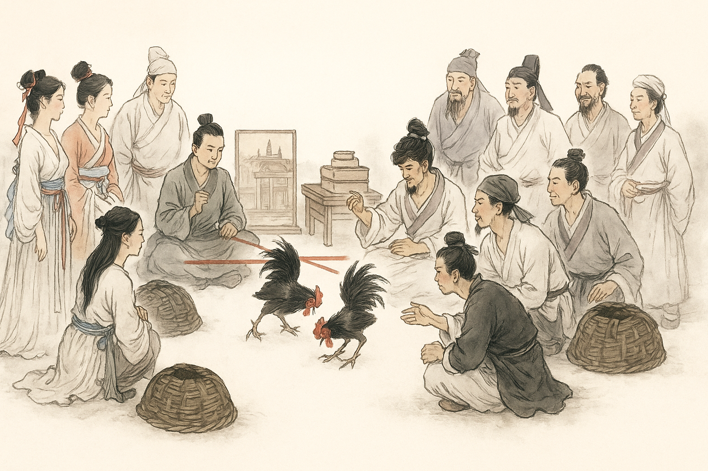
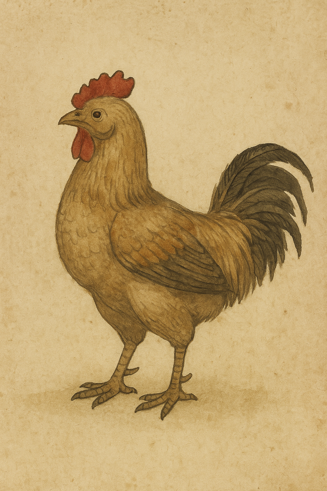
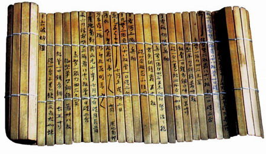

# 鸡声一怒，社稷俱亡：斗鸡在中国历史上的故事

## 一、斗鸡是什么时候开始的？

公元前517年，鲁国大夫季平子与郈昭伯斗鸡。

季平子在鸡的羽毛上涂芥末，想用刺激手段取胜；

郈昭伯则在鸡脚上戴上金属假距，暗藏杀器。

两人互相耍手段，最终郈昭伯更胜一筹，赢得了这场斗鸡比赛。

季平子输了比赛，非常生气，竟然霸占了郈昭伯的房子。

郈昭伯不甘心，向鲁昭公进言，说季孙氏权势过大，已经威胁到国家。

于是鲁昭公联合几位贵族进攻季孙氏，企图削弱其势力。

但这场政变失败了，郈昭伯身亡，鲁昭公也被迫逃亡齐国。

这一系列事件，深刻改变了鲁国的政治格局。

因此，《左传》《史记》《淮南子》等多部文献都详细记载了这场政变。

也许当时的史官并没有意识到，

他们在记录政局变动的同时，

也为后世留下了中国文献中关于斗鸡的最早记载。

当然，鲁昭公攻打季孙氏，绝不仅仅是因为一场斗鸡，

背后有更复杂的权力斗争和经济利益纠葛。

但斗鸡作为直接导火索，具有鲜明的象征意义。

正如《淮南子》所感慨：

> “祸之所从生者，始于鸡足；及其大也，至亡于社稷。”

从此以后，斗鸡正式登上了历史舞台，

频繁出现在史书、诗文和民间传说之中。

## 二、中国历史上的斗鸡

从春秋战国开始，到满清末年，

每个时代几乎都有斗鸡的记载，相关的诗词、赋文也从未断绝。

下面举几个小例子，供大家一窥其盛况。

### 1．呆若木鸡：斗鸡的哲学启示

“呆若木鸡”这个成语，今天多用于形容一个人呆愣失措。

但最初，它其实是一个褒义词，而且出自斗鸡的故事。

《庄子·达生》记载：

纪渻子为齐王养斗鸡，

十日后王问：“可以斗了么？”

纪渻子答：“还不行，鸡还有虚骄恃气。”

又十日，再问，又答：“尚未，鸡还会兴奋回应外界刺激。”

如此反复，四十日后，纪渻子才说：

> “几矣。鸡虽有鸣者，已无变矣。望之似木鸡矣，其德全矣。异鸡无敢应者，反走矣。”

这只斗鸡，看上去沉稳如木，

任凭其他鸡叫挑衅，都无动于衷，

真正上场时，反而气场强大，令敌鸡望而生畏。

庄子用这个故事，寓意真正的高手应该内敛沉稳、不露锋芒，

锋芒毕露者反而浮躁易败。

### 2．爱斗鸡的汉朝皇帝

从两汉到魏晋南北朝，斗鸡不仅民间盛行，

更是贵族、皇族生活中的重要娱乐项目。

比如，《西京杂记》记载：

刘邦的父亲，太上皇刘太公，迁居长安后，常年郁郁寡欢。

刘邦偷偷打听原因，得知太上皇怀念乡下的日子：

酤酒卖饼，斗鸡蹴鞠（踢球），

那才是他心中的快乐生活。

于是，刘邦在长安附近专门建了一个“新丰”，

邀请太上皇的旧友们搬迁过来，

让太上皇得以重温乡情，才终于露出了笑容。

汉朝明确记载喜欢斗鸡的皇帝还有好几位：

汉景帝刘启：喜欢斗鸡、斗鸭、斗鹅；

汉武帝刘彻：与宠臣董偃一起，观斗鸡、斗狗、斗马，极尽娱乐；

汉宣帝刘询：亦好斗鸡走马，借此了解民情；

汉成帝刘骜：酷爱斗鸡，甚至从交趾、越嶲专门引进“长鸣鸡”献艺。

可以说，在汉代，斗鸡已成为皇家乃至社会上层重要的休闲娱乐方式。

### 3.王勃的《檄英王鸡文》

唐代王勃年轻时在沛王府任职。

当时社会风靡斗鸡活动，诸王斗鸡，互有胜负。

一次，沛王李贤和英王李显斗鸡。

王勃兴致大发，替沛王写了一篇《檄英王鸡文》，

言辞犀利地“讨伐”英王的鸡，为沛王助威。

唐高宗李治看到后大为不满，

认为这种文章容易挑拨皇室诸王之间的关系，

于是将王勃免职，逐出沛王府。

一篇斗鸡文，竟让才华横溢的王勃仕途受挫，

可见斗鸡在当时社会中不仅是娱乐，

也牵动着权力与名誉的微妙博弈。

### 4.清朝时期：外国人眼中的斗鸡

到了清朝，斗鸡仍盛行不衰，

甚至引起了西方来华游客的关注与批评。

1806年，英国人约翰·贝娄（John Barrow）在游记中写道：

> 然而一些传教士郑重地告诉我们：“中国人对所有赌博游戏全然无知”，“他们没有娱乐可享，但这是法律规定的。”这些先生当然不可能对中国人最喜欢的一种游戏——斗鸡——毫无所闻。这种残酷的、非人道的、被他们不知羞耻地称为娱乐的游戏，在中国也和欧洲一些地方完全一样，为社会上层所倾心。出于同样的使之相互残杀的残酷目的而对鹌鹑进行的训练，为游手好闲者提供了大量的工作机会。

几十年后，瑞特（G. N. Wright）也写道：

> 还有其他一些对于文明之邦来说早已司空见惯的运动和游戏，应该补加到我们已经注意到的运动中。它们包括那些达官贵人最喜欢的、可能是从马来西亚传入的游戏斗鸡，还有斗鹌鹑和斗蟋蟀——全都同样残酷和不人道。驯养是一个可提供许多任务作机会的职业，从这种毫无价值的游戏中取得的利润是那样普遍和令人兴奋，只有那些赌棍们自己才能意识到会有这种事情。就像我们斗鸡场中的斗鸡那样，这些斗鸡也被施以钢距，所以总是可以令其中之一或双方死于非命。胜者被拿来拍卖或抽彩，渴望成为它的主人，则须为之押上或支付巨额金钱。

这些西方人的笔下，

既有批评中国娱乐方式的偏见，

也从侧面印证了：

在清代，斗鸡不仅流行，而且常与赌博联系在一起，并且为社会提供

了一些工作机会，很多游手好闲的人以此为生。

可见，斗鸡虽然只是一种娱乐活动，但实际上在中国人的生活中扮演了重要的角色。我们读史书的时候注意到这一点，可以多一个视角，挖掘出更多信息。
