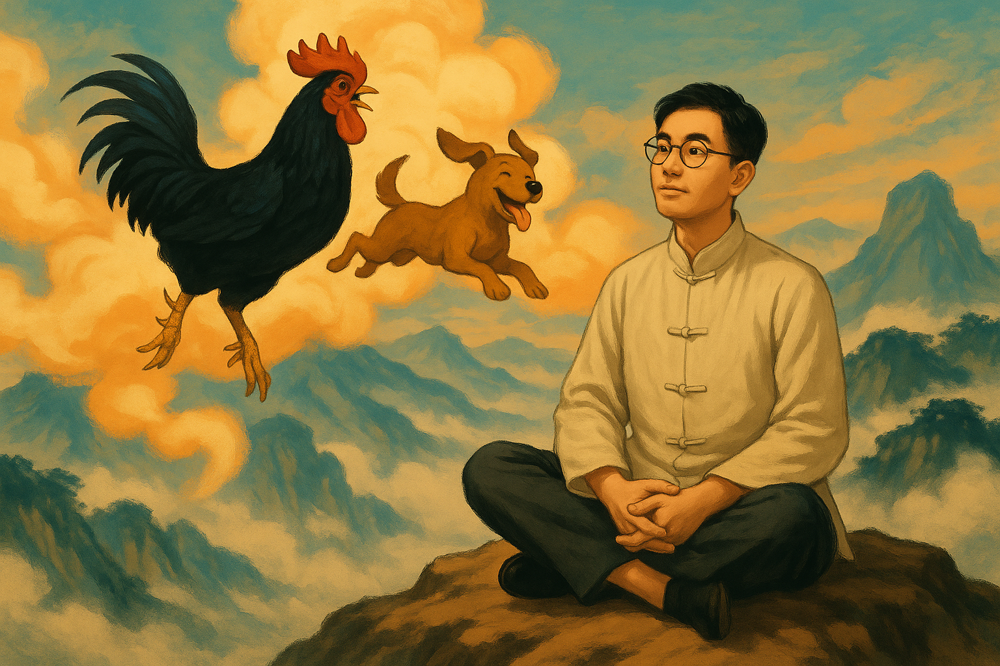
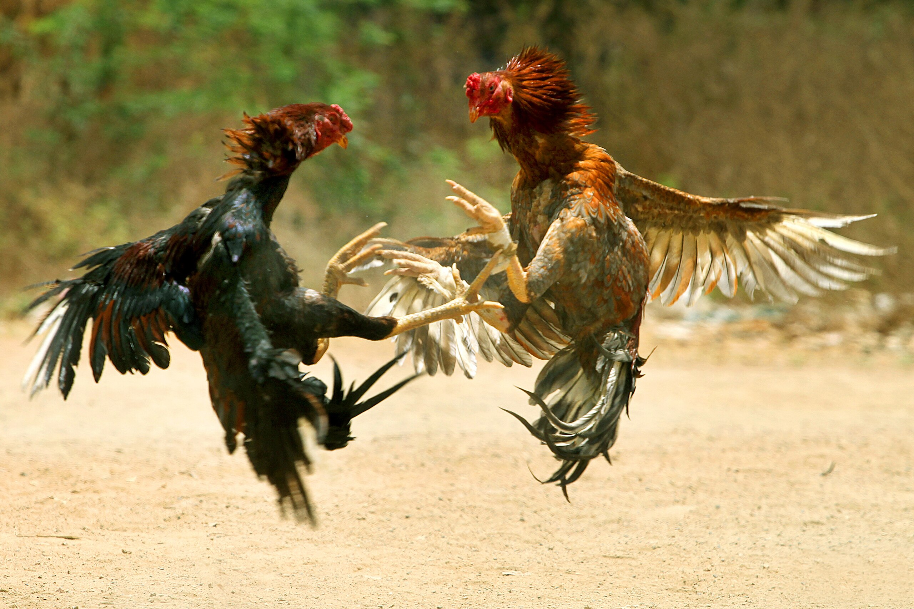
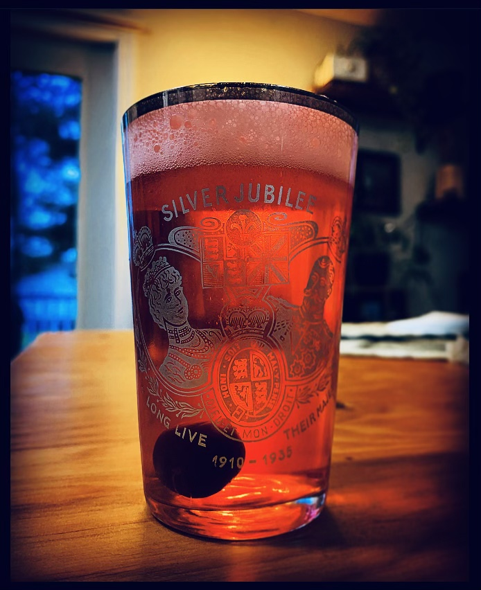
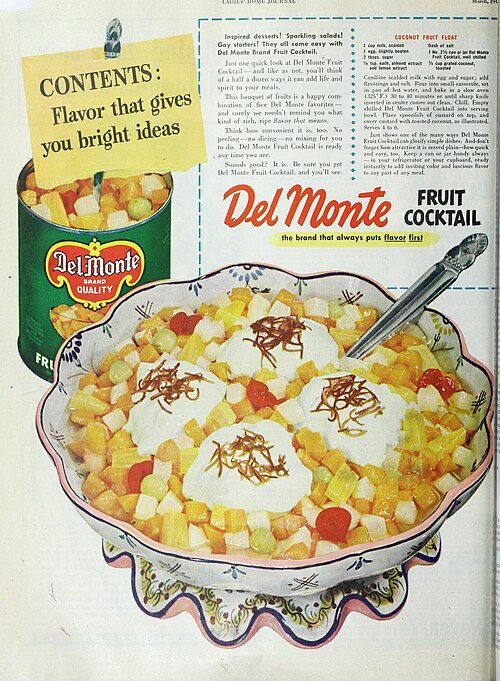

# 鸡你太美：关于鸡的10个冷知识（人文版）

## 一、鸡有五德

鸡有“五德”之说，这种说法出自《韩诗外传》：

> 头戴冠者文也，足傅距者武也，敌在前敢斗者勇也，见食相呼者仁也，守夜不失时者信也。

但鸡的“五德”并非原文的重点。重点是后文：

> 鸡有此五德，君犹日沦而食之者何也？则以其所从来者近也。

鸡有这么多的品德，但您并不珍惜它，反而吃它，这是为什么呢？因为它离您太近了，您不稀罕了。

> 夫黄鹄一举千里，止君园池，食君鱼鳖，啄君黍粱，无此五德者，君犹贵之者何也？以其所从来者远也。故臣将去君，黄鹄举矣。

相反，黄鹄一飞千里，在您的园池停下，吃您的鱼鳖，啄您的粮食，它没有这五种品德，但您却仍然珍惜它，是因为黄鹄距离您远啊。

这段话是田饶辞别鲁哀公时说的，他不被鲁哀公重视，便以鸡自比，说明鲁哀公不识货。后来田饶去到燕国，“燕立以为相。三年，燕政大平，国无盗贼。”实现了自己的抱负。

## 二、鸡犬升天

在古代，鸡总是跟狗相提并论，比如著名的成语“一人得道，鸡犬升天”。

这个典故来自王充的《论衡》，讲的是淮南王刘安在奇士的帮助下，吃了仙丹后成仙的故事：

> 王遂得道，举家升天。畜产皆仙，犬吠於天上，鸡鸣於云中。此言仙药有余，犬鸡食之，并随王而升天也。

剩下的仙丹被鸡狗吃了，所以它们能够跟着升天。

其实，王充说这个故事，并不是认为这件事是真的，也不是批判“一个人得势，跟他有关系的人也由此得到好处”这种现象。

相反，这件事是当时很多迷信之人普遍相信的传说，王充引用这个传说，是为了批判这种迷信的思想。后文紧接着写：

> 好道学仙之人，皆谓之然。此虚言也。
> 夫人，物也，虽贵为王侯，性不异於物。物无不死，人安能仙？鸟有毛羽，能飞，不能升天。人无毛羽，何用飞升？使有毛羽，不过与鸟同；况其无有，升天如何？……

古代的人普遍迷信，汉朝的道家和儒家都带有强烈的神学色彩，王充是少数专门著书立说弘扬科学精神的唯物主义者。

所以“鸡犬升天”的传闻本来是王充的批判对象，只是他通过批判记录下来了这些传闻罢了。

## 三、呆若木鸡

“呆若木鸡”这个成语跟斗鸡有关系，出自《庄子·达生》：

> 纪渻子为王养斗鸡。十日而问：“鸡已乎？”曰：“未也，方虚骄而恃气。”十日又问，曰：“未也，犹应向景。”十日又问，曰：“未也，犹疾视而盛气。”十日又问，曰：“几矣，鸡虽有鸣者，已无变矣，望之似木鸡矣，其德全矣。异鸡无敢应者，反走矣。”

纪渻子为齐王养斗鸡，养了四十天才养好。养好的标准是什么呢？就是像木鸡。为什么像木鸡就是好的呢？因为像木鸡说明沉稳，不会刻意表现自己的气势，其它鸡叫挑衅，它也无动于衷。真正上场的时候，反而气场强大，令敌鸡望而生畏。

庄子讲这个故事，是想说真正的高手应该内敛沉稳、不露锋芒，锋芒毕露者反而浮躁易败。

现在“呆若木鸡”指呆得像木头鸡一样，形容因恐惧或惊讶而发愣的样子。已经完全由褒义词变为贬义词了。

## 四、陈仓宝鸡

陕西省宝鸡市古代叫“陈仓”，就是那个“明修栈道，暗度陈仓”的陈仓。直到唐朝才更名为“宝鸡”。

为什么更名为“宝鸡”呢？宝鸡市地方志办公室的介绍说：

> 宝鸡古称陈仓，以陈仓山（今鸡峰山）而得名。唐肃宗至德二年（757），闻陈仓山神鸡鸣叫，肃宗以为神鸡为国之宝，鸡鸣乃吉祥之兆，遂将陈仓县改为宝鸡县，宝鸡地名沿用至今。

其实，陈仓在千年前就已经有关于鸡鸣的传说——尽管不是真的鸡。

《史记·封禅书》记载了秦文公（前766-716在位）在陈仓发现了一个像石头的东西，这东西在夜间降临，光辉若流星，形似雄鸡，声如鸡鸣，于是秦文公将它命名为“陈宝”。

> 秦文公获若石云，于陈仓北坂城祠之，其神或岁不至，或岁数来，来也常以夜，光辉若流星，从东南来集于祠城。则若雄鸡，其声殷云，野鸡夜雊。以一牢祠，命曰陈宝。

这种记载带有神秘色彩，后来有学者认为这东西就是陨石，没那么玄乎。但不管怎么样，陈仓后来改名“宝鸡”，不是拍脑袋随便改的，至少尊重了古代的传说。

事实上，在陈仓改名以前，就有诗文将陈仓和宝鸡联系在一起了。比如西汉张衡《西京赋》有言：“陈宝鸣鸡在焉。”南朝徐陵《斗鸡》诗云：“陈仓若有信，为觅宝鸡来。”

## 五、鸡鸣狗盗

这个故事跟孟尝君田文有关，说的是孟尝君代表齐国出使秦国，秦昭襄王欣赏孟尝君，想让他当秦相，后来又反悔，囚禁了孟尝君，打算谋杀他。

孟尝君求助秦王宠姬，宠姬想要孟尝君已经献给秦王的狐白裘。可是狐白裘已经送到王宫里了，拿不出来，所有门客都一筹莫展。最后是一位善于学狗叫的宾客挺身而出，通过模仿狗叫，在宫里的库房里拿到了狐白裘。

送过礼物后，宠姬如约向秦王求情，秦王便放了孟尝君。孟尝君怕秦王反悔，连夜逃走，但到了函谷关，却无法通过。因为按照秦国的法令，函谷关要等到鸡鸣以后才能放人。满座宾客都没有办法，又是一位擅长模仿鸡叫的宾客挺身而出，通过模仿鸡鸣，让函谷关提前开门。

孟尝君喜欢养门客，来者不拒，一开始其他宾客不屑于跟鸡鸣狗盗这种宾客为伍，但到了真正危险的时候，竟然是这两个人救了孟尝君的命，此事之后大家才信服。

当然，《史记》的这种故事我们也就听个开心，有点像故事汇。我很怀疑这件事的真实性，真实情况不可能那么简单。

王安石对此也不以为意，他评论道：

> 世皆称孟尝君能得士，士以故归之，而卒赖其力以脱于虎豹之秦。呜乎，孟尝君特鸡鸣狗盗之雄耳，岂足以言得士！不然，擅齐之强，得一士焉，宜可以南面而制秦，尚何取鸡鸣狗盗之力哉？夫鸡鸣狗盗之出其门，此士之所以不至也。

意思是孟尝君如果真的善于识人、用人，根本不会让自己沦落到使用鸡鸣狗盗之士的地步。这个观点却是一针见血。

## 六、鸡和鸡鸡，cock和cock

有一个很奇怪的现象，中文和鸡和英文的cock，都是既有鸡的意思，也有鸡*的意思……两种语言为何在这方面如此巧合？我想了三天三夜也没有想到答案。

有说法称，cock的用法延伸和斗鸡有关，公鸡的形象突出阳刚、斗志、生殖能力强，能让人联想到那种器官。

基思·托马斯（Keith Thomas）说：

> “正像打猎是因它能模拟战争而被看重一样，斗鸡活动和狗与熊的搏斗受到重视，是因它们能代表个人战斗。公鸡象征了男子的勇敢和性能力……”（Man and the Nature World）

中国民间有“说鸡不说ba，文明你我他”的流行语，所以百度贴吧为了讲文明，十二生肖里唯独没有“鸡”ba，百度也因此获得“度娘”的美称，沿用至今。

中文“鸡*”的延伸用法是怎么来的，我一时难以考证。据说并不是所有地方都叫“鸡*”，比如有些地方叫“鸟”，有些地方叫“雀”，有些地方则叫“牛”。

总之，这里面学问太深，不是我一个人能够搞清楚的，还请诸位读者多多指教。

## 七、鸡和鸭

还有一个奇怪的现象，当指代器官的时候，鸡对应的是男性的器官；但当指代人本身的时候，鸡却对应着女性——而具有相同属性的男性则被称为“鸭”。

为什么会这样呢？有很多种说法。

说法一：“鸡”与“妓”同音，故然。

说法二：公鸡喜欢卖弄炫耀，而且声音嘈杂，很像性工作者卖弄风骚，也符合红灯区热闹嘈杂的氛围。

说法三：叫鸡源自于香港塘西风月时期，当时要召妓叫一位红牌需要一张花笺，价值一元港币。而这张花笺就叫做Kai，由于人们读音不标准，误将kai读成鸡，自此就流传开去，而叫kai渐渐就等同于叫鸡，亦等同于召妓，其后再传去其他广东话地区。

不过，根据现有资料看，“鸡”的这种用法最早来自于港台地区，然后流行于粤语区，最后才风靡全国。

当然，“鸡”这种用法有蔑视、贬低之意，不尊重人，请读者慎用。

## 八、打鸡血

“鸡”的特殊用法来自港台，但是“打鸡血”一词却是大陆的原创。

上世纪五六十年代，当时中国民间流行一种疗法，把活鸡的血抽取后注射进人体，号称能增强免疫、治疗百病。

人们打完鸡血后，短期内确实精神亢奋，一些疾病有改善迹象，所以“鸡血疗法”也风靡一时。但很快发现这种疗法弊大于利，易引发感染与过敏，最终被官方禁止。

今天我们说一个人“像打了鸡血”，就是说这个人亢奋冲动，盲目激情，带着一丝讽刺（至少是调侃）意味。

现在“鸡娃”也是热门词了，大家都在用，其实这个词一开始的意思就是：给娃打鸡血。

这种比喻可谓是生动形象，目前难以找到其他更合适的表达。

## 九、鸡尾和鸡尾酒

鸡尾酒（Cocktail）也以“鸡”命名，它指以烈酒为基底，加入果汁、糖浆、苦精等辅料调制而成的混合型饮品。最早在19世纪初的美国文献中出现，当时被定义为“一种由任意烈酒、糖、水和苦味酒调制的刺激性饮料”。

鸡尾酒一词的起源仍有争议，一些历史学家和词源学家认为，鸡尾酒其实跟马有关系。

什么关系呢？

词源学家阿纳托利·利伯曼（Anatoly Liberman）说：

> 当时有一种习惯：给非纯种马剪短尾巴，这类马被称为“cocktailed horses”，后来简称为“cocktails”。由此引申，cocktail一词也用来形容出身低微却冒充上层人士的人，穿着体面却缺乏真正教养。在1806年的鸡尾酒定义中，特别提到了水作为成分，说明鸡尾酒本质上是一种被稀释过的酒精饮品，不是“纯种”，而是“被提升地位”的混合物。因此，沿用此前用来形容劣马和假绅士的俚语“cocktail”，再自然不过了。

按照这种说法，纯正的酒就对应纯种马，而鸡尾酒则对应剪短尾巴冒充纯种马的杂种马。

也就是说，在英语里，“鸡尾（cocktail）”从词源发展上就有“混合（mixed）”的意思。（尽管我还是想不通被剪短尾巴的杂种马为什么要被称为“cocktailed horses”……）

但是无论如何，在词典里，鸡尾酒cocktail还有两种引申意思，都和“混合”有关。一种是凉菜、冷盘（a dish of small pieces of food, usually served food），例如fruit cocktail，指一种混合了多种水果的冷菜。另一种就是指混合物（a mixture of different substance, usually ones that do not mix together well），比如a lethal cocktail of drugs，意思就是“致命的混合药物”。

## 十、公鸡母鸡

古代的鸡，无非是鸡肉、鸡蛋、鸡鸣、鸡斗这四种用途。公鸡母鸡都有鸡肉，但鸡蛋只能母鸡下，打鸣和斗鸡则只能靠公鸡。所以公鸡和母鸡职能完全不同，外观也有很大区别，由此也形成了各种说法。

在英语中，hen是母鸡，有个词叫henpecked，字面意思是“被母鸡啄的”，引申为一个男人在家庭中被妻子管得死死的、唯唯诺诺、毫无主见，跟中国的“妻管严”“耙耳朵”是一个意思。

chick是小鸡，chicken兼有“鸡（泛指）”“小鸡”和“鸡肉”的意思，语境决定具体含义。

cock和rooster都有公鸡的意思。前者是英国的用法，后者是美国的用法。据说是因为美国人特别喜欢用cock指代某种东西，结果真的想说公鸡的时候，就觉得cock这个词太粗鲁了，于是在18世纪时开始用“rooster”指代公鸡，“roost”是“栖息”“（鸟类）栖息处”的意思。

在汉语中，“牝（pìn）”指的是雌性动物，牝鸡就是母鸡。有个成语叫“牝鸡司晨”，讲的是母鸡代公鸡报晓，古时比喻妇女窃权乱政。出自《尚书》：

> 古人有言曰：“牝鸡无晨，牝鸡之晨，惟家之索。”今商王纣，惟妇言是用，昏弃厥肆祀弗答。

当然，说商纣亡国是因为一味听信女人的话，废弃了祭祀——这是古代父权社会的偏见。

相反，在赵本山的小品中，“下蛋公鸡”则被称为“公鸡中的战斗机”，完全是一个褒义词了。

- END-

这是一个能涨知识的公众号，关注我，阅读更多有趣文章～

相关文章推荐：

鸡声一怒，社稷俱亡：斗鸡在中国历史上的故事
