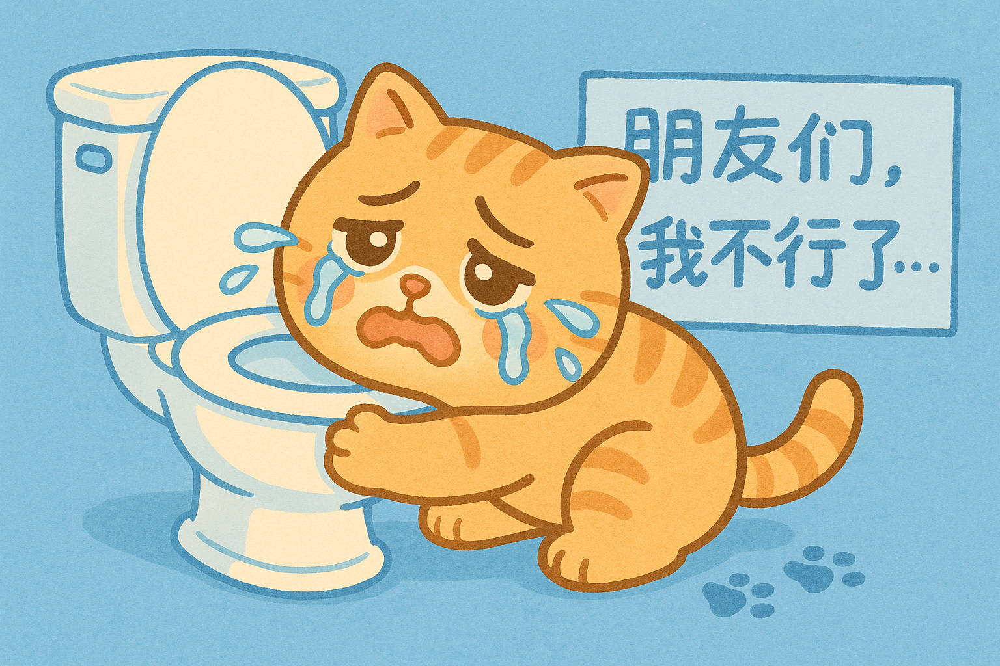
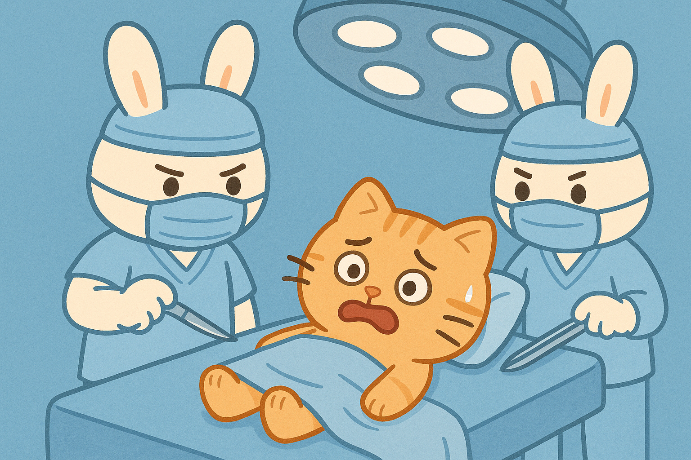
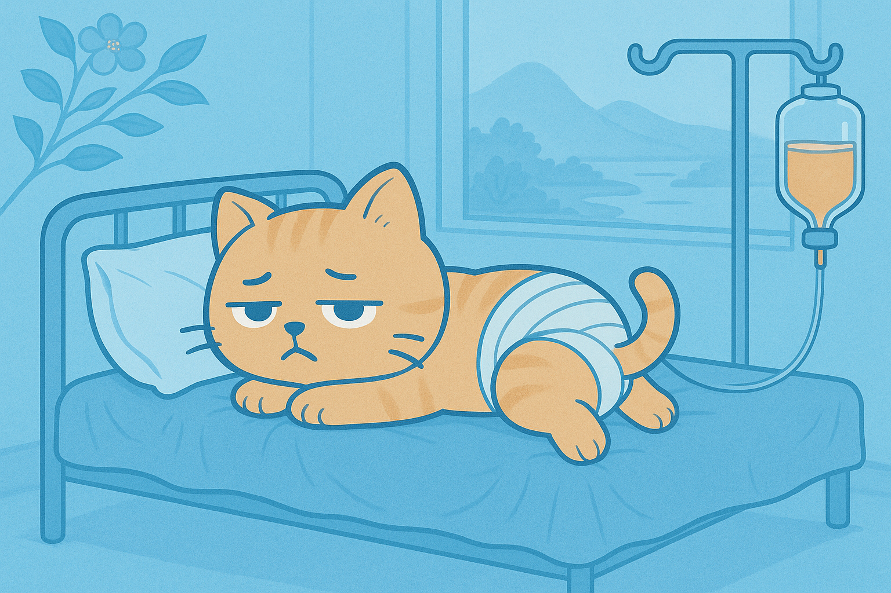

# 我亲历的痔疮手术：网上找不到的真话（吃饭慎入）

有人说，我在公众号上总喜欢写高雅的东西，不会写对自己形象不利的文章，比如我曾经在知乎上回答痔疮手术的感受，这种事肯定不会发到公众号上。

其实非也。知乎上有些回答是随手发的，没怎么经过思考，如果没有读者反馈，一般不会再发到公众号上，跟形象不形象没有什么关系。

但是我觉得痔疮手术确实值得写一下，毕竟这是很多人都会面临的生活问题，而我确实有一些经验，能对大家有所帮助。

## 一、得痔疮是什么感受？痔疮的表现是什么？

痔疮在一个人身上，是从无到有，从小到大，从少到多；人对痔疮的认识，是从无知到初步感知，再随着病情的加重，认识逐渐更多更深刻；人对痔疮的态度，则是从轻视到重视，从早期的不以为意到晚期的无可奈何。

一开始，只是发现有时上完厕所后，屁股会出来一个小肉球，不痛，很快又能自己回去。我于是知道自己得了痔疮，但是痔疮似乎也没什么，并不影响生活。

之后，肉球出来的次数越来越频繁，体积越来越大，自己回去的时间越来越长，到后来经常要用手辅助，才能把肉球塞回去。我逐渐习惯屁股后面有痔疮的感觉了，但仍然没有重视这个事情，毕竟我很忙，没时间管这种小事。

没过多久，我突然发现自己上厕所的时候经常出血，而且我发现我的屁股比舌头更能感受到辣味。当时我还觉得挺好玩，作为四川人，我的舌头对辣味早就麻木了，但是每次拉屎的时候，我都能更准确地判断前几顿的饭菜辣度如何。

后来，大便出血量越来越多，我养成了每次上厕所都回家上，上完就洗澡的习惯。同时，我开始在网上搜索痔疮的治疗方法，每天开始做提肛运动，并且把知乎上大家都在吹的“xx师”痔疮膏放进了购物车。

去年7月，我在成都上班，那时我的痔疮已经很严重了，但是成都这个地方让我的病情更加恶化，那里的生活环境也几乎断绝了其自愈的可能。

有一天，我上厕所，喷血，洗完澡后，发现自己路都走不动了，实在没法继续工作。

我的老板知道后，饶有兴致地跟我分享了自己得痔疮的经历，并且向我推荐了某医院的肛肠科，据说这是全世界做痔疮手术做得最好的科室。

于是我去医院检查。

一位美女医生给我做完指检后，很惊讶：“你才20多岁，怎么肛门糜烂成了这个样子？”

看来这个手术是不得不做了。

## 二、做痔疮手术是一种什么体验？

我现在不想流水账式地回忆手术的点点滴滴，实际上，我当时每天也确实写了简单的“流水账”，大家可以在公众号后台发送“痔疮日记”，即可看到我当时的每日记录，都是宝贵的一手历史资料（吃饭慎看）。

我只说一些让我印象很深刻的事情。

1. 肛肠科医生护士有男有女，且治疗患者不会做性别的区分。也就是说，假如你是一个男性，做检查的时候，会有女医生光明正大地捅你P眼（指检）；做手术前，会有女护士检查，然后毫无征兆地用刮胡刀把你留了几十年的毛剃掉；手术开始前，很多医生围着，一位女医生贴心地指导：“用手托住蛋蛋，手术就要开始了。”我算是脸皮厚的，也经受过北方澡堂的洗礼，但作为一个黄花大闺男，这次手术还是给了我不小震撼。

2. 手术前一天要灌肠，就是往肛门注入生理盐水（可能也有别的东西），然后憋几分钟，这样会把肠道排得比较干净。当时什么感觉有点忘了，但现在回想的时候，竟然有一种充实的愉悦感——难道这就是0的快乐？

3. 做手术的时候，双腿会放在比较高的架子上，然后把臀部对着前方，据说这跟女人生娃是一个姿势。然后打麻药，全麻。打完后没多久，我还没反应过来，就昏迷了，醒来后手术已经完成，只觉得屁股上有淡淡的灼烧感。这种感觉还挺奇妙。

4. 手术后几天要吃流食，也就是稀饭、燕麦、牛奶、藕粉之类，好像是能拉出shi后，才能慢慢吃正常的饭。不过当时那种情况也不饿，一是因为每天都输液，不缺营养，二是因为当时的注意力都在shi上。

5. 从住院开始每天都要输液，所以会用“滞留针”。滞留针针头很软，可以长期“滞留”在手上，故名。不光是输液，麻药也通过滞留针注射。好处是不用每天被针头刺了，坏处是，24小时手上都有针头，虽然也不痛，但心理上总感觉不自在。

6. 手术前后，我每天所有的精力和期待都在拉shi上。手术前，每次拉都很痛。痔疮手术的原理大概是把痔疮的根部扎上，让其失去供血，逐渐坏死，自然脱落。所以手术后，一开始吃流食，然后好几天都拉shi拉不出来，后来能拉了，但每次只有一点。有时候会拉出血浆，这可能是坏死的痔疮；有时候会拉出线头，可能是包扎痔疮用的。总之，每天都在担心，手术是不是没成功，我的屁股是不是要废了？

7. 手术后几天，慢慢能走路了，大家没事就会在走道里来回走，都像鸭子一样，或者说比鸭子还夸张，穿着长裙，走一步缓一步，歪歪扭扭，表情狰狞。病友之间会有交流，大家疾病都不一样，严重程度、做手术时间、手术后恢复情况也都不一样。肛肠科病房里男女老少都有，有人说现在得痔疮的年轻人越来越多了，还有人说他们见过做两次痔疮手术的。

8. 手术费用我忘了，好像是1万左右，社保可以报销一部分，商业保险也可以报销。但是最让我震惊的是，后来我听说我们老家也有人得了痔疮，在镇上割的，只花了几百块钱。中国的国情，真是复杂。

## 三、通过这次手术，我有什么反思？

“痔疮日记”我只记到手术后第八天，大概之后就不严重了，我把精力放在了别的地方。

手术后几个月，没有什么后遗症，唯一的后遗症就是感觉自己憋shi能力下降了，以前能憋几个小时，现在只能十几分钟。

除此之外一切良好，大便通顺，下体清爽，不惧辛辣，生活质量大幅提高。

现在大半年过去，甚至感觉自己憋shi能力也恢复了——也许当时觉得憋不住，只是饮食原因。

我现在反思，认为对痔疮影响最大的就是饮食。我以前特别喜欢重油重盐的东西，有时还喝酒，但是嘴巴喜欢，屁股受不了。

在成都，美食太多，辛辣的美食尤其多，我又管不住嘴，所以当时在成都就加重了病情。好在当地就有很好的肛肠科室，算是抵消了。

现在我已经很少吃辣，也几乎不喝酒了。我现在的原则是：偶尔吃点川菜，坚决不吃湘菜，非必要不喝酒。没办法，肛门太脆弱，已经糟蹋不起了。

最后，希望看到这篇文章的朋友，以我为戒，控制饮食，加强运动，做到这两点基本可以遏制痔疮的发展。如果发现痔疮严重了，一定要及时就医，千万不要拖，也不要自己买药治疗，越到后面手术费用越高，还要多受罪。

**痔疮警告后，你打算？**

- A. 从此清淡饮食，珍爱小屁屁
- B. 偶尔注意吧，还想吃火锅
- C. 爱咋咋地，人生苦短
- D. 开始做提肛运动预防一下
