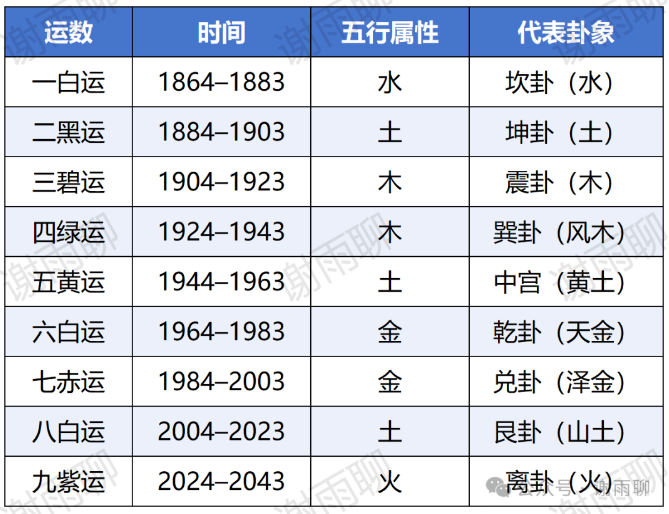
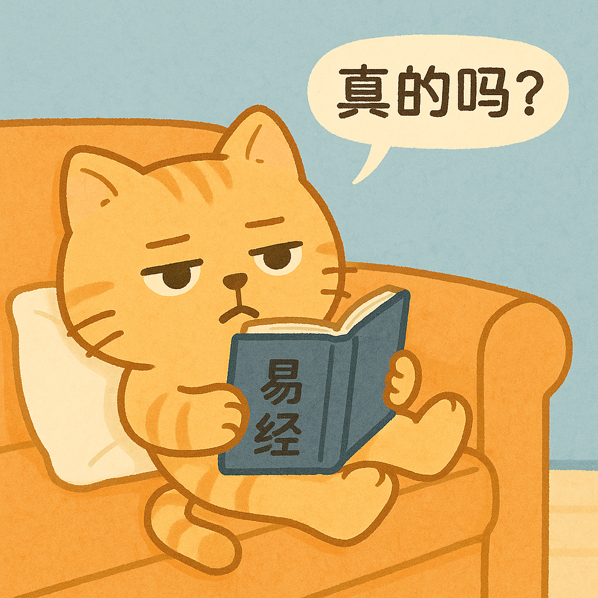

# “中女时代”，是玄学，还是现实？

现在有一个很火的概念，叫“中女时代”，这又是从哪里冒出来的呢？

简单来说，“中女时代”这个概念，是现代人拿《易经》里的符号体系，来解读现实社会变化的一种尝试。

它有一定道理，但归根到底，属于半合理、半扯淡的归纳。

先讲玄学角度。风水学中有一个概念叫做“三元九运”。

**三元：**上元、中元、下元。

**九运：**每元含三个运，每运20年，总共180年。

我们所在的轮回是1864-2043年，具体如下：

有人就根据这个理论解读，说2004-2023年是土运，对应代表山土的艮卦，所以这个时代房地产爆发、基建狂潮、教育内卷，是一个物欲时代。

而2024-2043年则是火运，对应代表火的离卦，而离卦在卦象中可以被解释为“中女”（具体怎么解释的我也不懂），所以这个时代被称为“中女时代”，特点是女性崛起，情绪爆发，科技与文化创新主导。

其实这种说法是非常附会的。

比如按照这个理论，1844-1863年也是九紫离火运，这段时间能代表女性崛起吗？

显然不能，因为当时的中国还是大清，而西方国家的妇女解放运动也并没有非常兴盛。

对中国妇女来说，她们地位上升最快的时期是1949年后，那么这个时期是九紫离火运吗？

不是，而是黄运，属土，实在想不到跟女性有啥关系。

有人说：“你根本不懂玄学！应该这样这样这样解释……”

好吧，我确实不太懂玄学，但你这么前后标准不统一的解释，只能更加说明你在牵强附会。

事实上，正是因为2020年代本身出现了女性意识抬头、性别意识发酵，所以才会有人拿九紫运的“离为中女”去强行绑定这种社会现象。

也就是说，如果社会没有出现女性议题的高潮，这波人就不会提“中女时代”，他们会用别的方式来解释“九紫离火运”。

更何况，这里面还有很大的资本运作因素，也就是说，提“中女时代”这个概念对某些人来说是有利可图的。

比如，某些所谓的女性主义电影，真的是为了弘扬女性的权利吗？

未必。但是投资人投资女性主义电影，一定是因为看好这个市场，想赚钱；一旦这个项目的收益不符合预期，他们对女性主义电影的投资也会减少。但投钱以后，吹一波“中女时代”概念，当然是百利而无一害的。

再比如，《看世界（2025年第二期）》，一篇署名为宝珠的文章《明星带货水晶，套路深不见底》就指出，很多明星都加入了水晶带货的大军，而卖得好的珠宝一定是跟玄学有关的。文章说：

> \*\*（某明星）在上述长达6分钟的视频中提到，2024年是九紫离火运的开端，紫水晶、发晶、金草莓等水晶都是未来20年运势的推助器。

所以，通过将“九紫离火运”和“女性崛起”相关联，就可以在短期内影响一些商品的价格：

> 中高端水晶普遍涨价了50%左右。小晴发现，去年以来，一串半盆绿幽灵手串的价格涨了2000～3000元。一名珠宝从业人士告诉笔者，一款叫作白月光的玛瑙手镯，2023年的价格还在100元以内，2024年被炒到了300～500元。

不过这也是双赢的：商家和带货明星赚到了钱，买者则得到了心理安慰。对这些买者来说，心理安慰的价值可能远远大于这溢出的几百几千块钱。

当然，这些都不是我想说的，我无意批判这种现象。

我只是想告诉读者：玄学是一种文化叙事，而不是科学预测，现实很复杂，玄学只是提供了简洁的模型和安慰感而已。

你可以说现在是“中女时代”，但现在也可以是“幼女时代”，是“长女时代”，还可以是“长子时代”“中子时代”“幼子时代”。所有人都有机会通过努力，在未来20年实现自己的人生价值。

**所以我们相信，未来由每一个努力的、追求正义的人决定，由社会规律决定，而不是由某个卦象决定。**
