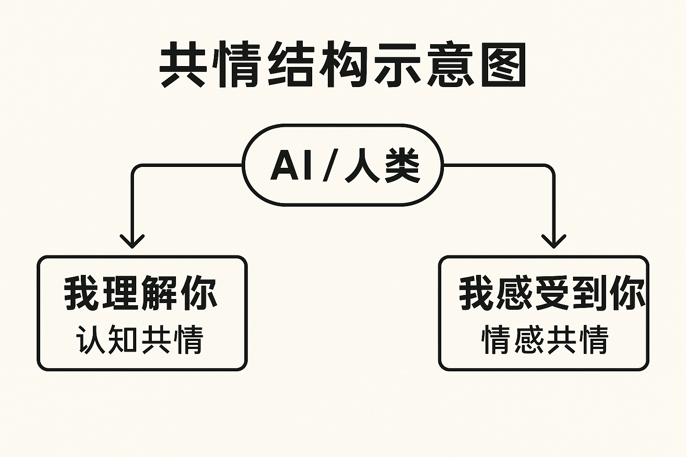
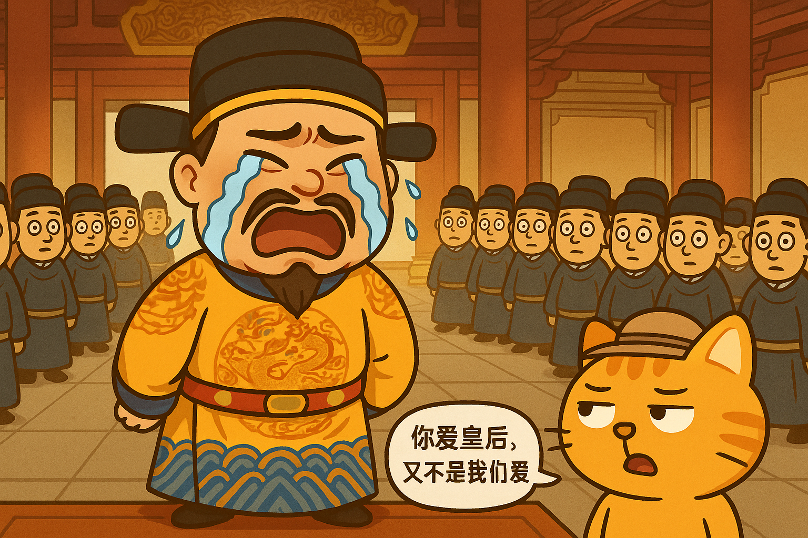

# 乾隆要你共情皇后之死，你能共情吗？

知乎上有个问题：“AI心理咨询师能真正「共情」吗？算法安慰和人类安慰的本质区别是什么？”

其实这个问题本身就有引导倾向。

什么是“共情”？什么又是“真正共情”？

我揣测一下，这个问题背后其实隐含了一个假设：人类安慰比算法安慰更高贵，AI并不能真正共情。

下面的回答也确实都在迎合这个假设。

但事实真的是这样吗？让我们认真分析一下这个问题。

## 1、首先我们要问，什么是“共情”？

共情，其实就是同理心（empathy），就是移情，就是设身处地，就是把自己代入到对方的处境之中，去理解和感受对方的处境、对方的情绪。

共情有两个方面，一是“知人之所感”，二是“感人之所感”。

前者被称为认知共情（Cognitive Empathy），即理解他人的情绪和处境，比如“我知道你很难过”。

后者被称为情感共情（Emotional Empathy），即与他人情绪产生共鸣，比如“我也感受到你的痛苦”。

那么AI的安慰是什么原理呢？

简单说，AI安慰=情绪识别+模式匹配+话术生成。

情绪识别：通过用户的文字、图像输入，识别用户的情绪状态。比如，你说“我今天好累，人生真没意思”，AI会识别为“疲惫+抑郁倾向”。

模式匹配：根据你的情绪状态，匹配数据库中对应情绪的安慰模板或对话框架，进一步判断你需要的是鼓励、共情、建议、陪伴的哪一种。

话术生成：基于大语言模型，生成个性化、语境相关的安慰话语。这可能会参考你们之前的对话，选择你喜欢的表达风格。AI还会调整语调、节奏和用词，创造“像人一样”的回应体验。

有些AI会加入人格设定，比如扮演一个“善解人意的女性倾听者”；有些会加入长期记忆，参考你们之前的对话，使回答形成一种“熟人感”。

总之，一切的一切，都是非情绪的运算过程。没有“真正的关心”，只有“高质量的模仿”。

所以，严格地说，AI并不能“知人之所感”，更不能“感人之所感”，AI心理咨询师无法真正“共情”。

这个问题就算回答完了。

## 2、但是，我还想再追问一句：我们真的需要“真正的共情”吗？

每个人都有寻求安慰的心理需求，他人的共情可以提供一些心理安慰，让自己心情变得舒坦。

但是，人们对共情的要求是有程度之分的，这跟人有关系，也跟事有关系。

比如，同样是难过需要安慰，有些人只需要对方能知道自己难过，就足够慰藉了；有些人希望对方跟着他一起难过，至少能看到对方表露出难过的样子；还有些人，在遇到某些特定事件时，会极端地希望对方能够完全感受到自己的处境，必须要对方跟着自己哭一场，否则就是不在乎他。

比如，乾隆皇帝和皇后富察氏感情很好，富察氏去世后，乾隆悲痛万分，写了很多诗悼念，举办了盛大的葬礼仪式。

富察氏死后，乾隆不但自己伤心，他还非常苛刻地要求其他人能够对自己共情，对于那些“不够共情”的人，都施加了严重的处罚。比如：

> ①翰林院所制的皇后册文，满文译文中“皇妣”一词被误译为“先太后”，于是乾隆将刑部所有官员一律革职，将管理翰林院的刑部尚书阿克敦判为斩监候，秋后处决。  
> ②乾隆认为皇后的册宝制造不够精良，配不上皇后的尊贵，把工部全堂问罪。  
> ③因为祭祀所用的桌子不够干净，把光禄寺的主要官员一律降职。  
> ④将所有百日内剃发的官员全部降罪，有些被处死，有些被革职。  
> ⑤皇长子永璜和黄三子永璋在皇后的葬礼上表现得不够悲痛，当场骂人，并且宣布这两位皇子“断不可继承大统”。

张宏杰在《饥饿的盛世》中写道：

> 对两个小孩子如此狗血喷头地痛骂，显示出皇帝正处于某种心理失常的状态。他希望所有人都理解他的痛苦，他不明白天都塌下来了，为什么还有那么多人平静无事？

是啊，对乾隆来说，天都塌下来了，你们怎么都无动于衷呢？你们怎么就不理解我的痛苦呢？沙雕！通通沙雕！！

但问题在于，其实没有任何人可以完全理解另一个人，更不能完全感受到另一个人的感受。

你乾隆爱皇后，那是因为你们一起哭过，一起笑过，一起xxx过，一起经历了很多事情，所以你对她的死感到无限悲伤，但是别人没有经历过啊，甚至很多人连富察氏见都没见过，根本没有感情，他凭什么悲伤？陪着你演一下已经够尊重你了。

有些丧妻之人可能还能根据自己的经验，稍微感受一下，但很多人甚至还是单身狗，有些人可能刚刚结婚，正高兴呢，你让他们怎么感受？很多人当时就是不伤心，装不好，露馅了，这不很正常吗？这不是人之常情吗？你这种强求别人共情自己的行为，难道不是一种压迫吗？你乾隆难道就能感受普通人的悲欢离合？

我举这个极端的例子，就是想说明，人生是自己的，没有人有义务以你为中心，没有人有义务完全理解和感受你的感受。“真正的共情”是不可能的，一味追求真正的共情，只会遇到渣男，遇到塑料闺蜜。

“人生得一知己足矣”，即使是知己，也只是在某些方面能够深刻理解你罢了。大多数人连知己都没有，人生还不是要继续过？又何必执着于真正的共情呢？

综上所述，我认为人不应该也不能够追求完全的共情，人当然需要心理安慰，但更重要的是锻炼自己的心性，只要内心强大，一些简单的安慰就足以让自己得到慰藉，继续前行。

## 3、算法安慰足以实现情绪支持。

话说回来，我们平时遇到的人类安慰也未必那么如意。

有些人根本不重视你，所以他们的安慰多少是敷衍的。

有些人没有那么多生活经验，即使有心安慰你，也不能理解你的感受。

极少数人能够理解你，又愿意倾听，但他们毕竟也有自己的人生，他们无法长期陪伴你，而且有时候他支持你情绪的同时，他自己却在损耗情绪，所以人类安慰是不能长久的。

心理咨询师呢？他们难道就能完全理解你吗？他们更多是学习了大量专业心理知识，看了足够多的病例，而且收了钱，所以愿意也有能力从你的角度提出解决方法，用各种方法安慰。

也就是说，人类心理咨询师其实也不能真正“共情”，对他们来说，给你安慰只是他们的工作而已，他们安慰你，更多用到心理知识，更多依靠案例和经验，而不是依靠对你的“共情”。事实上，很多心理咨询师接触了大量病人以后，他们的感情反而会麻木，代之以专业性的冷静。

再看AI，AI安慰的原理跟完全理性的人类心理咨询师安慰的原理又有什么本质区别呢？AI的数据库可能还比个体心理咨询师更丰富呢。

而且，AI便宜，不知疲倦，吸收了大量人类的经验成果，也只有AI会完全以你为中心。理论上只要你描述得足够详细，它就能完全将自己代入到你的情境中，为你量身定制你最需要的安慰语句，为你提出最适合你的解决方案——只要你有时间调教（投喂）它。

所以，你还觉得人类安慰比算法安慰更高贵吗？

当然，如果真的有一个完全以你为中心，而且能够长时间陪伴你的灵魂伴侣，这个人当然是吊打AI的（但是这个人就失去主体性了，不过这是另一个问题）。

问题是你遇得到吗？

其实，你追求的并不是真正的共情，大多数时候你只是想要有人不厌其烦地回复你的消息罢了。AI就足以做到这一点。

AI确实不会共情，但它是高质量的情绪拟态，每一次你向它倾诉烦恼的时候，它都在调用一个比你妈还耐心的情感数据库。AI不会真的懂你，但它却会给你提供你最想听的话。

这难道还不够吗？

拥抱AI吧！这是我们这个时代独有的权利！

## 你更愿意向谁倾诉？

1．一个真正懂你的人

2．一个永远回你消息的人

3.谁都不想说，自己憋着

4.当然是AI，AI最牛逼
