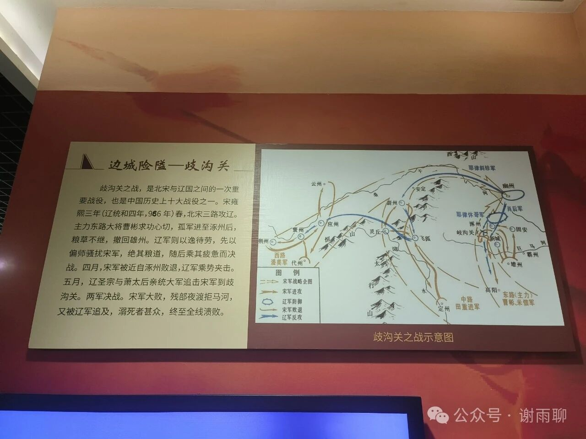
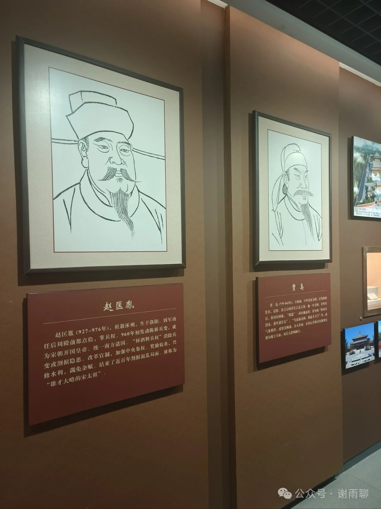

# 赵匡胤与涿州

逛涿州博物馆，发现涿州是赵匡胤的老家，但赵宋从头到尾只有两次占领过涿州。

一次是岐沟关之战，赵宋占领涿州十几天，很快战事失利，大败而归。

第二次是辽国涿州留守郭药师于北宋宣和四年降宋，但三年后又叛宋降金了。

也就是说，赵宋的帝乡，只有三年时间被赵宋政权控制，其它时间都在辽金的版图之下。

另外，汉昭烈帝刘备、汉桓侯张飞、东汉名臣卢植、《水经注》作者郦道元、初唐四杰之一卢照邻、唐朝诗人贾岛、唐代高僧惠能、当代作家史铁生，都是涿州人。

此外，韩国总统卢武铉、卢泰愚也自称是范阳卢氏分支，祖上都是涿州人。

> 转换说明：配图：第1–2幅暂沿用现图（指定资料目录未找到可靠且质量更好的无水印原件）。
