# 京南游记（上）：琉璃河博物馆关门了，但历史还开着

如果你在5月10日晚上问我第二天是什么打算，我会告诉你我只想安安静静地在家躺平。

如果你在5月11日上午问我在哪里，我会给你发一张琉璃河大桥的照片。

如果你在5月11日下午问我在哪里，我会给你发一张涿州博物馆的定位。

是的，我跟马哥两个人，早上7:37临时决定去琉璃河，匆匆准备后，8:45从良乡大学城出发，骑共享单车到良乡南关公交站，坐F68路公交车一路杀到西周燕都遗址，后来又临时决定从琉璃河镇坐838路公交车到涿州，游览博物馆、云居寺塔和鼓楼大街，晚上又连夜坐公交车回到房山，人均花费不超过40元，时间不超过12个小时。

这篇文章简单记录一下此次旅程的见闻。

## 一、窦店

窦店是良乡到琉璃河的必经之地，也是房山官方钦定的三大新城组团之一。

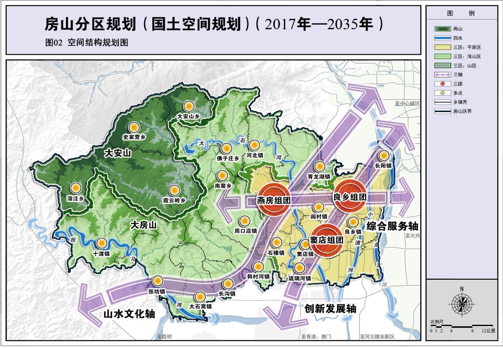

我以前从未去过窦店，因为这个地方距离良乡实在太远，直线距离13公里，而且不通地铁，存在感不高。我相信良乡大学城90%的学生可能连听都没听说过这个地方，更别说去了。

窦店比我想象中更大，其主要城区沿着大窦路南段分布，连续四五公里，街道两旁全是建筑：有居民区、饭店、建材市场、娱乐场所等。其中饭店种类繁多，既有北京当地的涮肉、烤鸭店、护国寺小吃，又有外地的清真餐厅、铁锅炖、河南胡辣汤、湘菜馆、四川火锅、重庆烤鱼。可见此地经济活跃，外地人众多。

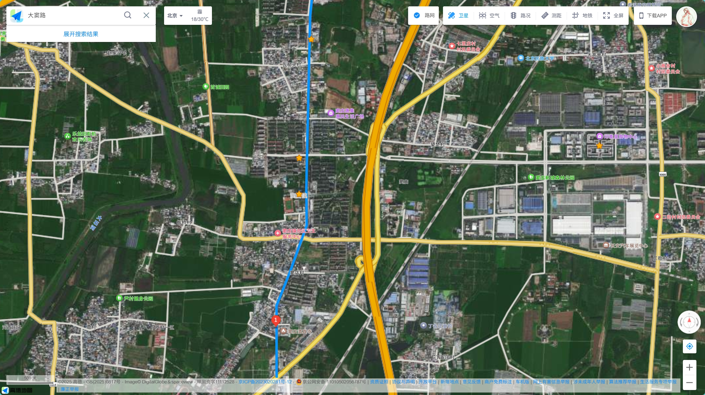

有人告诉我，窦店生活成本低，很多人晚上在这里居住，早上乘公交车去苏庄坐地铁上班；很多良乡人会专门来窦店吃喝玩乐；坏处就是缺乏大型商场，女人逛街都没啥好逛的。

另外，窦店清真寺也令我印象深刻，它通体采用白色石材，雕纹精致，造型简约大气，异域风格浓厚，在周围建筑中显得十分醒目。后来网上查阅才知道，这竟是华北地区规模最大的清真寺，难怪如此壮观。

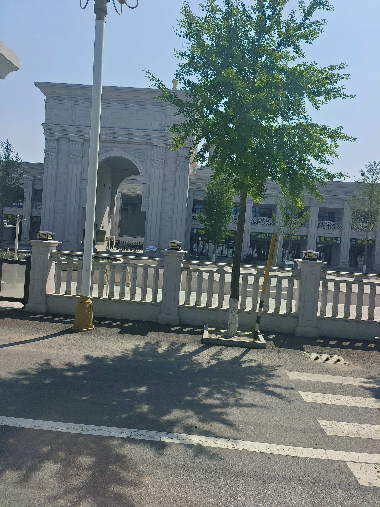

## 二、西周燕都遗址

琉璃河遗址即西周燕都遗址，此地是西周时期燕国都城的所在地。武王灭商以后，封弟弟召公奭为燕国国君。召公奭没有去燕国，而是留在中原，让自己的儿子克去燕国就任。

燕国在西周中期迁都，后来灭掉了北边的蓟国（在今天北京城区），将都城又迁到蓟。所以我们初中学历史的时候，背战国七雄的都城，燕国的都城就是蓟城。北京后来被称为“燕京”，也跟燕国有关。

史记说武王克殷后，封召公奭于燕，封帝尧之后于蓟，但没有说燕和蓟的具体位置。以前历史学家一直在争论燕国早期的都城在哪，但最终都没有结果，直到琉璃河遗址的挖掘，使这个历史悬案尘埃落定。

在琉璃河遗址中，考古工作者发现了大量西周初年的陶器、甲骨、青铜器、玉器等。

在众多文物中，有一个青铜鼎，上面刻着4行26字铭文。经考证，其大意为：

> “堇”奉燕侯之命，到宗周（周朝首都）向太保（召公）奉献食物，太保赏钱给堇，堇用赏的钱铸造了这尊鼎。

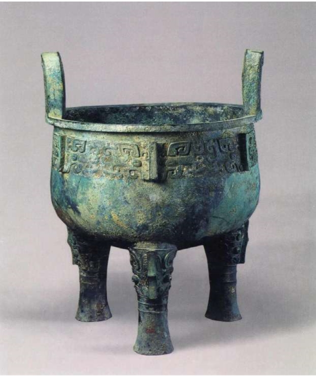

此外，遗址中发现的墓穴里，出土了两个青铜酒器，写着几乎一样的43个字的铭文，大意为：

> 周王说，太保，你用盟誓和清酒来供你的君王。我非常满意你的供奉，令你的儿子克去做燕国君侯，管理和使用那里的人民和土地。克到达燕地，接收了土地和管理机构，为了纪念此事，做了这件宝物。

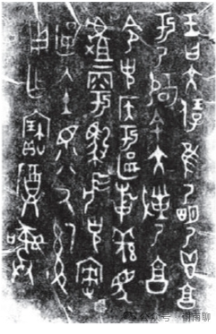

这个青铜鼎被命名为“堇鼎”，两个青铜酒器被命名为“克盉（hé）、克罍（léi）”。这些文物证明了这里就是3000多年前西周燕国最早的都城，还证明召公奭并没有去燕国，只是派长子到燕国就任。

也就是说，琉璃河遗址沉睡着西周燕国最早的都城，以及他们的第一代国君。对中国历史稍有常识的人都会赞同，琉璃河遗址的含金量实在是太大了。

这就是我跟马哥一定要来这里的原因——即使我们早已知道琉璃河遗址博物馆已经闭馆。

是的，你没有听错，琉璃河遗址早在前年8月就闭馆了，据说是受台风“杜苏芮”影响，大石河发大水，馆区受灾严重，要闭馆进行灾后抢险重建工作，一直到现在都没有重新开馆。

我们到遗址门口，只见门口有一堆西周士兵塑像，向大门里面望去，一条笔直宽阔的大路伸向南方，路的尽头是成排的树，两边是田地。遗址比我们想象的更大。

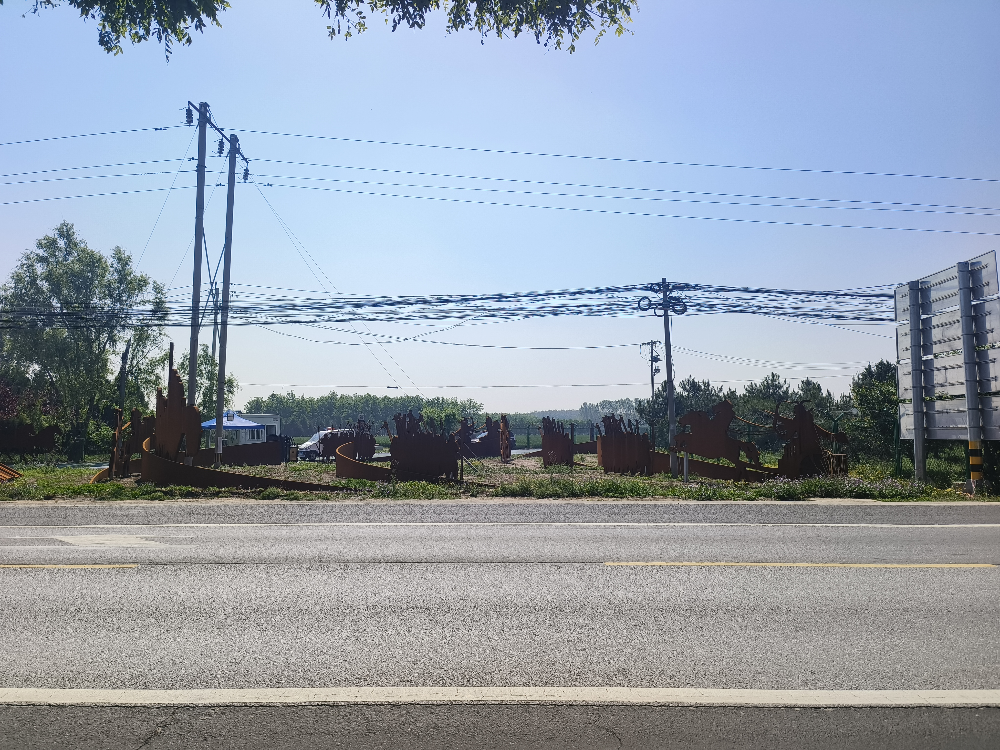

一位保安在门口打游戏，他告诉我们现在闭馆，不能进去。

我们问他，什么时候开馆。他说要等到明年。

我们又问，是明年的哪一天。他沉默了。

一切都在预料之中，于是我们转身，往琉璃河镇方向走。

保安却突然紧张起来，向我们喊：“千万别翻墙进去！这是违法的……”

好吧，难道是马哥坏事做得太多，面相变了，长得像犯罪分子吗？

## 三、琉璃河镇

大石河就是大石河，但是在这个地方却被叫作“琉璃河”，这是为什么呢？

河北边有个村叫“刘李店村”，难道是当地人玩了个谐音梗？

好吧，先不纠结这个问题。

我和马哥乘公交车到琉璃河镇，镇政府、刘李店村和燕都遗址在大石河北边，但更多建筑却在大石河南边。河南边有大量居民楼和商店餐馆，还有学校、加油站和水泥厂。可以推测在今后的发展中，大石河以北的街区会配合琉璃河遗址成为遗址保护区和风景区的一部分，而大石河以南则会成为联通涿州和房山的交通枢纽和居民聚居区。

联通琉璃河镇南北两部分的，有两座桥，一座是现代钢筋桥，为国道G107的一部分，所有车辆都从这里经过；另一座是石桥，有十一孔，名曰“琉璃河大桥”，是明朝修建的，历经数百年风霜，现在依旧坚固壮观，很多行人在桥上行走、游玩；石桥北边，竖立着历朝历代的石碑，都是历史文物。

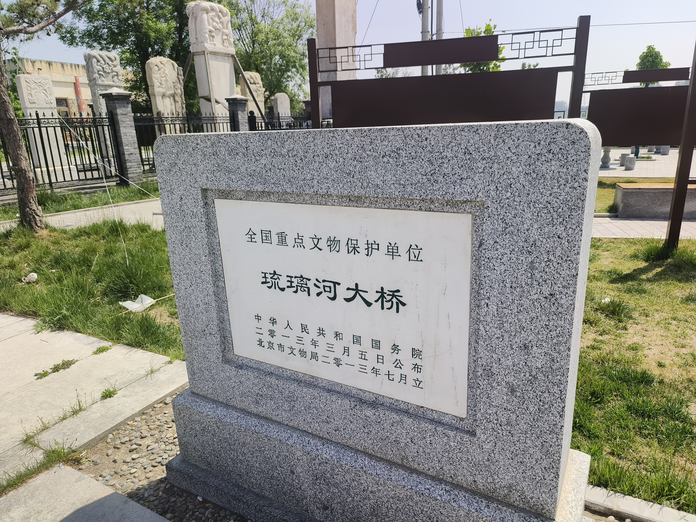

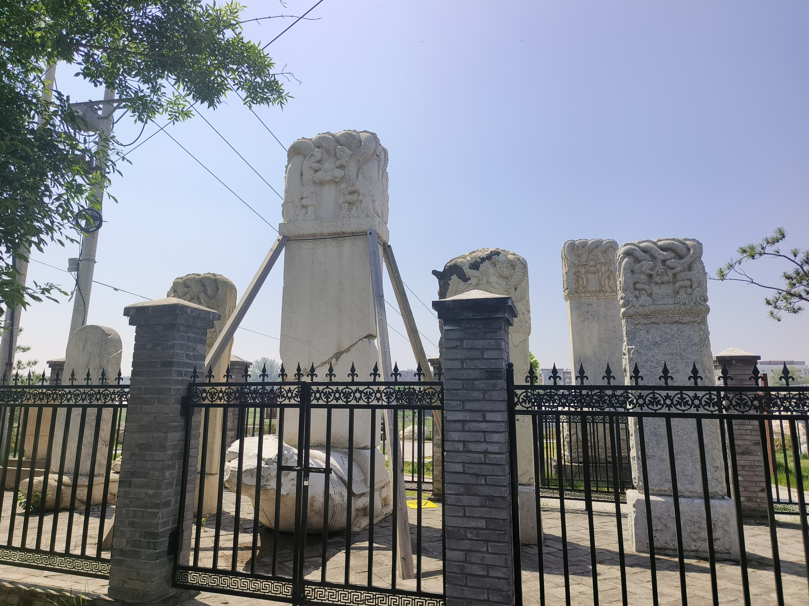

大石河水不多，石桥下只有一半为水域，还有一半则是石头铺成的台阶，很多钓鱼佬在河边垂钓，似乎颇有收获。河里还有螺蛳（田螺），不多，估计很难凑够一盘菜。

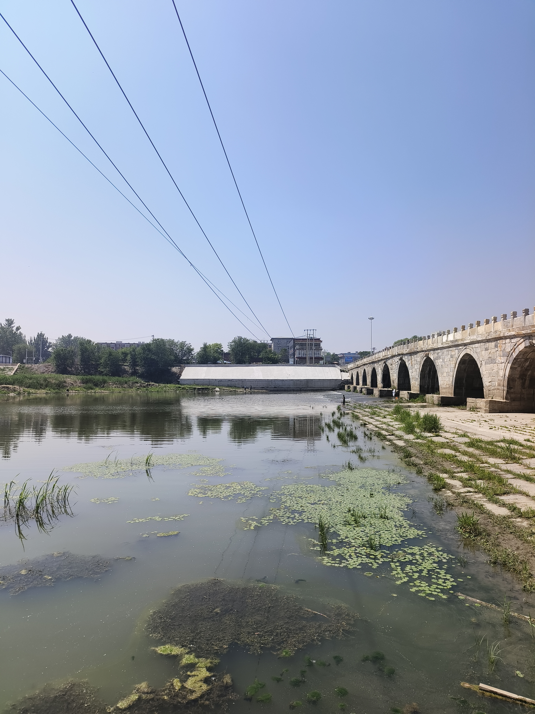

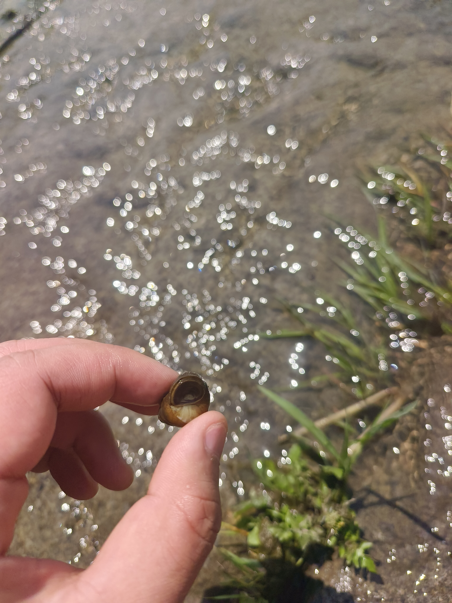

我和马哥向南走过石桥，总结上午的成果：看了窦店、琉璃河遗址、琉璃河大桥，虽然博物馆关门，但也算是不虚此行，那就打道回府吧。

这时我看了眼地图，突然发现琉璃河镇距离良乡有20公里，但是距离涿州市区却只有15公里，于是提了一嘴：“不如我们去涿州吧。”

没想到马哥竟然没有反对。

没有反对就是同意，沉默也可以是同意，当时不同意不代表现在不同意，这个世界就是因为有那么多同意，才有人类的合作与进步。既然我们两个都同意，那就出发吧。

于是我们坐上838路公交车，通过琉璃河检查站，进入河北界，穿过东仙坡镇，跨过拒马河，很快就到达涿州市区，这个刘备、赵匡胤的故里。

欲知后事如何，且听下文分解。

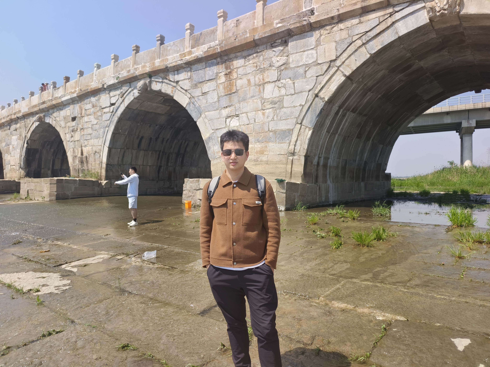

你听说过“琉璃河遗址”吗？（单选）

- 知道，听说过，是西周燕都
- 不知道，看完文章涨知识了
- 路过琉璃河，但没注意有遗址
- 遗址居然关门这么久？震惊！

-END-

这是一个能涨知识的公众号，关注我，阅读更多有趣文章～

相关文章推荐：

如何判断一个城市的市中心？来看官方地图！

主要参考文献

北京日报特别报道部. 北京三千年：从考古发现看北京建城史[M]. 北京：北京联合出版社
