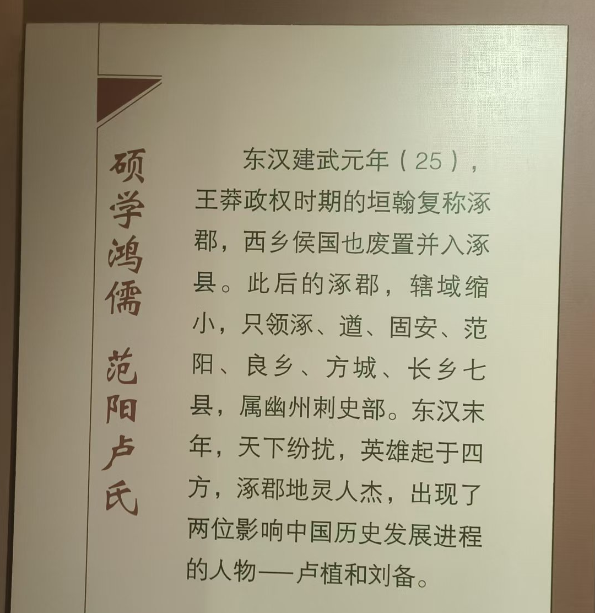
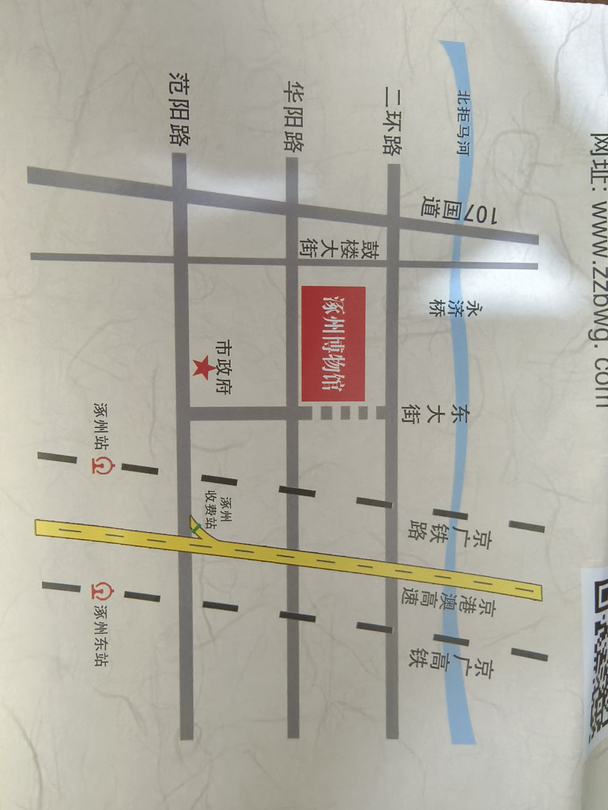
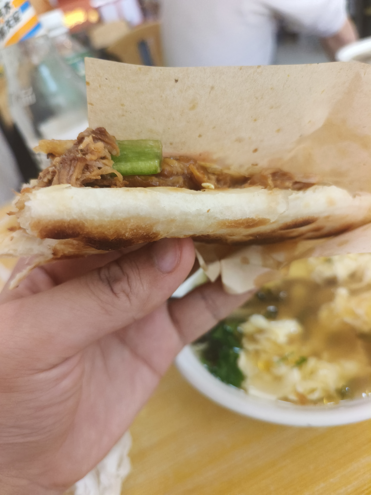
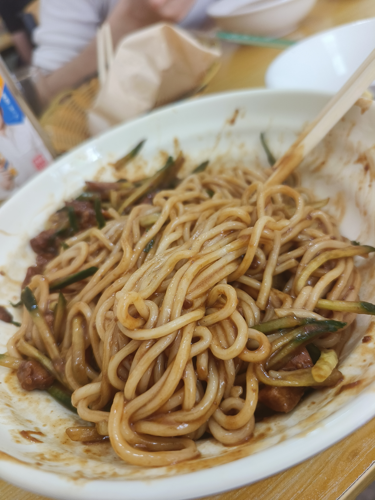
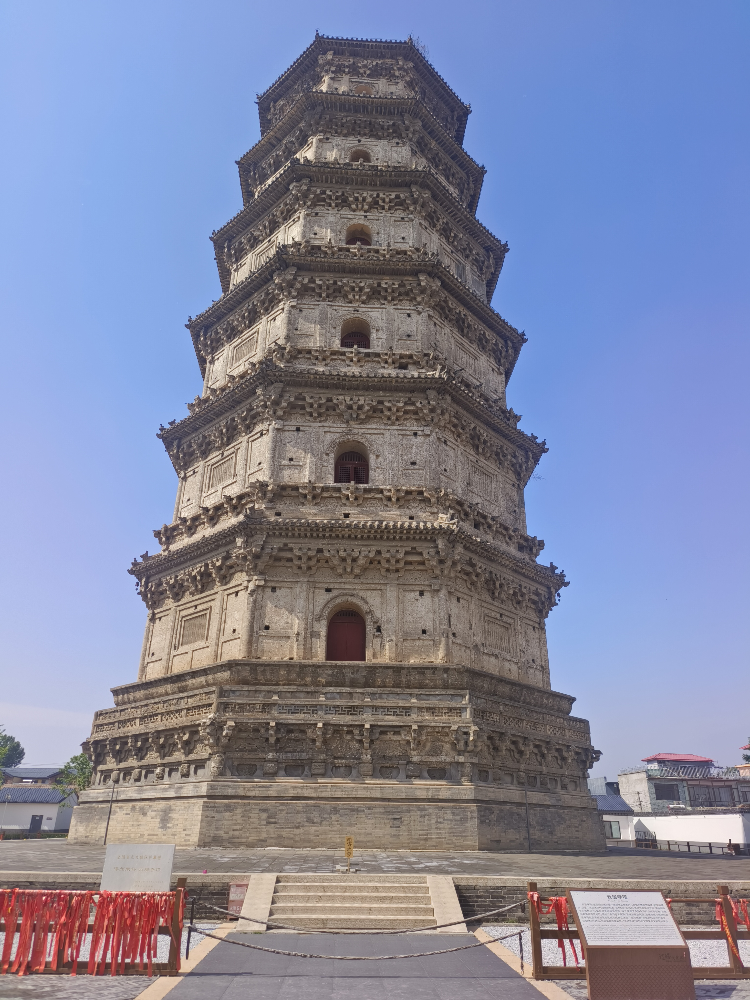
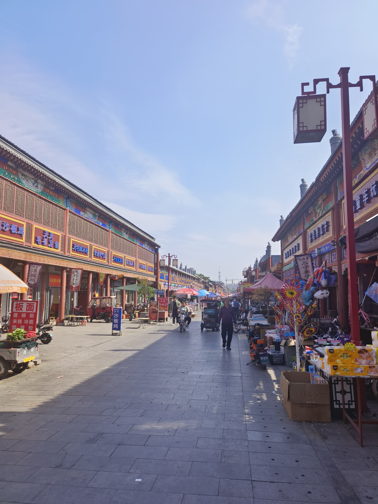
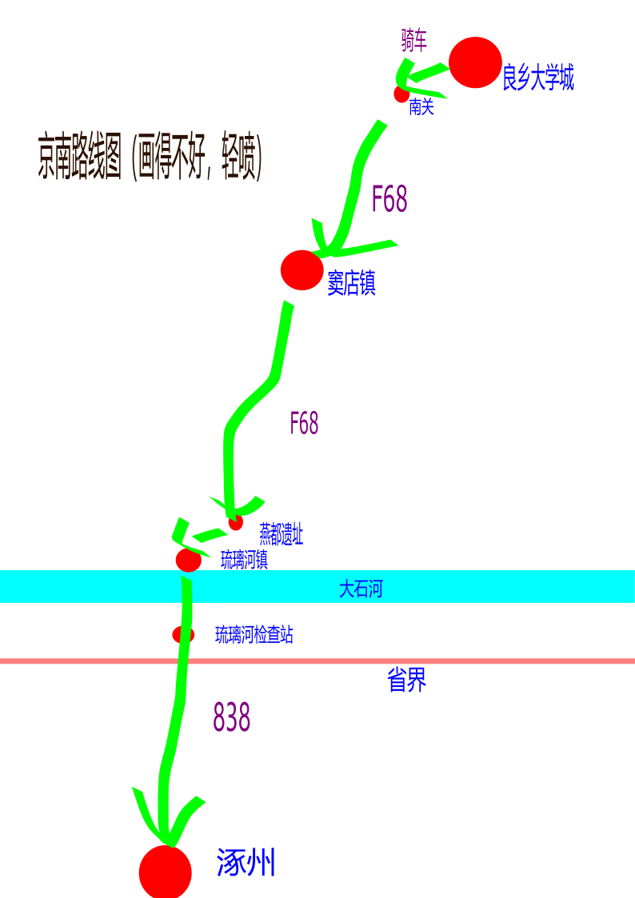

# 京南游记（下）：涿州

## 四、涿州怀古

**涿州**是保定下辖的县级市，但它距离**房山良乡**只有30多公里，距离**北京市区**60多公里，距离**保定市区**却有将近100公里。坐838路公交车可以直接从**涿州公交站**开往北京西三环的**六里桥南**，全程1.5个小时，票价14元。从距离上讲，涿州到北京市区，跟大兴机场到北京市区，几乎没什么差别。

在历史上也是如此。比如汉代的涿郡大致以今涿州为中心，广阳郡则位于今日北京一带，是同属于幽州的邻郡，而当时的良乡则隶属于涿郡。可见，这两个地方在文化、历史和地理上都非常亲密。

我和马哥到琉璃河的时候，打开地图，发现此地距离涿州竟然比良乡更近，所以临时决定去涿州一趟。

我们去了三个地方：涿州博物馆、云居寺北塔和鼓楼大街。

涿州博物馆让我们快速了解了涿州这个城市，可以看到，涿州自古人杰地灵，具有光辉的历史。比如，汉昭烈帝刘备、汉桓侯张飞、东汉名臣卢植、《水经注》作者郦道元、初唐四杰之一卢照邻、唐朝诗人贾岛、唐代高僧慧能、宋太祖赵匡胤、当代作家史铁生，都是涿州人。

当然，以上也算是笼统的说法，因为涿州的历史特别悠久，“涿”这个字作为地名代指这片土地也特别悠久。据说上古“涿鹿之战”的**涿鹿**，就是现在的涿州。汉朝时期是郡县制，当时有**涿郡涿县**，郡县两级行政区都叫涿，隋唐以后又长期叫**涿州**，中间的建制调整频繁而复杂，比如魏晋隋唐涿县属**范阳郡**。所以，在不同的历史时期，涿代指的范围可能很大，也可能很小，需要具体分析。

**范阳卢氏**是门阀时代的顶级家族，在南北朝时期是“四姓高门”之一，在唐朝则是“七姓十家”之一，出过七个宰相。想一想，有这么一个家族，连续四百年，几乎每一年都有人担任正国级官员，担任部长和封疆大吏的家族成员也不计其数，这是多么恐怖的存在。

不过有一点很有意思，范阳卢氏之兴盛起于**卢植**，卢植是东汉末年的经学大师，是马融的徒弟、郑玄的同学，卢植能有这么高的成就，跟儒学密不可分。但他的后人之中，却有一个佛教宗师。

唐朝高僧**慧能**俗姓卢，范阳人，大概率是卢植的后代，但他却是禅宗南宗的创始人，**“菩提本无树，明镜亦非台，本来无一物，何处惹尘埃。”**这首诗就是慧能所作。慧能在佛教史上地位很高，毛主席也特别推崇他，经常翻阅《六祖坛经》，有史料记载如下：

> 毛泽东还谈了慧能学说在佛教史上的地位。他说，慧能主张佛性人人皆有，创顿悟成佛说，一方面**使繁琐的佛教简易化**，一方面**使印度传入的佛教中国化**。因此，他被视为禅宗的真正创始人，**也是真正的中国佛教的始祖**。在他的影响下，印度佛教在中国至高无上的地位动摇了，甚至可以“喝祖骂佛”。——摘自林克《在毛泽东身边的岁月片段》（见《缅怀毛泽东》）

> 我不大懂佛经，但觉得佛经也是有区别的。有上层人的佛经，也有劳动人民的佛经，如唐朝时六祖《法宝坛经》（即《六祖坛经》）就是**劳动人民的**。——摘自毛泽东1959年10月22日同西藏banchan大师的谈话

总之，涿州的历史太深厚，由此散发，几天几夜也讲不完。以上只是我截取的几个具有代表性的片段，希望帮助大家记住这个城市而已。

## 五、涿州见闻

刚到涿州的时候，我和马哥找了一家当地饭店吃饭，我们各点了一个酱肉火烧、一碗紫菜蛋花汤和一碗炸酱面。可以看出这里喜面食，口味偏咸。我吃不习惯，饿的时候吃火烧觉得还不错，再吃杂酱面就感觉没有胃口了。

吃饭的时候，有两位帅哥跟我们搭话，他们是做教培的，据他们所说，涿州当地工资4000左右，但在他们那当老师工资可以达到7000以上。看来，能在涿州这样的城市做教培也不失为一种明智的选择，我早就听说山河四省的教培赚钱，因为当地教育资源不好，但家长很舍得花钱报补习班。

随后我们去博物馆。博物馆设计很好，两栋楼，中间又有一条长廊相连，从入口到出口只有一条参展路线，有《总序厅》《涿水长歌》《石艺通灵》《陶韵绚彩》《范阳遗风》《峥嵘岁月》六个展区，很难迷路。

印象最深刻的就是《范阳遗风》展区，介绍横岐调等涿州当地曲艺时，有一个对联：

> 演悲欢离合，当代岂无前代事；
>
> 观抑扬褒贬，座中常有剧中人。

真是大妙。

逛完博物馆，我和马哥便向北去看辽代双塔，其中北塔叫**云居寺塔**，南塔叫**智度寺塔**。我们对佛教和建筑缺乏了解，所以只去了北塔象征性看了一下。

北塔景区半价票7.5元，当天是周日，里面有很多小学生玩，但他们不是单纯地玩，有老师带着他们，还有很多家长在附近，看起来像是学校组织的游学活动。有的小学生还会拿着一张纸来填表。

由于我比较帅，很快就有几个小男孩围着采访我。

“请问你们从哪里来的。”

“北京良乡。”

“请问你们为什么来这里。”

“主要是为了感受涿州悠久的历史文化。”

我很快进入状态，准备回答更多的问题，并且计划在回答完问题后发表演讲，在演讲的结尾鼓励他们志存高远、刻苦学习……但没想到他们问到这就“任务完成”，直接说再见，一哄而散了，只留下我一个人在塔前风中凌乱。

云居寺塔共6层56米，材质以灰砖、石雕为主，色调灰黄、古朴淡雅，很是壮观。但是游客无法靠近，我们也就只能远观，然后离去。

双塔所在的街区，居民楼和小店众多，很有烟火气。居民楼和双塔建筑风格迥异，这种画面颇有一种史诗感，让人感到历史的变迁。

而鼓楼大街则是一条纯粹的商业街，里面的商品价格较低，看来主要面向周围居民，而非游客，只不过外观被统一装修成了古风。大街非常繁华，南北走向，将近1公里全是摊位，人山人海，电瓶车穿梭不息，有时候真有种“车毂击，人肩摩”的感觉。

此外，涿州还有永济桥、三义庙、乾隆行宫、王洛宾故居等景点，由于天色渐晚，我们就直接坐公交车回房山去了，没有继续游览。

