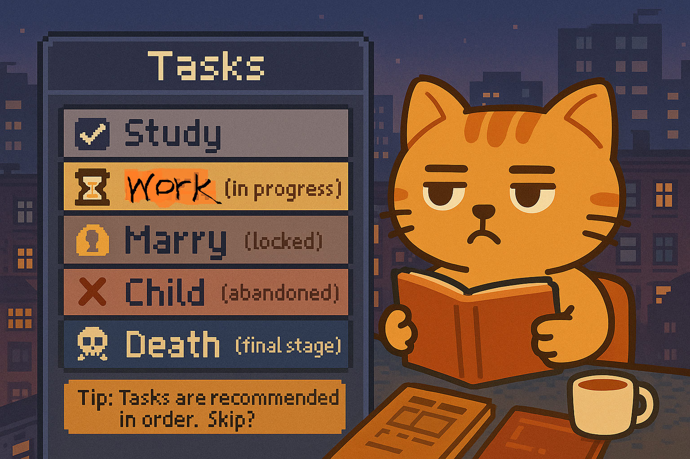
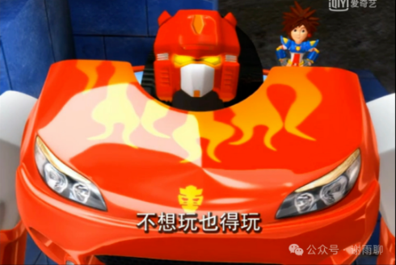
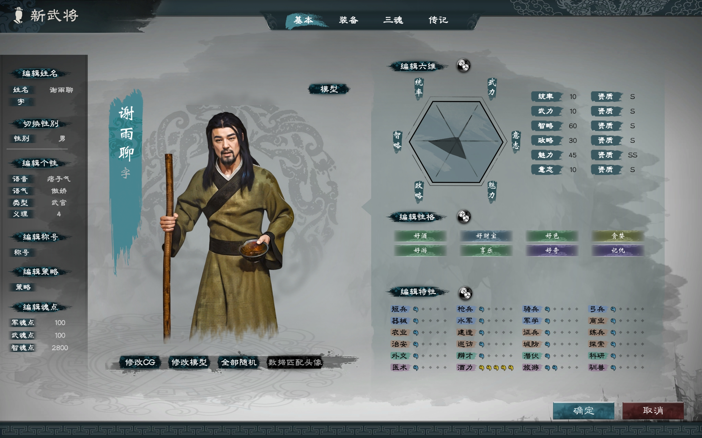

# 人生就是一场游戏：主线、支线与剧本的选择

大多数中国人得到的教育都是线性的：读书、工作、结婚、生娃、养娃、孝老、老去、死亡。这样教育大家，一方面是因为在这个时代，这种模式确实适合大多数人，按照这个模式走，不会出错，能保证基本的生活；另一方面就是这样做对国家和社会有利，大家都按流程来，社会稳定，皆大欢喜。

我不是来批判这种模式的，我只是想说，我们不妨把人生比作一场游戏，那么这种模式就是系统设定的“主线任务”，所有人都会随着游戏时间的进行，强行经历这些环节——当然，不同环节在不同人的游戏里长短不一样（比如有些人读书读了三十多年，有些人则没书读，很早打工），而且有些人压根就没有某些环节（比如很多人不结婚生娃），但是没关系，我们至少都会经历最后一个环节，那就是死亡。人死亡了，就算游戏结束通关了。

那么，我们游戏的目标是什么呢？难道是快速通关吗？

非也，我认为我们的游戏目标只有一个，那就是尽量体验游戏的乐趣。通过游玩，充分领略这个游戏世界的魅力，去探索这个游戏的世界观、去开发游戏的玩法、去解锁各种游戏成就、去和游戏里的其他玩家交流互动。除了你自己，没有人能够定义这场游戏的输赢，只要我们从中获得快乐，玩这个游戏就是值得的。

那么，我们应该如何玩好这个游戏呢？以下是我的看法。

## 1 充分了解你的角色初始配置。

你所处的时代，你的国籍、民族、阶级、性别、家庭、个人特征（基因）等，都会决定你的游戏环境和游戏难度，也就是说，每个人都有不同的游戏剧本。

这个游戏最悲催的事情，就是你拿着其他剧本的玩法，来玩你的剧本，最后还失败了。比如，在穷人剧本搞爱慕虚荣，在丑人剧本玩上嫁上娶，在封建剧本玩不婚不育，在民主剧本搞称王称帝，这些都是强行给自己增加难度。适当增加难度可以提升游戏乐趣，但是难度太高则会提前结束游戏，后面就没得玩了。

了解初始配置，尤其要注意了解游戏版本。比如我们的父母辈，在他们的游戏中，结婚生子就是能够大大降低游戏难度，提升游戏体验；但我们现在这个版本就未必了，不婚不育成为很多人的合理选择，这个选择未必一定不好。再比如我们的父母辈，男玩家追女生没有那么多禁忌；但在我们这个版本，男玩家一定要谨言慎行，必须再三确认女性本人的意愿，不然轻则女权警告，重则锒铛入狱。

社会的道德、经验、倡议等等，就像规则怪谈一样，这些条款有些违反了你会受到惩罚，但也有些条款你照做则会受到惩罚。所有规则都应该结合你自身情况独立思考，通过观察、试探，找到正确答案。一切都需要你自己去辨别。

这第一步，看似简单，其实很多玩家玩到游戏结束都没搞明白。

## 2 玩好主线任务

很多人对主线任务不屑一顾，其实对大多数玩家来说，主线任务是游戏引导，跟着主线任务走，至少能够保证你的基本游玩体验。

> 主线任务：读书、工作、结婚、生娃、养娃、孝老、老去、死亡。

比如，在游戏早期，如果你按照主线任务好好读书，那么你就不用考虑生活的责任。此时对你来说，最有利的选择就是趁着这个时间认真学习，发奋学习，因为你不学也会浪费时间；如果你提前辍学，家里人大概率会让你出去打工，这时你会增加“工作”这个环节的难度，而且丧失了“读书”这个环节的体验。

比如工作，工作可以让你有经济来源，还能给你带来一定的社交，让你逐渐接触社会，增强你对游戏的理解。如果说读书是阅读游戏百科、游戏说明书、游戏技巧，那么工作就是实战，有时候你读的游戏说明书必须在玩了以后才能真正理解；有些游戏说明书干脆就是假的，你不去试则根本不知道，被骗一辈子。

结婚、生娃、养娃、孝老，也都是一种游戏体验。你可以选择早体验、晚体验、不体验、多次体验、口头拒绝体验后面偷偷体验、看别人体验自己不体验……总之，玩法和选择都很多，把它们放到主线任务里，就是提醒玩家这是一个重要的游戏板块，是游戏设计者的得意之作。我觉得有条件的话，大家都可以玩玩看。

总之，建议大家认真完成主线任务，主线任务完成得好，游戏体验一定不会差。当然，主线任务玩不好，也可以用其他方式提高游戏体验，比如做一些支线任务。

## 3 探索和开发支线任务

人生这场游戏，比目前任意一个角色扮演游戏都更丰富、更复杂，这场游戏的支线任务数量几乎是无限的。我试举几类，算是抛砖引玉。

**A：研究游戏代码：**也就是搞科学研究，了解这个世界、这个社会的运行规律。由于游戏实在太大，所以一般搞清楚一部分代码，就已经很了不起了。

**B：地图打卡：**去这个游戏的各种地方打卡，比如异国他乡、网红景点、历史古迹等等。

**C：发展爱好：**比如唱歌跳舞、武术足球，通过这些娱乐活动，一是体会各种游戏的快乐，二是通过这些运动与其他玩家互动。

**D：改变游戏版本：**如果你对当前的游戏版本不满意，除了忍受，还可以改变。一种改变是你自己直接跑，比如跑到国外，其他国家可能正在玩另一个版本；另一种改变就是直接改变了，比如通过社会运动、议会立法、歌命造饭等。改变游戏版本可以大幅度提升游戏体验，这个过程本身就是很快乐的——只不过有些时候风险大，建议充分准备后再试。

**E：皈依宗教：**宗教信仰影响还是很大的，而且皈依宗教不只是影响你的思想，还影响你的生活。比如，如果你皈依伊斯兰教，你不但要学习古兰经，更重要的是，你要遵循不吃猪肉的教义，好处则是进入一个新的社交圈，说不定还能有机会和回族姑娘结婚，后代享受高考加分政策。

总之，玩法是很多的，相信大家对此都有经验，我就不班门弄斧了。

## 4 摆正游戏心态

我小时候看过一个动画片，叫《洛洛历险记》，讲的就是一个叫洛洛的小孩进入了一个游戏世界，这个游戏洛洛之前经常玩，背景是机车族和猛兽族之间的大战。

洛洛刚进入这个世界的时候，他说你们不是游戏角色吗？机车族的霹雳火回答说：“其实人生本来就是一场游戏，但是这场游戏和普通的游戏不一样。这场游戏你想玩也得玩，不想玩也得玩。”

我觉得这话一点毛病也没有。人生这场游戏，和这场游戏中的电子游戏相比，最大的不同，就是强制游玩，不能重开。

所以，每个玩家都要摆正心态。有些人拿到的剧本不好，但是没有办法，含着泪也得玩下去。如果自怨自艾，你的游戏只会越玩越烂。但是，如果你积极游玩，本来很烂的剧本，也有变好的可能。

甚至我们可以换个角度想，拿到好的剧本不一定是好事。因为他失去了从弱到强的那种养成型的游戏体验。

比如我们玩《三国志13》这个游戏，我们自建一个六维属性都是100的武将，其实未必就很快乐，你会发现没人是你的对手，很多游戏制作者精心设计的机制，在你看来都毫无乐趣。反而很多人玩这个游戏，都喜欢搞“六一居士”，创建一个六维属性都是1的武将，然后体验其逆天改命的养成过程，这样的游玩体验反而更好。

所以，每个人都有独特的游戏剧本，每个游戏剧本都有无数种发展方向，所以游戏体验都是独特的。虽然我们不可避免会去羡慕别人的剧本，但更重要的是玩好自己的剧本，体验我们这个剧本独有的快乐。

我们在自己的剧本里会做出各种决定，这些决定会给你带来很多好处，也会给你带来很多坏处。但是，这些都是你的人生。

**你更倾向于什么人生玩法？**

- 跟着主线稳扎稳打（读书工作成家）
- 支线丰富才是乐趣（旅行、创作、研究）
- 喜欢搞隐藏任务（逆天改命、突破设限）
- 根本不知道我在玩什么……

你觉得你拿到的人生剧本怎么样？地狱开局还是欧皇本？

你正在游戏人生的哪个阶段？新手村还是卡在某个副本了？

欢迎讨论。
